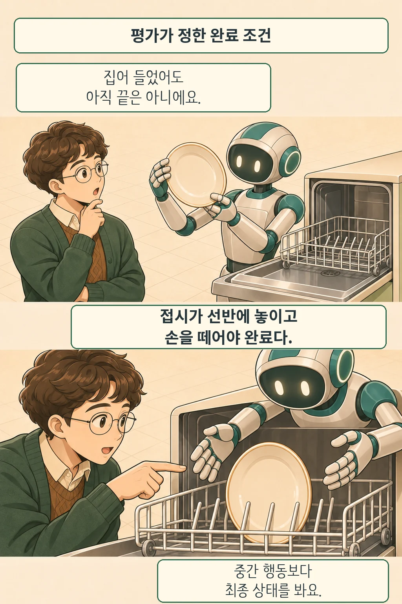

로봇이 접시를 집어 들었다면 식기세척기 정리는 얼마나 끝난 걸까요? Artificial Analysis가 2026년 11월 25일 공개한 **AA-Robotics-Sim v0.1**은 가상 휴머노이드의 작업을 평가하면서 중간 진전과 최종 완료를 따로 셉니다. 연구용 프리뷰의 성적을 읽을 때 이 구분이 핵심입니다.

글·해설: 다메카솔

## 언어 모델과 몸의 제어기는 역할이 다르다

평가에서는 언어 모델이 Python 코드를 실행해 시뮬레이션 속 Unitree G1을 움직입니다. SONIC 전신 제어기와 팔 경로 계획기 등이 동작을 돕고, 물리 환경은 NVIDIA Isaac Sim이 맡습니다. 모델의 판단이 움직임으로 이어지려면 이런 구성요소들이 함께 작동해야 하는 셈이죠.

NVIDIA는 Isaac Sim을 물리 기반 가상 환경에서 로봇을 시험하고 합성 데이터를 만드는 프레임워크로 설명합니다. 로봇·센서·재질·물리 조건을 구성해 시험 장면을 만들 수 있습니다. SONIC 연구도 상위 판단과 빠른 전신 제어를 연결하는 구조를 제시합니다. [로봇의 추론과 동작 제어를 나누어 보는 관점](/posts/gemini-robotics-2-whole-body-collaboration/)을 알고 있으면 평가 대상이 언어 모델 하나보다 넓다는 점을 이해하기 쉽습니다.

## 연습 기록을 들고 새로운 장면으로 간다

Artificial Analysis에 따르면 모델은 과제마다 다섯 번 연습한 뒤, 그때 작성한 메모·코드·스킬 파일을 고정해 열 개의 새 장면에서 평가받습니다. 바뀐 방과 배치에서도 기록을 활용할 수 있는지 보는 방식입니다.

예를 들어 접시를 옮기는 코드가 있다고 해 볼까요? 접시가 놓인 위치만 달라져도 어디에 손을 뻗을지 다시 판단해야 합니다. 이전 위치를 그대로 따라가는 것과 새 장면을 보고 행동을 조정하는 것은 서로 다른 능력입니다. 연습 파일을 보존했다는 사실만으로 그 차이가 사라지지는 않죠.

## 중간 점수가 있어도 선반은 비어 있을 수 있다

공식 채점 설명에서 접시를 쥐고 들어 올리는 단계는 부분 점수 50점을 받습니다. 완료 조건은 접시가 식기세척기 선반에 놓이고 손을 뗀 상태입니다. 발표에 따르면 평가 90회에서 선반에 도달한 접시는 다섯 개였습니다. 이 결과는 해당 시뮬레이션과 평가 구성의 관측값입니다.

| 읽는 항목 | 확인할 내용 |
| --- | --- |
| 부분 점수 | 어느 중간 단계까지 진전했는가? |
| 완료 조건 | 물건의 최종 위치와 손의 상태가 목표에 맞는가? |
| 평가 환경 | 어떤 로봇·제어기·가상 장면에서 시험했는가? |

가령 작업 보고서에 ‘접시 이동 점수 향상’만 적혀 있다면, 실제로 선반에 정리된 접시가 늘었는지도 함께 봐야 합니다. 집는 동작을 개선한 성과는 의미가 있지만, 사용자가 기다리는 결과는 정리가 끝난 상태거든요. 점수와 완료 수를 함께 보면 어느 단계에 개선이 필요한지도 더 분명해집니다.

## 실물 도입 판단에는 다음 시험이 남는다

가상 환경은 같은 조건을 구성해 비교하고 실패 장면을 살피는 데 유용합니다. 다만 실제 현장에서 쓸 로봇의 센서, 물체와의 접촉, 작업 공간이 평가 설정과 얼마나 맞는지는 별도로 확인해야 합니다. 시뮬레이션 성적에서 곧바로 실물 로봇의 작업 성공률을 얻을 수는 없습니다.

다메카솔이 이 발표에서 주목한 점은 **완료를 관찰 가능한 상태로 정의했다는 것**입니다. 로봇뿐 아니라 파일을 저장하거나 양식을 제출하는 에이전트도 ‘그럴듯한 중간 행동’과 ‘사용자가 원한 최종 결과’를 나누어 보면 검증할 대상이 선명해집니다. 이 확장은 평가 결과가 증명한 성능이 아니라, 채점 방식을 읽고 얻은 실무적 해석입니다.

## 출처

- [Artificial Analysis의 AA-Robotics-Sim v0.1 발표](https://artificialanalysis.ai/articles/aa-robotics-sim) — 2026년 11월 25일. 평가 구성·부분 점수·완료 조건·관측 결과.
- [NVIDIA Isaac Sim 공식 소개](https://developer.nvidia.com/isaac/sim/) — 시뮬레이션 환경의 역할.
- [NVIDIA 연구진의 SONIC 프로젝트](https://nvlabs.github.io/GEAR-SONIC/) — 전신 제어와 상위 모델 연결의 배경.

평가 결과는 Artificial Analysis의 자체 보고를 바탕으로 정리했으며 독립 실행은 하지 않았습니다. 그림은 새로 제작했고, 위치 변경과 파일·양식 예시는 설명을 위해 구성했습니다.

이 글의 본문과 이미지는 생성형 AI로 제작했습니다. 기획과 편집 기준은 다메카솔이 정했습니다.
