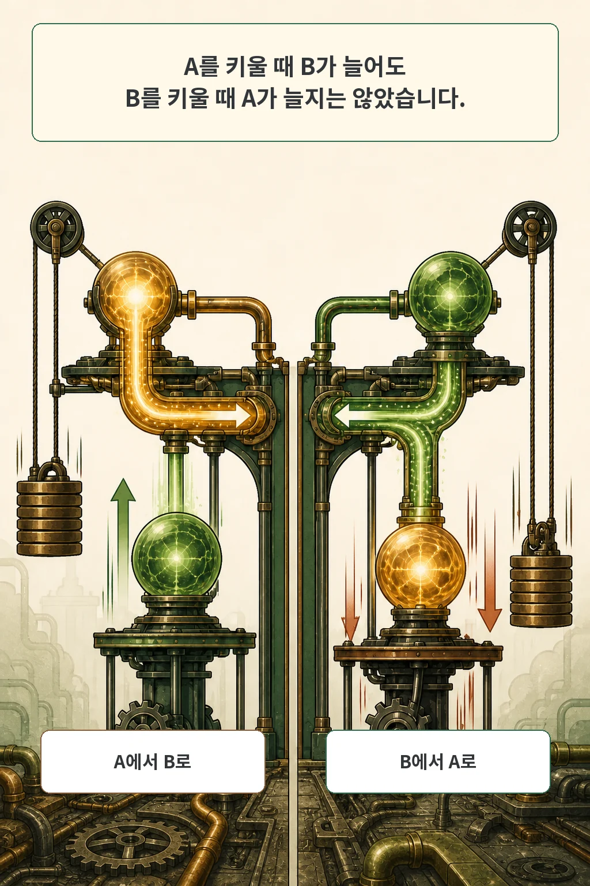

특정 행동 하나만 고치려고 LLM 내부에 활성화 조정(activation steering) 방향을 넣었더니 목표 점수는 좋아졌지만 설명의 깊이, 거절 성향, 불확실성 공개 태도가 함께 달라졌다면 그 조정을 성공이라고 부를 수 있을까요? **「Forecasting Side Effects of Activation Steering」**는 이 문제를 3개 공개 가중치 모델의 67개 행동 간 교차효과(cross-effect)로 측정했습니다. 목표 밖 부작용은 넓게 나타났고 방향은 비대칭이었으며, 개입 전 예측기는 위험한 점검 대상을 좁히는 데는 유용했지만 실제 사후 평가를 대신하지는 못했습니다.

글·해설: 다메카솔

## 핵심 내용

- 한 행동을 활성화 조정(activation steering)으로 바꾸면 수십 개의 주변 행동이 함께 움직일 수 있습니다.
- 3개 공개 가중치 모델(Gemma-3-4B, Gemma-3-12B, Qwen2.5-7B)에서 67개 행동의 교차효과를 측정한 결과, 위발견율(FDR) 보정 뒤에도 행동 쌍의 33~50%(조정 행동당 약 22~33개)에서 유의한 결합이 나타났습니다.
- 양방향이 모두 유의한 행동 쌍 중 18~26%는 부호가 반대여서, 단순 코사인 유사도만으로는 개입 결과를 설명하기 어려웠습니다.
- 조정 전 활성화로 만든 예측기는 상위 10% 부작용 후보의 증감 부호를 68~78% 정확도로 맞혔지만, 효과 크기를 보정해 맞히지는 못했습니다.
- 실무에서는 사전 예측을 점검 우선순위에 쓰고, 개입 뒤 안전·품질 평가를 별도로 유지해야 합니다.

## 목표 행동만 보면 놓치는 교차효과

활성화 조정(activation steering)은 추론 중 특정 층의 은닉 활성화(hidden activation)에 학습된 행동 방향을 더해 재학습 없이 출력 성향을 바꾸는 기법입니다. 문제는 그 방향이 목표 행동 하나에만 깔끔하게 닫혀 있지 않다는 점입니다.

저자들은 Gemma-3-4B, Gemma-3-12B, Qwen2.5-7B 세 모델에서 67개 행동을 평가해, 자기 행동을 유의하게 바꾼 출발 방향(모델별 52개, 52개, 47개)마다 여러 강도와 시드를 적용하고 모든 행동 루브릭으로 다시 판정하여 모델당 약 12만 8천 개의 생성 결과를 교차 평가했습니다.

그 결과 다중검정(FDR) 보정 뒤에도 전체 행동 쌍의 33~50%에서 유의한 결합(coupling)이 남았으며, 조정 행동 하나당 대략 22~33개의 부작용(side effect)이 관찰됐습니다(4점 판정 척도에서 유의한 결합의 중앙값은 0.20~0.25점이었고 무작위 방향은 약 0.007점만 움직였습니다). 또한 세 모델의 교차효과 행렬에서는 하나의 지배적 패턴이 분산의 약 64%를 설명했고 유효 차원도 4.6~4.9(무작위 섞음 대조군은 23~26)로 낮아, 부작용들이 몇 개의 구조화된 모드로 함께 움직인다는 점이 드러났습니다.

## A에서 B와 B에서 A는 다르고, 조정 전 예측에는 한계가 있습니다

흥미로운 발견은 방향의 비대칭성입니다. 양방향이 모두 유의한 행동 쌍 가운데 18~26%는 부호가 서로 반대였습니다. 즉 A를 키웠을 때 B가 늘었더라도, 반대로 B를 키웠을 때는 A가 늘지 않거나 오히려 줄어들 수 있었습니다. 실제로 조정 방향 벡터 사이의 코사인 유사도가 held-out 결합 분산을 설명한 비율은 최대 19%(다섯 변형 중 최선도 23%)에 그쳤고, 거절(refusal) 방향과의 코사인 유사도 역시 실제 거절 효과와 양의 상관을 보이지 않았습니다. 표현 공간에서 두 벡터가 가까워 보인다는 정적 사실과, 특정 방향으로 개입했을 때 생기는 동적 결과는 별개의 질문이었습니다.

연구진이 제안한 사전 예측기(forecaster)는 조정하지 않은 자연 텍스트 활성화로 층간 전파 지도(propagation map)를 학습한 뒤, 출발 조정 방향을 통과시켜 목표 행동 프로브로 변화 방향을 읽습니다(특정 행동의 행이나 열을 통째로 숨기는 leave-one-behavior-out 평가).

- **부호 예측 성과**: 예측된 상위 10% 부작용 후보에서 증가·감소 부호 정확도는 모델별 68~78%로 다수 부호 기준선(50~58%)을 앞섰습니다.
- **크기 보정과 순위화의 한계**: 개별 효과의 보정된 크기를 정확히 맞히지는 못했고, 가장 큰 변화 대상을 순위화하는 과제에서는 목표 행동별 평균 민감도를 재사용한 단순 기준선보다 약했습니다.

아울러 이 연구는 세 공개 모델의 선형 활성화 조정과 유클리드 유사도에 한정되며, 본 평가가 단일 LLM 심사자에 의존했다는 한계가 있습니다(보조 심사자는 확인 표본에만 쓰였고 블라인드 인간 평가의 사전 기준을 넘은 핵심 행동은 15개 중 4개였습니다). 2026년 8월 13일 기준 arXiv 페이지와 TeX 번들에 실제 코드·데이터 URL이 포함되지 않아 원문과 소스 번들의 수치를 교차 확인했습니다.

## 다메카솔의 해석

이 논문에서 가져갈 운영 원칙은 **사전 예측과 사후 검증의 역할을 섞지 않는 것**입니다. 사전 예측기는 제한된 검증 예산으로 어떤 주변 행동부터 먼저 점검할지 우선순위를 정하는 신호로 쓰고, 실제 배포 가능 여부는 개입 뒤의 사후 평가로 결정해야 합니다.

활성화 조정을 제품에 적용한다면 목표 행동 점수 하나로 성공을 선언하지 말고, 거절 성향·정직성·불확실성 공개·도움성 같은 핵심 안전·품질 축을 별도의 회귀 테스트로 묶어 두어야 합니다.

## 논문 정보

| 항목 | 내용 |
| --- | --- |
| 제목 | Forecasting Side Effects of Activation Steering |
| arXiv | 2608.11227 v1 (제출 2026-07-28 08:46:06 UTC, 2026-08-13 CS 신규 목록 등장) |
| 평가 모델 | Gemma-3-4B, Gemma-3-12B, Qwen2.5-7B (67개 행동 교차평가) |

## 출처

- [Forecasting Side Effects of Activation Steering — arXiv:2608.11227](https://arxiv.org/abs/2608.11227)
- [공식 arXiv PDF](https://arxiv.org/pdf/2608.11227)
- [공식 arXiv TeX source bundle](https://export.arxiv.org/e-print/2608.11227)

이 글의 본문과 이미지는 생성형 AI로 제작했습니다. 기획과 편집 기준은 다메카솔이 정했습니다. 논문 표와 그림은 복제하지 않고, claim ledger에 근거해 자체 시각 언어로 재구성했습니다.

Updated: 2026-08-13
