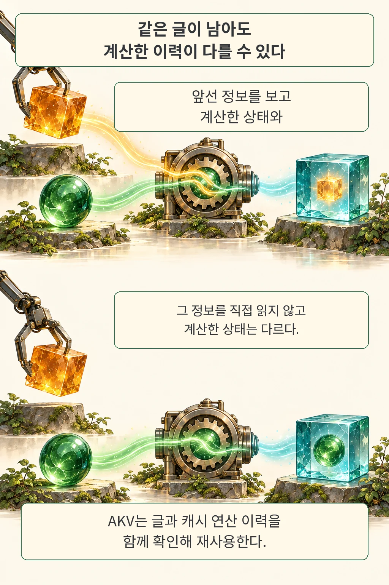

AI 에이전트의 작업 기록을 줄이면 다음 계산도 가벼워질 것 같습니다. 그런데 앞부분을 지우거나 요약하는 순간, 뒤에 남겨 둔 내용의 계산 상태까지 다시 만들어야 할 수 있습니다. 「Cache Engineering for Agents」는 대화 원문을 유지하면서 다음 계산에 참여할 KV 캐시를 직접 고르는 방법과, 이를 지원하는 AKV 서빙 시스템을 제안합니다.

글·해설: 다메카솔

이 글은 2026년 10월 20일 제출된 arXiv v1을 읽은 리뷰입니다. 저자들은 정해진 에이전트 평가에서 평균 점수와 환산 비용이 개선됐다고 보고했습니다. 어떤 정보가 남는지, 캐시를 재사용하는 기준이 어떻게 바뀌는지, 성능 수치에 어떤 조건이 붙는지를 차례로 살펴봅니다. 논문과 공개 코드를 확인했으며 GPU 벤치마크를 독립 재현하지는 않았습니다.

## 기록을 줄였는데 왜 다시 계산할까

KV 캐시는 모델이 앞선 토큰을 읽으며 만든 키와 값이라는 중간 계산 상태입니다. 다음 토큰을 생성할 때 이 상태를 참조하면 이전 내용을 처음부터 계산하는 일을 줄일 수 있습니다. 여기서 구분할 대상은 사람이 읽을 수 있는 대화·도구 기록과, 모델이 그 기록을 읽어 만든 계산 상태입니다.

뒤쪽 토큰의 상태에는 앞쪽 문맥이 영향을 줍니다. 따라서 이전 대화의 앞부분을 삭제하거나 요약문으로 바꾸면, 남아 있는 뒷부분도 새로운 문맥에 맞춰 다시 계산해야 합니다. 논문은 이 재입력 계산을 re-prefill이라고 부릅니다. 너무 자주 기록을 정리하면 재계산 비용이 커지고, 드물게 크게 줄이면 필요한 중간 정보까지 놓칠 수 있다는 것이 연구의 출발점입니다.

AKV의 접근은 원문을 그대로 두고 앞으로의 attention, 즉 다음 토큰을 계산할 때 참조하는 범위에서 특정 KV 항목을 제외하는 것입니다. 남겨 둔 KV 상태는 그대로 재사용합니다. 논문에서 ‘활성’이라는 말은 이후 attention에 참여한다는 뜻입니다. 물리적으로 GPU 메모리에 남아 있는지와는 다른 기준입니다.

## 제외, 재배치, 추가를 나눠 다룬다

논문은 캐시 제어를 세 연산으로 정리합니다.

| 연산 | 하는 일 | 구분할 점 |
| --- | --- | --- |
| `append` | 새 토큰을 현재 활성 캐시를 참조해 계산하고 추가합니다. | 어떤 앞선 상태를 참조했는지가 새 상태에 영향을 줍니다. |
| `drop` | 선택한 KV 항목을 이후 attention에서 제외합니다. | 남은 항목의 계산 상태와 위치 번호는 그대로입니다. |
| `repos` | 남은 키의 RoPE 위치 표현을 순서대로 재배치합니다. | 값과 이미 계산한 내부 상태를 처음부터 다시 만들지는 않습니다. |

`drop`만 반복하면 읽는 캐시 항목은 줄어도 위치 번호는 계속 커질 수 있습니다. `repos`는 이 위치 문제를 별도로 다룹니다. 캐시의 크기, 원문의 길이, 위치 번호를 같은 것으로 취급하지 않는 셈입니다.

또 하나의 경계가 있습니다. 어떤 정보를 직접 읽는 캐시에서 빼더라도, 그 정보를 이미 참고해 계산한 다른 상태에는 영향이 남을 수 있습니다. 이 연구의 `drop`을 개인정보 삭제나 학습 취소를 보장하는 기능으로 해석하면 안 됩니다. 원문도 유지됩니다.

## 같은 글이 남아도 같은 캐시는 아니다

기록에 A, B, C가 있다고 해 보겠습니다. 첫 번째 경로에서는 A를 참조하며 C를 계산한 다음 A의 캐시를 뺍니다. 두 번째 경로에서는 A의 캐시를 먼저 뺀 다음 C를 계산합니다. 마지막에 보이는 항목이 똑같이 B와 C여도, C를 만들 때 참고한 정보는 다릅니다.

이 때문에 텍스트 접두부가 같다는 이유만으로 캐시를 공유하면 잘못된 상태를 재사용할 수 있습니다. AKV는 텍스트와 함께 캐시 연산의 순서를 요청에 담고, 확장한 radix tree에 연산 이력을 기록합니다. 요청이 이전에 어떤 물리 캐시를 확보했는지 직접 추적할 필요가 없도록 서버가 재사용과 복원을 맡습니다.

한 요청의 `drop`이 같은 캐시를 공유하는 다른 요청의 참조 범위까지 바꾸어서도 안 됩니다. AKV는 다른 계산이 아직 쓰는 상태를 보존합니다. 메모리 압박으로 필요한 상태가 사라졌을 때는 과거의 참조 범위와 위치를 반영하는 segment-batch attention으로 한 번의 prefill 안에서 복원합니다. 따라서 남은 캐시의 직접 재사용과, 캐시가 실제로 없을 때 필요한 복원 계산은 구분해야 합니다.

## 평균 개선과 개별 과제의 차이

주 실험은 MiniMax-M2.7, GPT-OSS-120B, MiroThinker-1.7-Mini를 BrowseComp-Plus, GAIA-Text, SWE-bench Verified, xbench-DeepSearch-2510에 적용했습니다. GPT-OSS는 high reasoning effort, 나머지 두 모델은 thinking 모드로 평가했습니다. GAIA-Text는 검증 집합의 텍스트 전용 103과제이며, SWE-Verified 전체 결과와 일부 100과제 분석은 별도로 제시됩니다.

AKV의 주 정책은 최근 도구 응답 12개의 KV와 추론 기록의 KV를 유지하고 오래된 도구 응답의 KV를 제외합니다. 비교군 Standard는 GPT-OSS와 MiniMax에서 96K, MiroThinker에서 192K 토큰에 도달하면 요약합니다. Text Engineering은 같은 요약 정책을 모든 모델에서 48K에 실행합니다. AKV의 위치 재배치 기준은 각 모델의 Standard 요약 기준과 같습니다.

다음은 원문 Table 1의 네 벤치마크 평균입니다. 점수 단위는 %, 비용은 과제당 미국 센트이며, 같은 모델의 Standard와 AKV를 비교합니다. 서로 다른 벤치마크를 평균한 수치를 모든 과제를 합친 성공률로 읽으면 안 됩니다.

| 모델 | 평균 점수 Standard → AKV | 평균 환산 비용 Standard → AKV |
| --- | --- | --- |
| MiniMax-M2.7 | 52.4 → 53.7 | 5.0 → 4.4센트 |
| GPT-OSS-120B | 51.0 → 53.1 | 11.2 → 7.3센트 |
| MiroThinker-1.7-Mini | 44.1 → 45.8 | 20.4 → 14.8센트 |

전체 평균은 좋아졌지만 개별 결과는 섞여 있습니다. MiniMax의 SWE 점수는 75.2에서 74.4로, GPT-OSS의 xbench 점수는 38.5에서 37.5로 내려갔습니다. MiroThinker의 GAIA 비용은 9.2에서 9.5센트로 늘었습니다. 평균 개선을 ‘모든 과제에서 더 정확하고 저렴하다’로 바꿀 근거는 없습니다. 이 표의 점수 차이만으로 통계적 유의성을 단정하지도 않습니다.

비용은 고정한 토큰 단가로 계산한 API 환산 추정입니다. 주 에이전트의 생성과 문맥 요약 호출을 포함하고, AKV의 위치 재배치도 cache-hit 단가로 계산합니다. 모델마다 적용 단가가 다르되 같은 모델의 방법 간 비교에는 같은 단가를 씁니다. GPU 운영비나 검색·도구·채점까지 합친 전체 서비스 비용이 아니며, 현재 판매 가격을 안내하는 표도 아닙니다.

## 속도 수치에는 장비와 재생 조건이 붙는다

서빙 평가는 GPT-OSS-120B를 BF16으로 실행한 별도 실험입니다. SGLang 0.5.20 기반 시스템에서 A800 80GB GPU 8대를 prefill 4대와 decode 4대로 나눴습니다. 논문의 대표 비교는 각 방식이 최고 처리량을 낸 설정을 사용합니다. Standard는 동시 작업 수 12, AKV는 14입니다.

이 비교에서 출력 처리량은 초당 313토큰에서 369토큰으로 약 1.18배가 됐고, P95 요청 지연은 43.16초에서 28.49초로 줄었습니다. 논문의 1.51배 속도 향상은 두 지연의 비율입니다. 같은 동시 처리 수에서의 비교가 아니며, 모든 장비와 운영 부하에서 같은 효과를 보장하지 않습니다.

속도 측정에는 SWE-Verified에서 요약 없는 궤적의 최대 문맥 길이가 큰 80과제를 골랐습니다. 각 방식은 자기 정책으로 얻은 작업 궤적을 재생하므로 턴 수와 출력 길이 예산이 다를 수 있습니다. 새 모델 응답은 이후 기록에 넣지만 도구 응답은 저장된 기록에서 재생하며, 실제 도구를 다시 실행하지 않습니다.

높은 동시성에서는 측정 창도 주의해야 합니다. AKV의 동시성 14·16 결과는 먼저 완료된 30과제까지의 구간에 들어온 전체 요청을 세었고, Standard의 높은 동시성 두 실행은 일부 요청이 미완료인 상태에서 1시간으로 잘랐습니다. 논문은 별도로 첫 100과제를 온라인 실행한 결과도 보고합니다. 이 온라인 실험과 기록 재생의 지연 수치를 같은 실험처럼 합쳐 읽지 않는 것이 좋습니다.

## 다메카솔의 해석

이 연구에서 개발자가 가져갈 질문은 ‘무엇을 버릴까’에 더해 ‘남은 상태는 무엇을 보고 계산됐을까’입니다. 원문이 같더라도 계산 경로가 달라지면 재사용 조건이 달라집니다. 캐시 키를 설계할 때 출력에 영향을 주는 연산 이력을 빠뜨리지 않는다는 원칙으로 읽을 수 있습니다. 이는 논문을 바탕으로 한 해석이며, 모든 모델과 제품에서 검증된 적용 지침은 아닙니다.

[ContextRender의 실행 결과 재사용](/posts/contextrender-execution-reuse/)이 에이전트 작업의 반복을 줄이는 다른 층위를 다뤘다면, AKV는 모델 내부에서 다음 계산이 어떤 상태를 읽는지에 초점을 맞춥니다. 두 경우 모두 재사용의 단위를 분명히 해야 효과와 실패 조건을 설명할 수 있습니다.

적용을 검토한다면 작업 품질, 고정 단가로 환산한 비용, 실제 장비에서의 지연을 따로 기록하는 편이 유용합니다. 오래된 도구 결과를 뺀 뒤에도 필요한 근거를 활용하는지, 캐시가 메모리에서 사라진 뒤 올바른 상태를 복원하는지까지 확인해야 합니다. 작은 활성 캐시만으로 작업 품질이나 완전한 정보 삭제가 보장되지는 않습니다.

## 공개 코드와 검증 범위

2026년 10월 21일 확인한 저자 저장소에는 에이전트 정책과 SGLang 기반 서빙 구현, 설치 안내가 공개되어 있습니다. 확인한 커밋은 `c567a429a058f1abce3b2879e69978b09e0fda4c`입니다. 현재 README는 `drop_message`와 `reposition` 필드를 사용하고, 논문 PDF의 설명용 요청은 `cache` 아래 `drop`과 `reposition`을 둡니다. 논문의 예시를 그대로 실행 가능한 최신 API라고 옮기지 않았습니다.

OpenAI 호환 형식이라는 설명은 모든 상용 API가 이 캐시 연산을 지원한다는 뜻이 아닙니다. 실제 사용에는 해당 기능을 구현한 서빙 환경이 필요합니다. 이번 리뷰에서는 원문 PDF·HTML·저자 프로젝트·고정 커밋의 README를 대조했으며, 모델 실행이나 GPU 성능을 독립 재현하지 않았습니다. 이 논문은 사전공개본으로 다뤘고 학회 심사 통과를 확인한 것으로 표현하지 않았습니다.

## 출처

- Tianyu Fu 외, [Cache Engineering for Agents v1](https://arxiv.org/abs/2610.28577v1), 2026-10-20 제출. 방법 §3–4, 평가 §5, 재생 조건 부록 A.1.4, 비용 산정 부록 A.3.
- [논문 원문 PDF](https://arxiv.org/pdf/2610.28577v1): 본문의 표와 페이지 참조 기준.
- [저자 AKV 프로젝트](https://fuvty.github.io/thinking_yard_project_page/projects/akv/).
- [AKV 공식 코드 고정 커밋](https://github.com/thu-nics/AKV/tree/c567a429a058f1abce3b2879e69978b09e0fda4c).

이 글의 본문과 이미지는 생성형 AI로 제작했습니다. 기획과 편집 기준은 다메카솔이 정했습니다.
만화는 논문 그림을 복제하지 않고 개념을 새로 구성했으며, 글자는 별도의 텍스트 렌더러로 합성했습니다.
