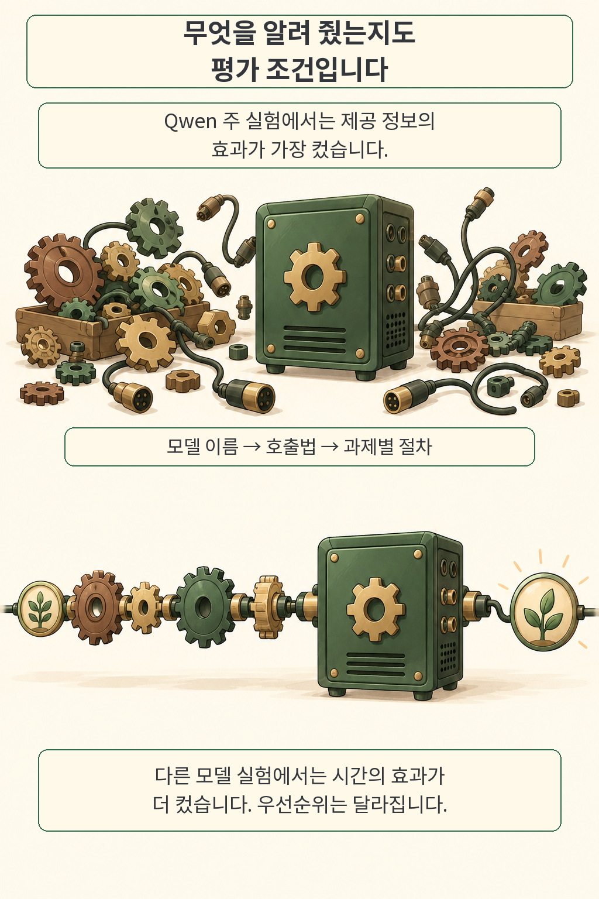
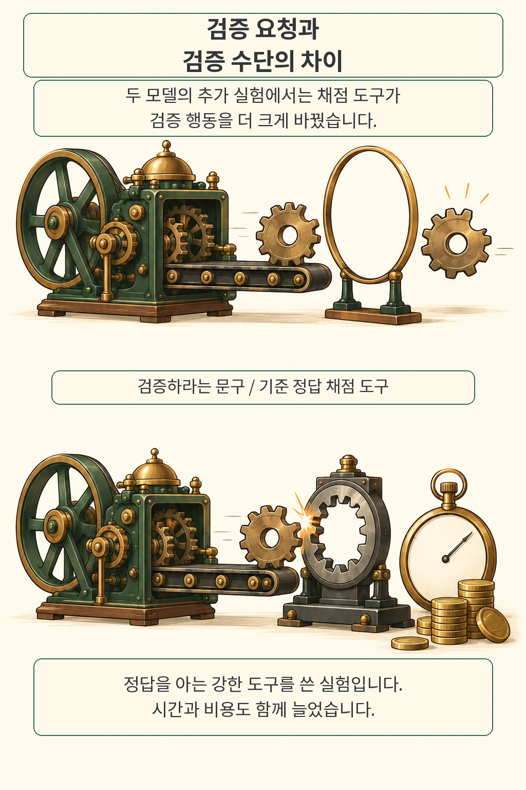

에이전트가 작업에 자꾸 실패하면 더 큰 기반 모델로 바꾸는 선택부터 떠올리기 쉽습니다. 그런데 모델을 그대로 두고 호출법과 작업 절차를 알려 주는 편이 더 큰 점수 차이를 만든 실험이 있는가 하면, 다른 모델에서는 실행 시간 예산을 늘렸을 때 성능이 훨씬 크게 뛰기도 했거든요. AI 에이전트를 평가할 때는 모델 이름 옆에 **어떤 정보와 검증 수단을 주고 얼마나 실행했는지**를 함께 적어야 결과를 제대로 읽을 수 있습니다.

글·해설: 다메카솔

## 핵심 내용

- **다섯 가지 시스템 설정 축 비교**: 과학 전문 모델을 호출하는 네 과제에서 제공 정보, 추론 방식, 검증 요청, 시간 예산, 기반 모델을 바꾼 432개 설정(각 5회 반복, 과제당 2,160회·주 실험 8,640회·전체 18,240개 궤적)을 비교했습니다.
- **모델군별 핵심 변수 차이**: Qwen3.5 주 실험(전문 모델 우세 세 과제)에서는 **제공 정보** 효과가 가장 컸고 검증 문구 효과가 가장 작았지만, 별도 Claude Sonnet 5 실험에서는 **실행 시간 예산**이 더 큰 차이를 냈습니다.
- **검증 도구와 반복 실행 분산**: 정답 채점 오라클 도구가 검증 행동과 점수를 끌어올렸고, 유효 완료 실행 분산의 **53.9%(약 54%)**는 동일 설정 내부의 반복 차이에서 나왔습니다.

이 결과는 Luis Wiedmann, Leander Girrbach, Cordelia Schmid, Zeynep Akata가 2026년 10월 1일 공개한 **「Agents Are Systems, Not Models: Rethinking Agentic Evaluation」**(arXiv v1 프리프린트)에서 보고한 내용입니다. 저자들은 전문 모델 가중치와 실행 환경이 설치된 GPU 샌드박스에서, 전용 래퍼 없이 파일 입출력·웹 조회·셸 명령만으로 전문 모델을 찾아 호출 코드를 짜게 했습니다.

## 모델을 바꿨는지, 입력 조건을 바꿨는지

같은 엔진이라도 연결 설명서가 빠지면 원래 성능을 발휘하기 어렵습니다. **예를 들어** 은하 이미지로 적색편이를 추정할 때, `AstroCLIP`을 써야 한다는 점과 입력 전처리 절차를 모르면 코드를 잘못 짜 점수가 크게 떨어지거든요. 반대로 객관식 천문학 문답에서는 기반 모델이 전문 모델(`AstroSage-8B`)보다 강해, 에이전트가 도구를 쓰지 않고 직접 답하는 판단이 필요해집니다.

저자들은 모델 밖의 조건이 성적을 얼마나 바꾸는지 재기 위해 다섯 가지 시스템 설정 축을 조합했습니다.

| 설정 축 | 실험에서 단계별로 바꾼 조건 |
| --- | --- |
| **제공 정보** | 추가 설명 없음 → 사용할 전문 모델 이름 → 호출 방법 → 과제 전체 절차 |
| **추론 방식** | 추론 토큰 생성 여부와 다음 단계 문맥 유지 여부 |
| **검증 요청 문구** | 결과를 검증하고 근거를 보고하라는 프롬프트 지시 강도 |
| **실행 시간 예산** | 5분, 10분, 20분 실행 제한 |
| **기반 모델** | Qwen3.5-35B-A3B, 122B-A10B, 397B-A17B (FP8) |

전문 모델이 우세한 세 과제에서 단계별 평균 점수 차이를 반복 실행 표준편차로 나눈 효과 크기를 재자, Qwen3.5 주 실험에서는 **제공 정보의 효과가 가장 컸고 검증 요청 문구의 효과가 가장 작았습니다.** 반면 별도 **Claude Sonnet 5** 실험(Table 16)에서는 세 과제 모두 시간 예산의 효과가 정보 제공을 앞섰습니다. 똑같은 처방이 모든 모델에 통하는 게 아니라, 모델군마다 병목이 되는 시스템 조건이 달라지는 셈이죠.

## 검증하라는 문구와 실제로 확인할 수단

프롬프트에 “결과를 검증하라”고 적는 것만으로는 에이전트가 틀린 답을 걸러 내기 어렵습니다. 대조할 기준 데이터가 없으면 형식만 맞춘 출력을 그대로 내보내기 쉽거든요. 저자들은 이를 확인하려고 Qwen-122B와 Step-3.7-Flash에 **제출물을 기준 정답과 대조해 점수를 알려 주는 오라클 도구**를 추가했습니다.

오라클 도구를 주자 참조 근거 기반 검증 행동과 최종 점수가 함께 오르고, 에이전트가 예상한 점수와 실제 점수의 오차도 줄었습니다. 다만 도구 호출이 늘어난 만큼 실행 시간과 비용도 함께 증가했죠. 게다가 이 오라클은 **정답을 미리 알고 채점하는 도구**인 데다 호출 자체가 검증 행동에 합산되므로, 정답을 모르는 운영 환경의 단위 테스트나 검증셋에서 똑같은 개선 폭을 기대하기는 조심스럽습니다.

## 한 번 잘 나온 점수와 반복해도 나오는 결과

같은 설정으로 여러 번 실행했을 때 점수가 얼마나 출렁이는지도 살펴볼까요? 전문 모델이 앞선 세 과제의 단순 기준선을 넘은 완료 실행을 분석한 결과, 전체 점수 분산 중 설정 간 차이가 설명한 비중은 **46.1%**였고 나머지 **53.9%(약 54%)**는 동일 설정의 반복 실행 내부에서 나왔습니다. 이는 실행 절반이 실패한다는 뜻이 아니라, 점수 변동 폭의 절반 이상이 같은 조건을 다시 돌릴 때의 흔들림에서 비롯됐다는 통계입니다.

점수 계산과 완료율 분리도 함께 봐야 합니다. 논문은 전문 모델이 우세한 세 과제에서 에이전트 점수 $S$, 기반 모델 점수 $B$, 전문 모델 점수 $R$로 정규화 점수 $G = (S - B) / (R - B)$를 계산합니다. 시간 내 미제출 실행은 점수에서 빼고 완료율로 따로 집계하며, 여러 시간 예산에서 모두 완료된 설정만 추려 비교하면(Appendix A.10) 작은 모델에서 보이던 시간 증가 시 점수 하락이 사라지기도 했습니다.

## 네 과제의 구성과 실험 범위

실험은 천문학·생물학 두 분야의 네 과제를 대상으로 삼았으며 표본 수와 평가지표가 각각 다릅니다.

| 과제 | 표본 및 데이터 | 활용 전문 모델 | 평가지표 및 특징 |
| --- | --- | --- | --- |
| 적색편이 추정 | 은하 이미지 20개 | AstroCLIP | $R^2$ (입력 전처리가 핵심) |
| 천문학 문답 | 객관식 152문항 | AstroSage-8B | 정확도 (기반 모델이 강해 도구를 쓰지 않는 판단도 필요) |
| 프로모터 예측 | DNA 서열 613개 | DNABERT-2 (미세조정) | MCC |
| RNA 구조 예측 | RNA 서열 300개 | RiNALMo (후처리) | 구조 수준 F1 |

이 연구는 미리 가중치가 설치된 GPU 샌드박스에서 네 과제에 한해 진행했고, 장기 기억이나 다중 에이전트 조정 구조는 고정한 채 설정을 바꿨습니다. 행동 분류 분석에는 별도 모델 판정과 군집화가 쓰였다는 점도 결과를 해석할 때 함께 감안해야 합니다.

## 다메카솔의 해석: 평가표에 설정과 검증 범위를 남깁니다

**가령** 사내 에이전트의 모델 교체를 검토할 때도 모델 이름만 바꿔 한 번씩 돌려 보는 방식은 원인을 가리기 어렵습니다. 모델 버전 옆에 **제공한 문서·프롬프트, 연결한 검증 도구의 성격, 실행 시간 예산**을 하나의 설정 버전으로 묶어 기록해야 무엇이 성적을 바꿨는지 분리할 수 있거든요.

실제 운영에는 정답을 아는 오라클이 없으므로 파싱 검사, 회귀 테스트, 별도 검증셋 채점을 구분해 각 검사가 잡아내는 실패 범위를 적어 두는 편이 좋습니다. 경험을 통해 무엇을 배웠는지 묻는 [EvoPathBench의 능력 평가](/posts/evopathbench-capability-checkpoints/)와 구분해, 에이전트 평가표에는 **반복 실행의 평균·분산과 완료율, 소요 시간**을 나란히 남기기를 권합니다.

## 출처

- [원문과 제출 이력: arXiv:2610.01618v1](https://arxiv.org/abs/2610.01618v1) (2026년 10월 1일 제출)
- [원문 PDF](https://arxiv.org/pdf/2610.01618v1): §3–4.1 실험 구성, Table 3 효과 비교, §4.3·Table 16 모델별 차이, Figure 2 반복 분산, §5 행동 분석, §6 한계, Appendix A.10 완료 실행 선택 효과.
- [저자 공식 코드 저장소](https://github.com/lusxvr/rethinking-agent-evaluation/tree/6fe6c65434d1489ad115f15e1d2c5ed8431ea534)(전체 코드·벤치마크 공개 예정 표기) 및 [실행 궤적 저장소](https://huggingface.co/datasets/lusxvr/agentic-science-trajectories/tree/219d99e984257d6b99370387984bbcff2f8d42df)(공개 파일 목록 확인 기준: 2026년 10월 3일).

이 글은 논문 원문과 공개 저장소 안내를 바탕으로 정리했으며, 전체 궤적 재집계나 모델 재실행은 포함하지 않았습니다.

이 글의 본문과 이미지는 생성형 AI로 제작했습니다. 기획과 편집 기준은 다메카솔이 정했습니다.
