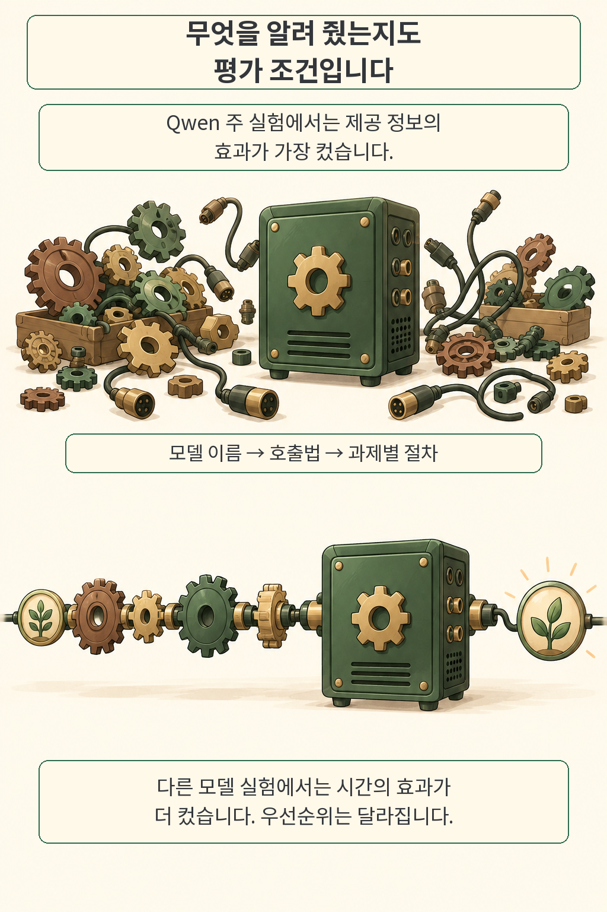
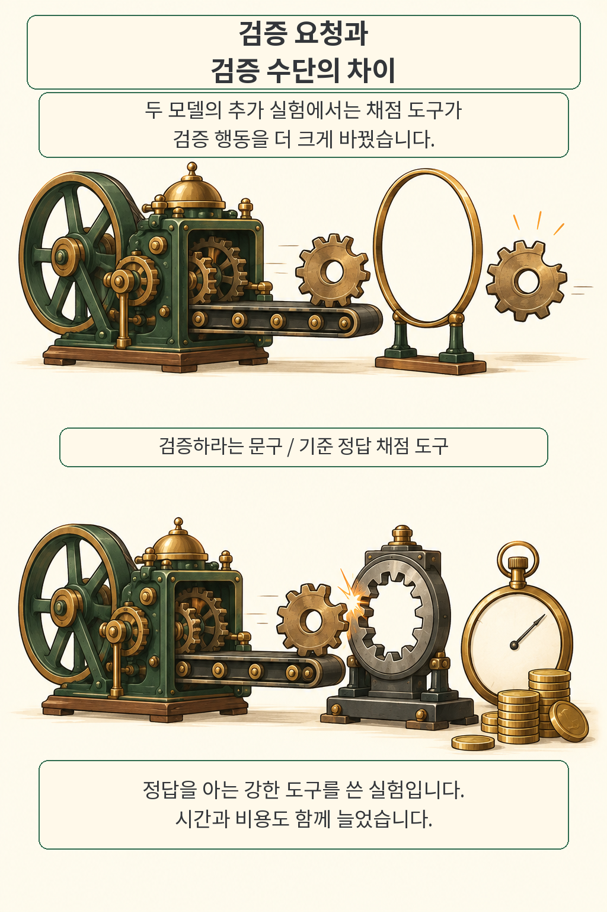

**에이전트가 자꾸 실패하면 더 큰 모델부터 떠올리기 쉽습니다.** 그런데 모델을 그대로 두고 호출 방법과 작업 절차를 알려 주는 편이 더 큰 성능 차이를 만든 실험이 있는가 하면, 다른 모델에서는 실행 시간을 늘려 주는 효과가 더 크게 나타나기도 했습니다. AI 에이전트를 비교할 때는 모델 이름에 더해 **어떤 정보와 도구를 주고 얼마나 실행했는지**를 함께 적어야 결과를 제대로 읽을 수 있습니다.

*글·해설: 다메카솔*

원문 확인·작성: 2026년 10월 3일

## 핵심 내용

- **다섯 가지 시스템 설정 축 비교**: 과학 분야 전문 모델을 찾아 코드로 실행하는 네 과제에서 제공 정보 수준, 추론 방식, 검증 요청 문구, 실행 시간(5·10·20분), 기반 모델(Qwen3.5 3종)을 조합한 432개 설정을 각 5회(주 실험 8,640회, 추가 실험 포함 총 18,240개 궤적) 비교했습니다.
- **모델마다 달랐던 핵심 변수와 검증 수단의 차이**: Qwen3.5 주 실험(전문 모델이 더 강한 세 과제)에서는 **제공 정보**의 효과가 가장 크고 검증 요청 문구의 효과가 가장 작았던 반면, 별도 Claude Sonnet 5 실험에서는 **실행 시간 예산**의 효과가 정보보다 컸습니다. 또한 말로만 검증을 독려하는 대신 기준 정답을 채점해 주는 오라클 도구를 주었을 때 검증 행동과 점수가 뚜렷이 올랐습니다.
- **반복 실행 분산과 완료율 분리**: 전문 모델이 더 강한 세 과제의 유효 완료 실행에서 전체 점수 분산의 **53.9%(약 54%)**가 같은 설정 내부의 반복 실행 차이에서 발생해, 단일 실행 점수만으로 설정 우열을 단정하기 어려움을 보여 주었습니다.

이번에 읽은 논문은 Luis Wiedmann, Leander Girrbach, Cordelia Schmid, Zeynep Akata가 2026년 10월 1일 제출한 **Agents Are Systems, Not Models: Rethinking Agentic Evaluation**(arXiv v1 프리프린트)입니다.

## 모델을 바꿨는지, 입력 조건을 바꿨는지

같은 엔진이라도 연결 설명서가 없으면 제 성능을 내기 어렵듯, 에이전트에게 얼마나 친절한 실행 정보를 주었는지 빼놓은 채 모델 점수만 비교하면 무엇이 성능을 끌어올렸는지 분리하기 어렵습니다. 저자들은 전문 모델 가중치와 실행 환경이 준비된 GPU 샌드박스에서, 전용 래퍼 도구 없이 파일 읽기·쓰기, 웹 조회, 셸 명령만으로 전문 모델을 찾아 호출 코드를 작성하게 했습니다.

실험에서 조합한 다섯 가지 설정 축은 아래와 같습니다.

- **제공 정보**: 추가 설명 없음부터 사용할 전문 모델 이름, 호출 방법, 과제 전체 절차까지 단계적으로 확대
- **추론 방식**: 추론 토큰을 생성하는지 여부와 이를 다음 단계 문맥에 남기는지 여부
- **검증 요청 문구**: 결과를 확인하고 근거를 보고하라는 프롬프트 지시의 강도
- **실행 시간 예산 및 기반 모델**: 5·10·20분 예산과 Qwen3.5-35B-A3B, 122B-A10B, 397B-A17B(FP8) 조합(432개 설정 × 5회 반복 = 과제당 2,160회, 네 과제 합계 8,640회)

전문 모델이 기반 모델보다 우수한 세 과제에서 설정 단계별 평균 점수 차이를 반복 실행 표준편차로 나눈 효과 크기를 비교하자, Qwen3.5 주 실험에서는 **제공 정보의 효과가 가장 컸고 검증 요청 문구의 효과가 가장 작았습니다.** 반면 별도로 수행한 **Claude Sonnet 5** 실험(Table 16)에서는 세 과제 모두 시간 예산의 효과가 정보 제공보다 크게 나타나, 모든 모델에 똑같은 처방을 적용하기보다 모델별로 어떤 시스템 조건에 민감하게 반응하는지 측정해야 함을 보여 주었습니다.

## 검증하라는 문구와 실제로 확인할 수단

프롬프트에 “답을 검증하라”고 적는 것만으로는 에이전트가 대조할 근거가 부족할 수 있습니다. 저자들은 이 차이를 확인하기 위해 Qwen-122B와 Step-3.7-Flash에 **현재 제출물을 기준 정답과 대조해 점수를 알려 주는 오라클 도구**를 추가했습니다.

오라클 도구를 제공하자 참조 근거에 기반한 검증 행동과 최종 과제 점수가 함께 올랐고, 에이전트가 스스로 예상한 점수와 실제 점수의 오차도 줄었습니다(대신 도구 호출이 늘어나 실행 시간과 비용도 함께 증가했습니다). 다만 이 실험의 오라클은 **정답을 미리 알고 채점하는 도구**이고 오라클 호출 자체가 참조 기반 검증 행동으로 집계되는 효과도 포함되어 있으므로, 정답을 모르는 일반 운영 환경의 단위 테스트나 검증셋에서 똑같은 개선 폭이 보장된다고 읽기는 어렵습니다.

## 한 번 잘 나온 점수와 반복해도 나오는 결과

똑같은 설정을 여러 번 실행했을 때의 흔들림도 무시할 수 없었습니다. 전문 모델이 더 강한 세 과제에서 단순 기준선보다 충분히 높은 점수를 낸 완료 실행들을 분석한 결과(Figure 2), 전체 점수 분산 가운데 설정 간 차이가 설명하는 비중은 **46.1%**였고 나머지 **53.9%(약 54%)**는 **동일 설정을 반복 실행할 때 생기는 내부 분산**이었습니다(실패 확률이 54%라는 뜻이 아니라 점수 변동의 절반 이상이 실행 간 흔들림에서 나왔다는 통계입니다).

점수 계산 방식과 완료율도 함께 봐야 합니다. 논문은 에이전트 점수 $S$, 기반 모델 단독 점수 $B$, 전문 모델 기준 점수 $R$에 대해 정규화 점수 $G = (S - B) / (R - B)$를 계산하며(제한 시간 내 미제출 실행은 점수에서 제외하고 완료율로 별도 집계), 여러 시간 예산에서 모두 완료된 설정만 엄격히 추려 비교했을 때는 작은 모델에서 보이던 시간 증가 시의 점수 하락이 사라지기도 했습니다.

## 네 과제의 구성과 확인 범위

실험에 사용된 두 과학 분야의 네 과제는 표본 수와 평가지표가 각각 다릅니다.

| 과제 | 표본 및 데이터 | 활용 전문 모델 | 평가지표 및 특징 |
| --- | --- | --- | --- |
| 적색편이 추정 | 은하 이미지 20개 | AstroCLIP | $R^2$ (입력 전처리가 핵심) |
| 천문학 문답 | 객관식 152문항 | AstroSage-8B | 정확도 (기반 모델이 전문 모델보다 강해 도구를 쓰지 않을 판단도 필요) |
| 프로모터 예측 | DNA 서열 613개 | DNABERT-2 (미세조정) | MCC |
| RNA 구조 예측 | RNA 서열 300개 | RiNALMo (후처리) | 구조 수준 F1 |

2026년 10월 3일 확인 기준 [저자 코드 저장소](https://github.com/lusxvr/rethinking-agent-evaluation/tree/6fe6c65434d1489ad115f15e1d2c5ed8431ea534)는 코드·벤치마크 공개 예정 상태였고, [실행 궤적 데이터 저장소](https://huggingface.co/datasets/lusxvr/agentic-science-trajectories/tree/219d99e984257d6b99370387984bbcff2f8d42df)에서 공개 파일 목록을 확인했습니다(전체 데이터 재집계나 모델 재실행은 수행하지 않았습니다).

## 다메카솔의 해석: 평가표에 설정과 실패 경로를 남깁니다

사내 에이전트의 모델 교체 실험을 준비한다면 **제공한 문서·프롬프트, 연결된 검증 도구의 성격, 실행 시간 예산**을 모델 이름과 함께 하나의 설정 버전으로 묶어 기록하겠습니다. 또한 출력 파싱 검사, 기존 기능 회귀 테스트, 별도 검증셋 채점이 각각 잡아내는 실패가 다르므로, 경험을 통해 무엇을 배웠는지 묻는 [EvoPathBench의 능력 평가](/posts/evopathbench-capability-checkpoints/)와 구분해 **같은 조건을 여러 번 반복 실행한 평균 점수와 완료율, 소요 시간**을 나란히 두고 판단하기를 권합니다.

## 출처

- [원문과 제출 이력: arXiv:2610.01618v1](https://arxiv.org/abs/2610.01618v1)
- [원문 PDF](https://arxiv.org/pdf/2610.01618v1): §3–4.1 실험 구성, Table 3 효과 비교, §4.3·Table 16 모델별 차이, Figure 2 반복 분산, §5 행동 분석, §6 한계, Appendix A.10 완료 실행 선택 효과.
- [저자 공식 코드 저장소](https://github.com/lusxvr/rethinking-agent-evaluation/tree/6fe6c65434d1489ad115f15e1d2c5ed8431ea534) 및 [실행 궤적 저장소](https://huggingface.co/datasets/lusxvr/agentic-science-trajectories/tree/219d99e984257d6b99370387984bbcff2f8d42df).

이 글의 본문과 이미지는 생성형 AI로 제작했습니다. 기획과 편집 기준은 다메카솔이 정했습니다.
