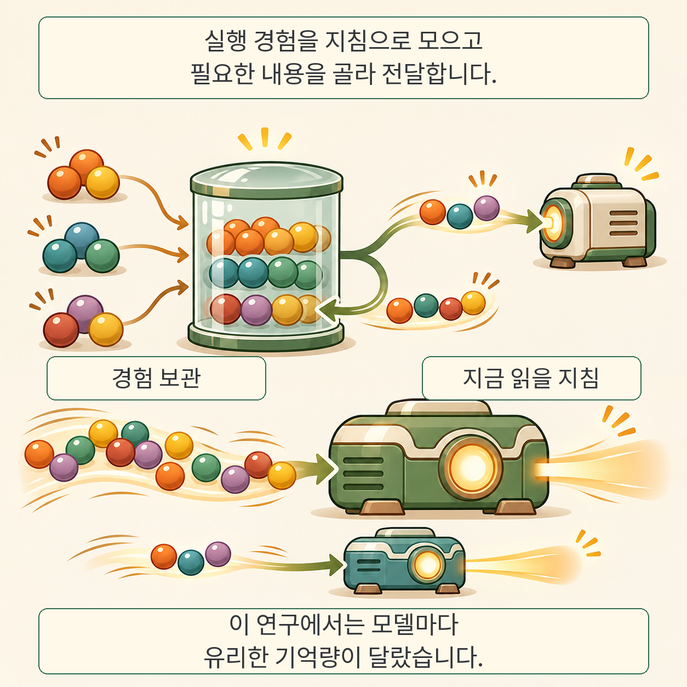

에이전트가 같은 API를 자꾸 잘못 호출하거나 순서를 건너뛸 때면, 지난 실패에서 정리한 지침을 프롬프트에 죄다 넣어 주고 싶어집니다. 그런데 잘 다듬은 기억이라도 모델에 따라서는 많이 건넬수록 성적이 오히려 내려갈 수 있거든요. 이번 연구가 던지는 핵심 질문은 **무엇을 저장소에 남기고, 지금 쓰는 모델에 그중 얼마만큼을 읽힐 것인가**입니다.

글·해설: 다메카솔

## 쌓아 두는 기억과 꺼내 읽는 기억 나누기

IBM 연구진은 에이전트의 실행 기록에서 교훈을 추출하고 유사한 교훈을 통합한 뒤 다음 작업에 전체 또는 일부 지침을 전달하는 파이프라인을 살폈으며, 이는 모델 가중치를 갱신하는 방식과 다릅니다. 공개 라이브러리 [ALTK Evolve](https://github.com/AgentToolkit/altk-evolve)에 구현된 이 흐름은 크게 세 단계로 작동하죠.

- **교훈 추출과 보존형 통합**: 실행이 끝날 때마다 실제 평가 결과를 기준으로 짧은 행동 지침을 뽑고, 비슷한 교훈을 임베딩으로 묶어 합치면서 몇 번의 독립 실행에서 나왔는지 뜻하는 지원도(`support`)와 출처 작업을 보존합니다.
- **선택적 전달**: 추론 시점에는 모인 지침 전체를 넣거나, 지원도가 높은 핵심 규칙과 현재 과제에 가까운 지침 일부만 골라 건넵니다.

예를 들어 고객 목록을 끝까지 못 읽은 작업과 주문 목록을 중간에 멈춘 작업이 있다고 떠올려 봅시다. 두 실패 모두 페이지 순회를 다루지만, 고객 API에만 통하는 종료 조건을 주문 API 지침으로 뭉뚱그려 합치면 엉뚱한 버그가 이어집니다. 그래서 저장소에 과거 교훈을 보존하는 일과 현재 입력에 넣을 양을 선택하는 일은 별개의 설계로 분리할 수 있습니다.

실제로 연구진이 DeepSeek 실행에서 모은 교훈을 12개의 깔끔한 요약 규칙으로 압축해 주었을 때보다, 딱 한 번씩만 등장한 상황별 교훈 144개까지 남긴 191개 전체 지침을 주었을 때 완료율 상승 폭이 세 배 이상 컸습니다. 이처럼 롱테일 경험을 버리지 않고 저장소에 온전히 남겨 두어야 나중에 선택 전달의 재료도 살아남는 셈이죠. 현재 공식 라이브러리는 통합 시 support와 출처 보존, MCP와 Python 접근, 파일시스템 및 선택적 벡터 저장소를 문서화하고 있으며, 논문 실험 당시보다 계속 발전하는 구현이므로 연동 전 최신 동작을 함께 확인하는 편이 좋습니다.

## 같은 기억량도 모델에 따라 득실이 갈립니다

연구진은 모의 앱 API 457개를 쓰는 AppWorld의 `test_normal` 168과제에서 ReAct 코드 에이전트를 돌려 기억량별 작업 완료율(TGC)과 시나리오 완료율(SGC)을 쟀습니다. 각 모델이 자기 실행에서 직접 뽑은 지침을 썼기 때문에, 모델마다 같은 기억 묶음을 나눠 읽은 실험과는 조건이 다릅니다.

| 모델 (AppWorld test_normal 168과제) | 기억 없음 | 전체 지침 (자체 추출) | 부분·선택 지침 | 과제당 평균 토큰 변화 |
| --- | --- | --- | --- | --- |
| DeepSeek-V3.2 | 79.8% | 191개, 89.3% | 47개(sup2), 85.7% | 없음 148K → 전체 263K |
| gpt-oss-120b | 39.9% | 199개, 51.2% | 약 29개, 55.4% (두 실행 56.0·54.8 평균) | 없음 110K → 선택 116K |

실험 결과는 모델 체급에 따라 정반대 방향으로 갈렸습니다. 강한 모델 쪽은 지침이 늘수록 성적이 꾸준히 올라 전체 지침에서 최고점을 찍었지만, 기준 완료율이 낮았던 gpt-oss 모델은 전체 199개를 통째로 넣었을 때보다 약 29개만 골랐을 때 완료율이 앞섰거든요. 약한 모델에 과한 지침을 넣으면 오류 대신 조용한 성능 저하가 나타납니다.

- **토큰 비용 변화**: 논문 비교에서 DeepSeek-V3.2 전체 지침은 과제당 토큰이 148K에서 263K로 늘어난 반면, gpt-oss-120b 선택 지침은 110K에서 116K(전체 전달 시 166K)로 증가 폭을 5% 안팎으로 억제했습니다.
- **스캐폴드와 난이도 한계**: 같은 모델에 ACE 방식을 붙였을 때와 비교해도 DeepSeek-V3.2는 기준선 대비 개선 폭(+9.5%p vs +8.4%p)은 비슷하면서 약 40% 토큰(263K vs 634K)만 썼고, gpt-oss-120b 선택 전달은 약 7분의 1 토큰(116K vs 777K)으로 대등한 완료율을 기록했습니다. 또한 메모리는 아슬아슬하게 틀리던 중간 난이도 과제(예: DeepSeek 보통 구간 SGC 62.5% → 93.8%)를 살리는 데 집중될 뿐, 약한 모델이 원래 못 풀던 고난이도 한계(gpt-oss 어려움 구간 SGC 9.5%)까지 넘겨 주지는 못했습니다.

다만 선택 설정은 `test_normal`에서 비교해 고른 값이며 별도 설정 선택용 검증 세트가 없었고, 대부분 단일 실행이므로 작은 차이는 실행 변동과 구분해야 합니다. 실제로 온도 0과 고정 시드로 같은 설정을 반복해도 수십 개 과제의 당락이 엇갈렸기에, 특정 숫자를 보편적 기준치로 고정하기보다 모델별 조정 근거로 읽는 편이 타당합니다.

## 자주 나온 조언이라고 정답은 아닙니다

논문에서 특히 눈여겨볼 사례는 여러 번 반복 도출된 페이지 순회 지침이 오히려 멀쩡한 과제를 망가뜨린 경우입니다. 높은 지원도를 얻은 이 지침은 페이지 크기보다 적은 항목이 오면 멈추라고 안내했는데, 에이전트가 API 기본 페이지 크기를 5가 아니라 20으로 잘못 가정한 탓에 첫 응답만 보고 뒷페이지를 전부 누락시켰거든요.

결국 연구진이 페이지 크기를 명시하고 빈 페이지가 돌아올 때까지 순회하도록 손수 고친 뒤에야 과제가 복구된 셈입니다. 이 사례가 보여 주듯 지원도는 교훈이 얼마나 자주 나왔는지 잴 뿐, 반복 횟수가 정확성을 자동으로 보증해 주지는 않습니다. 실제 watsonx Orchestrate 적용에서는 과거 HEIC 영수증 실패에서 배운 변환 규칙을 TIFF 영수증 청구로 옮겨 중복 제출을 막은 사례도 있었지만, 쓰기 훅 누락처럼 겉으로 드러나지 않는 장애와 최신성 신호 부재가 무인 운영의 걸림돌로 남았다고 전합니다.

## 다메카솔의 해석

다메카솔이 이 연구를 바탕으로 정리한 실무 설계 기준은 같은 모델·도구·프롬프트 조건에서 기억 없음·전체·선택을 비교하고, 출처와 적용 조건 및 지침별 회귀를 함께 기록하는 것입니다.

1. **동일 조건에서의 삼자 비교**: 프롬프트 스캐폴드만 달라도 기준선이 흔들리므로, 기억량 외의 변수를 고정한 상태에서 세 조건을 나란히 측정해야 합니다.
2. **토큰 비용과 지침별 회귀 기록**: 평균 완료율 옆에 과제당 토큰과 새로 실패한 과제를 함께 남겨야 역효과를 낸 규칙을 바로 가려낼 수 있거든요.
3. **출처와 적용 조건 분리 저장**: 지침 문장과 함께 출처 작업, 유효 파라미터 조건, 회귀 이력을 따로 관리하면 문제가 터졌을 때 해당 규칙만 정밀하게 수정하기 수월합니다.

[StateMem에서 다룬 현재 상태 추적](/posts/statemem-agent-memory-state-tracking/)이 기억 속 사실의 갱신 시점을 물었다면, 이번 연구는 쌓아 둔 조언을 모델 체급에 맞춰 얼마나 꺼내 줄지 묻습니다. 결국 에이전트 메모리는 기록을 모으는 단계보다 **적용 조건을 검증하며 꺼내 쓰고 회귀를 걸러내는 루프**까지 갖출 때 실무에서 힘을 발휘합니다.

## 출처

- K. R. Jayaram 외, [How Much Should an Agent Remember? Deployment Lessons from Self-Distilled Memory for LLM Agents](https://arxiv.org/abs/2611.26361v1), arXiv:2611.26361v1, 2026-11-19 제출. 실험 조건·표 1~3·Insights 1~7·제품 적용 사례를 중심으로 해설했습니다.
- [ALTK Evolve 공식 코드와 문서](https://github.com/AgentToolkit/altk-evolve), 2026-11-20 확인. 라이브러리와 관련 연구는 이번 논문 이전부터 공개돼 있습니다.

논문 실험은 독립 재현하지 않았으며, 만화는 원문 그림을 복제하지 않고 새로 구성했습니다.

이 글의 본문과 이미지는 생성형 AI로 제작했습니다. 기획과 편집 기준은 다메카솔이 정했습니다.
