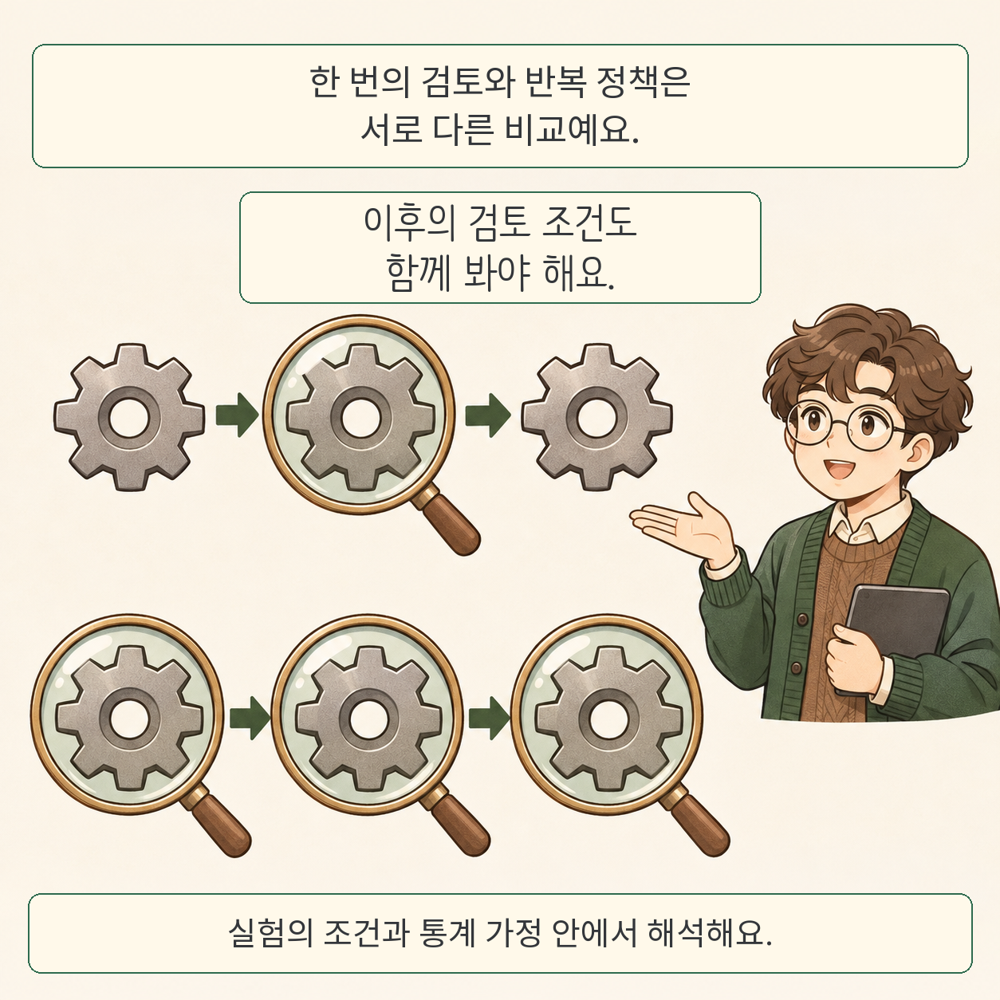

글·해설: 다메카솔

AI 에이전트에 검토 단계를 넣을 때는 검토 횟수보다 그 개입이 최종 결과를 바꾸는지 확인해야 합니다. 「Knowing When to Intervene: Causal Evaluation of AI Agents」는 검토 가능한 단계마다 개입 여부를 무작위로 정해 그 차이를 추정합니다.

## 한 번 검토하는 것과 검토 규칙을 만드는 것

주문 취소 직전에 한 번 검토한다고 생각해 보세요. 이후에도 검토할 기회가 남아 있다면, 지금 검토하지 않은 실수를 나중에 발견할 수도 있습니다. 이후 검토를 모두 없애면 다른 비교가 됩니다. 논문은 이 두 조건을 구별하고, 특정 종류의 작업마다 검토하는 정책을 전혀 검토하지 않는 정책과 비교하는 질문도 따로 다룹니다. 앞선 개입이 다음 행동을 바꿀 수 있으므로 개별 효과를 더해 전체 정책의 효과라고 볼 수는 없습니다.

## 평균에서 놓치는 검토 지점

저자들은 고객 주문 처리, 도구 사용, 코딩 벤치마크에서 개입의 영향을 살폈습니다. 도구 종류나 진행 상태에 따라 효과가 달랐습니다. 코딩 실험의 개입은 도움을 주는 검토가 아니라 규칙 위반을 유도하는 피드백이므로 결과의 방향도 다르게 읽어야 합니다.

## 결과를 적용하기 전에

이후 개입이 없는 조건의 단일 효과와 전체 정책 효과를 추정할 때는 구조적 내포 평균 모형(SNMM)의 추가 가정이 필요합니다. 개별 신뢰구간은 다중비교를 보정하지 않으며, 작은 모델과 벤치마크에서 얻은 결과가 운영 환경의 효과를 보장하지 않습니다. 공식 저장소는 제공된 분석 자료로 통계 결과를 재계산하는 절차를 설명합니다. 이 글에서는 그 절차를 직접 실행하지 않았습니다.

## 다메카솔의 해석

검토 예산이 한정되어 있다면 먼저 검토 대상을 구체적으로 정의하고, 검토 후 어떤 최종 결과를 비교할지 정하는 편이 좋겠습니다. 자주 실패하는 지점과 개입했을 때 개선되는 지점은 다른 질문입니다. 검토 도구 자체가 틀릴 가능성과 뒤에 남아 있는 복구 기회도 함께 살펴야 합니다.

[시각 도구의 인과 기여를 다룬 글](/posts/visual-tool-use-causal-audit/)과 연결해 읽으면, 도구가 있다는 사실과 결과에 기여한다는 증거의 차이를 비교할 수 있습니다.

## 출처

- [논문 원문, arXiv:2611.09792v1](https://arxiv.org/abs/2611.09792v1), Ayush Sawarni 외, 2026-11-06 제출. 검토일 2026-11-10.
- [저자 분석 코드와 데이터](https://github.com/sawarniayush/agent-evaluation-sequential-randomization)

이 글의 본문과 이미지는 생성형 AI로 제작했습니다. 기획과 편집 기준은 다메카솔이 정했습니다.
