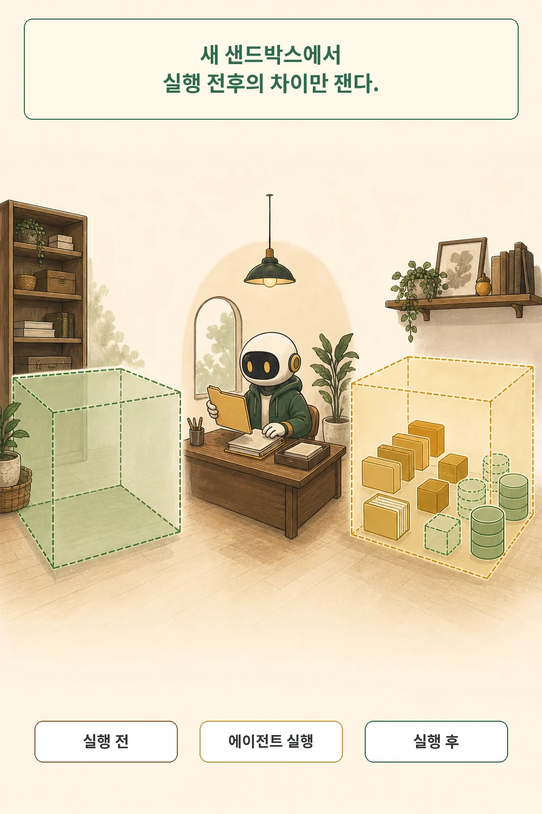
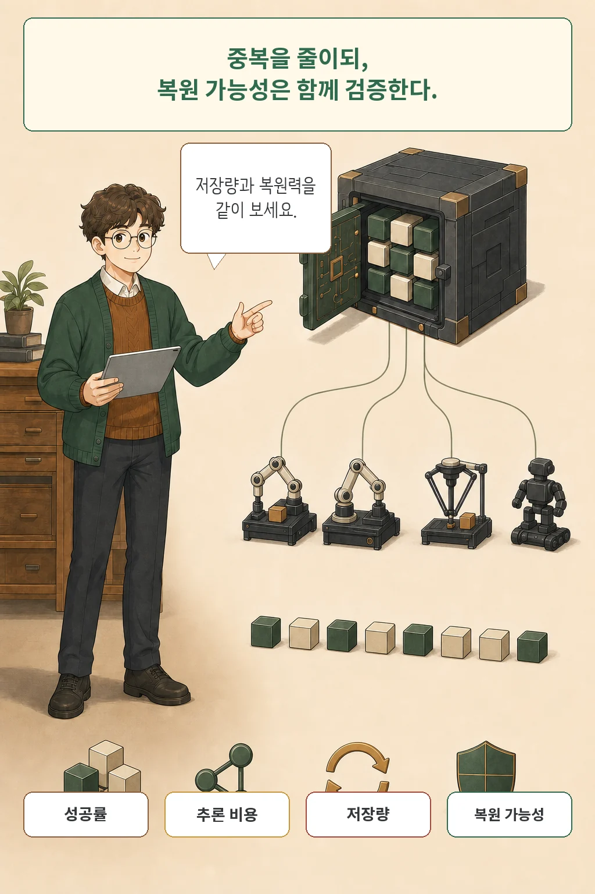

코딩이나 데이터 분석을 맡긴 AI 에이전트가 작업을 마치고 응답을 돌려주면 API 토큰 비용 청구는 그 자리에서 멈춥니다. 하지만 서버 디스크에는 SQLite 세션 DB와 체크포인트, 디버그 로그가 그대로 쌓여 남는데요. 논문 **〈The Hidden Footprint〉**의 **AgentFootprint**는 실행 뒤 디스크에 남는 저장 발자국을 정확도·비용과 함께 평가하도록 제안한 벤치마크입니다.

글·해설: 다메카솔

## 작업이 끝나도 남는 저장 발자국

연구진은 저장 발자국을 “실행 뒤 격리된 샌드박스의 작업공간과 홈 디렉터리 경로에 새로 늘어난 바이트”로 정의했습니다. 장애 복구와 감사에 꼭 필요한 기록이지만, 공유 가중치나 캐시를 빼고도 산출물보다 잔여물이 크게 불어나는 일이 잦습니다.

- **공급망 견적 운영 사례**: 한 작업에서 전달 파일(`2.6MB`) 외에 프레임워크 잔여물만 `79MB`(작업 총 `131MB`, 전체 중앙값 `715KB`)가 남았고, 전체 배포는 약 1,000라운드 동안 `56GB`를 누적했습니다.
- **최소 쓰기 과제**: `39바이트` 요약 파일을 만들고도 기본 오버헤드로 `128KB~1MB`(최대 `24,033배`)가 디스크에 기록됐습니다.

연구진은 여덟 개 프레임워크를 동일 모델과 최소 도구 조건에서 총 1,061회 실행해 전후 차이를 비교했습니다. 총 저장량(`Stotal`), 채널 구성, 중복 계수(`D`), 성장 지수(`α`), 압축 가능성(`C`), 대화 이력을 재구성하는 **복원 가능성(`R`, 0–3)**까지 여섯 지표를 한 프로필로 묶어 쟀습니다.

## 파일 크기만 보면 놓치는 직렬화 중복

디스크가 빠르게 차는데도 일반 중복 검사가 문제없다고 답하는 원인은 직렬화 방식에 있습니다. SQLite가 긴 값을 `4KB` 페이지로 쪼개고 JSON이 특수문자를 이스케이프하면 바이트 경계가 바뀌어 단순 청킹으로는 반복을 놓치기 쉽습니다.

- **직렬화 은폐**: LangGraph 체크포인트 DB는 원시 파일 청킹에서 `D=1.01`로 보였지만, SQLite 셀과 JSONL을 논리 스트림으로 풀자 `D=12.1`로 드러났습니다.

에이전트의 행동 차이와 저장 계층 자체의 비용을 분리하려고 연구진은 동일한 궤적을 일곱 지속 저장 프레임워크에 재생했습니다.

- **고정 궤적 통제**: 세 번 읽고 한 번 답하는 같은 흐름에서도 관찰 바이트 대비 저장 증폭이 `1.03배`(LlamaIndex)에서 `6.86배`(InfiAgent)까지 벌어졌고, 도구 호출을 순차 전송으로 바꾸자 LangGraph는 `3.24배`에서 `7.40배`로 뛰었습니다.

결국 같은 대화를 매 턴 껍데기만 바꿔 적고, 도구 호출을 묶는지 나누는지에 따라서도 디스크 부담이 크게 갈린 셈이죠.

## 성공률 100% 뒤에 숨은 저장량과 복원력 격차

같은 모델(`DeepSeek-V4-Flash`, 온도 0)로 파일 질의 10개 과제를 3회씩 반복 측정한 결과입니다.

| 프레임워크 | 저장 방식 | 저장량 | D | α | 정확도 | R | CAS 후 |
| --- | --- | ---: | ---: | ---: | ---: | :---: | ---: |
| **LangGraph** | SQLite 체크포인트 | 5.10MB | 12.8 | 1.74 | 100% | 3 | 0.50MB (10.3배) |
| **AutoGen** | 턴별 상태·로그 | 2.49MB | 8.4 | 1.95 | 86% | 3 | 0.07MB (32.7배) |
| **InfiAgent** | 작업 저장·트레이스 | 2.12MB | 1.8 | 1.15 | 100% | 3 | 0.36MB (5.8배) |
| **Agno** | SQLite 세션 DB | 1.15MB | 2.5 | 0.98 | 99.3% | 3 | 0.06MB (20.5배) |
| **LlamaIndex** | 직렬화 Context | 0.93MB | 4.2 | 1.88 | 100% | 3 | 0.09MB (10.3배) |
| **OpenAI Agents** | SQLiteSession | 0.33MB | 1.6 | 0.73 | 100% | 3 | 0.07MB (4.8배) |
| **CrewAI** | 작업 출력 저장소 | 0.32MB | 1.5 | 1.20 | 100% | 1 | 0.05MB (6.1배) |
| **SmolAgents** | 비저장(메모리) | 0B | - | - | 100% | 0 | - |

정확도가 100%로 같은 지속 저장 구성끼리도 실행당 저장량은 크게 벌어지지만, 바이트 수만으로 우열을 가리기는 어렵습니다.

**예를 들어** `2KB` 상태 파일을 200라운드 거듭 읽는 모니터링 에이전트를 운영한다고 가정해 봅시다. 매 턴 전체 이력을 다시 쓰는 구성은 초선형으로 불어나 LangGraph 기준 **323MB**(AutoGen 102MB)까지 쌓였지만, 윈도우나 증분 추가 방식은 훨씬 작은 용량을 유지했습니다.

- **동일 정확도 격차와 복원력**: 지속 저장 100% 정확도 구성 간 저장량 차이는 `15.7배`였고, `R=3`인 여섯 구성은 새 프로세스에서 194개 호출 이력을 복원한 반면 CrewAI(`R=1`)는 재개에 실패하고 SmolAgents(`R=0`)는 기록 자체가 빠졌습니다.
- **SWE-bench 궤적 분포**: 108개 정규화 제출의 내보낸 궤적 크기는 `1,617배` 벌어졌지만 해결률 상관은 검출되지 않았습니다(`τb=0.080`, `p=0.222`).

## CAS로 중복은 줄이고 복원력은 지킬 수 있을까

그렇다면 복원력(`R`)을 지키면서 중복 저장만 걷어낼 수는 없을까요? 연구진은 `1KB`보다 큰 문자열과 블롭을 zstd 압축 콘텐츠 주소 저장소(CAS)에 한 번만 두고, 체크포인트에는 해시 참조만 남기는 프로토타입을 시험했습니다.

- **CAS 절감 효과**: 일곱 지속 저장 구성의 70회 실행에서 보존량이 `4.8배~32.7배` 줄었고, 310개 파일 복원 검사와 기존 `R` 등급이 그대로 유지됐습니다.

다만 이 구현은 운영용 DB가 아니라 절감 여력을 보인 존재 증명입니다. 실서비스 적용에는 프레임워크별 어댑터가 필요하고, 솔트 없는 해시를 테넌트 간 공유하면 데이터 유무를 추정할 위험도 남습니다. 실험 역시 버전 고정 구성의 검색·보존 과제 중심이며 새 샌드박스 측정은 긴 공유 스레드 누적을 작게 잡을 수 있다는 한계를 함께 봐야 합니다.

## 다메카솔의 해석: 저장량과 복원력을 한 표에 두자

운영 대시보드에 성공률과 지연 시간, 토큰 비용만 두면 작업 뒤 디스크에 남는 부채는 놓치기 쉽습니다. 실행당 저장량과 성장 지수, 복원 등급 `R`을 함께 봐야 비로소 ‘복구용 바이트’와 ‘직렬화 중복’을 가려낼 수 있거든요.

- **보존 목적과 만료(TTL) 분리**: 임시 추론 로그와 복구·감사 대상 상태의 보존 기한을 먼저 나눕니다.
- **증분·윈도우 정책 비교**: 매 턴 풀 덤프 대신 참조 저장이나 최근 N턴 윈도우, 테넌트 분리 CAS로 초선형 폭증을 막습니다.
- **복원·삭제 동시 검증**: 감축 뒤 새 프로세스 재개(`R=3`)와 삭제 요청 시 공유 블롭 완전 제거까지 회귀 테스트합니다.

운영 비용과 가용성을 함께 살피고 싶다면 [스킬 회귀 비용(Regression Tax) 분석](/posts/llm-agent-skill-regression-tax/)과 [DB·오브젝트 스토리지 가동시간 설계](/posts/state-service-uptime-design/)도 이어서 볼 만합니다.

## 출처

- Chenglin Yu, Hongquan Gui, Ying Yu, Tao Zeng, Ming Li, [The Hidden Footprint: Making Storage a First-Class Metric for LLM Agent Evaluation, arXiv:2607.11149](https://arxiv.org/abs/2607.11149), 2026-07-13 v1 제출, 2026-07-23 12:36:42 UTC v3 수정.
- [논문 원문 PDF](https://arxiv.org/pdf/2607.11149) · [arXiv TeX 소스 번들](https://arxiv.org/src/2607.11149)
- [Creative Commons Attribution 4.0 International](https://creativecommons.org/licenses/by/4.0/)

원문 확인일: 2026-07-24. 이 글은 arXiv v3 논문 원문과 TeX 번들을 바탕으로 정리했으며, 부록에 언급된 코드·데이터 아카이브가 당시 공개 번들에 포함되지 않아 별도 실행 재현은 수행하지 않았고 만화는 논문 그림을 복제하지 않고 핵심 원리를 설명하도록 새로 구성했습니다.

이 글의 본문과 이미지는 생성형 AI로 제작했습니다. 기획과 편집 기준은 다메카솔이 정했습니다.
