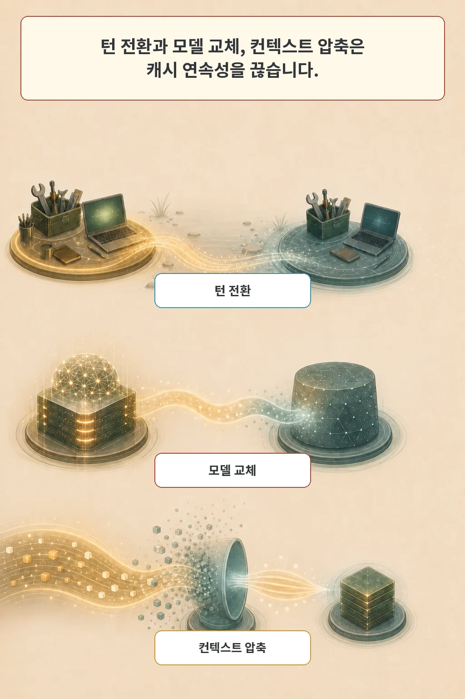

AI 코딩 에이전트를 서빙하다 보면 평균 KV 캐시 적중률이 높은데도 지연 시간과 GPU 메모리 부담은 쉽게 줄지 않는 상황을 만나곤 합니다. 요청을 한 번 보낼 때마다 내부에서는 모델 호출과 도구 실행이 수차례 이어지고, 요청 사이에는 긴 유휴 공백이 끼어들기 때문이죠. 실제 GitHub Copilot 운영 추적(trace)을 분석한 연구는 진짜 병목이 요청 건수가 아니라 **턴 내부와 턴 경계의 성격 차이**에 있다고 짚어줍니다.

글·해설: 다메카솔

## 핵심 내용

- **실운영 3계층 추적**: Visual Studio·VS Code의 GitHub Copilot 익명 메타데이터를 세션·턴·단계로 분석했습니다.
- **턴 내부 가열과 경계 냉각**: 턴 안에서는 캐시 적중률이 90%대까지 오르지만, 턴 경계와 모델 교체는 연속성을 끊었습니다.
- **장기 세션의 압축 부담**: 일부 장기 세션에 컨텍스트 압축과 토큰 소모가 몰리며 직후 캐시 적중률과 턴 지연에 부담을 주었습니다.

## 한 번의 요청은 수십 차례 호출로 이어집니다

에이전트 부하가 일반 챗봇과 다른 까닭은 요청 한 건 뒤의 실행 구조에 있습니다. 예를 들어 결제 모듈의 타임아웃 원인을 찾아 테스트까지 고쳐 달라고 요청한 상황을 떠올려 볼까요? 에이전트는 바로 답을 적는 대신 코드를 읽고 로그를 검색하며 패치를 검증하는 루프를 한 턴 안에서 반복합니다. 논문은 이 흐름을 **세션(수명주기)**, **턴(요청과 자율 실행 사슬)**, **단계(개별 모델·도구 호출)** 세 층위로 나누어 살폈습니다.

- **표본 규모**: 2026년 6월 첫째 주 미국 최대 세 시간대의 Visual Studio·VS Code 익명 GitHub Copilot 텔레메트리에서 세션 1,350만 건, 턴 9,510만 건, 사용자 320만 명, 모델 27종 이상(호출 7억 6,050만 건), 도구 45종 이상(호출 7억 7,470만 건)을 추적했습니다.
- **수집 경계**: 프롬프트·파일 내용·모델 출력·소스 코드·도구 인자·사용자 식별 정보는 제외하고 호출 시각·지속 시간·토큰 수·모델·도구 이름·성공 여부만 분석했습니다.

## 같은 턴 안에서는 왜 캐시가 빠르게 달아오를까

KV 캐시는 이전 토큰의 중간 계산 상태를 재사용해 중복 연산을 줄이는 장치입니다. 한 턴이 도는 동안에는 시스템 프롬프트와 이전 대화, 방금 실행한 도구 결과가 다음 호출의 앞부분에 계속 붙기 때문에 프롬프트 접두어가 안정적으로 유지됩니다.

실제 추적에서도 평균 적중률은 첫 호출 약 45%에서 두 번째 호출 약 86%로 뛰고, 세 번째 이후에는 90%대 초반을 유지했습니다. 전체 호출 중앙값이 98%에 이르는 것도 냉각 구간과 고적중 구간이 섞인 양봉 분포 영향인데요, 단계 간 대기도 짧아 진행 중인 턴의 캐시는 유지하는 편이 유리합니다.

## 턴 경계와 모델 교체, 압축이 연속성을 끊습니다

문제는 한 턴이 끝나고 다음 요청을 기다리거나 다른 모델로 넘어가며 발생합니다.

| 구간 및 사건 | KV 캐시 적중률 변화 | 유휴 시간 중앙값 및 원인 |
| --- | --- | --- |
| **턴 내부 (Intra-turn)** | 1회차 약 45% → 2회차 약 86% → 3회차+ 약 92~94% | KV 캐시 **1.2초**, 컨테이너 **5.8초** (도구 직후 즉시 재호출) |
| **턴 경계 (동일 모델)** | 직전 대비 평균 **26%p 하락** | KV 캐시 **172초**, 컨테이너 **243초**, 입력 간격 **25.2분** (2~10분대 축출) |
| **모델 교체** | 평균 적중률 **8%** (직전 대비 **67%p 하락**) | 토크나이저·내부 구조 차이로 기존 캐시 재사용 불가 |
| **컨텍스트 압축** | 직후 첫 호출 중앙값 **66.1% 하락** | 프롬프트 토큰 중앙값 **72.8%** 절감, 턴 시간 중앙값 **약 22%** 소모 |

턴 안에서는 몇 초 만에 다음 호출이 이어지지만, 턴을 건널 때는 사용자가 결과를 검토하는 동안 서빙 메모리의 시간 기반 축출 구간에 들어가 캐시가 비워지거든요. 여기에 호출량 제한 등으로 모델까지 바꾸면 토크나이저부터 달라져 처음부터 다시 계산해야 합니다.

긴 작업에서 컨텍스트 한도에 다다르면 작동하는 압축 역시 부담이 큰 편입니다. 오래된 맥락을 요약하면 앞부분 접두어가 통째로 바뀌어 직후 캐시 적중률이 떨어지고, 긴 입력 읽기(prefill)와 요약 생성(decode)이 턴의 핵심 경로에서 함께 실행됩니다.

- **장기 세션 집중**: 압축은 전체 세션의 7.8%에서만 일어났으나 이 세션들이 전체 토큰의 44.2%, 모델 호출의 37.1%, 도구 호출의 38.9%를 차지했습니다.

## 다메카솔의 해석: 턴 경계를 자원 정책의 신호로 본다

서빙 인프라에서는 모든 호출에 같은 캐시 보존 시간을 적용하기보다 턴 상태에 따라 정책을 나누는 전략이 유효합니다. 턴 안에서는 캐시와 컨테이너를 따뜻하게 붙잡아 두고, 턴 경계에서만 예상 유휴 시간과 복구 비용을 따져 호스트 메모리·디스크로 캐시를 내리거나(offload) 컨테이너를 절전(hibernate)으로 돌리는 셈이죠.

저자들도 턴 경계마다 유휴 길이를 예측하는 경량 모델을 시험했습니다. 다만 오프라인 추적으로 얻은 예측 결과이므로, 실제 환경의 복구 지연과 배치 효율까지 포함한 실절감액은 온라인 실험으로 검증해야 합니다.

- **유휴 시간 예측기**: 첫 주 15만 세션 학습·다음 주 5만 세션 평가 기준 생존 곡선 모델은 60초 초과 유휴 예측에서 ROC-AUC 0.73을 기록하고 전체 유휴 시간의 86~90%를 포착했습니다.

## 분석 범위와 실무 점검 사항

논문 수치를 설계에 반영할 때는 세 가지 데이터 경계를 함께 살펴야 합니다.

1. **과제 성공 품질 미포함**: 프롬프트·응답 원문을 수집하지 않아 긴 세션이 고난도 해결인지 무한 루프인지 구분하기 어렵습니다.
2. **클라이언트 측 관측**: 클라이언트 기준 텔레메트리라 서버 GPU 활용률, 큐 깊이, 배치 크기, 메모리 압력은 별도 서버 지표로 보완해야 합니다.
3. **표본과 재현 범위**: 2026년 6월 첫째 주 미국 최대 세 시간대 GitHub Copilot 표본이라 타 지역·제품·시기 일반화에 주의해야 하며, 공개 원시 데이터나 분석 코드는 제공되지 않았습니다.

실무에서는 **세션·턴·단계** 3계층으로 지표를 나누고, 모델 교체와 압축을 캐시 초기화 사건으로 기록해야 합니다. 아울러 턴 내부 유지와 경계 회수를 분리할 때 과제 성공률, 재시도 횟수, 사용자 대기 시간, 복구 지연 SLO를 함께 재야 안전합니다.

## 논문 정보

- **제목**: Agentic Coding in the Wild: Characterizing GitHub Copilot Traces at Production Scale (`cs.AI`, `cs.LG`, empirical preprint)
- **저자·일정**: Banruo Liu, Haoran Qiu, Íñigo Goiri, Rodrigo Fonseca, Ricardo Bianchini, Esha Choukse (v1 제출 2026-07-30 20:51:51 UTC, 2026-08-04 cs.AI 신규 목록 공개)

## 출처

- [논문 초록과 메타데이터, arXiv:2608.00101](https://arxiv.org/abs/2608.00101)
- [논문 원문 PDF](https://arxiv.org/pdf/2608.00101)
- [관련 글: AI 코딩 도우미는 보안 API도 안전하게 쓸까](/posts/copilot-security-api-study/)
- [관련 글: AI 에이전트는 로컬 디스크를 얼마나 쓰게 될까](/posts/agentfootprint-storage-benchmark/)

이 글은 arXiv에 공개된 논문 원문을 바탕으로 해설하며 별도 실험 재현이나 자체 운영 측정을 포함하지 않았고, 본문 이미지는 논문 도표를 복제하지 않고 새로 구성했습니다.
이 글의 본문과 이미지는 생성형 AI로 제작했습니다. 기획과 편집 기준은 다메카솔이 정했습니다.
