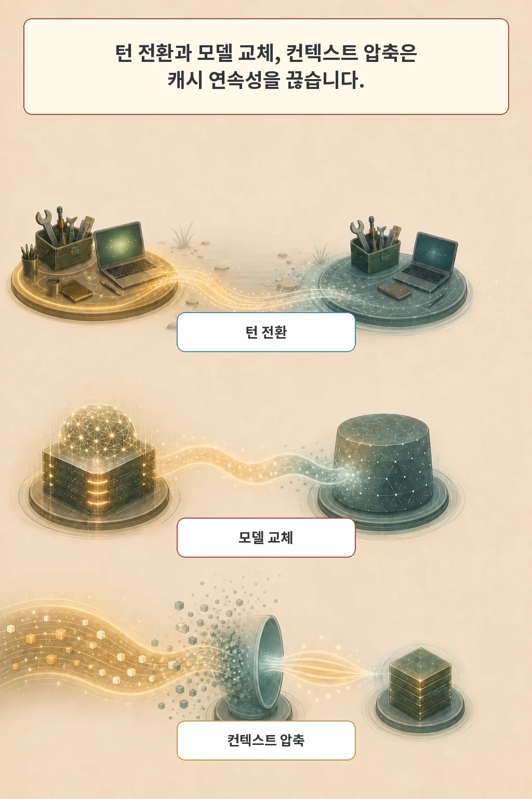

사용자가 한 번 요청하면 코딩 에이전트는 모델을 한 번 부르고 끝나지 않습니다. 모델이 상황을 읽고, 도구를 실행하고, 그 결과를 다시 읽는 루프가 수십 차례 이어집니다. **Agentic Coding in the Wild: Characterizing GitHub Copilot Traces at Production Scale**은 이 부하를 실험실 벤치마크가 아니라 실제 GitHub Copilot 운영 추적(trace) 데이터로 분석한 연구입니다.

핵심은 단순 요청 수가 아니라 **세션과 턴의 경계**입니다. 한 턴 안에서는 같은 프롬프트 접두어를 재사용해 KV 캐시가 빠르게 따뜻해지지만, 사용자가 다음 입력을 준비하는 긴 공백과 모델 교체, 컨텍스트 압축이 그 연속성을 끊어 놓았습니다.

글·해설: 다메카솔

## 핵심 내용

- **대규모 실운영 추적**: 2026년 6월 첫째 주 미국 지역의 Visual Studio 및 VS Code에서 수집한 익명 메타데이터(세션 1,350만 건, 턴 9,510만 건, 사용자 320만 명, 모델 호출 7억 6,050만 건, 도구 호출 7억 7,470만 건)를 세션·턴·단계 3계층으로 분석했습니다.
- **턴 내부의 빠른 캐시 워밍업과 턴 경계의 냉각**: 한 턴 안에서 평균 KV 캐시 적중률은 첫 호출 약 45%에서 2번째 약 86%, 3번째 이후 92~94%로 빠르게 오릅니다(턴 내 KV 캐시 유휴 중앙값 1.2초). 반면 턴이 바뀌면 같은 모델을 써도 적중률이 평균 26%포인트 떨어지고, 모델을 교체하면 평균 8%(이전 호출 대비 67%포인트 하락)로 급락합니다.
- **컨텍스트 압축의 양면성**: 컨텍스트 압축은 전체 세션의 7.8%에서만 발생했지만, 이 장기 세션들이 전체 토큰의 44.2%(모델 호출 37.1%, 도구 호출 38.9%)를 소비했습니다. 압축 1회당 프롬프트 토큰은 중앙값 72.8% 줄어들지만, 직후 캐시 적중률이 중앙값 66.1%포인트 떨어지고 해당 턴 실행 시간의 약 22%를 압축 자체에 소모했습니다.

## 한 번의 요청은 하나의 호출이 아니다

논문은 코딩 에이전트의 실행 흐름을 세 층위로 나눕니다.

- **세션(Session)**: 에이전트 작업의 전체 수명주기입니다.
- **턴(Turn)**: 사용자의 요청 하나와 그 뒤를 잇는 자율 실행 사슬입니다.
- **단계(Step)**: 한 턴 안에서 일어나는 개별 모델 추론이나 도구 호출입니다.

분석 대상은 2026년 6월 첫째 주 미국 내 최대 세 시간대의 Visual Studio와 VS Code에서 수집한 GitHub Copilot 코딩 에이전트 텔레메트리입니다. 27종 이상의 모델과 45종 이상의 도구가 쓰였으며, 프롬프트 원문·파일 내용·모델 출력·소스 코드·도구 인자·사용자 식별 정보는 수집하지 않고 호출 시각, 지속 시간, 토큰 수, 모델·도구 이름, 성공 여부 같은 구조적 메타데이터만으로 실행 흐름을 재구성했습니다.

## 같은 턴 안에서는 캐시가 빠르게 달아올랐다

KV 캐시는 이전 토큰에서 계산한 중간 상태를 재사용해 중복 연산을 줄이는 장치입니다. 코딩 에이전트의 한 턴 안에서는 시스템 프롬프트, 이전 대화, 도구 실행 결과가 다음 호출의 긴 접두어(prefix)로 계속 덧붙기 때문에 접두어 캐시가 유지되면 매번 처음부터 다시 계산할 필요가 없습니다.

실제로 한 턴 안의 평균 캐시 적중률은 첫 번째 호출 약 45%에서 두 번째 호출 약 86%로 뛰었고, 세 번째 호출 이후에는 약 92~94% 수준을 유지했습니다(전체 호출의 적중률 중앙값은 98%였으나 첫 호출의 cold start가 섞인 양봉 분포). 턴 내부의 단계 간 유휴 시간 중앙값은 KV 캐시 1.2초, 컨테이너 5.8초에 불과해, 한 턴이 진행 중일 때 캐시를 성급히 비우는 정책은 오히려 손해가 됩니다.

## 턴 경계와 모델 교체가 연속성을 끊었다

문제는 한 턴이 끝나고 다음 턴으로 넘어갈 때, 그리고 모델을 갈아탈 때 발생합니다.

| 구간 및 사건 | KV 캐시 적중률 변화 | 유휴 시간 중앙값 및 원인 |
| --- | --- | --- |
| **턴 내부 (Intra-turn)** | 1회차 약 45% → 2회차 약 86% → 3회차+ 약 92~94% | KV 캐시 유휴 **1.2초**, 컨테이너 유휴 **5.8초** (도구 실행 직후 즉시 재호출) |
| **턴 경계 (동일 모델 유지)** | 직전 대비 평균 **26%p 하락** | KV 캐시 유휴 **172초**, 컨테이너 유휴 **243초**, 사용자 입력 간격 **25.2분** (2~10분 유휴 구간부터 서빙 메모리에서 축출) |
| **모델 교체 (Model switch)** | 평균 적중률 **8%** (직전 대비 **67%p 하락**) | 모델별 토크나이저와 내부 구조가 달라 기존 KV 캐시 재사용 불가 |
| **컨텍스트 압축 (Compaction)** | 직후 첫 호출 적중률 중앙값 **66.1%p 하락** | 프롬프트 토큰을 중앙값 **72.8%** 줄이지만, 이전 접두어 자체가 바뀌어 캐시 재시작 및 턴 시간의 **약 22%** 소모 |

턴을 가로지르는 유휴 시간(KV 캐시 중앙값 172초, 사용자 입력 간격 중앙값 25.2분)은 턴 내부(1.2초)와 자릿수가 다릅니다. 턴 경계가 곧 자원을 회수하거나 다른 계층으로 내릴 시점을 알려주는 자연스러운 신호가 됩니다.

## 컨텍스트 압축은 세션을 살리지만 캐시를 다시 시작시켰다

긴 코딩 작업에서 컨텍스트 길이가 모델 한도에 가까워지면 에이전트는 오래된 기록을 요약해 세션을 이어 갑니다. 이 컨텍스트 압축은 전체 세션의 7.8%에서만 일어났지만, 이 긴 세션들이 **전체 토큰의 44.2%, 모델 호출의 37.1%, 도구 호출의 38.9%**를 차지했습니다.

한 번의 압축은 프롬프트 토큰을 중앙값 기준 72.8% 줄여 주었지만, 이전 접두어가 통째로 바뀌기 때문에 직후 첫 호출의 캐시 적중률이 중앙값 66.1%포인트 떨어졌습니다. 게다가 긴 입력을 읽는 prefill과 요약문을 생성하는 decode가 모두 턴의 임계 경로에서 실행되면서 압축 호출 하나가 해당 턴 전체 실행 시간의 약 22%(중앙값)를 썼습니다. 압축을 없앨 수는 없으므로, 압축 시점을 어떻게 고르고 이전 접두어 일부를 어떻게 보존할지가 중요한 시스템 과제가 됩니다.

## 다메카솔의 해석: 턴 경계를 자원 정책의 신호로 쓴다

코딩 에이전트 인프라를 운영한다면 모든 모델 호출에 획일적인 캐시 보존 시간을 적용하지 않아야 합니다. 한 턴이 도는 동안에는 다음 단계 호출이 1~6초 안에 돌아오므로 KV 캐시와 컨테이너 환경을 따뜻하게 유지하고, 턴이 끝나는 경계에서는 예상 유휴 시간과 복구 비용을 저울질해 GPU 캐시를 호스트 DRAM이나 디스크로 내리거나(offload) 컨테이너를 절전(hibernate) 상태로 전환하는 편이 합리적입니다.

실제로 논문 저자들도 턴 경계마다 유휴 시간을 예측하는 경량 모델을 실험했습니다(첫 주 15만 세션 학습, 다음 주 5만 세션 평가). 60초보다 긴 유휴 구간을 맞히는 ROC-AUC는 0.73이었고, 전체 유휴 시간의 86~90%를 포착했습니다. 다만 이는 언제 자원을 회수할 만한지 오프라인으로 예측한 결과이므로, 실제 서빙 환경에서 offload 후 복구 지연이나 배치 효율까지 포함한 실절감액은 별도의 온라인 실험으로 확인해야 합니다.

## 분석 범위와 한계

이 논문을 읽을 때는 세 가지 데이터 경계를 염두에 두어야 합니다.

1. **과제 성공 품질 미포함**: 프롬프트와 응답 원문을 수집하지 않았기 때문에, 토큰을 많이 쓴 긴 세션이 실제로 고난도 문제를 해결한 것인지 아니면 무한 루프에 빠져 실패를 반복한 것인지 구분할 수 없습니다.
2. **클라이언트 측 관측**: 텔레메트리가 클라이언트 기준으로 수집되어 서빙 클러스터의 실제 GPU 활용률, 큐 깊이, 배치 크기, 메모리 압력은 직접 측정되지 않았습니다.
3. **표본과 재현 자료 범위**: 2026년 6월 첫째 주 미국 내 GitHub Copilot(Visual Studio·VS Code) 표본이며, arXiv 원문과 TeX 소스에는 공개 추적 데이터나 분석 코드 저장소 링크가 포함되지 않았습니다.

## 운영 체크리스트

1. 단일 요청 단위가 아니라 **세션·턴·단계** 3계층으로 텔레메트리를 분리해 수집하는가?
2. 턴 내부의 `cache-hot` 경로와 턴 사이의 `idle` 경로에 서로 다른 캐시·컨테이너 보존 정책을 적용하는가?
3. 모델 교체와 컨텍스트 압축을 단순 기능 호출이 아니라 **캐시 수명주기 초기화 사건**으로 기록하는가?
4. 인프라 자원 절감 지표와 함께 과제 성공률·재시도 횟수·사용자 대기 시간을 나란히 측정하는가?
5. 캐시 offload나 컨테이너 절전 뒤 복구 지연이 서비스 응답 목표(SLO)를 넘지 않는지 온라인 환경에서 검증했는가?

## 논문 정보

| 항목 | 내용 |
| --- | --- |
| 제목 | Agentic Coding in the Wild: Characterizing GitHub Copilot Traces at Production Scale |
| 저자 | Banruo Liu, Haoran Qiu, Íñigo Goiri, Rodrigo Fonseca, Ricardo Bianchini, Esha Choukse |
| arXiv v1 제출 | 2026-07-30 20:51:51 UTC (2026-08-04 cs.AI 목록) |
| 분야 | cs.AI, cs.LG |
| 유형 | empirical (arXiv preprint) |

## 출처

- [논문 초록과 메타데이터, arXiv:2608.00101](https://arxiv.org/abs/2608.00101)
- [논문 원문 PDF](https://arxiv.org/pdf/2608.00101)
- [관련 글: AI 코딩 도우미는 보안 API도 안전하게 쓸까](/posts/copilot-security-api-study/)
- [관련 글: AI 에이전트는 로컬 디스크를 얼마나 쓰게 될까](/posts/agentfootprint-storage-benchmark/)

이 글의 본문과 이미지는 생성형 AI로 제작했습니다. 기획과 편집 기준은 다메카솔이 정했습니다.
