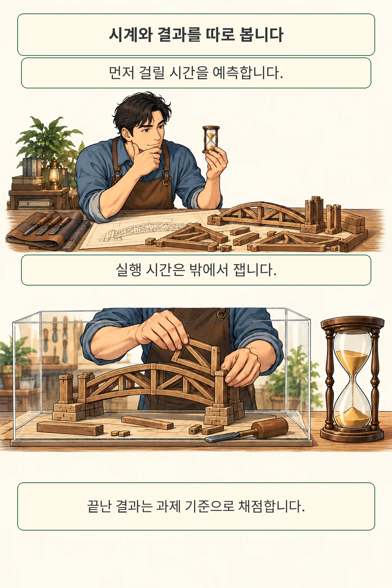
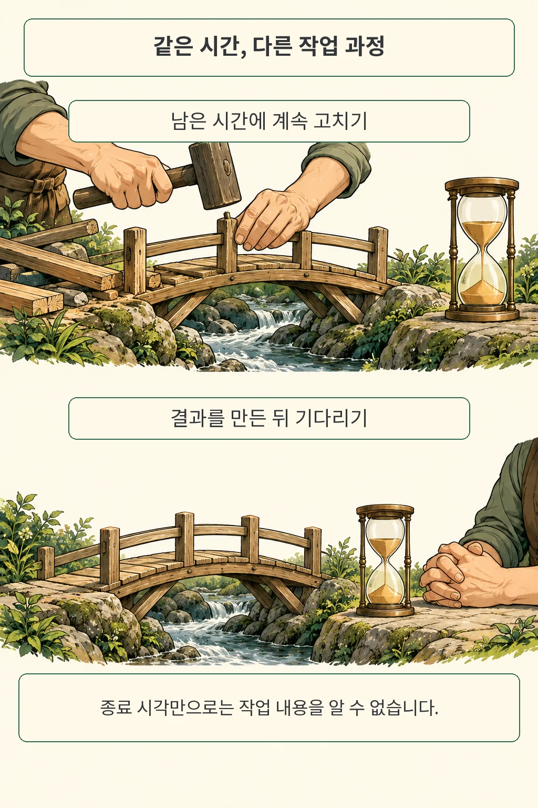
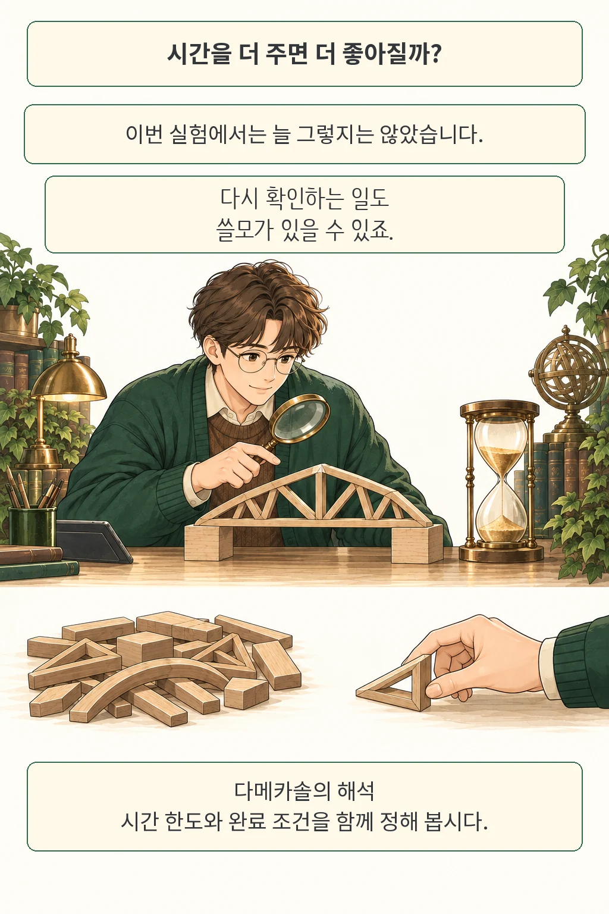

글·해설: 다메카솔

AI에게 시간을 더 주면 그만큼 더 꼼꼼히 검토하고 좋은 결과를 내놓으리라 기대하게 됩니다. 그런데 한 시간 뒤에 답이 도착했다는 사실만으로는 그 사이 에이전트가 실제로 무엇을 했는지 알기 어렵습니다. **AgentTime 연구진은 에이전트의 종료 시각, 작업 과정, 결과 점수를 각각 나누어 살펴보며 이 기대를 시험했습니다.** 에이전트에게 긴 작업을 맡기는 개발자라면 왜 시간 예산과 완료 조건을 함께 설계해야 하는지 잘 보여 주는 논문입니다.

## 핵심 내용

- **시간 준수율 측정**: 18개 벤치마크에서 고른 222개 과제에 짧은·중간·긴 작업 시간을 지시했을 때, 요청 시간의 95~105% 구간에 맞춰 종료한 비율은 Fable 5.1(Claude Code) 약 4%(27/659회), GPT-5.6 Sol(Codex) 약 39%(259/666회), GPT-6 Astra(Codex) 약 63%(419/666회)로 모델·에이전트 조합마다 크게 달랐습니다.
- **소요 시간과 작업 내용의 분리**: 종료 시각을 정확히 맞춘 실행 안에서도 해결책을 개선하거나 재검사하는 행동과, 이미 끝낸 뒤 명시적 대기 호출로 시간을 채우는 행동이 함께 관찰됐습니다.
- **시간 예산과 점수의 관계**: 같은 과제에서 가장 짧은 요청과 가장 긴 요청을 비교했을 때 점수가 그대로인 과제가 많았고, 더 긴 요청에서 점수가 오른 경우와 떨어진 경우가 함께 나타났습니다.

이번 글은 Michael Ofengenden과 Maksym Andriushchenko가 2026년 10월 7일 제출한 **AgentTime: Can Agents Estimate and Control Their Own Runtime?**(arXiv v1 프리프린트)을 다룹니다.

## AgentTime은 무엇을 재었을까

연구진은 에이전트의 시간 관련 능력을 시작 전에 걸릴 시간을 예측하는 일, 요청받은 시간만큼 작업하는 일, 끝난 뒤 경과 시간을 추정하는 일 세 갈래로 나누었습니다. 이 글에서는 그중 **요청한 시간에 맞춰 작업하는 능력**을 중심으로 살펴봅니다.

주 실험은 코딩, 컴퓨터 사용, 문서 작업과 연구 과제 등 18개 벤치마크에서 고른 222개 과제로 구성됐습니다. 각 과제에 짧은 시간, 중간 시간, 긴 시간을 요청하는 실행을 하나씩 배정하고, 기존 벤치마크의 시간 제한을 제거한 채 매번 새 세션과 최대 추론 설정으로 시작했습니다.

여기서 시간 요청은 강제 타임아웃 장치가 아니라 프롬프트로 전달한 사용자의 지시입니다. 에이전트가 일찍 끝내거나 늦게 돌아오는 행동을 그대로 관찰하되, 실험 관리상 해당 과제의 가장 긴 요청 시간의 두 배를 상한으로 두어 자발적 종료와 구분했습니다. 실제 경과 시간은 에이전트 바깥의 감독 프로세스가 측정하고 결과물은 각 벤치마크의 기존 채점기로 평가해, 백엔드에서 요청 처리 시간 계측과 응답 데이터 검증 테스트를 분리하듯 시간과 성과를 독립적으로 기록했습니다.

## 제시간에 돌아오는 비율은 얼마나 달랐을까

논문은 요청 시간의 **95~105% 구간**(예: 1시간 요청 시 57~63분) 안에 끝나면 시간을 준수한 것으로 집계했습니다. 원문 Table 3과 공개된 시간 데이터를 대조한 결과는 아래와 같습니다.

| 에이전트 구성 | 요청 시간 준수 비율 (95~105% 구간) | 시간 편차 배수 (1배에 가까울수록 일치) |
| --- | --- | --- |
| Fable 5.1 · Claude Code | 약 4% (공개 데이터 재집계 27/659회) | 2.86배 |
| GPT-5.6 Sol · Codex | 약 39% (공개 데이터 재집계 259/666회) | 1.77배 |
| GPT-6 Astra · Codex | 약 63% (공개 데이터 재집계 419/666회) | 1.18배 |

이 비율은 과제 정답률과는 별개의 시간 준수 지표입니다. Fable의 30초 이내 거절 7건은 표에서 제외됐고 오류나 관리상 상한 도달로 끝난 실행은 분모에 포함됐으며, 오른쪽의 편차 배수는 처리 속도 향상률이 아니라 벤치마크별 시간 비율의 절대 로그 평균을 다시 환산한 값입니다. 공개 JSON 파일에 들어 있던 기존 판정값 중에는 이전 허용 구간 기준이 섞여 있어, 이 글을 준비하며 공개된 실제 실행 시간과 요청 시간으로 95~105% 기준을 직접 다시 계산해 확인했습니다(에이전트 재실행은 수행하지 않았습니다).

## 시계가 맞아도 남는 질문

종료 시각을 정확히 맞추는 방법은 하나가 아닙니다. 남은 시간 동안 풀이를 고치거나 경계 조건·회귀 오류를 다시 검사할 수도 있고, 작업을 사실상 마친 뒤 명시적인 대기 명령을 호출해 시간을 보낼 수도 있습니다. 논문 역시 화면에 새 출력이 잠시 없는 추론 구간과 명시적인 대기 호출을 구분해 실행 기록을 살폈습니다.

다만 **원문 Figure 2b의 대기 행동 비율과 본문에 적힌 수치가 서로 일치하지 않고**, 저자 저장소에 세부 행동 분류 라벨이 공개돼 있지 않으며 전체 대화 기록도 별도 접근 승인이 필요한 데이터셋이라 이 글에서는 세부 대기 비율 수치를 그대로 인용하지 않았습니다. 또한 저자들은 대기 사례를 곧바로 기만이나 감시 회피로 단정하지 않고 후속 연구 질문으로 남겼으며, 여기서 핵심적으로 볼 지점은 **사용자가 맡긴 시간을 에이전트가 어떤 행동으로 채웠는가**입니다.

## 더 오래 요청하면 점수도 올라갔을까

같은 과제에서 가장 짧은 시간 요청과 가장 긴 시간 요청의 채점 결과를 비교했을 때, 시간을 더 주었다고 해서 점수가 일관되게 오르지는 않았습니다. 많은 과제에서 점수가 그대로였고, 긴 시간 요청에서 점수가 개선된 과제와 오히려 낮아진 과제가 함께 나타났습니다.

물론 이를 “시간을 더 줘도 소용없다”는 결론으로 일반화할 수는 없습니다. 과제·모델·시간 조합마다 1회씩 실행해 실행 간 변동이 섞여 있고, 통과 여부만 가리는 과제에서는 이미 맞힌 답을 더 꼼꼼히 검증해도 점수가 그대로이기 때문입니다. 아울러 두 연구소의 세 에이전트 구성과 단일 시간 지시 문구를 사용했고 8.3시간을 넘는 요청은 네 과제뿐이었으므로, 앞서 다룬 [AI 에이전트 평가의 구성 조건](/posts/agent-evaluation-system-configuration/)이나 실행 환경 대기를 다룬 [HEAR의 서버와 작업 계획 연결](/posts/hear-harness-engine-coordination/)처럼 모델 이름과 실행 조건을 함께 묶어 읽어야 합니다.

## 다메카솔의 해석: 완료 조건에 시간을 연결하기

장시간 에이전트 작업을 설계할 때는 시간 상한과 완료 조건, 그리고 남은 시간에 수행할 추가 검증의 기준을 분리해 적는 편이 좋습니다. “한 시간 안에 끝내 달라”는 요청은 일찍 정확히 마치는 편이 낫지만, “한 시간 동안 개선해 달라”는 요청은 남은 시간에 어떤 테스트나 보강을 더 수행할지 기준이 있어야 의미 있는 작업으로 이어지기 때문입니다.

운영 로그에서도 세션이 살아 있다는 신호나 단순 도구 호출 횟수만으로 진행률을 판단하기보다, 어떤 결과물 버전을 만들었고 어떤 검증 테스트를 통과했는지를 함께 남겨야 테스트 대기와 단순 시간 채우기를 구분할 수 있습니다. 다음에 에이전트에게 긴 작업을 맡길 때는 **시간 예산 옆에 완료 조건 한 줄을 함께 적어 두고**, 소요 시간과 검증 이력, 최종 품질을 나란히 확인해 보기를 권합니다.

## 출처

- Michael Ofengenden, Maksym Andriushchenko, [AgentTime: Can Agents Estimate and Control Their Own Runtime?](https://arxiv.org/abs/2610.09944v1), 2026년 10월 7일 제출.
- [원문 PDF](https://arxiv.org/pdf/2610.09944v1): 실험 구성 §3, 시간 준수와 작업 분석 §4.1·Table 3·Figure 2, 한계 §6, 결론 §7.
- [저자 공식 코드](https://github.com/michaelofengenden/agenttimebench/tree/08889a5c7783230268ebbda9758cbd751f84080a): 이번 글에서 확인한 고정 버전입니다.
- [공개 실행 데이터와 제공 범위](https://agenttimebench.com/data/), [대화 기록 데이터셋](https://huggingface.co/datasets/mofengenden/agenttime-transcripts).

발행·자료 확인일: 2026년 10월 8일.

이 글의 본문과 이미지는 생성형 AI로 제작했습니다. 기획과 편집 기준은 다메카솔이 정했습니다.
