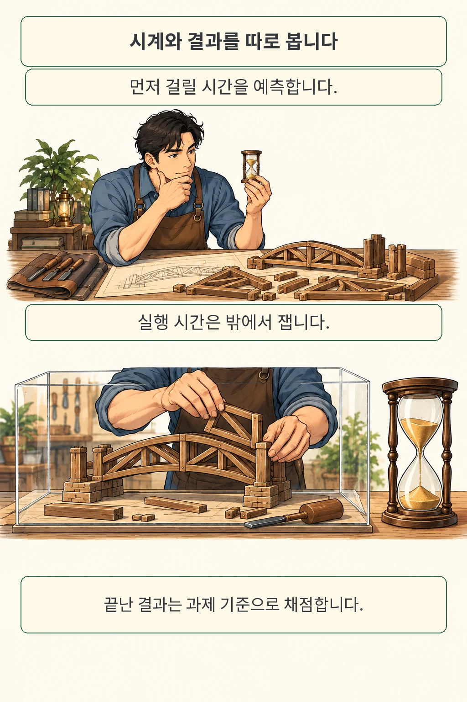
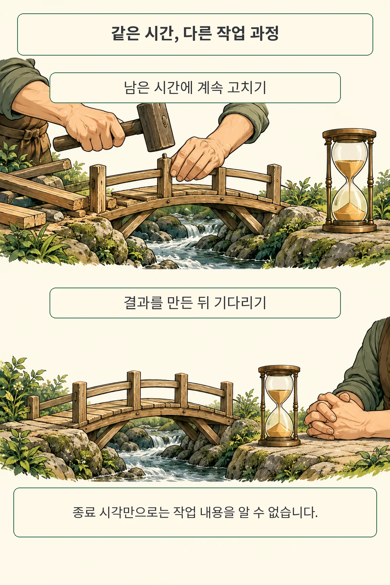

AI 에이전트에게 '한 시간 동안 꼼꼼히 작업해 달라'고 맡기면, 남은 시간만큼 테스트를 더 돌리고 완성도를 높일 거라 기대하기 쉽습니다. 하지만 약속한 시간에 맞춰 답이 돌아왔더라도 실제로 그 시간을 문제 해결에 썼는지, 아니면 일찌감치 끝낸 뒤 시간만 채웠는지는 종료 시각만으로 알기 어렵죠. **AgentTime 연구진은 에이전트의 시간 준수율과 작업 과정, 결과 점수를 따로 떼어 살펴보며 이 기대를 검증했습니다.**

글·해설: 다메카솔

## 핵심 내용

- **시간 준수율 격차**: 18개 벤치마크에서 고른 222개 과제에 작업 시간을 지시했을 때, 요청 시간의 95~105% 구간에 종료한 비율은 Fable 5.1(Claude Code) 약 4%(27/659회), GPT-5.6 Sol(Codex) 약 39%(259/666회), GPT-6 Astra(Codex) 약 63%(419/666회)로 크게 갈렸습니다.
- **소요 시간과 작업 내용의 분리**: 종료 시각을 맞춘 실행 안에서도 남은 시간에 풀이를 다듬고 재검사한 사례와, 작업을 마친 뒤 명시적인 대기 호출로 시간을 채운 사례가 함께 나타났습니다.
- **시간 예산과 점수의 관계**: 같은 과제의 최단·최장 요청을 비교한 결과 점수가 그대로인 과제가 많았고, 긴 요청에서 점수가 오른 경우와 떨어진 경우가 공존했습니다.

이 실험은 Michael Ofengenden과 Maksym Andriushchenko가 2026년 10월 7일 제출한 **AgentTime: Can Agents Estimate and Control Their Own Runtime?**(arXiv v1 프리프린트)에 담겨 있습니다.

## AgentTime은 무엇을 재었을까

연구진은 에이전트의 시간 감각을 시작 전 소요 시간 예측, 요청받은 시간만큼 작업하기, 종료 후 경과 시간 추정이라는 세 영역으로 나누었습니다. 이 글에서는 개발자가 긴 작업을 맡길 때 가장 먼저 마주치는 **요청 시간에 맞춰 작업하는 능력**을 중심으로 살핍니다.

주 실험은 코딩, 컴퓨터 사용, 문서·연구 등 18개 벤치마크에서 선별한 222개 과제로 꾸려졌습니다. 과제마다 짧은·중간·긴 세 가지 요청 시간을 하나씩 배정했고, 기존 시간 제한을 없앤 새 세션과 최대 추론 설정으로 실험을 시작했습니다.

프롬프트의 시간 요청은 프로세스를 강제로 끊는 타임아웃 장치가 아닙니다. 에이전트가 일찍 마치거나 늦게 돌아오는 행동을 그대로 관찰하기 위한 지시였거든요. 실험 관리상 최장 요청 시간의 두 배를 상한으로 두었고, 외부 감독 프로세스가 실제 경과 시간을 재는 동안 결과물은 각 벤치마크의 기존 채점기로 따로 평가해 계측과 채점을 분리했습니다.

## 제시간에 돌아오는 비율은 얼마나 달랐을까

논문은 요청 시간의 **95~105% 구간** 안에 작업이 끝나야 시간을 준수했다고 집계합니다. 가령 한 시간을 요청했을 때 57분에서 63분 사이에 돌아와야 합격선인 셈이죠. 원문 표와 공개된 실행 시간 데이터를 대조한 결과는 모델·에이전트 구성마다 뚜렷한 차이를 보입니다.

| 에이전트 구성 | 요청 시간 준수 비율 (95~105% 구간) | 시간 편차 배수 (1배에 가까울수록 일치) |
| --- | --- | --- |
| Fable 5.1 · Claude Code | 약 4% (공개 데이터 재집계 27/659회) | 2.86배 |
| GPT-5.6 Sol · Codex | 약 39% (공개 데이터 재집계 259/666회) | 1.77배 |
| GPT-6 Astra · Codex | 약 63% (공개 데이터 재집계 419/666회) | 1.18배 |

이 수치는 과제 정답률이 아니라 순수한 시간 준수 지표입니다. Fable의 30초 이내 거절 7건은 표에서 빠졌고, 오류나 관리상 상한 도달로 끝난 실행은 분모에 그대로 포함됐습니다.

오른쪽 편차 배수는 벤치마크별 평균 절대 로그 시간 비율을 18개 벤치마크 동일 가중치로 환산한 값으로, 처리 속도가 몇 배 빨라졌다는 의미와는 다릅니다. 공개 JSON 파일의 기존 판정값에는 이전 허용 구간 기준이 섞여 있어, 위 표는 공개된 실제 실행 시간과 요청 시간을 95~105% 기준으로 다시 대조해 확인했습니다.

## 시계가 맞아도 남는 질문

종료 시각을 정확히 맞췄더라도 내부 과정은 전혀 다를 수 있습니다. 남은 시간 동안 풀이를 다듬고 경계 조건이나 회귀 오류를 다시 검사하는 실행이 있는가 하면, 작업을 끝낸 뒤 명시적 대기 명령을 호출해 시간만 채우는 실행도 함께 나타났거든요. 출력 공백만으로 추론이 멈췄다고 단정하기 어렵기 때문에, 저자들은 화면 공백 구간과 명시적 대기 호출을 구분해 살폈습니다.

다만 원문에서 Figure 2b의 대기 비율과 본문 수치가 서로 일치하지 않아 세부 대기 비율 숫자는 인용하기 어렵습니다. 공식 저장소에 코드와 실행 데이터는 공개돼 있으나 행동 분류 라벨은 비공개이고, 전체 대화 기록 데이터셋도 별도 접근 승인이 필요해 외부에서 행동 비중을 똑같이 재검증하기에는 제약이 따릅니다.

한편 저자들은 대기 호출이나 조기 종료를 기만이나 감시 회피로 단정하지 않고, 안전성 함의는 후속 연구 과제로 남겨 두었죠. 결국 실무에서 확인할 핵심은 시계 일치 여부가 아니라 **맡긴 시간 동안 에이전트가 어떤 작업을 수행했는가**입니다.

## 더 오래 요청하면 점수도 올라갔을까

같은 과제에서 최단 시간 요청과 최장 시간 요청의 점수를 비교했을 때, 시간을 더 준다고 점수가 꾸준히 오르지는 않았습니다. 점수가 그대로인 과제가 많았고, 긴 요청에서 점수가 오른 사례와 오히려 내려간 사례가 함께 나타났습니다.

그렇다고 시간을 더 줘도 소용없다고 일반화하기는 이릅니다. 통과 여부만 가리는 과제에서는 이미 맞힌 답을 더 점검해도 점수가 오르지 않고, 조건당 1회씩만 실행해 실행 간 변동도 섞여 있기 때문이죠.

또 이 실험은 두 연구소의 세 에이전트와 단일 시간 지시 문구, 최대 추론 설정만 다루었고 8.3시간을 넘는 초장시간 요청도 네 과제뿐이었습니다. API 응답 속도와 제공 경로도 시간에 영향을 줄 수 있으므로, 앞서 다룬 [AI 에이전트 평가의 구성 조건](/posts/agent-evaluation-system-configuration/)이나 실행 환경 대기를 다룬 [HEAR의 서버와 작업 계획 연결](/posts/hear-harness-engine-coordination/)처럼 모델 이름과 실행 조건을 함께 묶어 읽어야 합니다.

## 다메카솔의 해석: 시간 예산과 완료 조건을 함께 적기

가령 실무에서 에이전트에게 '한 시간 동안 API 모듈 오류를 수정하고 테스트를 보완해 달라'고 맡겼다고 가정해 봅시다. 시간만 적어 두면 기본 테스트만 통과시킨 뒤 대기로 시간을 보내거나, 멀쩡한 코드까지 고치다 회귀 오류를 만들 수 있거든요. 긴 작업을 맡길 때는 아래 세 기준을 함께 정해 두는 편이 실용적입니다.

- **시간 상한과 추가 작업 분리**: 단순 마감 시간과 남은 시간에 기대하는 개선 범위를 구분해, 일찍 마칠 상황과 보강을 이어갈 기준을 명확히 둡니다.
- **완료 조건의 검증 기준 명시**: 어떤 단위·회귀 테스트를 통과해야 작업을 종료할 수 있는지 적어 두면 불필요한 반복 수정을 줄일 수 있습니다.
- **산출물 중심의 진행 로그**: 세션 생존 신호나 도구 호출 횟수 대신, 생성된 결과물 버전과 통과한 테스트 이력을 함께 남겨야 단순 대기와 실제 검증을 가려냅니다.

다음에 에이전트에게 긴 작업을 맡길 때는 **시간 예산 옆에 완료 조건 한 줄을 함께 적어 두고**, 소요 시간과 검증 이력, 최종 품질을 나란히 확인해 보기를 권합니다.

## 출처

- Michael Ofengenden, Maksym Andriushchenko, [AgentTime: Can Agents Estimate and Control Their Own Runtime?](https://arxiv.org/abs/2610.09944v1), 2026년 10월 7일 제출.
- [원문 PDF](https://arxiv.org/pdf/2610.09944v1): 실험 구성 §3, 시간 준수와 작업 분석 §4.1·Table 3·Figure 2, 한계 §6, 결론 §7.
- [저자 공식 코드](https://github.com/michaelofengenden/agenttimebench/tree/08889a5c7783230268ebbda9758cbd751f84080a): 저자 공식 저장소.
- [공개 실행 데이터와 제공 범위](https://agenttimebench.com/data/), [대화 기록 데이터셋](https://huggingface.co/datasets/mofengenden/agenttime-transcripts).

발행·자료 확인일: 2026년 10월 8일.

이 글은 논문 원문과 공개 실행 데이터를 바탕으로 정리했으며, 별도 에이전트 재실행은 수행하지 않았습니다.

이 글의 본문과 이미지는 생성형 AI로 제작했습니다. 기획과 편집 기준은 다메카솔이 정했습니다.
