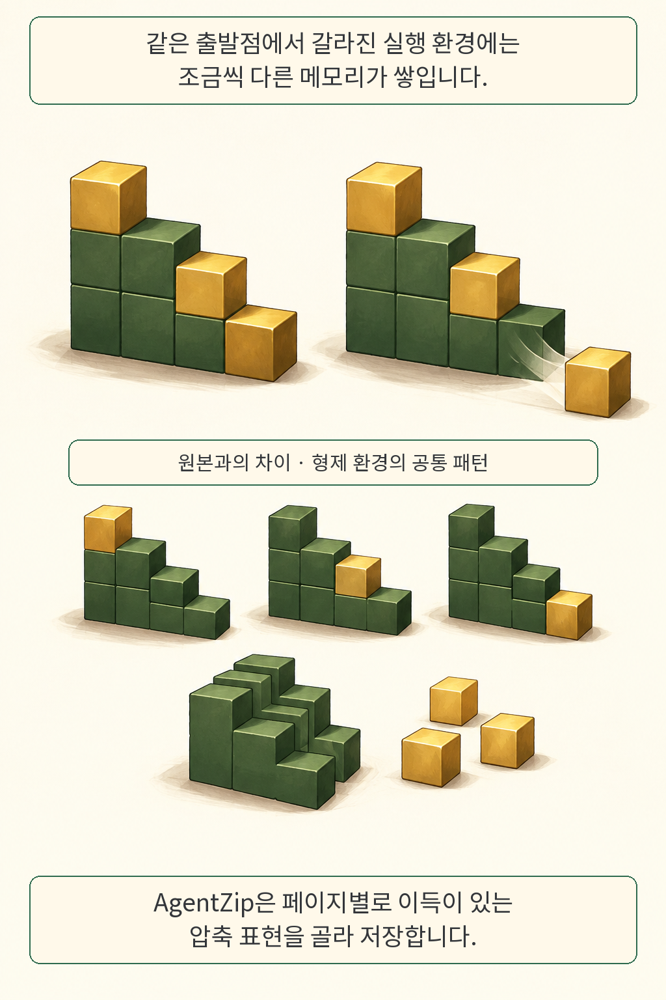
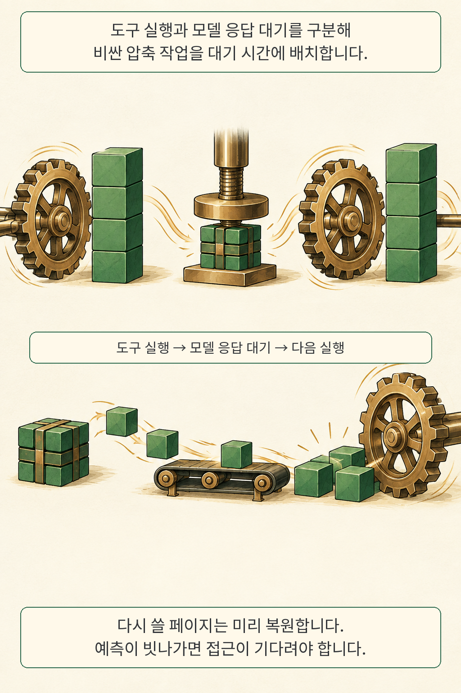

AI 코딩 에이전트 작업 하나를 처리하려고 샌드박스 열여섯 개를 동시에 띄우면, CPU는 모델 응답을 기다리며 노는데 서버 RAM부터 금세 바닥납니다. AgentZip 연구팀은 바로 이 유휴 시간과 실행 환경 사이의 메모리 유사성을 파고들어, **샌드박스 전용 메모리를 평균 88.55% 줄이면서 완료 시간 배율은 1.403배 수준으로 묶는 방법**을 제안했습니다. 무엇을 압축하고 어떤 지연 비용을 감수하는지 살펴볼까요?

글·해설: 다메카솔

## 핵심 내용

- **압축 대상**: 모델 문맥이나 KV 캐시가 아니라, 도구 실행용 샌드박스 OS의 물리 메모리(RAM)를 다룹니다.
- **유사성 활용**: 템플릿 차이, 형제 환경 공통 사전, 페이지 내 반복 바이트 압축을 페이지마다 고릅니다.
- **시간 배분**: 모델 응답 대기에 압축하고 다음 실행 전 미리 복원해 도구 충돌을 피합니다.
- **실험 성격**: 고정 기록 재생 기반의 저자 보고 결과이며, 모델 정답률은 평가 범위와 별개입니다.

## 조금 다른 복사본에서 공통 패턴 찾기

예를 들어 `pandas`나 `NumPy` 저장소의 버그 하나를 고치려고 에이전트 샌드박스 열여섯 개를 동시에 띄우는 상황을 떠올려 봅시다. 처음에는 copy-on-write(CoW)로 베이스 스냅샷을 공유하지만, 각 에이전트가 코드를 고치고 테스트를 돌리면 페이지가 달라지며 전용 RAM이 불어나거든요.

커널의 KSM은 바이트까지 완전히 같은 페이지만 합치고, `zswap`은 단일 페이지 안의 반복만 압축해 템플릿이나 형제 환경의 유사성을 살리기 어렵습니다. AgentZip은 세 기법을 조합해 4KiB 페이지마다 메타데이터를 포함한 크기가 가장 작은 표현을 고릅니다([논문 2~4절](https://arxiv.org/html/2609.11294v1#S4)).

- **템플릿 델타**: 불변 템플릿의 같은 주소 페이지와 비교해 달라진 블록과 비트맵만 남깁니다.
- **코호트 사전**: 같은 과제에서 파생된 형제 집단으로 Zstd 공통 사전을 학습해 비슷한 상태를 묶습니다.
- **RLE 압축**: 0이 길게 이어진 페이지처럼 내부 반복 바이트를 가볍게 줄입니다.

RLE와 템플릿 델타를 먼저 적용하면 사전 압축만 단독으로 쓸 때와 비슷한 절감률을 유지하면서도 사전 압축 대상 페이지를 약 60% 덜어낼 수 있죠.

## 도구 실행과 모델 대기를 나눈 압축 타이밍

메모리 부족 때 뒤늦게 도는 `zswap`은 짧은 세션의 평균 RAM을 줄이기 어렵고, 도구 실행 중 압축을 돌리면 테스트나 컴파일과 CPU를 다툽니다. AgentZip은 도구 실행 중에는 정찰 스레드(scout)로 후보만 점수화하고, 실제 압축과 페이지 회수는 모델 응답 대기에 배치하며 새 도구가 호출되면 즉시 멈춥니다([논문 스케줄링·프리페치 절](https://arxiv.org/html/2609.11294v1#S4.SS3)).

덕분에 곧 다시 쓸 '따뜻한 페이지'까지 압축할 수 있는데요. 접근 시 `userfaultfd`(UFFD) 복원 지연을 줄이려고 순차·전이·도구 호출 빈도 기반 예측기로 다음 페이지를 미리 비동기 복원합니다. 예측에 없는 페이지만 요청 시점 복원을 거치는데, 비동기 프리페치는 p99 기준 8.09ms에 끝나는 반면 실행 도중 가로채는 요청 시점 복원은 223.27ms까지 늘어나 작업 흐름을 끊어 놓거든요.

## 같은 실행을 재생해 얻은 결과와 측정 범위

저자들은 동일한 도구 실행 기록을 여러 압축 설정에 반복 재생하며 메모리와 시간 비용을 함께 쟀습니다.

- **구현·서버**: Zeroboot(Firecracker CoW 스냅샷) 기반, Xeon Platinum 8480C · Linux 5.15.0
- **워크로드**: R2E-Gym 파이썬 저장소 10곳(`aiohttp`, `NumPy`, `pandas` 등)의 도구 순서와 모델 대기 시간(`think_time_ms_before`) 동일 재생
- **시나리오**: 강화학습용 **Rollout**(과제당 16궤적)과 추론 후보 선별용 **GAF**(역할 프롬프트가 다른 4궤적) 동시 실행

비교 기준은 압축을 끈 경우이며, 메모리는 서버 전체 RAM이나 GPU 메모리가 아니라 샌드박스 전용 물리 페이지와 메타데이터 포함 압축 저장소 합계의 시간평균입니다. 완료 시간 역시 재생 시작부터 마지막 샌드박스 종료(모델 대기 포함)까지를 쟀습니다([원문 5~6절](https://arxiv.org/pdf/2609.11294v1)).

| 실행 방식 | 설정 | 평균 메모리 절감률 | 완료 시간 배율 |
| --- | --- | ---: | ---: |
| Rollout (16궤적) | zswap | 48.66% | 1.436배 |
| Rollout (16궤적) | KSM + zswap | 51.24% | 1.517배 |
| Rollout (16궤적) | AgentZip | 88.55% | 1.403배 |
| GAF (4궤적) | zswap | 4.86% | 1.118배 |
| GAF (4궤적) | KSM + zswap | 21.25% | 1.159배 |
| GAF (4궤적) | AgentZip | 64.29% | 1.468배 |

Rollout에서는 AgentZip이 메모리 절감 폭(88.55%)이 가장 크면서 완료 시간 배율(1.403배)도 기존 조합보다 낮았습니다. 반면 경로가 흩어지는 GAF에서는 메모리를 64.29% 줄이는 대신 전체 완료 시간이 기준 대비 1.468배 수준까지 늘어나며 지연 비용이 커졌죠.

한편 Rollout에서 압축 뒤 남은 평균 메모리 비율(11.45%)의 역수를 계산하면 초록의 '최대 8.7배' 절감이 어떻게 나왔는지 알 수 있습니다. 서버 전체 RAM이나 클라우드 요금이 그만큼 줄어든다기보다, 샌드박스 전용 메모리 풀 안의 밀도 개선으로 읽어야 정확합니다.

## 다메카솔의 해석: 밀도와 지연을 함께 볼 이유

운영 환경에서 동시 실행 수를 정할 때는 워크로드 성격에 따라 기준을 둘로 나눠야 합니다. 강화학습 롤아웃이나 배치 평가처럼 서버에 샌드박스를 최대한 많이 채워야 한다면 1.4배 수준의 지연보다 메모리 밀도 상승이 큰 이점으로 작용하거든요. 반면 사용자가 기다리는 대화형 서비스는 요청 시점 복원의 꼬리 지연이 체감 반응성을 깎아먹을 수 있습니다.

도입 전에는 운영 트래픽과 닮은 기록을 재생하며 모델 대기 시간 분포와 p95·p99 꼬리 복원 지연을 함께 재보는 편이 안전합니다. 모델이 빨라지거나 작업이 다양해지면 압축할 유휴 시간과 공통 패턴도 달라지기 때문입니다. 논문도 E2B 게이트웨이에서 테넌트별 네임스페이스 분리를 적용하지만 보안 격리 인증까지 다룬 연구는 아니므로, 공통 사전의 수명·접근 경계와 복원 실패 처리는 서비스 보안 기준에 맞춰 따로 점검해야 합니다.

에이전트 실행 조건을 자원별로 나눠 읽는 이 시선은 [JarvisGUI의 기기 간 상태 전달 실험](/posts/jarvisgui-cross-device-state/)과도 이어집니다. 앞선 글이 작업 성공 조건을 살폈다면 이번 논문은 실행 환경의 RAM과 지연 비용을 짚어 주는 셈이죠. **동시 실행 수를 늘리기 전에 우리 작업에서 아낄 RAM과 감수할 기다림을 같은 기록 위에서 함께 재보는 것**이 가장 현실적인 출발점입니다.

## 출처

- Mengming Li, Ceyu Xu 외, [Memory Compression for High-Fanout Agent Sandboxes, arXiv:2609.11294v1](https://arxiv.org/abs/2609.11294v1), 2026-09-10 09:25:43 UTC 제출. 프리프린트.
- [원문 PDF](https://arxiv.org/pdf/2609.11294v1) · [원문 HTML](https://arxiv.org/html/2609.11294v1). 방법 3~4절, 측정 5절, 결과 6절.

확인·작성일: 2026-09-13. 이 글은 논문 원문을 해설하며 공식 구현과 실행 기록을 별도 확보해 실험을 독립 재현하지 않았고, 만화 그림은 설명을 위해 새로 구성했습니다.

이 글의 본문과 이미지는 생성형 AI로 제작했습니다. 기획과 편집 기준은 다메카솔이 정했습니다.
