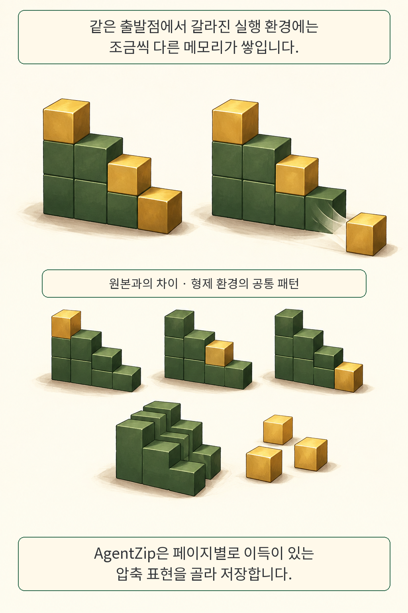
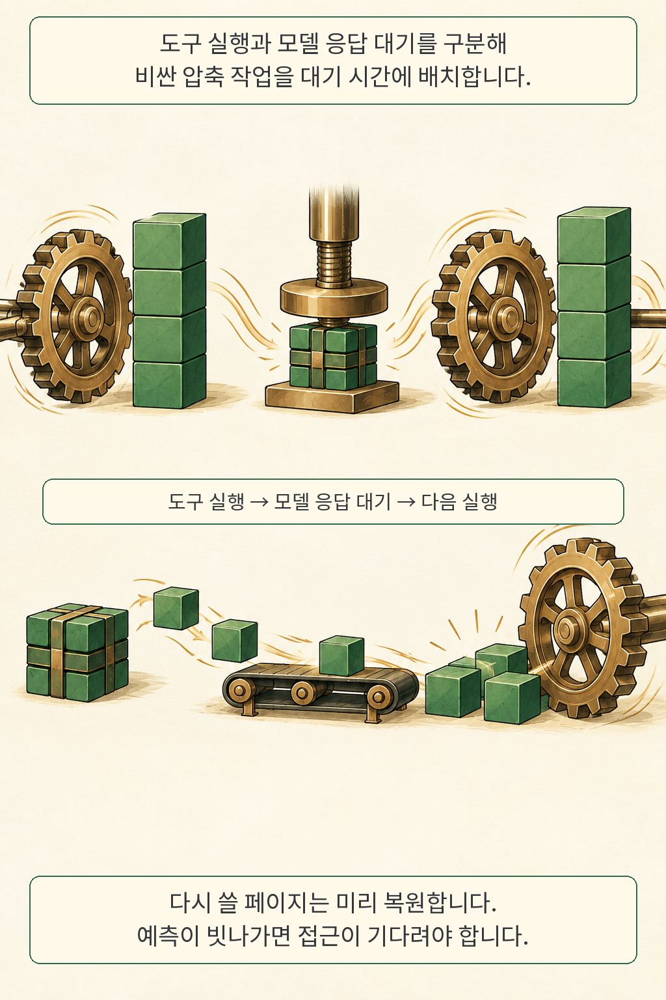

**88.55%의 메모리 절감에도 완료 시간은 늘었습니다.** 비어 있는 공간을 얻는 대신 다음 작업의 기다림을 감수한 셈인데요. AgentZip 연구팀은 여러 AI 실행 환경이 품은 비슷한 메모리를 압축하면서 모델 응답을 기다리는 유휴 시간을 활용했습니다. 무엇을 줄였고 어떤 시간을 더 썼는지 함께 짚어 보겠습니다.

글·해설: 다메카솔

## 핵심 내용

- **대상 자원**: 모델의 답변 요약이 아니라, AI 도구가 실행되는 샌드박스의 RAM(메모리 페이지)을 다룹니다.
- **압축 원리**: 원본 템플릿과의 차이, 형제 실행 환경의 공통 사전, 페이지 안의 반복 바이트 압축을 조합합니다.
- **시간 배분**: 모델 응답을 기다리는 동안 비싼 압축을 수행하고, 다음에 다시 쓸 페이지는 미리 복원합니다.
- **검증 범위**: 아래 수치는 고정된 실행 기록을 특정 서버에서 재생한 저자 보고 결과입니다.

## 조금 다른 복사본에 남는 공통 부분

같은 저장소를 여러 에이전트에게 나눠 맡기면 실행 환경도 여러 개가 필요합니다. 출발점이 같기 때문에 실행 도중 바뀐 메모리 페이지에는 원본의 흔적이 남고, 서로 다른 실행 환경 사이에서도 비슷한 바이트 패턴이 반복해서 나타납니다.

AgentZip은 템플릿 대비 차이, 같은 실행 집단의 공통 사전, 반복 바이트 압축을 조합해 페이지마다 가장 저장 이득이 큰 표현을 고릅니다([논문 2~4절](https://arxiv.org/html/2609.11294v1#S4)). 완전히 동일한 페이지만 공유하는 KSM이나 단일 페이지 안의 반복만 활용하는 일반 zswap 압축보다 더 넓은 유사성을 활용하려는 설계입니다(만화의 블록과 유리 돔은 각각 메모리 일부와 실행 환경을 뜻하는 설명용 비유이며, 블록 개수나 크기가 실제 바이트 수나 성능 비율을 나타내지는 않습니다).

## 압축할 시간과 다시 꺼낼 시간

압축한 페이지를 프로그램이 다시 찾으면 복원 과정이 필요하고 여기서 지연이 생깁니다. 이를 줄이기 위해 AgentZip은 도구 실행 중에는 가벼운 후보 탐색만 수행하고, 비용이 큰 압축 작업은 모델 응답을 기다리는 시간에 배치합니다([논문 4.3~4.4절](https://arxiv.org/html/2609.11294v1#S4.SS3)). 또한 다음에 쓸 페이지는 미리 복원해 두되, 예상하지 못한 접근이 발생하면 요청 시점에 복원을 수행합니다. 그림의 압축기·톱니·컨베이어는 이러한 메모리 페이지 압축과 복원 순서를 보여 주기 위한 비유입니다.

## 같은 실행을 재생했을 때의 결과

저자들은 R2E-Gym의 Python 저장소 10개에서 얻은 실행 기록을 바탕으로 비교 실험을 진행했습니다. Rollout은 과제당 16개, GAF는 4개 후보 궤적을 동시에 재생하며, 도구 실행 순서와 그 앞의 모델 대기 시간은 모든 비교 설정에서 동일합니다(구현 기반은 Zeroboot, 실험 환경은 Xeon Platinum 8480C와 Linux 5.15.0).

| 실행 방식 | 설정 | 평균 메모리 절감률 | 완료 시간 배율 |
| --- | --- | ---: | ---: |
| Rollout | zswap | 48.66% | 1.436배 |
| Rollout | KSM + zswap | 51.24% | 1.517배 |
| Rollout | AgentZip | 88.55% | 1.403배 |
| GAF | zswap | 4.86% | 1.118배 |
| GAF | KSM + zswap | 21.25% | 1.159배 |
| GAF | AgentZip | 64.29% | 1.468배 |

비교 기준은 각 실행 기록에서 **압축을 끈 경우**입니다. 메모리는 전용 물리 페이지와 메타데이터를 포함한 압축 저장소의 시간평균으로 계산했고, 완료 시간은 재생 시작부터 마지막 샌드박스 종료까지(기록된 모델 대기 포함)를 쟀습니다([원문 8쪽, 5~6.1절 및 그림 5·6](https://arxiv.org/pdf/2609.11294v1)).

표에서 보듯 Rollout에서는 비교한 압축 설정 가운데 AgentZip의 메모리 절감 폭(88.55%)이 가장 컸고 지연(1.403배)도 가장 작았습니다. 반면 GAF에서는 메모리를 64.29% 줄이는 대신 다른 압축 설정보다 완료 시간이 더 길어졌습니다. 초록에 언급된 '최대 8.7배'는 Rollout에서 남은 평균 메모리(11.45%)의 역수에 해당하므로, 이를 서버 전체 RAM이나 GPU 메모리, 혹은 클라우드 요금의 감소 배율로 그대로 옮겨 읽기에는 측정 범위가 다릅니다.

## 원문과 확인 범위

2026년 9월 13일 기준으로 12쪽 분량의 원문 PDF와 HTML, 제출 이력을 확인했습니다. 이번 검토 시점에는 공식 구현 코드와 실행 기록이 공개되지 않아 확보하지 못했으므로, 모델 평가나 성능 실험을 독립 재현한 결과가 아니라 특정 서버와 고정 기록 재생에서 얻은 저자 보고치로 읽어야 합니다. 아울러 모델의 최종 정답률 개선 여부는 이 메모리 실험의 검증 대상 밖입니다.

## 다메카솔의 해석: 밀도와 지연을 함께 볼 이유

이 연구를 실제 운영 관점에서 읽는다면 동시 실행 수를 정하는 지표부터 둘로 나눠야 합니다. 메모리가 먼저 차오르는 배치 서버에서는 압축 덕분에 더 많은 작업을 한꺼번에 수용할 여지가 생깁니다. 하지만 사용자가 화면 앞에서 기다리는 대화형 서비스라면 다음 도구 호출이 멈추는 지연 시간이 훨씬 민감할 수 있어, 용량(밀도)과 응답성의 목표가 갈리게 됩니다.

정책을 도입하기 전에 평가용 실행 기록을 따로 마련해 두는 것도 좋은 방법입니다. 같은 도구 호출 기록을 반복 재생하면 압축 정책을 바꿨을 때의 영향을 나란히 비교하기 쉽기 때문입니다. 여기에 더해 실제 서비스의 대기 시간 분포와 유난히 오래 걸리는 꼬리 복원 요청(tail latency)도 함께 살펴야 합니다. 모델 응답이 빨라지거나 작업 내용이 다양해지면 압축할 시간 여유와 환경 간 공통 패턴도 달라질 수밖에 없습니다.

마지막으로 공유 경계 역시 꼼꼼히 따져 봐야 할 대상입니다. 같은 베이스 템플릿을 쓴다는 이유만으로 서로 다른 고객의 작업을 같은 압축 집단으로 묶어도 된다는 결론은 이 논문에서 나오지 않으며, 보안 격리가 인증된 것도 아닙니다. 공통 사전의 수명과 접근 범위, 복원 실패 시의 예외 처리까지 각 서비스의 격리 요구사항에 맞춰 설계해야 합니다.

에이전트의 실행 조건을 분리해서 읽는 이러한 관점은 [JarvisGUI의 기기 간 상태 전달 실험](/posts/jarvisgui-cross-device-state/)과도 이어집니다. 앞선 글이 기기를 넘나드는 작업 성공 조건을 다뤘다면, 이번 글은 그 작업을 담는 실행 환경의 자원 비용을 짚어 줍니다. **동시 실행 수를 늘리기 전에, 우리 작업에서 줄일 RAM과 늘어날 기다림을 같은 실행 기록 위에서 함께 재보는 것**이 가장 현실적인 첫걸음입니다.

## 출처

- Mengming Li, Ceyu Xu 외, [Memory Compression for High-Fanout Agent Sandboxes, arXiv:2609.11294v1](https://arxiv.org/abs/2609.11294v1), 2026-09-10 09:25:43 UTC 제출. 프리프린트.
- [원문 PDF](https://arxiv.org/pdf/2609.11294v1) · [원문 HTML](https://arxiv.org/html/2609.11294v1). 방법 3~4절, 측정 5절, 결과 6절.

확인·작성일: 2026-09-13. 만화의 블록·기계·유리 돔은 의미를 설명하기 위한 재작화이며 원문 그림을 복제하지 않았습니다.

이 글의 본문과 이미지는 생성형 AI로 제작했습니다. 기획과 편집 기준은 다메카솔이 정했습니다.
