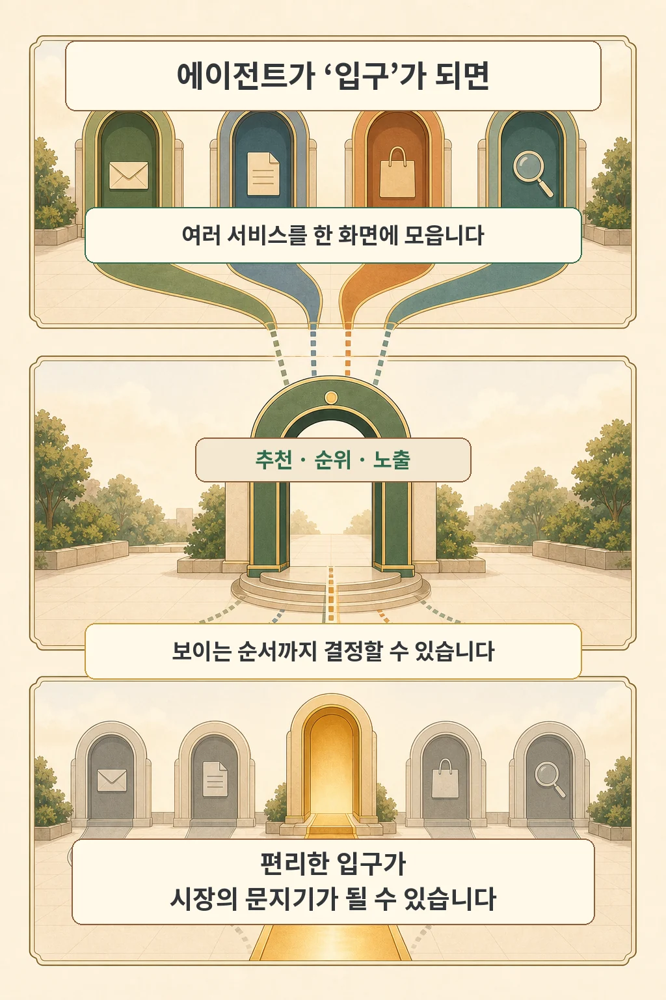
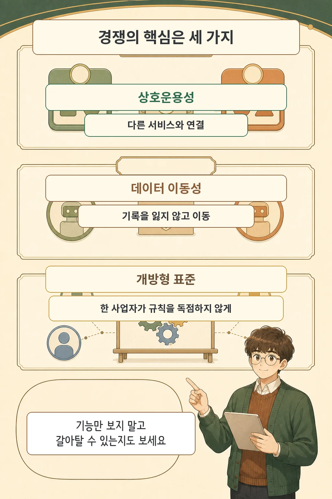

에이전트가 메일을 보내고 상품까지 대신 고르기 시작하면서 제품 경쟁의 초점이 모델 점수 밖으로 넓어지고 있습니다. 사용자가 어느 에이전트를 첫 ‘입구’로 만나는지, 그리고 원할 때 다른 서비스로 갈아탈 수 있는지가 시장 판도를 가르게 됐거든요. 프랑스 경쟁당국이 **2026년 7월 17일** 공개한 AI 에이전트 시장 의견서는 바로 이 병목이 사용자 접점과 데이터 이동성, 상호운용성, 표준 거버넌스로 옮겨가고 있다고 짚었습니다.

글·해설: 다메카솔

## 에이전트가 서비스의 새 ‘입구’가 될 때

프랑스 경쟁당국은 의견서 **26-A-05**에서 AI 에이전트를 여러 디지털 서비스로 통하는 새로운 관문(플랫폼)으로 봅니다. 사용자는 하나의 대화 화면에서 검색과 문서 작성은 물론 외부 서비스 실행까지 한 번에 처리할 수 있습니다. 여러 단계를 줄여 주는 편리함이 에이전트의 핵심 경쟁력인 셈이죠.

하지만 모든 경로가 한 입구에 모이면 그 화면이 추천·순위·노출 조건을 쥐는 ‘문지기’가 될 수 있습니다. 예를 들어 사용자가 항공권이나 쇼핑 상품을 에이전트에 맡기는 상황을 떠올려 볼까요? 이전처럼 여러 사이트를 둘러보는 대신 에이전트가 추려 준 한두 개 후보만 보고 결정하게 되는데, 노출 기준이 불투명하거나 계열사 서비스를 앞세우면 다른 사업자는 사용자 앞에 설 기회조차 줄어듭니다.

운영체제나 브라우저, 협업 도구에 기본 탑재된 에이전트는 사용자 도달 비용에서도 유리한 위치를 점합니다. 당국은 이런 플랫폼화가 중개자 배제, 차별과 자기우대, 노출 조건 통제, 묶음 제공과 기술적 잠금(록인) 위험으로 이어질 수 있다고 분석했습니다. 이는 모든 에이전트가 경쟁을 해친다고 단정하기보다, 에이전트가 플랫폼으로 커질 때 생기는 구조적 위험을 미리 가려낸 진단입니다.

## 진입은 쉬워졌지만 규모 확장은 어렵습니다

개발 진입 문턱만 보면 AI 에이전트를 만들기는 대형 모델을 직접 훈련하는 것보다 한결 수월합니다. 상용 모델 API나 공개 가중치 모델을 조합해 제품을 빠르게 꾸릴 수 있기 때문이죠.

막상 제품을 시장에서 키우려면 넘어야 할 벽이 꽤 높습니다. 안정적인 사용자 접근과 품질 좋은 데이터, 기존 서비스와의 상호운용성, 기술 이전 여건, 그리고 호출량이 늘수록 불어나는 추론 비용까지 함께 감당해야 하거든요. 당국이 업계·기관 의견을 듣고 공개 의견수렴에서 약 40건의 기여를 받아 정리한 진단 역시 초기 개발이 아니라 확장 단계의 제약에 초점이 맞춰져 있습니다.

시장 집중도 역시 소수 사업자 쪽으로 크게 쏠려 있습니다. 의견서는 **OpenAI·Google·Anthropic**이 **2026년 5월 기준 세계 AI 에이전트 부문의 84% 이상**을 차지했다고 기술했는데, 이 수치는 특정 시점과 세계 시장 범위에 대한 당국의 판단으로 참고하는 편이 정확합니다.

## 경쟁을 지키는 세 가지 설계 축과 규율 방향

규율 방식에서 당국은 새 법을 서두르기보다 기존 경쟁법과 유럽연합의 **AI Act, 디지털시장법(DMA)**을 충실히 집행하라고 권고했습니다. 보완 규칙이 필요할 때도 우선 지침이나 이해관계자 협의 같은 유연한 수단을 검토하고, 제도 변화는 유럽연합 차원에서 추진하자는 입장입니다.

서비스 구조와 생태계 측면에서는 세 가지 축이 핵심으로 제시됩니다. 한 사업자가 연결 규칙을 사실상 독점하면 후발 제품은 기술보다 접속 조건에서 밀릴 수밖에 없기 때문입니다.

| 핵심 축 | 해결하려는 병목 | 제품·운영 기준 |
| --- | --- | --- |
| **상호운용성** | 제3자 에이전트의 연결 차단 | 공개 문서화된 인터페이스로 외부 서비스 연동 보장 |
| **데이터 이동성** | 사용 기록·설정의 서비스 종속 | 대화·작업 이력과 설정의 손실 없는 내보내기·가져오기 |
| **개방형 표준** | 단일 업체의 상거래 규칙 독점 | 보안·신뢰성 범위에서 투명하고 협력적인 표준 채택 |

## 다메카솔의 해석: 성능표에 ‘갈아탈 수 있는가’를 추가하자

에이전트 제품을 고를 때는 보통 모델 성능과 가격, 지원 도구 수부터 비교합니다. 여기에 ‘사용자와 연동 서비스가 큰 마찰 없이 갈아탈 수 있는가’까지 제품 요구사항에 올려 두면 도입 뒤 종속 위험을 훨씬 줄일 수 있습니다.

- **연동 개방성**: 인증과 도구 연결 인터페이스가 공개 문서로 제공되는가
- **데이터 이동 경로**: 사용자 기록과 설정을 표준 형식으로 내보내고 복원할 수 있는가
- **추천·노출 투명성**: 추천 순서와 노출 기준, 상업적 제휴 관계를 설명할 수 있는가
- **표준 거버넌스**: 핵심 연결 표준을 한 업체가 일방적으로 바꿀 수 있는가

당국도 이번 의견서가 미래의 경쟁법 판단이나 집행을 미리 정하는 결정은 아니며, 식별한 위험을 계속 모니터링하겠다고 밝혔습니다. 에이전트가 실행까지 대신하는 시대에는 ‘무엇을 잘 수행하는가’와 함께 **‘다른 선택지로 옮겨 갈 수 있는가’**를 초기 구조부터 챙기는 편이 안전합니다.

## 함께 읽을 AI 기술 글

- [스킬을 더했는데 왜 더 못해질까, Regression Tax가 측정한 것](/posts/llm-agent-skill-regression-tax/)
- [AI 에이전트의 숨은 저장 발자국, AgentFootprint가 측정한 것](/posts/agentfootprint-storage-benchmark/)

## 출처

- [프랑스 경쟁당국 영문 보도자료 — AI agents: the Autorité de la concurrence issues its opinion on the competitive functioning of the AI agents sector](https://www.autoritedelaconcurrence.fr/en/press-release/ai-agents-autorite-de-la-concurrence-issues-its-opinion-competitive-functioning-ai)
- [프랑스 경쟁당국 의견서 26-A-05 공식 페이지](https://www.autoritedelaconcurrence.fr/fr/avis/relatif-au-fonctionnement-concurrentiel-du-secteur-des-agents-dintelligence-artificielle)
- [프랑스 경쟁당국 의견서 발표자료 PDF](https://www.autoritedelaconcurrence.fr/sites/default/files/2026-07/Avis_26-A-05_ADLC_conference_compressed.pdf)

이 글은 2026년 7월 17일 공개된 프랑스 경쟁당국 공식 보도자료·의견서·발표자료를 바탕으로 정리했으며, 별도의 독립 시장 조사나 원문 도표 복제는 포함하지 않았습니다.
이 글의 본문과 이미지는 생성형 AI로 제작했습니다. 기획과 편집 기준은 다메카솔이 정했습니다.
