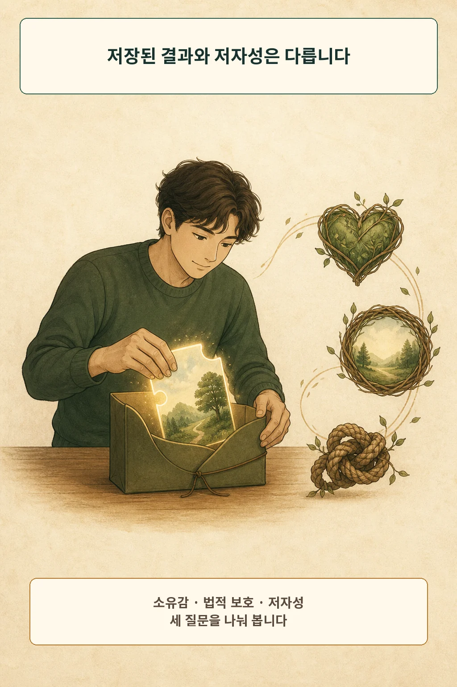
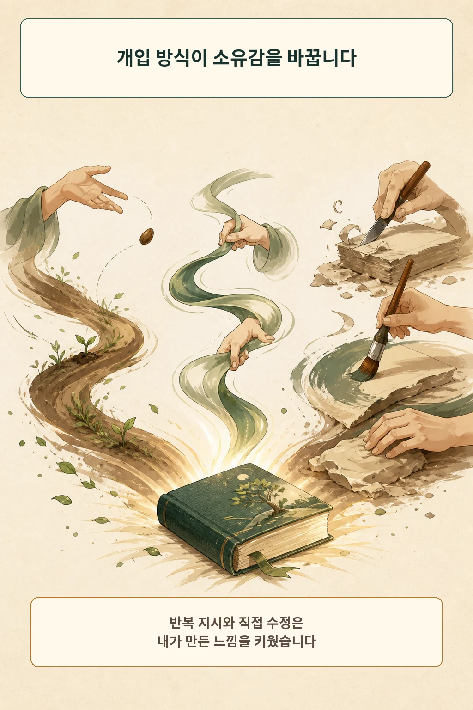
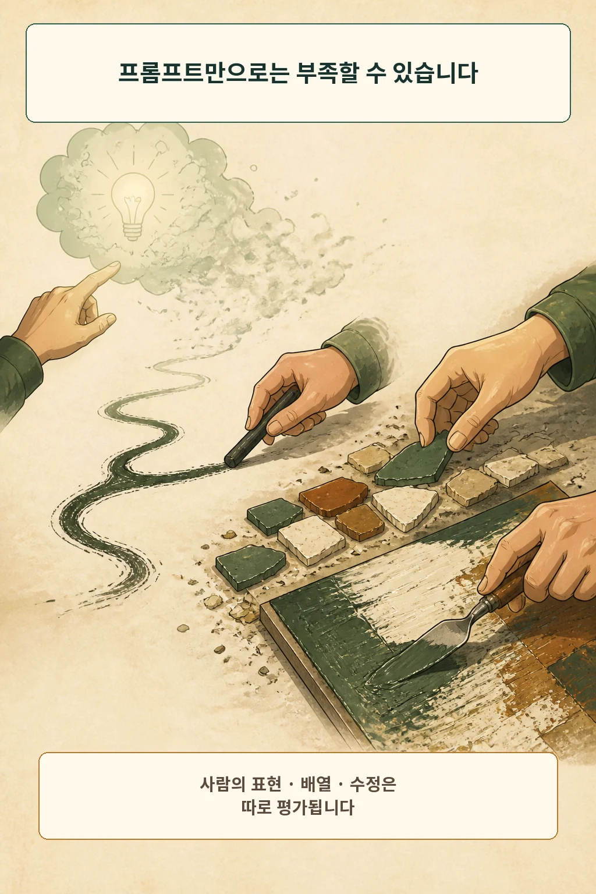
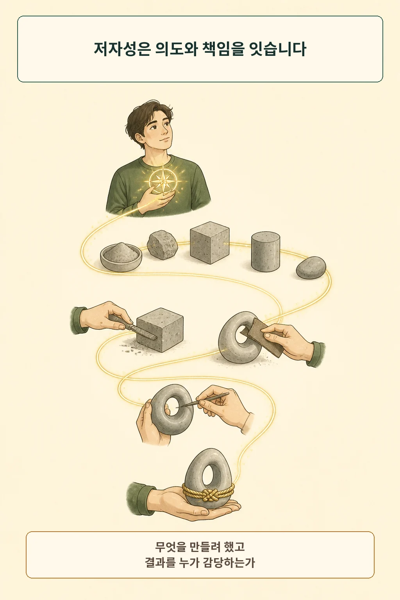
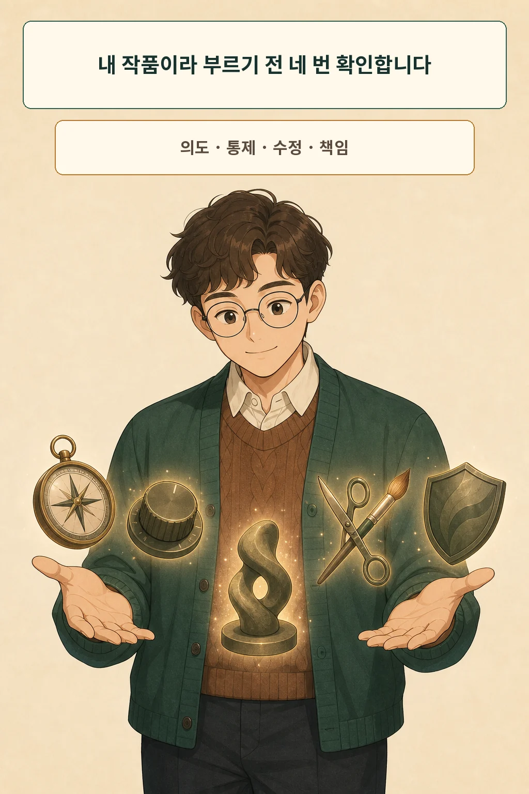

늦은 밤 AI와 대화를 주고받으며 발표 자료나 짧은 글의 초안을 완성하고 저장 버튼을 누른 적 있으신가요? 문장을 다듬고 마음에 드는 표현을 추려 넣다 보면 '내가 만들었다'는 느낌이 들다가도, 막상 내 이름을 달아 세상에 내놓으려니 문득 망설여지곤 합니다. AI를 썼다고 내 기여가 사라지는 것은 아니지만, 파일을 저장했다는 사실만으로 온전한 저자가 되기도 어렵다는 점은 분명하거든요.

글·해설: 다메카솔

## 저장하면 내 것이 될까

AI가 건넨 문장을 다듬어 회의 자료에 넣거나 생성 이미지를 선택해 올리면 자연스럽게 애착이 생깁니다. 시간과 취향, 판단을 쏟은 만큼 내 것 같다는 느낌이 드는 일 자체는 당연합니다.

가령 동네 모임 포스터를 만들 때 AI 시안 열 장 중 한 장을 골라 제목 글꼴만 바꾼 경우와, 구도와 문구를 여러 번 다시 짜서 끝까지 손본 경우는 사뭇 다릅니다. 두 사람 모두 결과물에 애착을 느낄 수 있지만, 바깥에 설명할 수 있는 기여의 무게는 서로 다르거든요.

혼동을 줄이려면 엉켜 있는 세 가지 질문을 먼저 나누어 보는 편이 좋습니다.

- **소유감**: 결과물이 내 것처럼 느껴지는 심리적 경험입니다.
- **법적 보호**: 특정 관할의 규칙이 어떤 인간 기여를 보호 대상으로 보는지 묻는 기준입니다.
- **저자성**: 누가 작품의 방향을 세웠고 그 결과를 자기 이름으로 감당하는지 묻는 관계입니다.

이 세 질문은 서로 겹쳐 보이지만, 실제로는 저마다 다른 자리에서 다른 답을 내어 줍니다.

## 개입 방식은 소유감을 바꿉니다

그렇다면 사람이 과정에 어떻게 개입해야 '내 작품 같다'는 마음이 커질까요? 2026년 Pennanen 연구팀은 온라인 참가자 273명이 짧은 이야기를 쓰는 사전등록 실험을 통해, 완전 수동 작성과 여러 AI 보조 작성 조건을 비교했습니다([How prompting and editing shape psychological ownership](https://doi.org/10.1016/j.chbah.2026.100381)). 사전등록 실험이란 데이터를 보기 전에 분석 계획을 미리 공개해 두는 방식이라, 연구자가 유리한 결과만 골라 해석할 여지를 줄여 줍니다.

연구팀은 단일 프롬프트와 반복 프롬프팅, 그리고 생성 후 직접 수정 가능 여부를 조합해 소유감의 변화를 살폈습니다. 참여자들의 개입 방식에 따라 소유감이 어떻게 달라졌는지 핵심 결과를 표로 묶어 보았습니다.

| 작성 방식 | 사람의 개입 특징 | 실험에서 나타난 소유감 흐름 |
| --- | --- | --- |
| **완전 수동 작성** | 처음부터 끝까지 AI 없이 직접 집필 | 모든 AI 보조 조건보다 높음 (노력·품질 인식·내적 동기 보정 후에도 유지) |
| **생성 후 직접 수정** | 나온 초안의 문장과 표현을 직접 손봄 | 특히 한 번의 프롬프트로 생성한 조건에서 소유감을 높임 |
| **반복 프롬프팅** | 원하는 방향에 맞춰 여러 차례 지시 조율 | 직접 고칠 수 없을 때도 소유감을 끌어올림 |

결국 한 번 지시해 두고 결과만 고르는 흐름보다, 방향을 여러 번 틀거나 문장을 직접 고치는 과정이 "내 손으로 빚었다"는 감각을 키우는 셈이죠. 두 방식 모두 사람이 과정을 통제하고 자기 판단을 투자할 틈을 만들어 주기 때문입니다. 물론 완전 수동 작성의 소유감은 모든 AI 보조 조건보다 높았으며, 들인 수고나 완성도 인식, 글쓰기 자체의 즐거움(내적 동기)을 보정한 탐색 분석에서도 이 차이는 그대로 남았습니다.

이 연구가 측정한 것은 짧은 이야기 쓰기에서 느끼는 **심리적 소유감**입니다. 개입 방식에 따라 사람의 경험이 달라진다는 근거는 분명하지만, 법적 권리나 철학적 저자성까지 가려 주려면 다른 기준을 함께 보아야 합니다.

## 저작권은 소유감과 다른 질문입니다

마음속 소유감이 커지는 문제와 법의 보호를 받는 문제는 서로 다른 기준에서 출발합니다. 미국 저작권청이 2025년에 펴낸 보고서는 현재 일반적으로 쓰이는 기술에서 프롬프트만으로는 출력물의 저자가 되기에 충분한 인간 통제가 제공되기 어렵다고 결론 내렸습니다([Copyright and Artificial Intelligence, Part 2](https://www.copyright.gov/ai/Copyright-and-Artificial-Intelligence-Part-2-Copyrightability-Report.pdf)). 지시문이 아무리 자세해도 시스템이 최종 표현 요소를 어떻게 구현할지 사람이 충분히 결정했는지를 사례별로 보기 때문이죠.

예를 들어 그림을 생성할 때 "노을 아래 앉아 있는 고양이"라는 문장만 입력해 나온 이미지를 그대로 올렸다면, 그 그림 자체는 인간의 저작물로 보호받기 어렵습니다. 반면 AI가 인간 창작을 보조하고, 사람이 만든 표현이 결과에 드러나거나 AI 재료를 창의적으로 선택·배열·수정했다면 그 인간 기여는 사례별로 보호 대상이 될 수 있습니다.

참고로 이는 미국 저작권 행정의 현재 판단 기준을 정리한 보고서 범위입니다. 한국을 비롯한 다른 나라에서는 각 관할의 법령과 사안에 따라 판단이 달라질 수 있으니, 실제 권리 문제가 걸려 있다면 해당 지역의 기준을 따로 확인해야 합니다.

## 철학의 렌즈는 의도와 책임을 연결합니다

감정도 법도 각자의 경계가 있다면, 우리가 일상에서 말하는 '저자성'은 어떤 관계로 볼 수 있을까요? 철학 논문 《Complete Artworks without Authors》는 여러 저자성 이론을 검토하면서 그중 **Livingston**의 논의를 짚습니다([Complete Artworks without Authors](https://doi.org/10.1017/can.2024.10)). 이 관점에서는 작품을 만들려는 적절한 의도가 실제 생산에 원인으로 작용하고(인과적 기여), 그 사람이 적어도 일부는 작품에 궁극적 책임을 지는 연결을 중요하게 봅니다.

이 철학의 렌즈는 '아이디어를 내가 떠올렸으니 내 작품인가' 하는 막연한 물음을 훨씬 구체적으로 바꿔 줍니다. 내가 의도한 표현이 결과물에 어떤 결정으로 남았는지, 그리고 오류가 드러났을 때 출처와 수정 이유를 설명하며 다시 고칠 사람은 누구인지 묻게 만듭니다. 결국 저자성은 영감의 소유권보다 **결정과 책임이 한 사람에게 이어진 관계**에 가까워집니다.

## 다메카솔의 판단: 네 흔적만큼 말합니다

심리학 실험과 저작권 기준, 철학의 렌즈를 나란히 놓아 보면 실생활에 쓸 수 있는 기준이 한결 또렷해집니다. 저는 AI 보조 결과물을 내 작업이라 부르기 전에 다음 네 가지 흔적을 확인하는 편입니다.

1. **의도**: 생성 전에 전달할 질문과 기준을 내가 스스로 정했는가?
2. **통제**: 분위기만 주문한 것이 아니라, 결과를 바꾸는 결정을 내렸는가?
3. **수정**: 고르는 데서 멈추지 않고 표현을 직접 수정하고 필요하면 거절했는가?
4. **책임**: 출처와 AI 사용을 밝히고 오류가 생겼을 때 설명·수정할 수 있는가?

네 흔적의 밀도에 따라 결과물을 소개하는 말의 강도도 달라집니다. 예컨대 한 번 생성해 마음에 드는 결과를 골라 올린 정도라면, 내가 처음부터 만들었다고 말하기보다 **"AI 생성 결과를 골랐다"**고 표현하는 편이 솔직합니다. 반대로 의도를 세우고 여러 차례 조율하며 직접 수정하고 최종 책임까지 맡았다면, AI 사용 사실을 함께 밝히면서 **"AI 보조로 만든 내 작업"**이라고 말할 근거가 충분합니다.

정리하면 소유감은 내가 느끼는 감각이고, 저작권은 관할이 인정하는 법적 보호이며, 저자성은 결과에 남긴 의도와 책임의 연결입니다. 다음에 AI와 함께 만든 결과물을 공개하기 전, 양극단 사이에서 내가 실제로 남긴 네 흔적만큼만 차분히 설명해 보는 건 어떨까요?

## 출처

- [Pennanen et al., How prompting and editing shape psychological ownership in AI-assisted creative writing](https://doi.org/10.1016/j.chbah.2026.100381)
- [U.S. Copyright Office, Copyright and Artificial Intelligence, Part 2: Copyrightability](https://www.copyright.gov/ai/Copyright-and-Artificial-Intelligence-Part-2-Copyrightability-Report.pdf)
- [Kelly Trogdon, Complete Artworks without Authors](https://doi.org/10.1017/can.2024.10)

공개된 학술 연구와 공식 보고서, 철학 논의를 바탕으로 정리한 해설이며, 특정 관할의 법률 자문을 대신하지 않습니다.

이 글의 본문과 이미지는 생성형 AI로 제작했습니다. 기획과 편집 기준은 다메카솔이 정했습니다.

이미지는 텍스트 없는 원화에 결정적 레터링을 합성해 제작했습니다.
