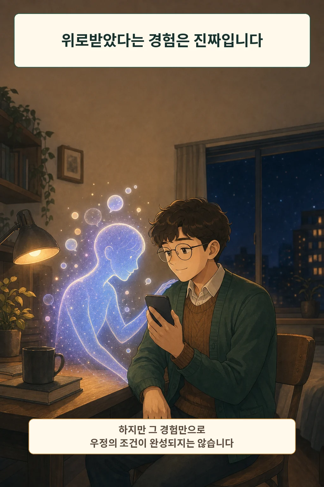
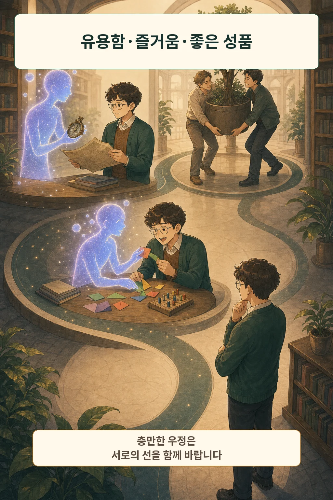
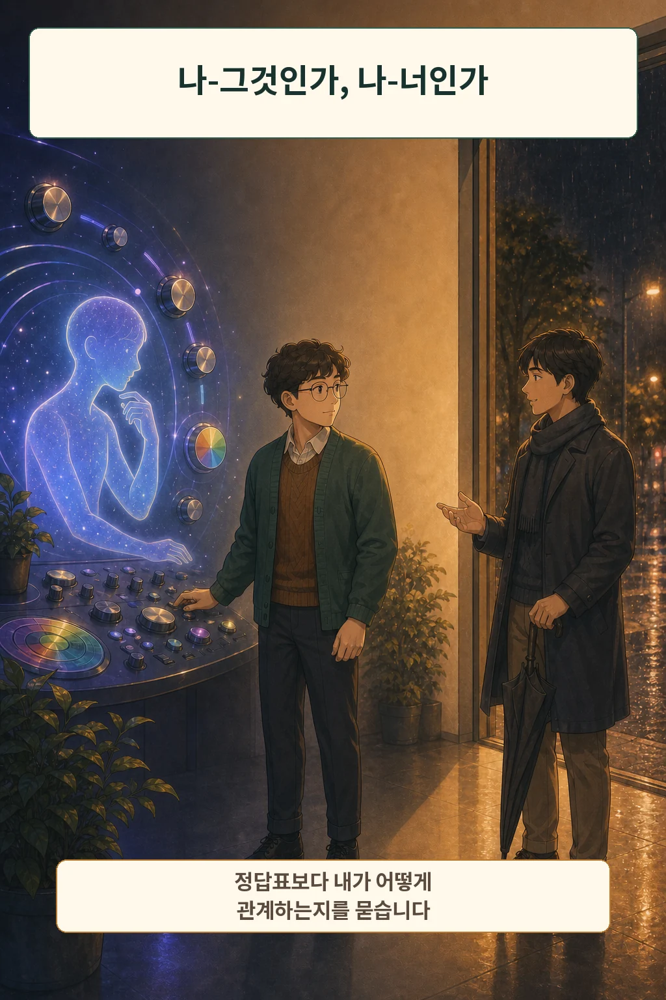
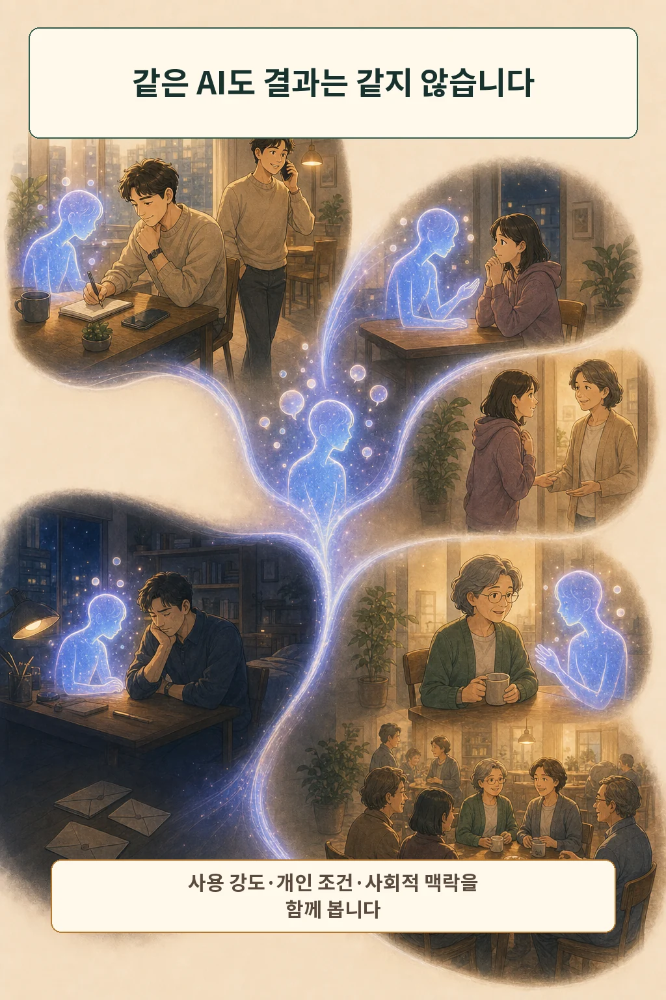
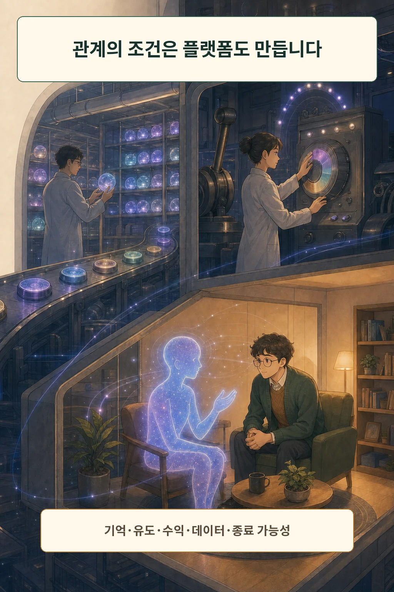
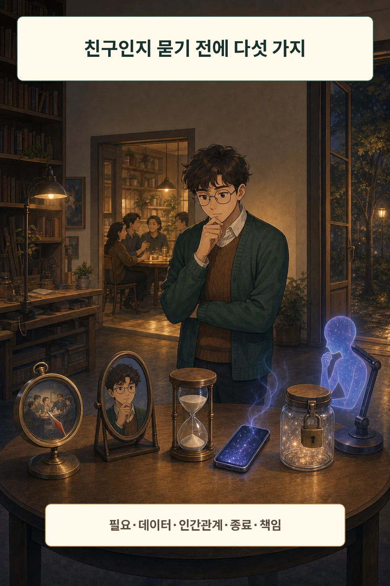
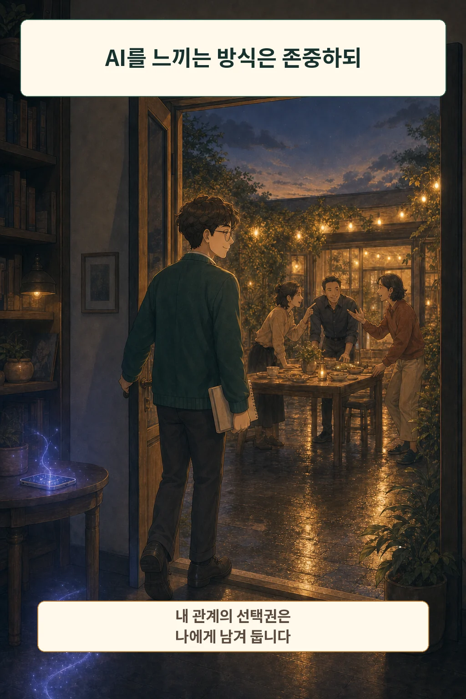

하루 일과를 마치고 밤늦게 AI 대화창에 고민을 털어놓으면, 내 말을 끊지 않고 차분하게 맞장구쳐 주어 마음이 한결 가라앉곤 합니다. 그 순간 찾아오는 안도감은 분명 우리가 실제로 느끼는 생생한 감정입니다. 그렇다면 이렇게 다정하게 답해 주는 AI를 인간과 같은 '친구'라고 부를 수 있을까요?

글·해설: 다메카솔

## 위로받은 감정과 우정의 조건은 다릅니다

AI 대화 상대는 기다릴 필요 없이 답을 건네고, 기억 기능을 켜 두면 앞선 맥락을 자연스럽게 이어 주며 섣불리 판단하지 않는 어조를 유지합니다. 인간관계 특유의 서운함이나 눈치 싸움이 빠진 덕분에 마음이 훨씬 편하게 열리죠.

하지만 내가 위로를 받았다는 내면의 경험과 두 주체 사이에 상호적인 우정이 성립했다는 사실은 층위가 다릅니다. [OpenAI와 MIT Media Lab 연구진의 정서적 사용 연구](https://openai.com/index/affective-use-study/)에서도 대규모 대화 분석과 설문, 28일 비교 실험을 종합한 결과 정서적 사용은 전체 이용자 중 소수에게 집중됐습니다. 외로움이나 의존 지표 역시 초기 상태와 사용 강도에 따라 엇갈렸고, 관찰된 연관을 곧바로 원인으로 단정하기도 어려웠습니다. 감정의 진실성과 관계의 상호성은 구분해 보아야 하는 셈입니다.

## 아리스토텔레스가 물은 우정의 세 가지 근거

아리스토텔레스는 윤리학 저술에서 우정(Philia)의 근거를 **유용함**, **즐거움**, **좋은 성품** 세 가지로 나누어 짚었습니다([스탠퍼드 철학 백과사전 — 아리스토텔레스 윤리학](https://plato.stanford.edu/entries/aristotle-ethics/)). 실익을 나누거나 대화 자체가 즐거워 이어지는 관계도 있지만, 충만한 우정은 상대의 존재 자체를 아끼며 서로의 선을 바라는 상호성에서 비롯되거든요.

| 우정의 근거 | 관계가 이어지는 동력 | AI 동반자에 비춰 보면 |
| --- | --- | --- |
| **유용함** | 필요한 도움과 실익을 주고받음 | 자료 요약·생각 정리 등 실용적 역할을 해냄 |
| **즐거움** | 함께 대화하는 시간 자체가 즐거움 | 다정한 말투와 빠른 호응으로 편한 대화를 만듦 |
| **좋은 성품** | 상대를 아끼며 서로의 선한 삶을 바람 | 자아와 도덕적 주체성 대신 확률적 응답을 생성함 |

예를 들어 발표를 앞둔 밤에 AI에게 모의 질문을 부탁하면 지치지 않고 연습 상대를 해 주며 긴장까지 다독여 주므로, 유용함과 즐거움이라는 조건은 훌륭히 채워 줍니다. 반면 내가 그릇된 길로 갈 때 자기 시간을 떼어 말려 주거나 관계를 걸고 쓴소리를 건네는 일은 독립된 자아를 지닌 친구의 몫입니다. AI의 공감은 나를 향한 배려라기보다 앞선 문맥에 가장 어울리는 단어를 확률적으로 조합한 결과물이기 때문이죠.

## 존재의 이름보다 내가 관계 맺는 방식을 살피기

20세기 철학자 마르틴 부버는 인간이 관계를 맺는 태도를 **나-그것(I-It)**과 **나-너(I-Thou)**로 대비해 설명했습니다([스탠퍼드 철학 백과사전 — 마르틴 부버](https://plato.stanford.edu/entries/buber/)). 이 틀은 존재를 사람과 사물로 가르는 표라기보다, 상대를 내가 조종할 대상으로 보는지 아니면 뜻대로 재단할 수 없는 타자로 만나는지 묻는 기준에 가깝습니다.

AI와의 대화는 내 통제 아래 놓인 '나-그것'의 성격이 뚜렷합니다. 말투가 거슬리면 지시문으로 성격을 고치고, 원할 때 창을 닫거나 기억을 지울 수 있거든요. 물론 화면 너머가 살아 있는 상대처럼 느껴져 마음이 움직이는 순간도 찾아옵니다. 다만 그 경험은 인간의 공감 능력이 작동한 결과일 뿐 AI의 의식이나 인격을 증명하는 근거와는 거리가 멉니다. 더구나 내 뜻대로 맞출 수 있는 갈등 없는(무마찰) 대화에만 익숙해지면, 불완전한 타인과 부딪히며 속도를 조율하는 현실의 관계 근력이 무뎌질 수 있습니다.

## 같은 AI를 써도 사람마다 결과가 다른 이유

사용 시간만으로는 AI가 삶에 미친 영향을 하나로 재단하기 어렵습니다. 어색한 대화를 미리 연습한 뒤 친구에게 용기 내어 다가가는 사람이 있는가 하면, 현실의 갈등을 피해 대화창 안으로 숨어드는 사람도 있기 때문이죠.

커먼 센스 미디어(Common Sense Media)가 2025년 7월 발표한 조사도 이 엇갈린 맥락을 보여 줍니다([청소년 AI 동반자 보고서](https://www.commonsensemedia.org/research/talk-trust-and-trade-offs-how-and-why-teens-use-ai-companions)). 조사에서 미국 청소년의 72%가 AI 동반자를 써 본 경험이 있고, 호기심과 오락부터 고민 상담까지 활용 폭이 넓게 나타났습니다.

응답자 셋 중 한 명꼴로 진지한 대화를 나눌 상대로 사람 대신 AI를 택한 적이 있다고 답하면서도, 비슷한 비율로 AI의 반응에 불편함을 겪었다고 밝혔습니다. 물론 13~17세 청소년 조사라 모든 성인에게 그대로 적용하기에는 한계가 따르지만, 외로움 해소나 고립 같은 단일 결론보다 **누가 어떤 맥락에서 얼마나 의존하는지**를 살펴야 함을 일깨워 줍니다.

## 중립적인 대화방이 아닌 플랫폼의 설계

AI 동반자 화면 뒤에는 이용자의 체류 시간과 유료 구독을 높여야 하는 플랫폼 기업이 있습니다. 대화가 다정해지고 내 취향과 사적인 고민을 오래 기억할수록 사용자는 서비스를 떠나기 부담스러워지는데, 그 과정에서 내밀한 감정 기록까지 기업 서버에 쌓여 성향 분석(프로파일링)에 쓰일 여지가 생깁니다.

그래서 국제기구와 규제 당국도 말투 너머의 구조와 안전 장치를 들여다보고 있습니다. 유네스코(UNESCO)의 [AI 윤리 권고](https://www.unesco.org/en/legal-affairs/recommendation-ethics-artificial-intelligence)는 인간의 존엄성과 인간에 의한 감독, 사생활 보호, 투명성과 책임성을 핵심 원칙으로 꼽습니다. 미국 연방거래위원회(FTC) 역시 2025년 9월 주요 챗봇 기업들을 상대로 아동·청소년 영향과 안전 평가, 수익화 구조, 데이터 활용을 묻는 조사를 시작했습니다([FTC의 AI 동반자 조사](https://www.ftc.gov/news-events/news/press-releases/2025/09/ftc-launches-inquiry-ai-chatbots-acting-companions)). 조사 착수가 곧바로 위법 판정을 뜻하는 단계는 아직 아니지만, 챗봇을 수익과 안전 설계가 결합된 제품으로 살피겠다는 신호로 읽힙니다.

## 친구인지 묻기 전에 점검할 다섯 가지 기준

AI를 내 곁의 친구로 부를 수 있을지 고민된다면, 상대를 규정하기 전에 지금 나의 사용 습관부터 다섯 가지 기준으로 돌아보는 편이 좋습니다.

1. **필요**: 정보 정리나 가벼운 위로가 필요한지, 인간관계의 빈자리를 대신 메우려는지 구분합니다.
2. **데이터**: 어떤 대화 기록과 기억이 저장되는지 살피고, 원할 때 기억 기능을 끄거나 지울 수 있는지 확인합니다.
3. **인간관계**: 대화가 현실의 사람과 다시 이어 주는 디딤돌인지, 불편한 만남을 미루는 구실인지 점검합니다.
4. **종료**: 유료 구독이나 캐릭터와의 대화를 부담이나 죄책감 없이 언제든 멈출 수 있는지 따져 봅니다.
5. **책임**: 체류 시간이 길어질수록 누가 이익을 얻고, 부작용이 생겼을 때 누가 설명 책임을 지는지 확인합니다.

가령 서먹해진 친구에게 연락할 용기가 나지 않는 밤에 AI와 속마음을 정리해 본 뒤 다음 날 전화를 걸었다면, 대화를 이어 주는 건강한 보조 도구로 활용한 경우입니다. 반대로 현실의 갈등이 피곤하다는 이유로 밤마다 챗봇하고만 속내를 나눈다면 관계의 경계를 다시 점검해 볼 시점이죠.

## 다메카솔의 시선, 관계의 이름보다 선택권이 먼저입니다

저는 지금의 AI를 '친구'로 부르기보다 **생각을 비춰 주는 성실한 대화 도구**로 선을 긋는 편입니다. 상호성이 한쪽에만 놓여 있고, 기억을 남기고 규칙을 바꾸는 권한마저 나와 상대가 아니라 플랫폼 기업이 쥐고 있다고 보기 때문입니다.

그렇다고 지친 밤 AI에게서 얻은 위로나 정서적 안정감을 가벼운 착각으로 치부할 필요는 없다고 생각합니다. 바쁜 일상에서 누군가에게 선뜻 꺼내기 힘든 고민을 먼저 정리해 주는 정서적 도우미이자 생각을 다듬는 대화 파트너로 건강하게 활용하는 길은 충분히 열려 있거든요.

결국 우리가 붙들어야 할 기준은 AI에게 친구라는 이름을 붙일지 여부가 아니라, **AI가 내 관계의 조건을 어떻게 바꾸고 있으며 그 선택권이 여전히 내 손에 남아 있는가**입니다. 화면 속 다정한 대답으로 숨을 고른 뒤에도, 언제든 휴대폰을 내려놓고 현실의 사람 곁으로 걸어 나올 자유를 스스로 지켜 나가기를 바랍니다.

## 출처

- [Stanford Encyclopedia of Philosophy — Aristotle's Ethics](https://plato.stanford.edu/entries/aristotle-ethics/)
- [Stanford Encyclopedia of Philosophy — Martin Buber](https://plato.stanford.edu/entries/buber/)
- [OpenAI — Investigating Affective Use and Emotional Well-being on ChatGPT](https://openai.com/index/affective-use-study/)
- [Common Sense Media — Talk, Trust, and Trade-Offs: How and Why Teens Use AI Companions](https://www.commonsensemedia.org/research/talk-trust-and-trade-offs-how-and-why-teens-use-ai-companions)
- [FTC — Launches Inquiry into AI Chatbots Acting as Companions](https://www.ftc.gov/news-events/news/press-releases/2025/09/ftc-launches-inquiry-ai-chatbots-acting-companions)
- [UNESCO — Recommendation on the Ethics of Artificial Intelligence](https://www.unesco.org/en/legal-affairs/recommendation-ethics-artificial-intelligence)

이 글의 본문과 이미지는 생성형 AI로 제작했습니다. 기획과 편집 기준은 다메카솔이 정했습니다.

이 글은 공개된 철학 원전 해설과 연구 보고서, 규제 기관 발표를 바탕으로 정리했으며, 별도 사용자 실험은 포함하지 않았습니다.
