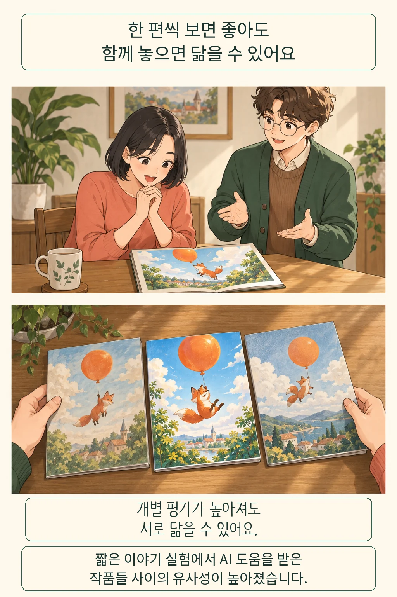
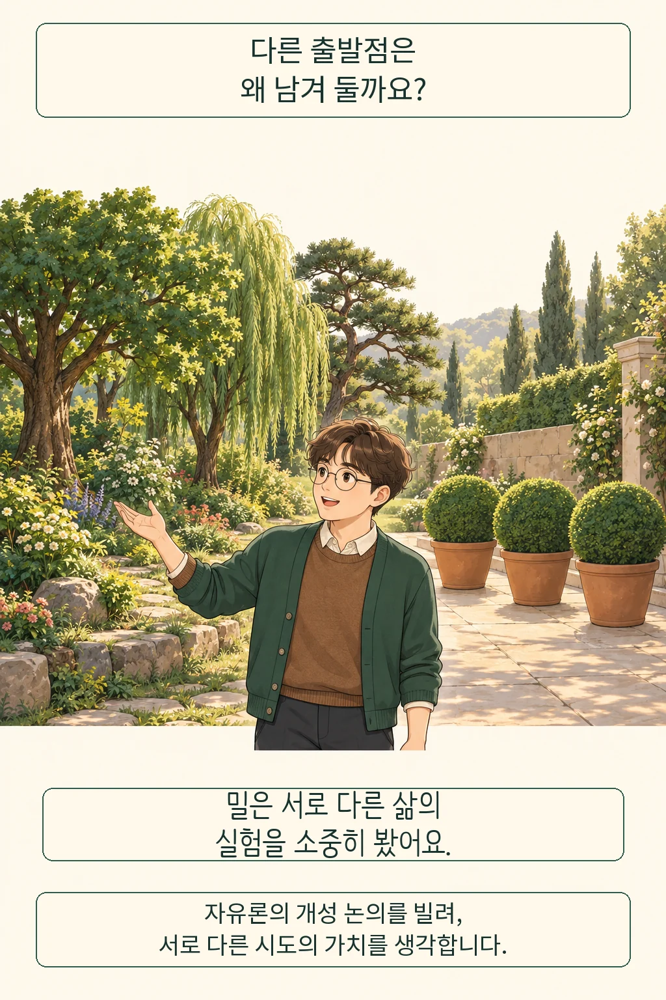
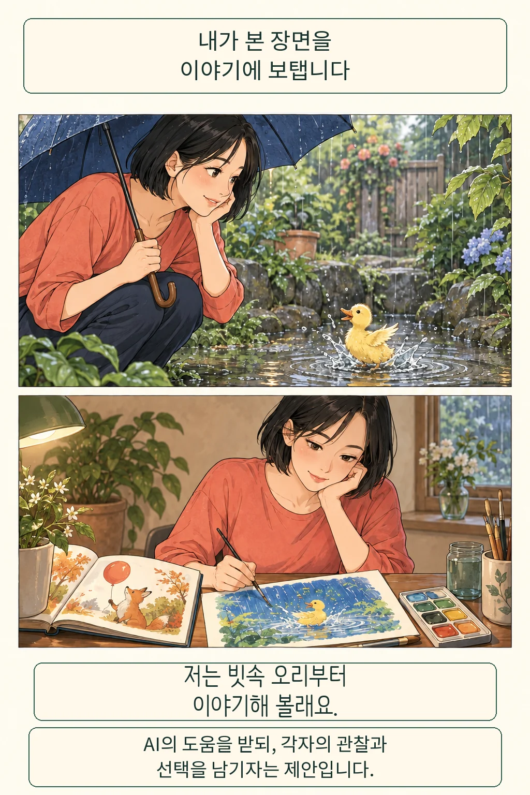

AI로 다듬은 내 이야기가 더 좋아졌다면, 우리가 함께 읽는 이야기의 세계도 그만큼 넓어질까요? **각자의 작품 평가가 높아지는 일과 작품들 사이의 차이가 커지는 일은 따로 살펴야 합니다.** 저는 AI의 도움을 누리면서도 각자가 보고 겪은 일을 출발점으로 남기는 창작을 지지합니다.

글·해설: 다메카솔

## 한 편의 점수와 여러 편의 거리는 다릅니다

한 편씩 읽으면 재미있는 글도 나란히 놓으면 비슷하게 느껴집니다. 독서 모임에서 각자 쓴 짧은 이야기를 펼쳤는데 모두 풍선을 타고 떠나는 여우로 시작한다고 상상해 봅니다. 문장은 유려하고 결말도 만족스럽습니다. 그래도 다음 글에서 만날 풍경은 쉽게 예상됩니다. 이 장면은 차이를 설명하려고 만든 예시입니다.

도시와 하우저는 2024년 발표한 실험에서 일반 참여자들에게 짧은 이야기를 쓰게 하고, 일부에게 GPT-4의 줄거리 아이디어를 제공했습니다. 별도 독자들이 평가했을 때 AI 아이디어에 접근한 집단의 이야기는 평균적으로 더 새롭고 유용하다고 평가됐습니다. 동시에 연구진이 텍스트를 수치로 표현해 비교하자, 그 집단의 이야기는 서로 더 유사했습니다. [논문 원문](https://discovery.ucl.ac.uk/id/eprint/10195027/)

좋아졌다는 평가와 닮았다는 비교가 함께 나온 셈입니다. 이 실험은 여덟 문장 소설과 정해진 아이디어 제공 방식을 다뤘습니다. AI와 자유롭게 대화하거나 지시문을 바꾸는 과정은 포함하지 않았습니다. 전문 작가의 장편이나 오늘날 모든 AI 창작으로 넓혀 읽을 때는 이 조건을 기억해야 합니다. 사람의 개성이 사라졌는지를 직접 측정한 연구로도 볼 수 없습니다.

## 밀의 질문: 다른 시도를 남겨 둘 이유

그렇다면 조금 닮았어도 읽기 좋으면 충분할까요? 목적에 따라 답이 달라집니다. 안내문에서 익숙한 표현은 오히려 이해를 돕습니다. 서로 다른 경험을 만나려는 이야기 모임이라면, 매끈함 외에 얼마나 다른 세계를 보여 주는지도 중요해집니다.

존 스튜어트 밀은 『자유론』 3장에서 타인에게 해를 끼치지 않는 범위의 서로 다른 삶의 실험을 옹호했습니다. 남의 경험에서 배우되 자신의 상황과 성격에 맞게 해석하고 선택하는 일을 중시했습니다. 개성이 자라는 과정 자체에도 가치가 있다는 관점입니다. 이 논의는 AI를 예측한 말이 아니라 지금의 질문에 빌려 쓰는 철학적 렌즈입니다. [『자유론』 3장](https://utilitarianism.net/books/on-liberty-john-stuart-mill/3/)

저는 이 렌즈로 창작 도구의 편리함을 한 번 더 살펴보겠습니다. 좋은 제안을 받아들이는 선택과, 모두가 같은 출발점으로 모이도록 만드는 환경은 구별할 필요가 있습니다. 추천을 거절하는 일이 늘 더 훌륭한 것도 아닙니다. 마음에 든 이유를 생각하고 자기 경험에 맞게 바꾸는 자리까지 남아 있는지가 제 관심입니다.

그림의 정원은 이 질문을 드러내는 비유입니다. 둥글게 다듬은 나무에도 쓰임이 있고, 서로 다르게 자란 나무에도 매력이 있습니다. 모든 정원을 한 모양으로 꾸밀 때 놓치는 것이 무엇인지 묻자는 뜻입니다. 식물의 모양으로 인간의 가치를 재거나 실험의 수치를 대신하려는 의도는 없습니다.

## 다메카솔의 해석: 추천 앞에 내 관찰을 놓겠습니다

이야기 모임의 독자가 빗속 웅덩이에서 노는 오리를 봤다고 해 봅니다. 저는 이 장면을 먼저 적은 뒤 AI에게 구성을 물어보겠습니다. AI가 제안한 반전이 마음에 들면 쓰고, 관찰했던 엉뚱한 움직임이 사라지면 다시 넣겠습니다. 이것은 앞선 실험에서 효과를 입증한 처방이 아니라, 도움과 자기 선택을 함께 남기려는 제안입니다.

서비스를 만든다면 첫 제안 하나를 화면 전체의 기본값으로 굳히는 설계부터 살펴보겠습니다. 이용자가 자기 소재를 먼저 남길 수 있고, 서로 다른 방향의 초안을 나란히 보며 되돌아갈 수 있게 하겠습니다. 추천을 바로 채택한 비율만 높이면 좋은 도구라고 판단하기 쉽습니다. 여러 결과를 함께 읽으며 소재와 관점이 얼마나 달라졌는지도 따로 확인할 이유가 있습니다.

반대쪽의 이익도 큽니다. 시작이 막막한 사람에게 익숙한 줄거리 하나는 실제로 글을 완성하게 만드는 발판이 됩니다. 다양성을 지키겠다는 이유로 그 도움을 포기하라고 요구하고 싶지는 않습니다. 공통 형식이 필요한 글에는 익숙함을 허용하고, 다른 목소리를 기대하는 자리에는 탐색할 여유를 남기는 쪽이 제 입장입니다.

[AI와 함께 쓴 작품의 저자성](/posts/ai-assisted-authorship-ownership/)이 한 작품에 담긴 선택을 물었다면, 여기서는 작품들을 함께 놓았을 때 생기는 차이를 물었습니다. 다음 모임에서 풍선 속 여우 옆에 빗속 오리가 놓이는 결말을 떠올립니다. 둘 다 읽기 좋고, 서로에게서 예상하지 못한 장면을 만나는 모임입니다.

## 출처

- Doshi, A. R. & Hauser, O. P. (2024). [Generative AI enhances individual creativity but reduces the collective diversity of novel content](https://doi.org/10.1126/sciadv.adn5290). Science Advances, 10(28), eadn5290. [UCL 공개 전문](https://discovery.ucl.ac.uk/id/eprint/10195027/)의 실험 설계, 이야기 유사성 분석, 논의의 적용 한계를 참고했습니다.
- Mill, J. S. (1859). [On Liberty, Chapter III](https://utilitarianism.net/books/on-liberty-john-stuart-mill/3/). 개성과 서로 다른 삶의 시도에 관한 원전입니다. AI에 연결한 판단은 다메카솔의 해석입니다.

발행일: 2026-10-12 · 출처 확인일: 2026-10-12

이 글의 본문과 이미지는 생성형 AI로 제작했습니다. 기획과 편집 기준은 다메카솔이 정했습니다.
