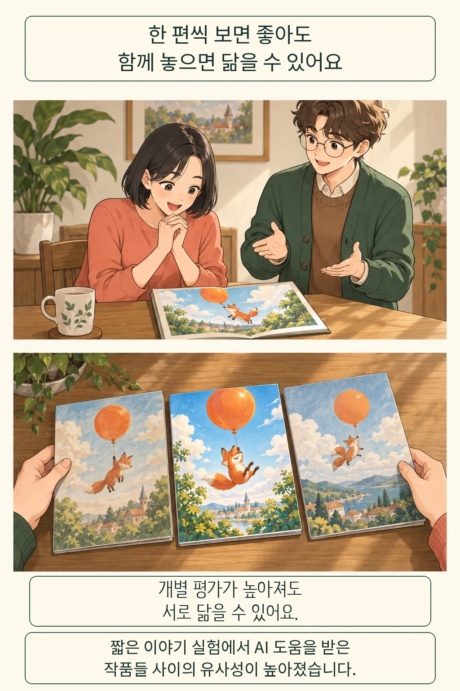
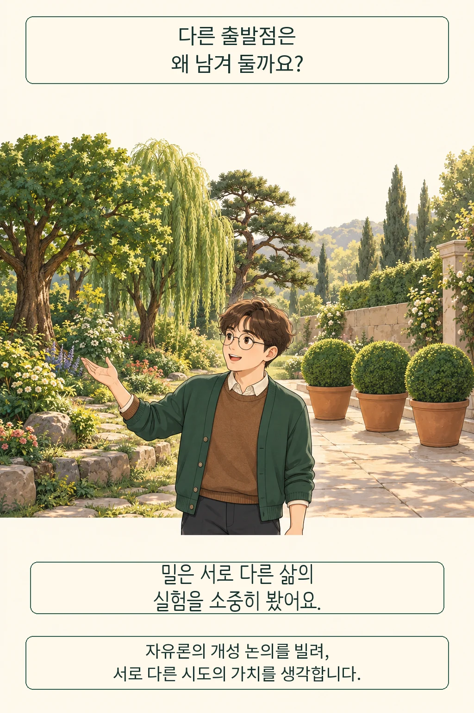
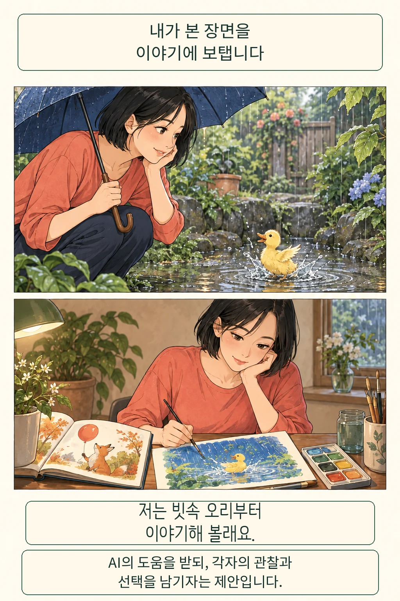

주말 글쓰기 모임에서 AI의 도움을 받아 다듬은 짧은 소설을 돌려 읽다 보면, 문장은 참 매끈한데 왠지 옆 사람의 글과 배경이나 전개가 비슷해 놀랄 때가 있습니다. 이처럼 **각 작품의 완성도가 높아지는 일과 여러 작품 사이의 다양성이 넓어지는 일**은 따로 살펴야 합니다. 저는 AI가 주는 글쓰기 도움을 누리면서도, 각자가 직접 보고 겪은 장면을 이야기의 출발점으로 남기는 창작을 지지합니다.

글·해설: 다메카솔

## 핵심 내용

- **완성도와 다양성의 분리**: 한 편씩 보면 새롭고 읽기 좋은 글이라도, 같은 AI 제안에서 출발한 여러 편을 모으면 서로 닮아 갈 수 있습니다.
- **밀의 개성 렌즈**: 존 스튜어트 밀은 『자유론』에서 남의 경험에서 배우되 자기 상황에 맞게 해석하고 고를 때 개성이 자란다고 보았습니다.
- **관찰 우선의 글쓰기**: 추천 문장을 바로 받아쓰기보다 내가 본 장면을 먼저 기록하고 여러 갈래를 비교할 때 각자의 목소리가 살아납니다.

## 한 편의 점수와 여러 편의 거리는 다릅니다

한 편씩 읽으면 꽤 재미있는 글도 여러 편을 나란히 펼쳐 놓으면 묘하게 닮아 보일 때가 있습니다. 예를 들어 독서 모임에서 각자 써 온 짧은 이야기를 펼쳤는데, 앞사람에 이어 뒷사람까지 풍선을 타고 떠나는 여우로 첫 장면을 연다고 상상해 볼까요? 문장마다 매끄럽고 결말도 그럴듯하지만, 다음 사람 원고를 펼칠 때 어떤 풍경이 나올지 금방 짐작이 가 버립니다.

비슷한 현상은 실제 실험에서도 관찰됐습니다. 도시와 하우저가 2024년 발표한 온라인 무작위 실험에서는 일반 참여자들에게 여덟 문장짜리 짧은 소설을 쓰게 하고, 일부 집단에만 GPT-4가 만든 줄거리 아이디어를 건넸습니다([논문 원문](https://discovery.ucl.ac.uk/id/eprint/10195027/)).

완성된 글을 별도 독자 평가단에게 맡기자 AI 아이디어를 참고한 글이 평균적으로 더 새롭고 유용하다는 평가를 받았습니다. 그런데 연구진이 각 이야기의 내용과 표현을 컴퓨터가 비교할 수 있는 숫자 좌표(임베딩)로 바꾼 뒤 같은 집단 안의 평균 좌표와 얼마나 가까운지 재어 보니, AI 도움을 받은 집단일수록 글끼리 서로 닮은 정도가 높아졌습니다. 한 편의 점수는 올라갔지만, 여럿을 모았을 때의 거리는 오히려 좁혀진 셈이죠.

| 실험 요소 | 실험 구성과 결과 | 해석할 때 살필 점 |
| --- | --- | --- |
| **참여자와 과제** | 일반 참여자 **293명**이 여덟 문장짜리 짧은 소설 작성 | 전문 작가의 장편이나 음악·그림 분야까지 그대로 적용하기는 어렵습니다 |
| **AI 제공 조건** | 아이디어 비제공 / **GPT-4** 줄거리 최대 **1개** 또는 **5개** 제공 | 2024년 발표 실험 기준으로 프롬프트 수정이나 대화형 협업은 빠졌습니다 |
| **개별 평가** | 별도 평가자 **600명**이 AI 접근 집단을 평균적으로 더 새롭고 유용하게 평가 | 단편 과제의 평가는 높아졌지만 현재 모델이나 모든 창작자의 보편 효과로 단정하기는 어렵습니다 |
| **집단 다양성** | 이야기 임베딩과 조건 내 평균 간 코사인 유사도 비교 시 AI 집단의 유사성 상승 | 글 사이의 표현 거리를 잰 지표로, 사람의 개성 소멸이나 사회 획일화를 직접 측정한 수치와는 구분됩니다 |

이처럼 정해진 줄거리 몇 개를 받아 짧은 소설을 쓰는 조건에서는 AI가 개별 글의 완성도를 높이는 데 도움을 주지만, 같은 안내판을 보고 출발한 글들이 비슷한 방향으로 모이는 경향도 함께 생기는 편입니다. 프롬프트를 바꾸거나 AI와 대화를 주고받으며 고쳐 쓰는 과정은 실험에 포함되지 않았으므로, 실제 창작에 적용할 때는 도구 자체를 피하기보다 어떻게 출발점을 다르게 잡을지 고민할 필요가 있습니다.

## 밀의 질문: 다른 시도를 남겨 둘 이유

그렇다면 글이 서로 조금 닮았어도 읽기 편하면 그만일까요? 가령 아파트 관리실의 단수 안내문이나 회의 일정 공지처럼 정확한 전달이 목적인 글에서는, 모두가 익숙해하는 문장 틀을 따르는 편이 오해를 줄이고 시간을 아껴 줍니다. 반면 각자의 시선과 경험을 나누려는 모임 글이나 에세이에서는 매끈함 못지않게 ‘이 사람만의 눈으로 본 장면’이 얼마나 담겼는지가 읽는 즐거움을 좌우하거든요.

19세기 철학자 존 스튜어트 밀은 1859년 출간한 『자유론』 3장에서 왜 사회가 서로 다른 시도를 품어야 하는지 차분히 설득했습니다([『자유론』 3장](https://utilitarianism.net/books/on-liberty-john-stuart-mill/3/)). 밀은 타인에게 해를 끼치지 않는 범위에서 사람들이 각기 다른 삶의 방식을 실험해 보는 일을 옹호했습니다. 남의 경험에서 지혜를 배우되, 자기 상황과 성향에 맞춰 다시 해석하고 고르는 과정 자체에서 개성이 자란다고 본 것이죠.

물론 1859년에 나온 밀의 글은 오늘날의 AI를 예측한 연구가 아니라 시민 사회의 자유를 다룬 철학 원전입니다. 그래도 모범 답안을 그대로 복제하기보다 자기 손으로 고르고 변주하는 자리를 중시한다는 점에서 지금의 AI 글쓰기를 돌아보는 렌즈로 삼기에 충분합니다. 정원에서도 반듯하게 다듬은 나무와 햇빛을 따라 제각기 자란 나무가 어울릴 때 풍경이 풍성해지듯, 핵심은 추천을 쓰느냐보다 각자의 출발점으로 빠져나갈 여지가 남아 있는가에 있습니다.

## 다메카솔의 해석: 추천 앞에 내 관찰을 놓겠습니다

가령 동네 산책길에서 빗속 웅덩이를 뒤뚱거리며 헤엄치는 오리를 본 독자가 짧은 이야기를 쓴다고 해 봅시다. 저라면 빈 화면에서 곧장 AI에게 줄거리를 달라고 하기보다, 오리의 우스꽝스러운 몸짓과 그때 느낀 감정을 서너 줄이라도 먼저 적어 두겠습니다. 그런 다음 AI에게 문장 연결이나 반전을 물어보되, 처음 관찰했던 엉뚱한 세부 묘사가 매끈한 문장에 밀려 사라졌다면 다시 꺼내 제자리에 살려 넣으려 합니다.

이런 생각은 글을 쓰는 개인의 습관뿐 아니라 서비스를 설계하는 방향에도 그대로 닿아 있는데, 첫 번째 추천 하나를 화면 전체의 기본값으로 굳혀 버리는 구조부터 다시 살펴볼 만하거든요. 일상에서 AI와 함께 글을 쓰거나 도구를 고를 때는 다음 네 가지를 기준으로 삼아 보면 좋습니다.

- **내 관찰 먼저 적기**: AI의 첫 제안을 보기 전에 오늘 겪은 장면이나 내가 묻고 싶은 질문 한 줄을 먼저 남깁니다.
- **여러 갈래 나란히 보기**: 한 가지 줄거리만 기본값으로 고르기보다 분위기와 시점이 다른 초안을 나란히 비교하고 되돌아갈 여지를 둡니다.
- **어색해도 나다운 표현 살리기**: AI가 문장을 다듬으며 지워 버린 개인적인 세부 묘사를 골라 다시 제자리에 돌려놓습니다.
- **모임 전체의 풍경 살피기**: 추천을 바로 채택한 비율뿐만 아니라, 여러 결과물에서 소재와 관점이 얼마나 달라졌는지도 함께 확인합니다.

물론 이 순서는 논문 속 실험 조건이라기보다, 일상에서 AI와 글을 쓸 때 나만의 소재가 덮이지 않도록 돕기 위해 제가 권하는 글쓰기 기준입니다. 첫 문장을 떼기 막막할 때 익숙한 줄거리 하나가 글을 끝까지 완성하게 돕는 든든한 디딤돌이 되기도 하니, 안내문에는 익숙한 틀을 빌려 쓰고 개성이 반가운 글에는 탐색할 여유를 남기는 균형을 권하고 싶습니다.

앞서 다룬 [AI와 함께 쓴 작품의 저자성](/posts/ai-assisted-authorship-ownership/) 글이 한 작품 안에 담긴 의도와 책임을 물었다면, 이번 이야기는 그렇게 완성된 여러 작품을 나란히 놓았을 때 생기는 차이를 이어서 짚어 보았습니다. 다음 독서 모임 책상 위에서는 풍선 속 여우 옆에 빗속 오리 이야기가 나란히 놓여, 둘 다 술술 읽히면서도 서로에게서 뜻밖의 시선을 건네받는 풍경을 기대해 봅니다.

## 출처

- Doshi, A. R. & Hauser, O. P. (2024). [Generative AI enhances individual creativity but reduces the collective diversity of novel content](https://doi.org/10.1126/sciadv.adn5290). Science Advances, 10(28), eadn5290. [UCL 공개 전문](https://discovery.ucl.ac.uk/id/eprint/10195027/)의 실험 설계, 이야기 유사성 분석, 논의의 적용 한계를 참고했습니다.
- Mill, J. S. (1859). [On Liberty, Chapter III](https://utilitarianism.net/books/on-liberty-john-stuart-mill/3/). 개성과 서로 다른 삶의 시도에 관한 원전입니다. AI에 연결한 판단은 다메카솔의 해석입니다.

발행일: 2026-10-12 · 출처 확인일: 2026-10-12

이 글의 본문과 이미지는 생성형 AI로 제작했습니다. 기획과 편집 기준은 다메카솔이 정했습니다.

본문은 공개된 논문과 철학 원전을 바탕으로 정리했으며 별도 실험 재현은 포함하지 않았습니다. 만화에 등장하는 '풍선 속 여우'와 '빗속 오리' 등 그림 속 이야기는 설명을 위해 새로 구성한 창작 비유입니다.
