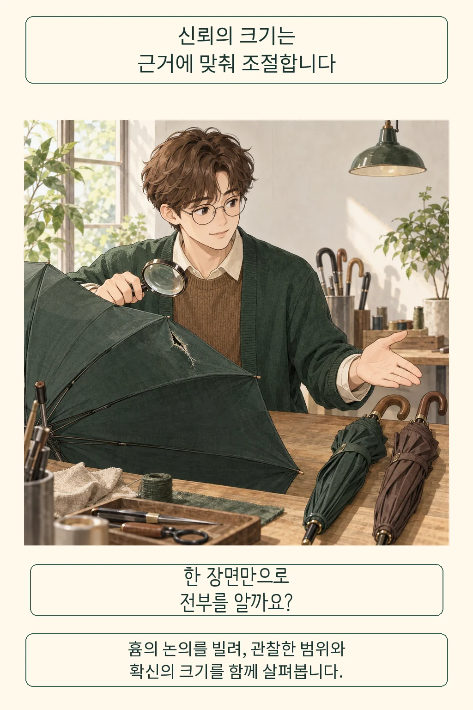

오랜만에 나선 소풍 날, AI가 추천한 일정을 믿고 나갔다가 빗속에 발이 묶였다면 다음 조언도 선뜻 믿기 어렵습니다. 한 번의 실수로 마음이 돌아서는 것은 아주 자연스러운 반응이죠. 그래도 가벼운 일정 추천과 되돌리기 어려운 결정을 같은 신뢰로 묶기보다는, 대안의 성능과 오류의 피해를 함께 살펴 다시 맡길 범위를 정해 두어야 합니다.

글·해설: 다메카솔

## 사람에게 허용한 실수도 함께 봅니다

만약 친구가 주말 날씨가 맑을 거라고 장담했다가 함께 비를 맞았다면 어떨까요? 다음 약속에서도 친구의 의견을 한 번쯤 다시 물어보게 되는 경우가 많습니다. 반면 AI가 한 번 틀렸을 때는 훨씬 빠르게 실망하고, 아예 사용을 접어 버리고 싶어집니다.

바로 이 지점에서 우리가 종종 빠뜨리는 비교 대상이 하나 생깁니다. 실수한 AI를 내친 뒤 내가 대신 고를 사람이나 기존 방식은 얼마나 자주, 또 얼마나 크게 틀리는지 같은 잣대로 견줘 보았느냐는 질문이죠.

디트보르스트와 동료들이 2015년에 발표한 실험이 이런 심리를 잘 보여 줍니다. 연구진은 참가자들에게 사람과 통계 예측 모델의 결과를 각각 지켜보게 한 뒤, 보상이 걸린 다음 과제에서 어느 쪽을 선택할지 살폈습니다. 다섯 편으로 이뤄진 이 연구에는 MBA 성적과 미국 주별 순위 예측처럼 모델이 사람보다 전반적으로 더 잘 맞히는 과제들이 포함되어 있었는데요.

흥미롭게도 모델이 틀리는 장면을 직접 본 참가자들은, 모델이 사람보다 더 잘 맞힌다는 점을 확인한 뒤에도 모델을 덜 신뢰하고 사람보다 덜 선택했습니다. 연구진은 이 경향을 **‘알고리즘 기피(algorithm aversion)’**라고 설명합니다. [연구 원문](https://faculty.wharton.upenn.edu/wp-content/uploads/2016/11/20-Dietvorst-Simmons-Massey-2015.pdf)

물론 이 실험 결과를 오늘날의 생성형 AI에 그대로 대입하기는 이릅니다. 2015년 연구는 모델이 사람 대안보다 객관적으로 우수한 통계 예측 조건을 다뤘고, 저자들 역시 과제와 알고리즘 특성에 따른 일반화 한계를 인정했거든요. 내 질문에 생성형 AI가 실제로 더 정확한지는 따로 확인해야 하며, AI를 거부했다는 이유만으로 비합리적이라고 단정하기도 어렵습니다. 결국 이 연구가 건네는 질문은 ‘AI가 실수했는가’를 넘어 **‘내가 택할 대안과도 같은 잣대로 비교했는가’**입니다.

## 흄의 렌즈: 확신에도 크기가 있습니다

눈앞의 실패가 강렬할수록 전체 판단을 그 한 장면으로 채우기가 쉽습니다. 우산 가게에서 찢어진 우산 하나만 돋보기로 들여다보면, 옆에 멀쩡히 접혀 있는 다른 우산의 상태까지 놓치기 마련이죠. 한 번의 실수로 전체를 재단하기 전에, 내가 실제로 살펴본 범위가 어디까지인지 한 걸음 물러서서 돌아볼 필요가 있습니다.

철학자 데이비드 흄은 『인간지성에 관한 탐구』 10절에서 경험에 일치와 불일치가 섞여 있을 때 확신의 크기를 어떻게 다뤄야 하는지 논합니다. 본래 증언과 기적의 신빙성을 검토하던 논의지만, 경험한 증거의 무게에 맞춰 믿음의 크기를 조절하는 태도를 강조했습니다. AI 설계를 다룬 글은 아니더라도, 오류를 겪었을 때 신뢰를 전면 불신과 맹신으로 양분하지 않고 내 확신의 근거를 돌아보는 철학적 렌즈로는 충분히 빌려올 만합니다. [원전 10절 1부](https://davidhume.org/texts/e/10)

우산 가게의 장면으로 다시 생각하면 이 차이가 한층 선명해집니다. 찢어진 우산 한 개만 보고 매장 전체를 불량으로 단정하면 놓치는 것이 생기고, 반대로 진열된 우산을 모두 펼쳐 봤더라도 내일 몰아칠 강풍까지 견딜지는 또 다른 문제거든요. 관찰한 표본의 범위와 앞으로 사용할 환경 조건을 구분했다면, AI에게 맡길 일도 위험 크기에 따라 단계별로 나누는 편이 좋습니다.

| 위임 단계 | 맡겨 볼 일의 예시 | 함께 챙길 확인과 기준 |
| --- | --- | --- |
| **참고 단계** | 가벼운 소풍 일정 추천, 아이디어 탐색 | 대안과 가볍게 비교한 뒤 직접 고르기 |
| **초안 단계** | 안내 문구 정리, 자료 요약 초안 작성 | 사실관계와 최신 정보를 직접 대조한 뒤 반영하기 |
| **위임 단계** | 외부 발송 등 자동 실행 권한까지 직접 부여 | 오류 피해 규모와 되돌릴 안전장치를 먼저 확인하기 |

그렇다고 해서 위험한 실패를 여러 번 참아 줄 의무가 생기지는 않습니다. 잘못된 실행 단 한 번이 치명적인 피해를 남기거나, 문제가 고쳐졌는지 확인할 길이 없다면 즉시 사용을 멈추는 쪽이 훨씬 합리적입니다. ‘평균적으로는 괜찮다’는 말 뒤에 누가 어떤 실패 비용을 감당하는지가 빠져 있다면, 저는 그 도구의 도입을 보류하겠습니다.

## 다메카솔의 해석: 다시 맡기는 조건을 남깁니다

다시 처음의 소풍 이야기로 돌아가 보면, 실수 한 번을 겪은 뒤 우리가 취할 수 있는 현실적인 행동은 그리 어렵지 않습니다. 예를 들어 AI의 일정 추천은 가볍게 참고만 하되 출발 전 최신 기상 예보를 직접 확인하고, 비가 올 때 옮겨 갈 실내 장소와 우산을 미리 챙겨 두는 식이죠. 한 번 틀렸다고 도구를 무조건 외면하지도, 아무 대비 없이 전적으로 믿지도 않는 균형 잡힌 기준입니다.

결과물을 사람이 조금이라도 손볼 수 있는지가 재사용 여부를 바꾸기도 합니다. 디트보르스트와 동료들의 2018년 후속 실험에서도 참가자가 보상이 걸린 예측 과제에서 모델의 예측값을 일부 수정할 수 있을 때, 불완전한 알고리즘을 훨씬 더 잘 받아들였습니다. 다만 사람이 고친 예측이 원래 모델보다 늘 정확했던 것은 아니며, 수정이 오히려 예측을 악화시키는 경우도 보고되었는데요. 결국 **‘내가 고칠 수 있다는 심리적 만족’**과 **‘실제로 더 정확해졌다는 증거’**는 분리해서 살펴야 합니다. [후속 연구의 논의와 한계](https://faculty.wharton.upenn.edu/wp-content/uploads/2016/08/Dietvorst-Simmons-Massey-2018.pdf)

제가 AI 서비스를 설계하는 입장이라면, 사용자가 오류를 겪고 신고한 뒤 무엇이 어떻게 달라졌는지 눈으로 확인할 수 있는 경로를 남기겠습니다. 막연한 사과보다 구체적인 확인 장치가 있어야 신뢰를 회복할 여지가 생기기 때문입니다.

- **원래 답과 수정된 답 나란히 남기기**: 오류가 난 응답과 고친 응답을 함께 기록해 달라진 지점을 확인하게 합니다.
- **같은 유형의 입력 재시험 결과 제시**: 비슷한 조건을 다시 시험해 같은 오류가 반복되지 않는지 보여 줍니다.
- **검증 전 실행 권한 축소와 복구 장치 유지**: 확인이 끝날 때까지 자동 실행 범위를 좁히고, 이전 상태로 되돌릴 안전장치를 둡니다.

이렇게 확인 경로를 열어 두어야 이용자도 매번 모든 답변을 처음부터 끝까지 의심해야 하는 피로에서 벗어날 수 있습니다. 신뢰를 되찾는 과정은 감정의 설득보다 검증 가능한 흔적을 남기는 일에 가깝기 때문입니다.

앞서 다룬 [AI의 설명과 확인을 구분한 글](/posts/ai-explanation-trust-evidence/)이 그럴듯한 이유를 들었을 때의 태도를 다뤘다면, 이번 글은 명백한 오류를 겪은 다음의 판단을 살폈습니다. 제 결론은 **조건부 재사용**입니다. 대안과 비교할 근거가 있고 실패를 감당할 안전장치가 확보된 일부터 다시 맡기되, 그 조건이 무너지면 주저 없이 멈추겠습니다. 막연히 ‘한 번만 더 믿어 줄까’를 고민하기보다, **‘이 범위까지 다시 맡길 근거와 안전장치가 생겼나’**를 먼저 묻는 습관이 막연한 실망을 더 단단한 판단으로 바꿔 줍니다.

## 출처

- Dietvorst, B. J., Simmons, J. P. & Massey, C. (2015). [Algorithm Aversion](https://doi.org/10.1037/xge0000033). Journal of Experimental Psychology: General, 144(1), 114–126. 저자 소속 기관의 공개 전문에서 연구 설계와 pp.123–124의 논의·한계를 확인했습니다.
- 같은 저자들 (2018). [Overcoming Algorithm Aversion](https://doi.org/10.1287/mnsc.2016.2643). Management Science, 64(3), 1155–1170. 수정 가능성과 선택, 원래 모델 대비 수정의 한계를 참고했습니다.
- Hume, D. (1748). [An Enquiry concerning Human Understanding, Section X](https://davidhume.org/texts/e/10), E 10.3–10.4. AI에 연결한 판단은 다메카솔의 해석입니다.

발행일: 2026-10-15 · 업데이트: 2026-11-20 · 출처 확인일: 2026-10-15

이 글은 공개된 논문과 철학 원전을 바탕으로 해설했으며 실험을 독립 재현하지 않았고, 본문의 소풍·우산 그림은 이해를 돕기 위해 새로 구성했습니다.
이 글의 본문과 이미지는 생성형 AI로 제작했습니다. 기획과 편집 기준은 다메카솔이 정했습니다.
