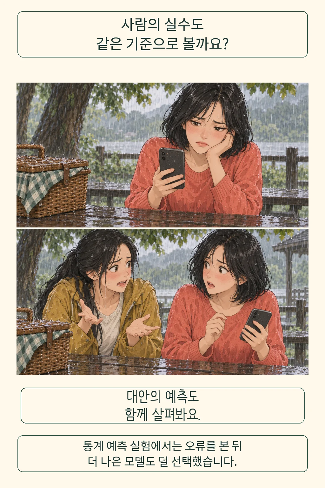
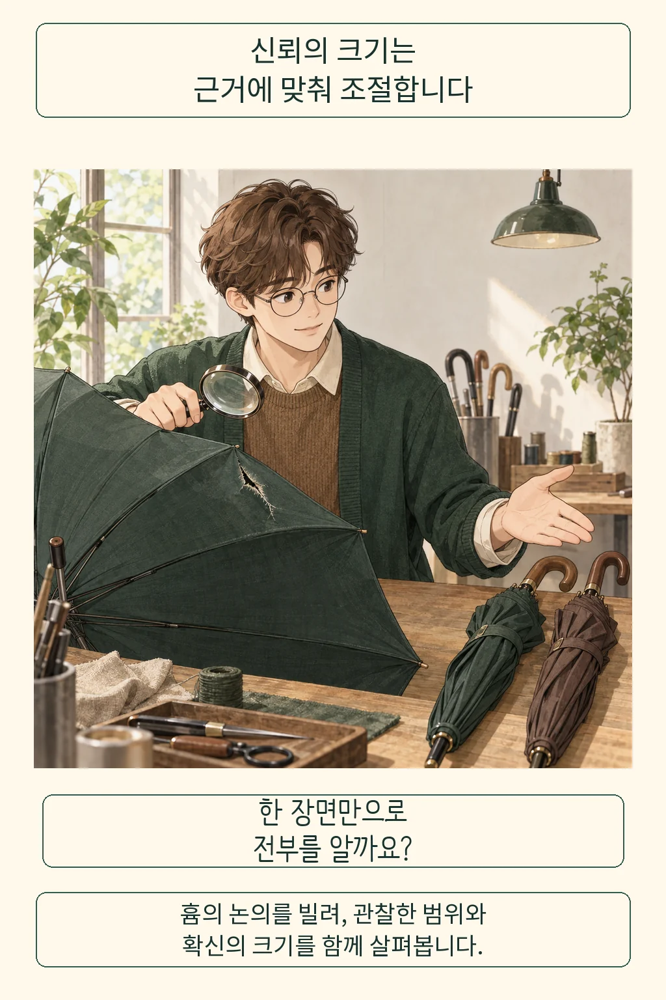

AI가 추천한 소풍 날에 비를 맞았다면, 다음 조언은 어디까지 믿어야 할까요? 한 번의 실수로 마음이 돌아서는 일은 자연스럽습니다. **저는 다시 맡길 범위를 대안의 성능과 오류의 피해에 맞춰 정하겠습니다.** 가벼운 일정 추천과 되돌리기 어려운 결정을 같은 신뢰로 묶을 이유는 없습니다.

글·해설: 다메카솔

## 사람에게 허용한 실수도 함께 봅니다

친구가 날씨를 잘못 예상했다면 다음 약속에서도 의견을 물을까요? AI에게는 곧바로 기회를 거둬들이고 싶을 수도 있습니다. 여기서 잠깐 비교할 대상이 생깁니다. 실수한 AI를 버린 뒤 우리가 택할 방법은 얼마나 자주, 얼마나 크게 틀리는지입니다. 그림의 소풍은 이 질문을 위한 창작 장면입니다.

디트보르스트와 동료들은 2015년 논문에서 참여자들이 사람이나 통계모델의 예측을 보고, 이후 보상이 걸린 예측에 어느 쪽을 쓸지 고르게 했습니다. 모델이 더 잘하는 것을 봤어도, 그 수행과 오류를 본 사람들은 모델을 덜 선택하는 경향을 보였습니다. 저자들은 이를 알고리즘 기피와 연결했습니다. [연구 원문](https://faculty.wharton.upenn.edu/wp-content/uploads/2016/11/20-Dietvorst-Simmons-Massey-2015.pdf)

여기서 비교 대상은 중요합니다. 연구는 성적과 순위를 예측하는 통계모델을 다뤘고, 모델이 사람보다 우수한 조건이었습니다. 오늘의 챗봇이 내 질문에 더 정확한지는 따로 확인해야 합니다. AI를 거절했다는 사실만으로 비합리적이라고 판단할 근거도 부족합니다. 이 연구에서 빌릴 질문은 ‘실수를 봤는가’에 더해 ‘대안과도 같은 기준으로 비교했는가’입니다.

## 흄의 렌즈: 확신에도 크기가 있습니다

한 번의 실패가 강렬할수록 전체 판단을 그 장면으로 채우기 쉽습니다. 철학자 데이비드 흄은 『인간지성에 관한 탐구』 10절에서 경험이 일치하는 정도에 따라 확신의 크기를 달리하고, 믿음을 증거에 비례시키는 태도를 논합니다. 증언과 기적을 검토하던 문맥입니다. AI의 신뢰도를 계산하는 공식으로 읽기보다, 내 확신의 근거를 묻는 렌즈로 빌려 봅니다. [원전 10절 1부](https://davidhume.org/texts/e/10)

이 렌즈로 보면 ‘계속 믿는다’에도 여러 수준이 생깁니다. 아이디어를 얻는 데 참고할 수 있고, 사실을 대조한 뒤 초안에 반영할 수도 있으며, 실행 권한까지 맡기는 단계도 있습니다. 같은 AI라도 무엇을 맡기는지에 따라 필요한 근거가 달라집니다. 저는 신뢰를 조절할 때 이 차이를 먼저 말하겠습니다.

가령 우산 한 개의 찢어진 부분만 보고 가게의 우산을 모두 평가하면 놓치는 것이 있습니다. 반대로 모든 우산을 직접 살펴도 내일의 강풍을 견딜지는 다른 질문입니다. 그림은 관찰 범위와 사용 조건을 구분하려는 비유입니다. AI의 오류율을 우산 개수로 나타낸 도표는 아닙니다.

그렇다고 실패를 여러 번 지켜볼 의무가 생기지는 않습니다. 잘못된 실행 한 번이 큰 피해를 남기거나, 문제가 고쳐졌는지 확인할 길이 없다면 멈추는 선택에 충분한 이유가 있습니다. 평균적으로 괜찮다는 말에도 누가 어떤 실패를 감당하는지 빠져 있다면 판단을 보류하겠습니다.

## 다메카솔의 해석: 다시 맡기는 조건을 남깁니다

소풍객에게 필요한 다음 행동은 어렵지 않습니다. AI의 일정 제안을 참고하면서 최신 예보를 확인하고, 비가 오면 바꿀 장소를 정해 둘 수 있습니다. 이는 제가 제안하는 사용 방식입니다. 연구가 이 소풍 준비의 효과를 검증했다는 뜻은 아닙니다.

조금 고칠 여지가 선택을 바꾸기도 합니다. 같은 연구진의 2018년 예측 실험에서는 참여자가 모델의 예측값을 수정할 수 있을 때 불완전한 모델을 더 잘 받아들였습니다. 그러나 사람이 고친 예측이 원래 모델보다 늘 정확한 것은 아니었습니다. 고칠 수 있다는 만족과 실제로 잘 고쳤다는 증거도 따로 봐야 합니다. [후속 연구의 논의와 한계](https://faculty.wharton.upenn.edu/wp-content/uploads/2016/08/Dietvorst-Simmons-Massey-2018.pdf)

서비스를 만든다면 저는 오류를 신고한 뒤 무엇이 달라졌는지 확인할 길을 두겠습니다. 원래 답과 수정한 답을 남기고, 같은 종류의 문제를 다시 시험한 결과를 보여 주겠습니다. 확인이 끝나기 전에는 실행 권한을 좁히고 이전 상태로 돌아갈 수 있게 하겠습니다. 이용자가 매번 모든 답을 검사하는 부담을 덜어 주는 일도 서비스의 몫입니다.

[AI의 설명과 확인을 구분한 글](/posts/ai-explanation-trust-evidence/)은 그럴듯한 이유를 들었을 때를 다뤘습니다. 이번 질문은 실제 오류를 본 다음입니다. 제 결론은 조건부 재사용입니다. 비교할 근거와 실패를 감당할 방법이 확보된 일부터 다시 맡기고, 그 조건이 무너지면 중단하겠습니다. ‘다시 믿어 줄까’ 대신 ‘이 일까지 다시 맡길 근거가 생겼나’를 묻겠습니다.

## 출처

- Dietvorst, B. J., Simmons, J. P. & Massey, C. (2015). [Algorithm Aversion](https://doi.org/10.1037/xge0000033). Journal of Experimental Psychology: General, 144(1), 114–126. 저자 소속 기관의 공개 전문에서 연구 설계와 pp.123–124의 논의·한계를 확인했습니다.
- 같은 저자들 (2018). [Overcoming Algorithm Aversion](https://doi.org/10.1287/mnsc.2016.2643). Management Science, 64(3), 1155–1170. 수정 가능성과 선택, 원래 모델 대비 수정의 한계를 참고했습니다.
- Hume, D. (1748). [An Enquiry concerning Human Understanding, Section X](https://davidhume.org/texts/e/10), E 10.3–10.4. AI에 연결한 판단은 다메카솔의 해석입니다.

발행일: 2026-10-15 · 출처 확인일: 2026-10-15

이 글의 본문과 이미지는 생성형 AI로 제작했습니다. 기획과 편집 기준은 다메카솔이 정했습니다.
