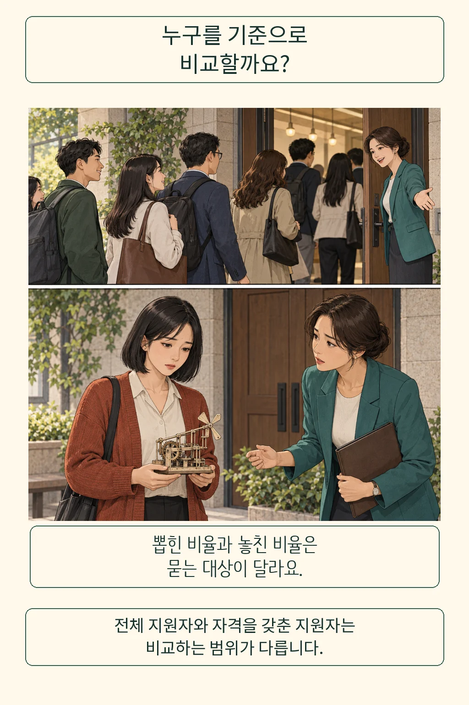

취업이나 교육 과정을 지원하고 AI 평가 결과를 기다리는 순간을 떠올려 볼까요? 사람의 기분에 따라 기준이 흔들리지 않고 모든 지원자에게 똑같은 공식을 적용한다면 일단 믿음직해 보입니다. **하지만 같은 공식을 썼더라도 무엇을 점수로 삼았는지, 준비된 누가 억울하게 떨어졌는지까지 함께 살필 때 비로소 공정성을 온전히 판단할 수 있습니다.** 일관된 계산 규칙은 출발점일 뿐, 평가의 목적과 출발선 조건, 결과를 묻고 고칠 절차까지 함께 보아야 한다고 생각합니다.

글·해설: 다메카솔

## 같은 비율도 누구를 세느냐에 따라 달라집니다

전체 집단에서 선발 비율을 맞추는 일과 억울한 탈락자를 줄이는 일은 서로 다른 질문입니다. 예를 들어 AI가 교육 과정 수강생을 뽑은 뒤 두 담당자가 결과를 점검하는 장면을 생각해 봅시다. 한 담당자는 각 집단 전체 지원자 대비 합격 비율을 비교하고, 다른 담당자는 과정을 따라갈 실력을 갖춘 사람 가운데 누가 문밖에 남았는지를 살핍니다. 같은 합격 명단을 두고도 두 사람이 분모로 삼은 집단 자체가 완전히 다른 셈이죠.

솔론 바로카스, 모리츠 하르트, 아르빈드 나라야난은 『Fairness and Machine Learning』 3장에서 이 차이를 통계적 기준으로 구분합니다([저자들의 설명](https://fairmlbook.org/classification.html)). 전체 지원자를 기준으로 집단별 합격 비율을 같게 맞추는 조건을 **독립성(Independence)**이라고 부릅니다. 반면 실제 자격을 갖춘 사람 가운데 잘못 탈락시킨 비율, 곧 거짓 음성률만 맞추는 접근은 자격을 갖춘 사람의 탈락 비율과 자격이 모자란 사람의 합격 비율을 함께 맞추는 **분리 기준(Separation)** 전체와 구별되는 완화 조건입니다.

같은 점수표를 보더라도 어떤 질문을 앞에 두느냐에 따라 지켜지는 가치와 놓치기 쉬운 빈틈이 갈립니다.

| 공정성 기준 | 비교하는 대상(분모) | 주로 지켜 주는 가치 | 함께 살펴야 할 빈틈 |
| --- | --- | --- | --- |
| **같은 계산 규칙** | 모든 개별 지원자 | 담당자의 자의적 편견 배제 | 과거 편향이 담긴 항목까지 점수화 |
| **선발 비율 균등 (독립성)** | 각 집단의 전체 지원자 | 집단 간 참여·선발 기회 균등 | 준비된 지원자의 탈락 차이 가려짐 |
| **억울한 탈락 줄이기 (분리 기준 일부)** | 실제 자격을 갖춘 지원자 | 역량 있는 지원자의 탈락 완화 | '자격 있음'을 정한 정답 기준의 편향 |

이 가운데 어느 비율을 우선할지는 수학 공식이 정해 주기보다 우리가 가치 판단으로 선택해야 할 영역입니다. 참여 기회를 넓히는 목적과 준비된 사람을 놓치지 않으려는 목적은 지향점이 다르거든요. 게다가 저자들이 짚듯 분류 모델이 학습하는 ‘과정을 마칠 사람’ 같은 정답 변수 자체가 이미 기존의 불평등을 반영하고 있을 수 있습니다. 정답표에 편향이 배어 있다면 오류 비율을 아무리 똑같이 맞춰도 공정성이 저절로 보장되기는 어렵기에, 점수를 따지기 전에 그 점수가 예측하려는 실제 결과부터 일상 언어로 물어야 합니다.

## 준비할 기회도 같았을까요?

채용 평가로 시선을 옮기면 점수표에 찍히기 전의 시간까지 드러납니다. 가령 가상의 두 지원자가 똑같이 ‘외부 대회 수상 경력’ 항목으로 평가받는 장면을 떠올려 볼까요? 한 사람은 조용한 환경에서 온전히 대회 준비에 시간을 쏟았고, 비슷한 잠재력을 지닌 다른 사람은 카페 아르바이트로 생활비를 벌며 틈틈이 과제를 준비했습니다. 겉으로 찍힌 수상 점수만 보아서는 두 사람이 서 있던 출발선 차이까지 읽어 내기 어렵습니다.

바로카스, 하르트, 나라야난은 같은 책 4장에서 존 롤스의 ‘공정한 기회균등’ 개념을 해설하며 이 문제를 사회 제도의 차원으로 넓혀 봅니다([기회균등의 여러 관점](https://fairmlbook.org/relative.html)). 비슷한 잠재력과 의욕을 지닌 사람이 배경 환경 때문에 뒤처지지 않도록 평가 기준과 사회 제도를 함께 살피는 관점입니다. 롤스 원전을 직접 인용하지 않고 저자들의 해설을 따라가 보아도, 점수표 이전의 여건을 묻는 일이 왜 중요한지 한결 또렷해지죠.

이 관점은 특정 지원자에게 몇 점의 가산점을 주라는 단일 공식을 정해 주기보다, 경력을 쌓을 기회가 어떻게 나뉘었는지 묻게 만듭니다. 과거 수상 경력 비중을 줄이고 실제 직무 과제로 역량을 살필지, 입사 후 교육 과정을 넓혀 격차를 메울지처럼 점수 계산 바깥의 제도 설계까지 함께 고민하게 하는 렌즈입니다.

## 다메카솔의 판단: 점수 뒤에도 대화가 이어져야 합니다

만약 제가 평가 시스템을 설계한다면 결과 화면에 점수 숫자 하나만 남기는 구조부터 바꾸고 싶습니다. 점수는 평가의 끝이 아니라 지원자와 운영자가 결과를 점검하는 대화의 시작점이어야 하거든요. 앤드루 셀브스트와 동료들은 2019년 논문에서 공정성을 알고리즘 내부의 수학적 속성으로만 가두고 주변의 제도와 사람을 빼버리는 ‘추상화의 함정’을 지적하며, 사회적 행위자와의 상호작용까지 설계 범위에 넣어야 한다고 논증했습니다([논문 원문](https://doi.org/10.1145/3287560.3287598)). 현장에 제도를 도입해 개입 효과를 측정한 실험이라기보다, 기술 시스템만 떼어 볼 때 생기는 개념적 맹점을 짚어 낸 분석입니다.

그래서 저는 평가 절차를 볼 때 최소한 네 가지가 갖춰졌는지 먼저 확인해 보고 싶습니다.

1. **평가 목적**: 이 점수가 실제로 재려는 역량이 무엇이며, 기존의 불평등이 섞인 지표를 그대로 쓰고 있지는 않은가?
2. **오류 부담**: 자격을 갖춘 사람을 놓치는 손실과 기준에 못 미치는 사람을 뽑는 손실 가운데 어느 위험을 더 엄격히 관리하는가?
3. **설명과 정정 경로**: 어떤 항목이 근거가 되었는지 확인하고, 잘못 입력된 이력이나 누락 자료를 고쳐 달라고 요청할 창구가 있는가?
4. **목적에 맞는 과제 검증**: 과거 대회 경력에만 의존하기보다 실제 직무 수행 과제 같은 대안적 평가 방식을 검토했는가?

물론 문의 창구에 담당자 한 명을 배치하는 것만으로 문제가 저절로 풀리기는 어렵습니다. 사람에게도 편견이 있을 수 있고, 점수를 고칠 권한 없는 담당자에게 민원만 쌓일 수 있기 때문이죠. 따라서 사람의 재검토가 의미를 가지려면 투명한 재심의 기준과 실제 결과를 수정할 권한을 함께 설계해야 합니다. 이 지점은 앞서 다룬 [AI가 실수했을 때의 책임](/posts/ai-mistake-responsibility-boundary/)과도 이어지는데, 결과를 바꿀 권한이 있는 곳에 설명과 수정의 책임도 함께 두어야 신뢰가 유지됩니다.

결국 같은 계산 규칙은 공정성의 출발점일 뿐이며, 평가의 목적과 출발선의 조건, 오류를 바로잡는 절차까지 맞물려야 믿을 수 있는 평가가 됩니다. 앞으로 AI 평가 결과를 마주한다면 숫자만 보고 물러서기보다 먼저 이렇게 물어보면 어떨까요? “이 점수는 무엇을 재었고, 잘못 반영된 사실은 어떻게 고칠 수 있나요?”

## 출처

- Barocas, S., Hardt, M. & Narayanan, A. [Fairness and Machine Learning, 3장](https://fairmlbook.org/classification.html): Independence, Separation 및 정답 변수의 한계.
- 같은 책 [4장](https://fairmlbook.org/relative.html): 기회균등의 넓은 관점(롤스 철학에 관한 저자 해설로 참고).
- Selbst, A. D. et al. (2019). [Fairness and Abstraction in Sociotechnical Systems](https://doi.org/10.1145/3287560.3287598), 서론과 §2.1.

발행일: 2026-10-06 · 출처 확인일: 2026-10-06

이 글의 본문과 이미지는 생성형 AI로 제작했습니다. 기획과 편집 기준은 다메카솔이 정했습니다.

본문은 공개된 연구 문헌과 저자들의 철학 해설을 바탕으로 정리했으며, 교육·채용 장면은 이해를 돕기 위한 가상 예시일 뿐 특정 기업이나 지원자의 실측 사례가 아닙니다.
