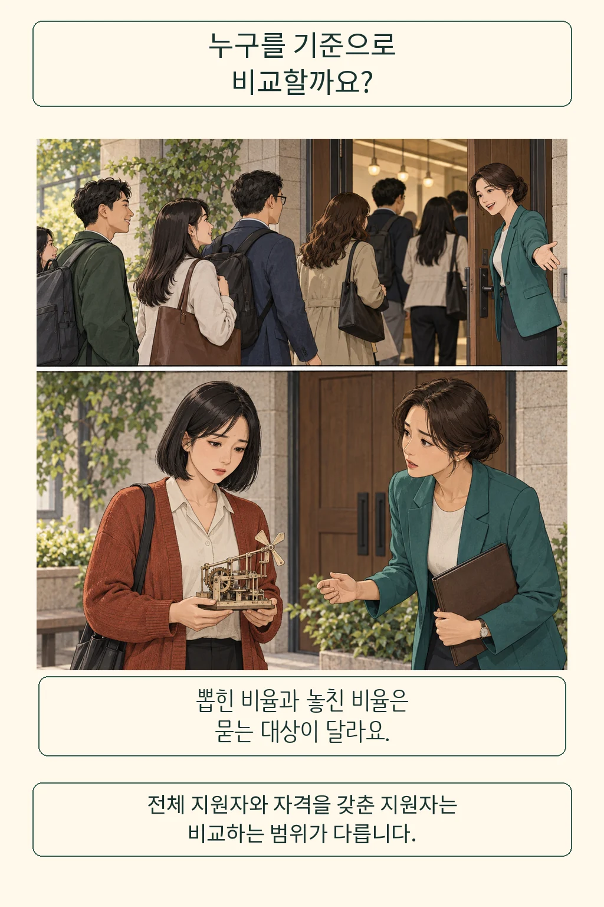

AI가 누구에게나 같은 기준으로 점수를 매기면 공정할까요? 사람의 기분에 따라 결과가 흔들리는 것보다는 믿음직해 보이지만, **무엇을 점수로 만들었는지와 어떤 사람을 잘못 탈락시켰는지까지 살펴야 공정성을 온전히 판단할 수 있습니다.** 저는 일관된 계산 규칙에 더해, 평가받는 사람이 이유를 묻고 오류를 바로잡을 길이 열려 있어야 한다고 봅니다.

글·해설: 다메카솔

## 같은 비율도 누구를 세느냐에 따라 달라집니다

전체 집단에서 선발 비율을 맞추는 일과 억울한 탈락자를 줄이는 일은 서로 다른 질문입니다. 예를 들어 AI가 교육 과정 지원자를 고르는 상황에서, 한 담당자는 각 집단에서 선발된 사람의 비율을 비교하고 다른 담당자는 과정을 따라갈 준비가 된 사람 중 누가 잘못 탈락했는지를 살핀다면 두 사람이 보는 분모 자체가 달라집니다.

솔론 바로카스, 모리츠 하르트, 아르빈드 나라야난은 『Fairness and Machine Learning』에서 이 차이를 통계적 기준으로 구분합니다. 전체 지원자를 기준으로 선발 비율을 맞출 수도 있고(독립성), 실제 자격을 갖춘 지원자 안에서 잘못 탈락한 비율을 맞출 수도 있습니다(분리 기준의 일부). ([저자들의 설명](https://fairmlbook.org/classification.html))

어느 비율을 우선할지는 수학 공식만으로 정할 수 없는 가치 판단입니다. 참여 기회를 넓히는 목적과 준비된 사람을 놓치지 않는 목적은 관심사가 다르고, 과거 데이터에 담긴 ‘준비됐다’는 판정 자체에 이미 편향이 섞여 있을 수도 있기 때문입니다. 따라서 점수가 높고 낮음을 따지기 전에, 그 점수가 예측하려는 실제 결과가 무엇인지 일상적인 언어로 먼저 물어야 합니다.

## 준비할 기회도 같았을까요?

이 질문을 채용 평가로 옮기면 점수표에 찍히기 전의 시간까지 시야에 들어옵니다. 가상의 두 지원자가 똑같이 ‘외부 대회 수상 경력’ 항목으로 평가받을 때, 한 사람은 온전히 대회 준비에 시간을 쏟을 수 있었고 다른 사람은 생계를 위해 아르바이트를 병행하며 틈틈이 준비했다면 같은 점수표만으로는 그 출발선 차이까지 알기 어렵습니다.

같은 책의 저자들은 존 롤스의 공정한 기회균등 개념을 해설하면서, 비슷한 잠재력과 의욕을 지닌 사람이 배경 환경 때문에 뒤처지지 않도록 평가 기준과 사회 제도를 넓게 살피는 관점을 소개합니다(여기서는 롤스 원전을 직접 인용하지 않고 저자들의 해설을 참고했습니다). ([기회균등의 여러 관점](https://fairmlbook.org/relative.html))

이 관점은 특정 지원자에게 몇 점의 가산점을 주라는 단일 공식을 정해 주기보다, 경력을 쌓을 기회가 어떻게 배분됐는지 묻게 만듭니다. 과거 경력 비중을 줄이고 실제 직무 과제를 해 볼 기회를 줄지, 입사 후 교육 과정을 넓힐지처럼 점수 계산 바깥의 제도 설계까지 함께 고민하게 하는 렌즈입니다.

## 다메카솔의 해석: 점수 뒤에도 대화가 이어져야 합니다

평가 시스템을 설계한다면 결과 화면에 숫자 하나만 남기는 구조부터 바꾸고 싶습니다. 어떤 항목을 근거로 평가했는지, 잘못 입력된 이력은 어디서 고칠 수 있는지, 이의를 제기하면 누가 어떤 기준으로 재검토하는지까지 하나의 평가 절차 안에 포함해야 하기 때문입니다.

앤드루 셀브스트와 동료들은 공정성을 머신러닝 모델 내부의 수학적 속성으로만 가두고 주변의 제도와 사람을 시야에서 빼버리는 ‘추상화의 함정’을 지적하며, 사회적 행위자와의 상호작용까지 설계 범위에 넣어야 한다고 논증했습니다. ([논문 원문](https://doi.org/10.1145/3287560.3287598))

물론 문의 창구에 담당자 한 명을 배치하는 것만으로 문제가 해결되지는 않습니다. 사람에게도 편견이 있을 수 있고, 점수를 바꿀 권한이 없는 담당자에게 민원만 쌓일 수도 있으므로 재검토 기준과 실질적인 수정 권한을 함께 설계해야 합니다. 이는 앞서 다룬 [AI가 실수했을 때의 책임](/posts/ai-mistake-responsibility-boundary/)과도 이어지는 질문입니다.

결국 같은 계산 규칙을 적용하는 일은 공정성의 출발점일 뿐, 평가의 목적과 기회의 조건, 그리고 오류를 바로잡는 절차까지 맞물려야 비로소 신뢰할 수 있는 평가가 됩니다. 평가 결과를 마주했을 때 우리가 던져야 할 첫 질문도 분명합니다. “이 점수는 무엇을 재었고, 잘못 반영된 사실은 어떻게 고칠 수 있나요?”

## 출처

- Barocas, S., Hardt, M. & Narayanan, A. [Fairness and Machine Learning, 3장](https://fairmlbook.org/classification.html): Independence, Separation 및 정답 변수의 한계.
- 같은 책 [4장](https://fairmlbook.org/relative.html): 기회균등의 넓은 관점(롤스 철학에 관한 해설로 참고).
- Selbst, A. D. et al. (2019). [Fairness and Abstraction in Sociotechnical Systems](https://doi.org/10.1145/3287560.3287598), 서론과 §2.1.

발행일: 2026-10-06 · 출처 확인일: 2026-10-06

이 글의 본문과 이미지는 생성형 AI로 제작했습니다. 기획과 편집 기준은 다메카솔이 정했습니다.
