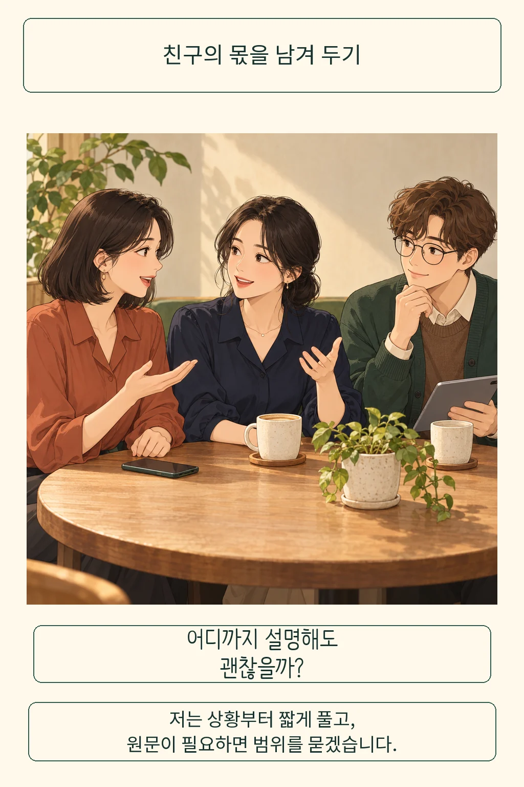

친구에게 더 다정한 답장을 보내려고 AI에 대화 내용을 넣는다면, 그 친절은 어디까지 허락된 걸까요? **저는 답장을 돕는 데 필요한 상황부터 제 말로 풀고, 친구의 원문이 꼭 필요할 때는 옮길 범위를 먼저 묻겠습니다.** 내 고민을 해결하는 과정에도 상대가 맡긴 이야기가 들어 있기 때문입니다.

글·해설: 다메카솔

## 나에게 말한 것과 새로 전달하는 것

친구가 직장 문제로 속상하다는 긴 메시지를 보냈다고 해 봅니다. 위로하고 싶은데 말이 잘 떠오르지 않아 대화 전체를 복사하려는 순간, 나에게 보낸 이야기를 다른 곳에서도 다뤄도 되는지 생각하게 됩니다. 답장을 잘 쓰려는 마음과 친구가 기대한 대화의 범위가 어긋날 수도 있는 장면이죠.

철학자 헬렌 니센바움은 프라이버시를 이해할 때 정보의 내용과 그 정보가 흐르는 맥락을 함께 보자고 제안했습니다. 어떤 관계에서 나누기에 적절한 정보인지, 누구에게 어떤 조건으로 전달되는지를 묻는 ‘맥락적 무결성’이라는 관점입니다. 우정에서는 폭넓은 이야기를 나누면서도, 그 말이 임의로 다른 사람에게 퍼지지는 않으리라 기대한다고 설명합니다. [2004년 원전](https://nissenbaum.tech.cornell.edu/papers/H.%20Nissenbaum,%20_Privacy%20as%20Contextual%20Integrity.pdf)

이 렌즈로 보면 친구의 이름을 지웠다는 사실만으로 판단이 끝나지는 않습니다. 이름을 가려도 자세한 사건과 말투를 그대로 옮겼다면 무엇을 새로 전달하는지 살펴볼 여지가 남습니다. AI에 입력한 내용이 어떻게 처리되는지는 서비스와 설정에 따라 따로 확인해야 하지만, 상대가 맡긴 이야기를 어느 범위까지 옮길지는 입력하는 나의 선택에도 달려 있습니다.

## 많이 알수록 더 잘 도울까

상황을 자세히 알려 주면 조언이 더 나아질 것이라는 기대에는 이유가 있습니다. 앞뒤 사정을 빼면 엉뚱한 답장이 나올 수 있고, 상대의 표현을 보고 싶은 경우도 있죠. 그래서 저는 정보량을 늘리기 전에 지금 부탁한 일이 무엇인지부터 좁혀 보겠습니다. 친구를 분석해 달라는 요청과, 부담을 주지 않는 위로 문장 몇 개를 써 달라는 요청은 필요한 설명의 범위가 다릅니다.

AI 도우미를 연구한 갈레비케사비와 동료들도 2024년 연구에서 ‘일을 마쳤는가’와 ‘필요 이상으로 정보를 전달했는가’를 나누어 평가했습니다. 합성 인물 자료와 입력 양식을 만들고, 무엇을 공유할 필요가 있는지 사람의 판단을 붙였습니다. Gemini Ultra를 사용한 주요 비교에서는 받는 곳과 정보의 종류 등 맥락을 추론하도록 한 도우미가 두 평가에서 조금 앞섰습니다. 모델이나 지시 방식이 달라지면 개인정보 보호와 유용성에서 앞서는 설계도 달랐습니다. [연구 원문](https://arxiv.org/abs/2408.02373v2)

이 연구는 양식 작성 과제에서 얻은 결과이며 실제 친구들의 대화를 관찰한 실험은 아닙니다. 저자들도 사람을 대상으로 한 추가 검증과 악의적인 상대에 대한 보호를 후속 과제로 남겼습니다. 여기서 가져올 만한 질문은 분명합니다. 도움을 받았다는 만족감 옆에서, 그 도움에 꼭 필요했던 정보였는지도 함께 볼 수 있다는 것입니다.

## 다메카솔의 해석: 친구가 정할 자리를 남깁니다

위로 문장 몇 줄을 고르는 데 대화 전체가 꼭 필요할까요? 저는 우선 ‘일 때문에 속상한 친구에게 해결책을 강요하지 않는 위로를 쓰고 싶다’고 설명하겠습니다. 이 정도로 목적을 이룬다면 친구의 대화 전체를 옮길 이유가 줄어듭니다. 특정 문장의 뉘앙스를 꼭 살펴야 한다면 어떤 도구에 어느 부분을 보여 주려는지 친구에게 말하고 함께 범위를 정하겠습니다. 상대는 다른 방식의 도움을 원할 수도 있으니까요.

매번 긴 확인 절차를 거치자는 뜻은 아닙니다. 공개해도 좋다고 함께 정한 내용이나, 개인 사정 없이 물을 수 있는 표현 질문부터 시작하면 부담이 작아집니다. 반대로 누군가의 안전이 급한 상황까지 평상시의 대화 예절 하나로 판단하기는 어렵습니다. 이 글의 제안은 일상적인 관계 조언을 얻을 때 지킬 공유 범위에 관한 것입니다.

서비스를 설계한다면 자료에 접근할 수 있다는 이유로 대화 전체를 기본 전송하는 방식부터 바꾸겠습니다. 보내기 전에 필요한 부분과 받는 곳을 보여 주고, 사용자가 고른 범위만 넘기게 하는 편이 제 입장에 맞습니다. ‘자세히 알려 주세요’라는 입력창 앞에 자기 이야기와 타인의 이야기를 구별할 여유가 생기기 때문입니다.

[AI가 기억한 나를 고치는 문제](/posts/ai-memory-revision-context/)가 저장된 정보의 맥락을 물었다면, 이번에는 입력하기 전의 관계를 물었습니다. 좋은 답장을 얻는 일에 친구가 자신의 이야기를 다룰 자리를 보태고 싶습니다. 도움을 구하는 나의 편리함과, 이야기를 맡긴 친구의 기대를 함께 살피는 친절입니다.

## 출처

- Helen Nissenbaum (2004). [Privacy as Contextual Integrity](https://nissenbaum.tech.cornell.edu/papers/H.%20Nissenbaum,%20_Privacy%20as%20Contextual%20Integrity.pdf), Washington Law Review 79, 119–158. 정보의 적절성과 흐름, 우정의 비밀 유지 기대에 관한 논의. AI 입력에 연결한 기준은 다메카솔의 해석입니다.
- Sahra Ghalebikesabi et al. (2024). [Operationalizing Contextual Integrity in Privacy-Conscious Assistants, v2](https://arxiv.org/abs/2408.02373v2). 양식 작성 평가와 6.1절의 한계를 참고했습니다.

출처 확인일: 2026-10-21

이 글의 본문과 이미지는 생성형 AI로 제작했습니다. 기획과 편집 기준은 다메카솔이 정했습니다.
