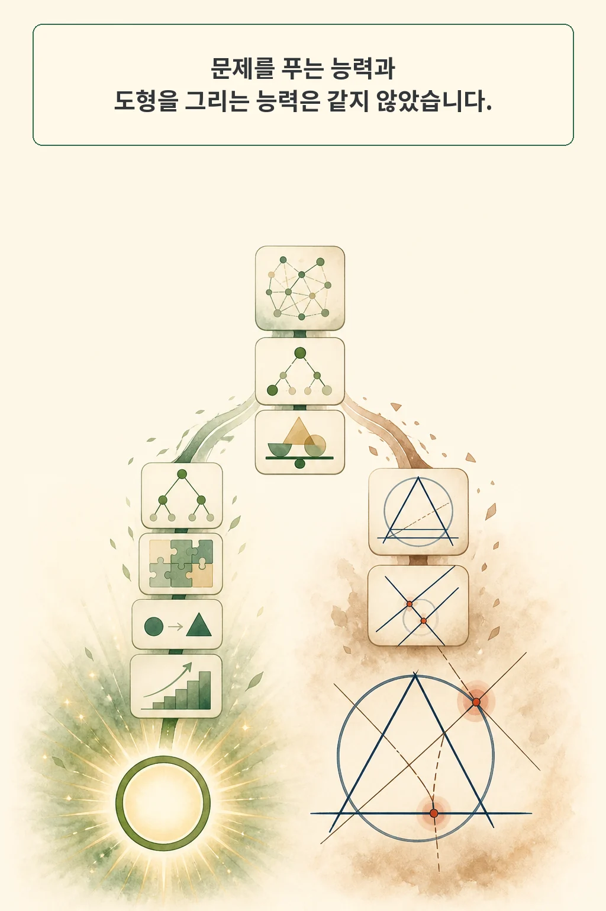
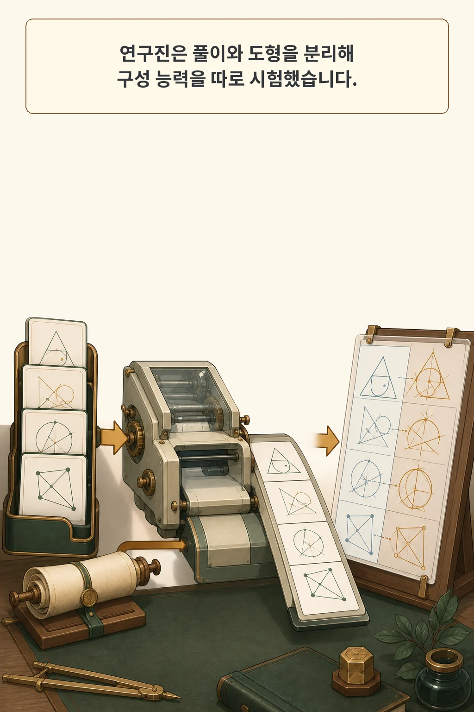
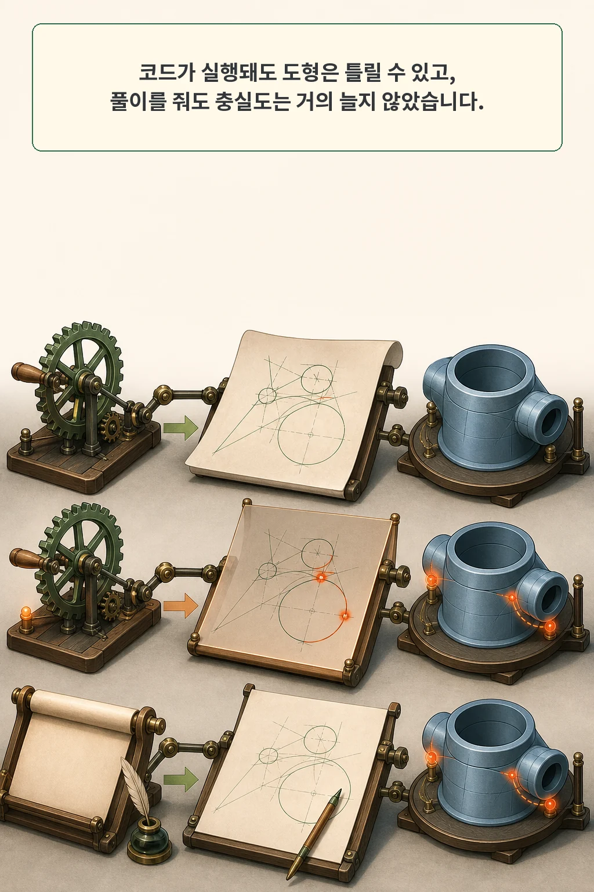
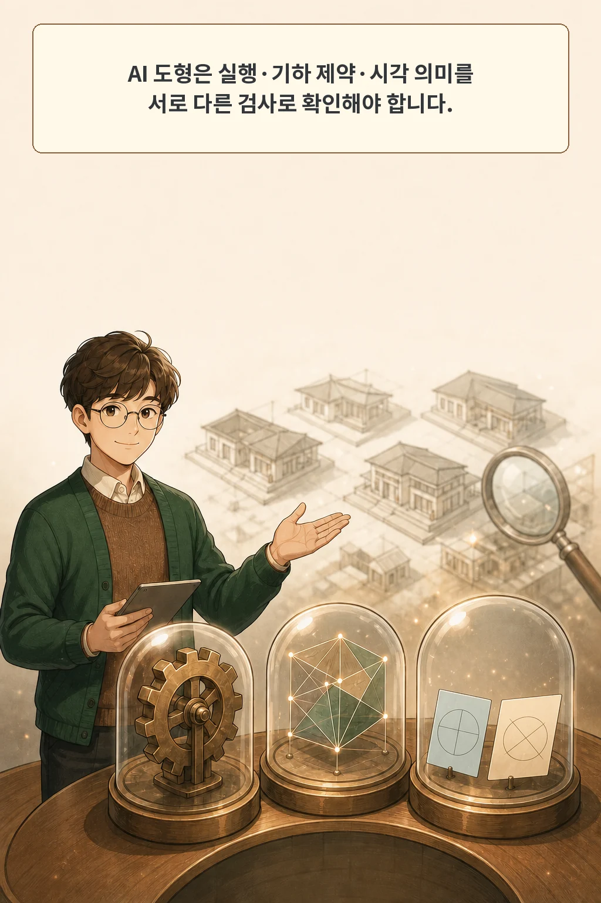

올림피아드 기하 문제를 도형 코드로 바꾸게 했을 때 실험 전체의 평균 컴파일 성공률은 36.14%에 그쳤고, 실행에 성공한 결과조차 점의 배치와 선의 관계가 맞는지는 다시 확인해야 했습니다. **「Solving Is Not Drawing: A Benchmark for Diagrammatic Reasoning in Olympiad Geometry」**는 모델이 텍스트로 답을 구하는 능력과 문제에 적힌 관계를 충실한 그림으로 구성하는 능력을 분리해 측정합니다. 공개된 수학 풀이 성적이 높은 모델도 도형 구성에서는 크게 흔들렸고, 참조 풀이를 함께 주어도 렌더링된 도형의 시각적 충실도는 거의 오르지 않았습니다.

*글·해설: 다메카솔*

## 핵심 내용

- 논문은 텍스트 문제 풀이와 도형 구성을 분리해 올림피아드 기하 문제의 Asymptote 도형 생성 능력을 평가했습니다.
- 저자들이 보고한 전체 수집분은 954문제이고, 실제 벤치마크 평가는 어려운 297문제 하위 집합에서 진행됐습니다.
- 모델과 조건을 평균한 컴파일 성공률은 36.14%, VLM 비평 점수는 100점 만점에 46.58점이었습니다.
- 참조 풀이를 주면 텍스트·코드 표면 겹침은 늘었지만 렌더링된 도형의 충실도는 거의 좋아지지 않거나 일부 조건에서 오히려 낮아졌습니다.
- 도형을 설정당 한 번씩만 생성했고 VLM 심사에도 한계가 있으므로, 실제 제품에서는 실행·기하 제약·시각 의미를 나누어 검사해야 합니다.

## ‘풀었다’와 ‘그렸다’ 사이

기하 문제의 정답을 구하는 모델은 텍스트나 수식으로 관계를 추론하지만, 도형을 그리는 모델은 그 관계를 구체적인 좌표와 점, 선, 원, 교점으로 평면에 배치해야 합니다. 여기에는 문제 지문에 직접 쓰이지 않은 암묵적 공간 제약까지 일관되게 맞추는 일이 포함됩니다. 예를 들어 풀이가 “두 선의 교점”을 올바르게 사용했더라도 생성된 그림에서 그 선들이 만나지 않으면 시각 설명은 틀리게 됩니다.

저자들은 문제의 명시적·암묵적 기하 관계를 만족하는 시각 구성을 만들고 검증하는 이 능력을 **도형적 추론(diagrammatic reasoning)**이라고 부릅니다. 정답 풀이 점수를 곧바로 도형 생성 품질 점수로 쓸 수 없는 이유입니다.

## 무엇을 어떻게 시험했나

논문은 사람이 작성한 Asymptote 해설 도형이 있는 자족적 올림피아드 기하 문제 954개를 모으고, 그중 어려운 297문제 하위 집합을 골라 다섯 모델 계열을 시험했습니다(문제만 주는 조건 vs. 참조 풀이까지 주는 조건). 생성 결과는 단일 점수로 합치지 않고 네 층으로 나누어 평가했습니다.

| 평가 층 | 확인하는 것 | 놓칠 수 있는 것 |
| --- | --- | --- |
| 텍스트·코드 겹침 | 참조 설명이나 코드와 표현이 비슷한가 | 다른 표현으로 만든 올바른 도형 |
| 컴파일 성공 | Asymptote 코드가 실행되는가 | 실행되지만 기하 관계가 틀린 그림 |
| 이미지 유사도 | 렌더 결과가 참조 이미지와 시각적으로 가까운가 | 동치인 다른 배치와 미세한 관계 오류 |
| VLM 비평 | 시각 모델이 문제 조건과 그림을 함께 보고 평가하는가 | 심사 모델이 놓치거나 잘못 판단한 오류 |

프로그램이 에러 없이 실행된다는 사실, 이미지가 참조 도형과 비슷해 보인다는 사실, 그리고 문제의 기하 관계가 실제로 맞는다는 사실은 서로 다른 증거이기 때문입니다.

## 실행 성공은 기하 충실도가 아니었다

실험 결과는 코드 생성부터 시각 충실도까지 단계별 병목을 뚜렷하게 보여 주었습니다.

- **낮은 컴파일 성공률**: 모델과 입력 조건을 평균한 Asymptote 컴파일 성공률은 36.14%(모델·조건별 20.8%~59.3%)로 코드 생성 단계부터 불안정했습니다.
- **컴파일 이후의 시각 품질 한계**: 컴파일된 결과의 평균 VLM 비평 점수는 100점 만점에 46.58점이었고 어떤 개별 설정도 53.2점을 넘지 못했습니다. 문법적으로 유효한 코드는 시작 조건일 뿐 기하 충실도의 완료 증거가 아니었습니다.
- **참조 풀이 제공의 역설**: 참조 풀이를 함께 주면 설명 키워드와 코드 표현의 겹침은 늘었지만, 렌더 이미지 유사도와 VLM 비평 같은 시각 충실도 지표는 거의 개선되지 않거나 일부 설정에서 오히려 낮아졌습니다. 풀이에 필요한 관계를 읽는 일과 그 관계를 일관된 좌표계에 배치하는 일 사이에 별도의 병목이 존재한다는 신호입니다.

물론 이 실험 결과를 읽을 때는 몇 가지 경계를 함께 봐야 합니다. 논문은 같은 297문제에서 모델의 풀이 정확도를 직접 다시 측정하지 않고 공개된 AIME 2025 시스템 카드 성적과 나란히 비교했으며, 각 문제·모델·조건에서 도형을 한 번씩만 생성해 샘플링 변동성을 재지 않았습니다. 또한 VLM 심사자의 판정 오류 가능성과 텍스트·코드 겹침 지표의 한계가 있고, 2026년 8월 20일 확인한 공식 Hugging Face 저장소 스냅숏에는 전체 954문제가 아닌 어려운 하위 집합 297행(문제·풀이·Asymptote 코드 필드 포함)만 공개되어 있어 이번 검토에서는 공개된 데이터 구조를 감사하고 원문 수치를 교차 확인했습니다.

## 다메카솔의 해석: 생성 도형은 세 번 검사한다

생성형 교육 자료나 기술 문서 파이프라인에 이 교훈을 옮긴다면 생성 도형은 다음 세 층으로 분리해 검증해야 합니다.

1. **실행 검사**: 코드나 SVG가 문법 오류 없이 파싱·렌더링되는지 확인합니다.
2. **기하 제약 검사**: 교점, 공선, 평행, 수직, 내접처럼 문제의 핵심 관계를 계산 가능한 기하 규칙으로 검사합니다.
3. **시각 의미 검사**: 레이블 위치, 선 겹침, 가독성, 교육적 오해 가능성을 사람이나 독립 심사기가 확인합니다.

실행 검사를 통과한 틀린 도형도 있고 참조 이미지와 배치가 달라도 기하 관계는 올바른 도형도 있으므로, 세 검사는 서로를 대신할 수 없습니다. 도형 생성 작업에서는 “렌더링됐는가?”에서 멈추지 않고 “기하 관계가 맞는가?”, “독자가 같은 의미로 읽는가?”를 별도의 품질 게이트로 남겨야 합니다.

## 논문 정보

| 항목 | 내용 |
| --- | --- |
| 제목 | Solving Is Not Drawing: A Benchmark for Diagrammatic Reasoning in Olympiad Geometry |
| 저자 | Hsien Xin Peng, Anthony Kim, Alvin Li, Calvin Supasanya, Shivank Garg, Kevin Zhu |
| 공개 이력 | arXiv v1 제출 2026-06-23 (2026-08-20 cs.AI 신규 목록 등장) |
| 발표 정보 | ICML 2026 AI4MATH Workshop |
| 이 글의 분류 | 경험적 벤치마크 연구 |

## 자주 묻는 질문

### 컴파일에 성공하면 도형도 맞는 것 아닌가요?

컴파일은 코드 문법과 실행 가능성만 확인합니다. 점과 선이 문제의 기하 관계를 만족하는지는 별도의 제약 검사와 시각 검토가 필요합니다.

### 참조 풀이를 주면 왜 그림이 바로 좋아지지 않나요?

풀이 텍스트에 필요한 관계가 담겨 있어도 이를 구체적인 좌표와 객체로 평면에 배치하는 과정이 따로 남기 때문입니다. 논문에서도 텍스트·코드 겹침은 늘었지만 렌더 충실도는 거의 개선되지 않았습니다.

### 공개 데이터로 결과를 재현할 수 있나요?

공식 저장소의 297행 하위 집합은 직접 감사할 수 있지만, 현재 공개 스냅숏에는 논문이 보고한 전체 954문제와 정확한 실행 환경이 없어 전체 벤치마크를 독립 재현했다고 말할 수는 없습니다.

## 함께 읽기

- [AI가 과학 도형을 고칠 때, 무엇을 보존해야 할까 — SciDiagramEdit 논문 리뷰](/posts/scidiagramedit-paper-figure-revision/)

## 출처

- [Hsien Xin Peng 외, “Solving Is Not Drawing: A Benchmark for Diagrammatic Reasoning in Olympiad Geometry,” arXiv:2608.18111](https://arxiv.org/abs/2608.18111)
- [arXiv HTML 본문](https://arxiv.org/html/2608.18111v1)
- [공식 Hugging Face 데이터셋](https://huggingface.co/datasets/max98765/hard_geometry_problems_with_diagrams)

이 글의 본문과 이미지는 생성형 AI로 제작했습니다. 기획과 편집 기준은 다메카솔이 정했습니다.

Updated: 2026-08-20
