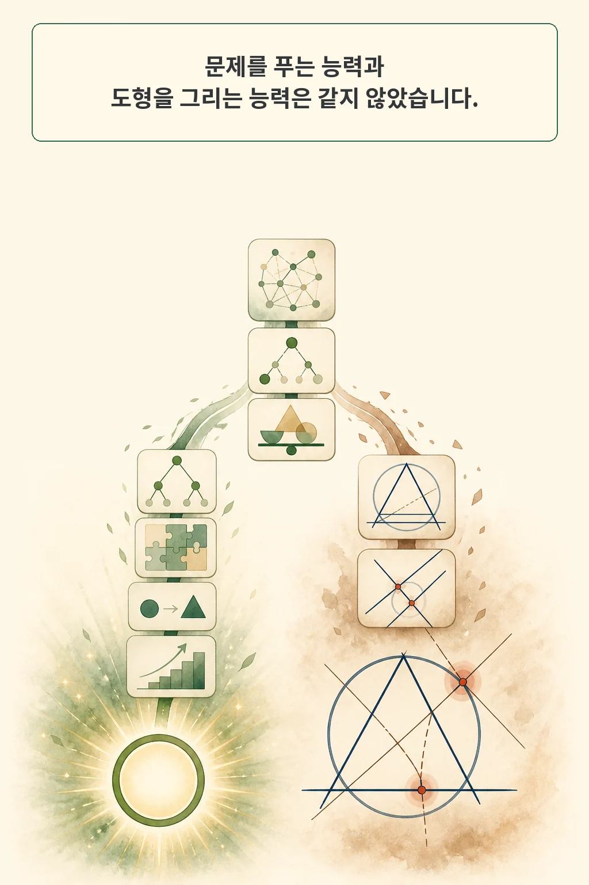
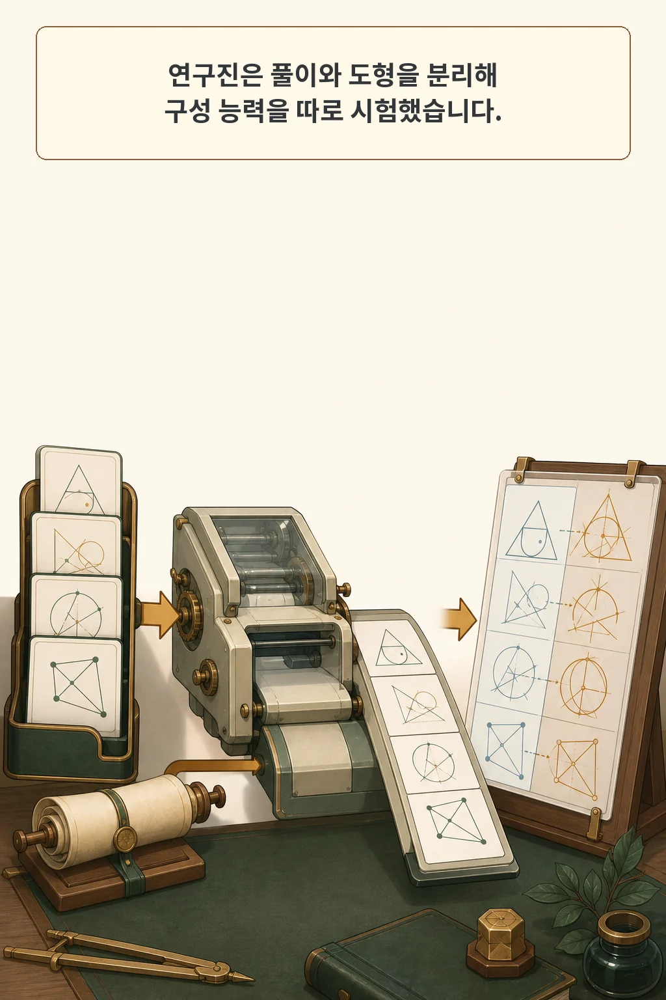
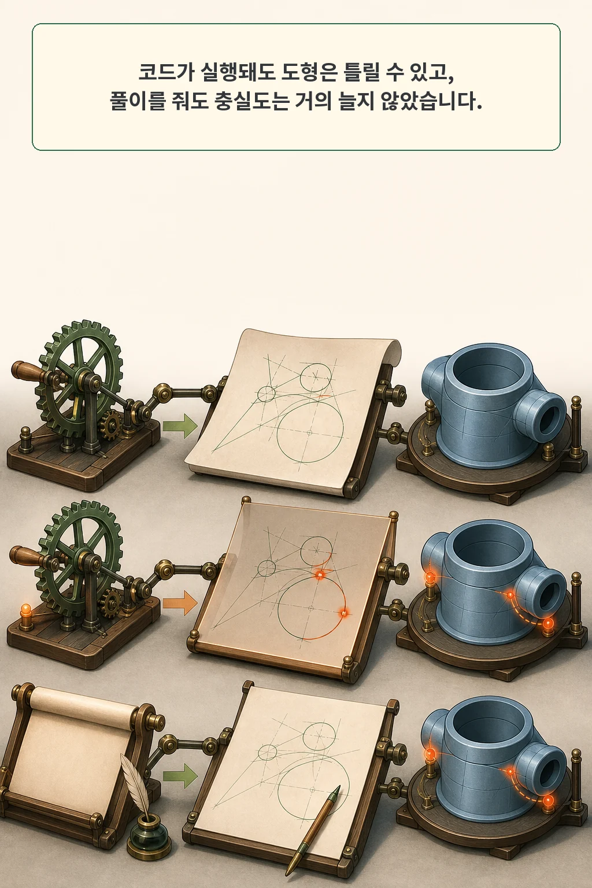
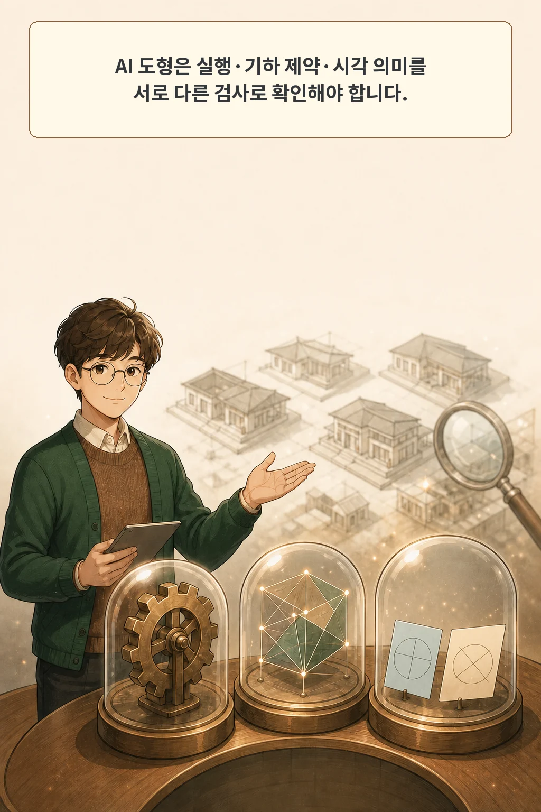

수학 올림피아드 문제를 척척 푸는 AI에게 도형 코드까지 짜 달라고 하면 실행되는 그림 정도는 쉽게 나올 것 같습니다. 하지만 **「Solving Is Not Drawing: A Benchmark for Diagrammatic Reasoning in Olympiad Geometry」**는 텍스트 풀이 능력과 문제 조건을 충실한 도형으로 구성하는 능력을 분리해 측정했고, 두 역량 사이에는 뚜렷한 격차가 드러났습니다. 전체 평균 Asymptote 컴파일 성공률이 36%대에 그쳤을 뿐 아니라, 참조 풀이를 함께 건네도 렌더링된 도형의 기하 충실도는 나아지지 않았거든요.

글·해설: 다메카솔

## 핵심 내용

- **풀이와 구성의 분리**: 954개 중 어려운 297문제를 추려 다섯 모델의 Asymptote 도형 생성을 평가했습니다.
- **낮은 컴파일과 충실도**: 평균 컴파일 성공률 36.14%, 평균 VLM 비평 점수 46.58점(100점 만점)에 머물렀습니다.
- **참조 풀이의 역설**: 정답 풀이를 주면 코드 겹침은 늘었지만, 시각 충실도는 거의 오르지 않거나 오히려 낮아졌습니다.

## ‘풀었다’와 ‘그렸다’ 사이

텍스트로 기하 문제를 푸는 일은 대수식이나 논리 단계를 따라 정답을 찾는 과정입니다. 반면 도형을 그리는 일은 점, 선, 원, 교점을 평면 좌표에 동시에 배치해 지문에 적히지 않은 암묵적 공간 제약까지 맞추어야 합니다.

예를 들어 AI가 "선분 AB와 CD의 교점 P가 외접원 위에 놓인다"고 풀어 정답을 맞혔다고 해 볼까요? 막상 생성한 도형 코드를 렌더링해 보니 두 선분이 만나지 않거나 점 P가 원 밖에 찍혀 있다면 그림은 독자를 오도하게 됩니다. 저자들은 이처럼 명시적·암묵적 기하 관계를 만족하는 시각 구성을 만들고 검증하는 역량을 **도형적 추론(diagrammatic reasoning)**이라 부릅니다. 풀이 점수를 곧바로 도형 품질의 근거로 삼기 어려운 이유죠.

## 무엇을 어떻게 시험했나

저자들은 사람이 작성한 Asymptote 해설 도형이 있는 자족적 기하 문제 954개를 모으고, 그중 어려운 297문제 하위 집합으로 다섯 모델 계열을 시험했습니다. 화질 변수를 배제하려 모델의 주력인 Asymptote 코드 출력을 요구했으며, 문제만 주는 조건과 참조 풀이를 함께 주는 조건을 나란히 비교한 것입니다. 결과는 단일 점수 대신 네 층으로 나누어 평가했습니다.

| 평가 층 | 확인하는 것 | 놓칠 수 있는 것 |
| --- | --- | --- |
| 텍스트·코드 겹침 | 참조 설명·코드와 표현이 비슷한가 | 다른 표현으로 그린 올바른 도형 |
| 컴파일 성공 | Asymptote 코드가 실행되는가 | 실행되지만 관계가 틀린 그림 |
| 이미지 유사도 | 렌더 결과가 기준과 가까운가 | 동치 배치와 미세한 관계 오류 |
| VLM 비평 | 시각 모델이 기준과 기하 일치도를 보는가 | 심사 모델이 놓치거나 오판한 오류 |

코드가 실행된다는 사실과 그림 속 기하 관계가 맞다는 사실은 전혀 다른 층위의 증거거든요. 네 층을 나눈 덕분에 병목이 문법 단계인지 공간 배치인지 또렷이 갈렸습니다.

## 실행 성공은 기하 충실도가 아니었다

다섯 모델과 두 입력 조건을 조합한 열 가지 실험에서는 코드 생성부터 시각 충실도까지 단계별 병목이 뚜렷이 드러났습니다.

| 평가 모델 | 컴파일 성공률 (문제만 / 풀이) | VLM 비평 /100 (문제만 / 풀이) |
| --- | --- | --- |
| `Gemini 3.1 Flash-lite` | 59.3% / 59.2% | 45.2 / 42.6 |
| `GLM 5.1` | 38.6% / 40.0% | 45.0 / 44.2 |
| `Claude Sonnet 4.6` | 41.3% / 27.6% | 51.0 / 49.5 |
| `Kimi K2.5` | 22.0% / 30.9% | 53.2 / 50.8 |
| `GPT-5.4-mini` | 20.8% / 21.7% | 46.4 / 37.9 |
| **전체 평균 (범위)** | **36.14%** (20.8%~59.3%) | **46.58** (최고 53.2) |

표의 수치를 짚어 보면 두 가지 역설이 눈에 띕니다. 우선 코드를 가장 안정적으로 컴파일한 모델이 기하 충실도까지 높지는 않았습니다. 컴파일 성공률 1위 모델은 VLM 비평에서 전체 평균을 밑돌았고, 반대로 컴파일 실패가 더 잦았던 두 모델이 비평 점수 상위에 올랐거든요.

여기에 참조 풀이를 함께 건네도 그림의 시각 품질은 좀처럼 오르지 않았습니다. 풀이 텍스트를 주자 키워드와 코드 겹침 지표는 일제히 올랐지만, 다섯 모델 모두에서 VLM 비평 점수는 오히려 소폭 내려갔고 이미지 유사도 역시 제자리에 가까웠습니다. 모델이 해법을 이해하지 못해서라기보다, 그 관계를 일관된 좌표와 보조 구성으로 번역하는 단계에서 따로 막히는 셈이죠.

물론 이 실험 결과를 실무에 옮길 때는 네 가지 설계 경계도 함께 봐야 합니다.

- **외부 성적 대비**: 같은 297문제에서 풀이 정답률을 다시 재지 않고 공개된 AIME 2025 시스템 카드 성적(도구 유무에 따라 약 87~100% 수준)과 비교했습니다.
- **단일 생성 평가**: 설정당 도형을 한 번씩만 생성해 반복 샘플링에 따른 변동성은 별도로 남았습니다.
- **심사 지표 한계**: VLM 심사자(GPT-5.4-mini)가 미세 오류를 오판할 수 있고, 코드 겹침 지표는 상투적 문법 재사용에 유리합니다.
- **공개 스냅숏 범위**: 수집분은 954문제지만 2026년 8월 공개된 Hugging Face 저장소에는 어려운 하위 집합 297행(문제·풀이·코드 포함)만 담겼습니다.

## 다메카솔의 해석: 생성 도형은 세 번 검사한다

이 결과는 도형 생성기가 쓸모없다는 뜻이 아니라, **정답 풀이 점수만으로 도형 품질까지 대신 평가할 수 없다**는 실무 신호에 가깝습니다. 교육 자료나 기술 문서 파이프라인에 AI 도형을 쓴다면, 최소한 아래 세 단계 검증을 분리해 두는 편이 좋습니다.

1. **실행 검사**: Asymptote나 SVG 코드가 문법 오류 없이 파싱·렌더링되는지 확인합니다.
2. **기하 제약 검사**: 교점, 공선, 평행, 수직, 접선, 내접 같은 핵심 조건이 실제 좌표 계산에서도 맞는지 검산합니다.
3. **시각 의미 검사**: 레이블 겹침이나 선 혼선, 오해를 부르는 비율 왜곡은 사람이나 독립 심사기로 확인합니다.

가령 원에 접하는 직선을 생성하는 문제 은행이라면, 렌더링 통과만 보고 배포하기보다 원의 중심과 직선 거리가 반지름과 같은지 좌표 계산으로 한 번 더 걸러내야 합니다. 실행만 통과한 오답 그림도 있고 배치가 달라도 관계가 맞는 그림도 있어 세 검사를 모두 거쳐야 안심할 수 있습니다.

## 논문 정보

| 항목 | 내용 |
| --- | --- |
| 제목 | Solving Is Not Drawing: A Benchmark for Diagrammatic Reasoning in Olympiad Geometry |
| 저자 | Hsien Xin Peng, Anthony Kim, Alvin Li, Calvin Supasanya, Shivank Garg, Kevin Zhu |
| 공개 이력 | arXiv v1 제출 2026-06-23 02:39:21 UTC · 2026-08-20 cs.AI 신규 목록 등장 |
| 발표 정보 | ICML 2026 AI4MATH Workshop |

## 함께 읽기

- [AI가 과학 도형을 고칠 때, 무엇을 보존해야 할까 — SciDiagramEdit 논문 리뷰](/posts/scidiagramedit-paper-figure-revision/)

## 출처

- [Hsien Xin Peng 외, “Solving Is Not Drawing: A Benchmark for Diagrammatic Reasoning in Olympiad Geometry,” arXiv:2608.18111](https://arxiv.org/abs/2608.18111)
- [arXiv HTML 본문](https://arxiv.org/html/2608.18111v1)
- [공식 Hugging Face 데이터셋](https://huggingface.co/datasets/max98765/hard_geometry_problems_with_diagrams)

이 글은 arXiv 논문 원문(PDF·TeX 소스)과 공개된 297행 데이터셋 스냅숏을 바탕으로 해설했으며 실험을 독립 재현하지 않았고, 만화는 논문 그림을 복제하지 않고 자체 시각 언어로 재구성했습니다.
이 글의 본문과 이미지는 생성형 AI로 제작했습니다. 기획과 편집 기준은 다메카솔이 정했습니다.
