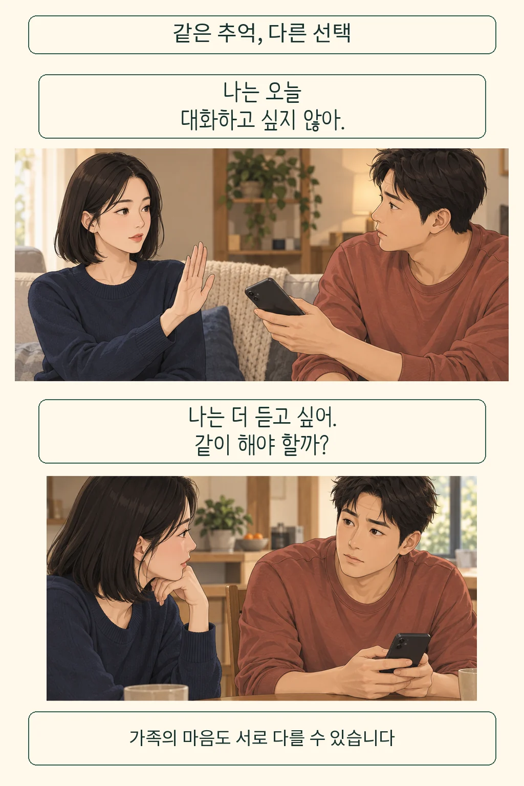
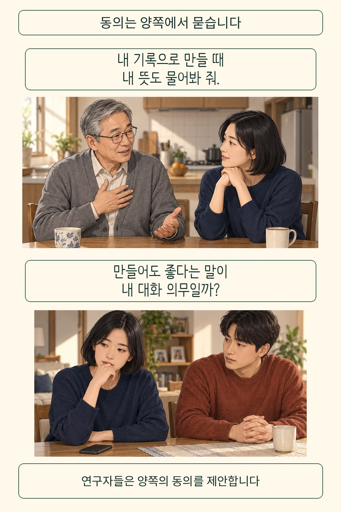
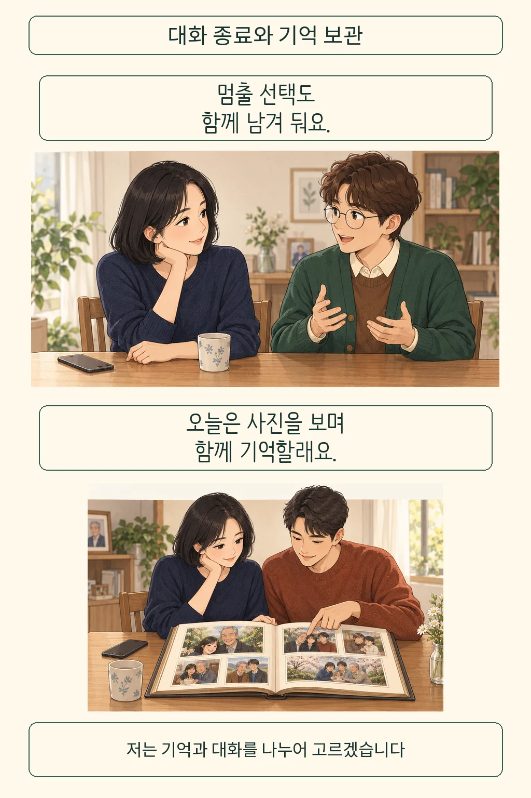

AI 대화창을 닫는 일과 떠나보낸 가족을 잊는 일은 어디서 갈라질까요? 아버지의 옛 사진과 음성 파일은 소중히 간직하고 싶어도, 그 말투를 흉내 내며 새로운 답장을 건네는 AI에는 선뜻 답하기 어려울 수 있습니다. 기록을 보존하는 일과 생성형 대화에 참여하는 일을 하나의 선택으로 묶어 버리면 이 미묘한 차이를 놓치게 됩니다. **저는 생전의 뜻과 현재 남겨진 사람들의 의사를 함께 살피며, 추억은 간직하되 AI 대화는 언제든 멈출 수 있어야 한다고 봅니다.**

글·해설: 다메카솔

## 같은 가족이어도 원하는 거리는 다릅니다

이 차이를 살펴보기 위해 성인 남매의 가상 장면을 떠올려 봅니다. 오빠가 아버지의 생전 메시지로 대화형 AI를 만든 뒤 동생에게도 접속 링크를 건넵니다. 오빠는 그리운 말투를 다시 마주하며 위로를 얻고 싶지만, 동생은 아직 그 말투로 생성된 새 문장을 읽을 마음의 준비가 되지 않았습니다. 두 사람 모두 아버지를 깊이 그리워하면서도 AI 재현물과 두고 싶은 거리는 서로 다를 수 있습니다.

오빠에게 아버지의 메시지 파일이 있다는 사실만으로 동생의 대화 참여까지 대신 결정할 수는 없습니다. 가족 전체를 하나의 동의로 묶어 버리면, 한 사람에게는 따뜻한 초대가 다른 사람에게는 거절하기 미안한 부담이 되기 때문입니다. [AI와 친구 관계를 다룬 글](/posts/ai-companion-friendship-philosophy/)에서 관계의 조건을 물었듯, 고인을 재현한 AI에서도 말투가 얼마나 자연스러운지 따지기 전에 **누가 그 대화를 실제로 원하고 있는지**부터 나누어 물어야 합니다.

## 생전의 허락과 지금의 참여는 다른 질문입니다

설령 아버지가 생전에 자신의 기록으로 AI를 만드는 일에 동의했더라도, 남겨진 동생이 그 AI와 매일 대화를 이어 갈 의무까지 생기는 것은 아닙니다. 토마시 홀라네크와 카타지나 노바치크바신스카는 2024년 철학 논문에서 고인이 된 **데이터 공여자(data donor)**, 기록을 관리하는 **이용자**, 그리고 실제로 AI와 마주하는 **서비스 수혜자(대화 참여자)**의 관점을 구분해야 한다고 논증합니다. ([논문 원문](https://doi.org/10.1007/s13347-024-00744-w))

저자들은 가상 서비스 시나리오를 분석하며 생전 당사자와 현재 대화 참여자 양쪽의 상호 동의를 구하고, 상대가 AI 재현물임을 명확히 알리는 고지와 품위 있는 종료(디지털 은퇴) 절차를 설계에 포함하자고 제안합니다(이는 윤리·설계 기준에 관한 철학적 논증이며, 특정 애도 방식의 임상적 효과를 측정한 실험 연구는 아닙니다).

이 렌즈를 앞선 남매의 장면에 비추어 보면 질문이 한결 또렷해집니다. 고인은 어떤 기록을 어디까지 쓰기를 허락했는지(확인되지 않은 추측을 생전의 명시적 허락처럼 부풀리지 않았는지), 그리고 초대를 받은 가족 구성원이 죄책감 없이 거절하거나 대화를 멈출 수 있는지가 핵심입니다.

## 다메카솔의 해석: 기억할 길과 멈출 길을 함께 둡니다

대화를 멈추고 싶을 때도 선택지를 세 갈래로 나누어 두면 갈등을 줄일 수 있습니다. **내가 AI와의 대화를 쉬는 일, 고인이 남긴 원본 사진·메시지를 보관하는 일, 그리고 AI가 새로 생성한 대화록을 다른 가족에게 공유하는 일**을 별개의 결정으로 다루는 것입니다.

특히 AI가 그럴듯하게 생성한 새 문장을 두고 “아버지라면 이렇게 말씀하셨을 것”이라며 가족 사이의 새로운 결정이나 약속의 근거로 삼는 일은 경계하고 싶습니다. 고인이 실제로 남긴 생전의 말과 모델이 확률적으로 이어 붙인 문장을 구별해 두어야 각자의 기억도 안전하게 지킬 수 있습니다.

물론 AI 대화를 통해 위로를 얻고 싶은 사람의 선택도 존중받아야 합니다. 대화를 이어 가고 싶은 사람의 자유와 잠시 멈추고 싶은 사람의 거리를 함께 지키는 방법은 어렵지 않습니다. 동생이 오늘은 접속을 쉬겠다고 말했을 때 오빠가 그 뜻을 존중하고 함께 옛 사진첩을 펼치는 것처럼, **기억할 방법과 멈출 시점을 각자 고를 수 있는 여유**가 남겨진 사람들의 관계를 지켜 줍니다.

## 출처

- Hollanek, T. & Nowaczyk-Basińska, K. (2024). [Griefbots, Deadbots, Postmortem Avatars](https://doi.org/10.1007/s13347-024-00744-w). *Philosophy & Technology* 37, 63. 방법과 범위는 §3, 동의와 종료 제안은 §§4.3, 5.3, 6.3을 참고했습니다.

발행일: 2026-10-03 · 출처 확인일: 2026-10-03

이 글의 본문과 이미지는 생성형 AI로 제작했습니다. 기획과 편집 기준은 다메카솔이 정했습니다.
