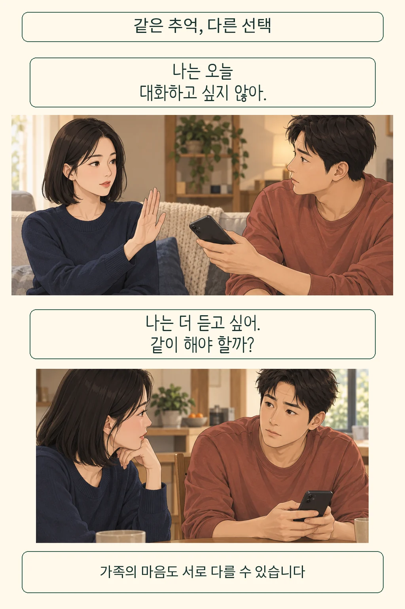
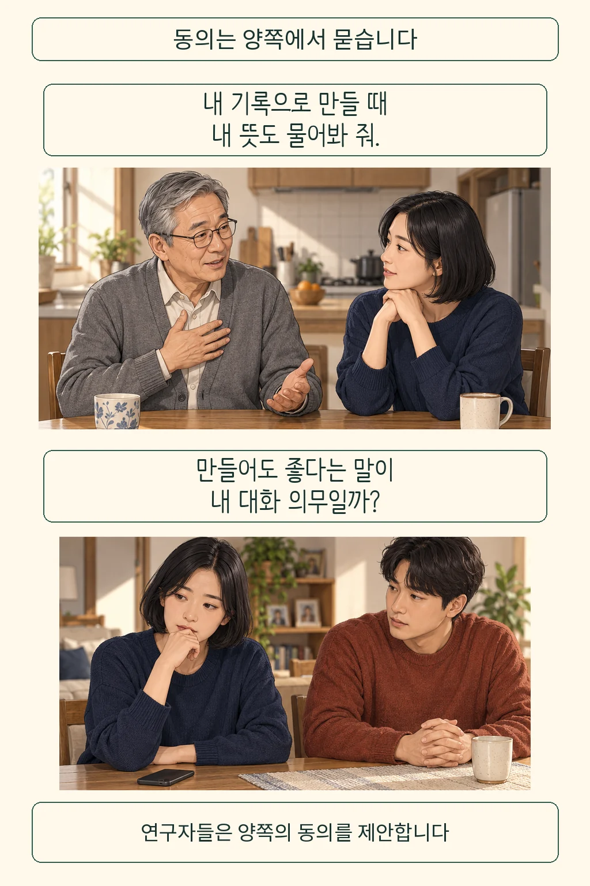
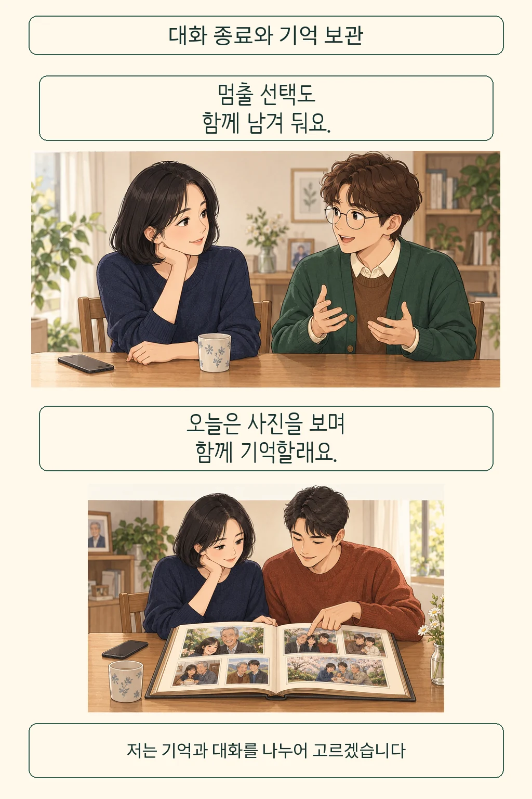

늦은 밤, 먼저 떠나보낸 아버지의 옛 사진과 음성 메시지를 열어 보다가 그 말투를 학습한 AI가 새로운 안부 인사를 건네 온다면 선뜻 답장을 누르기 어렵습니다. 소중한 추억을 간직하고 싶은 마음과, 고인의 말투로 새 대답을 생성하는 AI 대화창을 켜 두는 일은 겉보기와 달리 서로 다른 선택이거든요. **고인의 기록을 보존하는 일과 AI 대화를 이어 가는 일은 분리해서 선택할 수 있으며,** 저는 생전의 뜻과 남겨진 사람들의 마음을 함께 살피며 언제든 대화를 멈출 수 있어야 한다고 봅니다.

글·해설: 다메카솔

## 핵심 내용

- **기억 보관과 AI 대화의 분리**: 고인이 남긴 사진·음성 같은 원본 기록을 아끼는 마음과, 생성형 AI가 새로 만들어 내는 대화에 계속 참여하는 일은 따로 선택할 수 있습니다.
- **세 주체와 상호 동의**: 철학 연구에서는 기록을 남긴 **데이터 공여자**, 데이터를 관리하는 **이용자**, 실제 화면 앞에서 대화를 나누는 **서비스 수혜자(대화 참여자)**를 나누어 양쪽의 동의를 함께 묻자고 제안합니다.
- **품위 있는 종료와 가족 합의**: 상대가 AI 재현물임을 분명히 알리는 고지와 대화를 마무리하는 종료 절차를 갖추고, 가족 사이에서도 보관·참여·공유의 범위를 각자 존중하는 편이 안전합니다.

## 같은 가족이어도 원하는 거리는 다릅니다

먼저 성인 남매의 일상적인 장면을 하나 떠올려 보겠습니다. 아버지를 떠나보낸 뒤 오빠가 생전의 문자와 음성 파일을 모아 대화형 AI를 만들고, 동생에게도 함께 이야기해 보자며 접속 링크를 건넵니다. 오빠는 그립던 말투를 다시 마주하며 조금이나마 마음을 달래고 싶지만, 동생은 아직 아버지의 목소리를 닮은 새 문장이 화면에 떠오르는 상황을 받아들이기 버겁게 느낍니다. 두 사람 모두 아버지를 깊이 그리워하면서도 AI 재현물과 두고 싶은 심리적 거리는 서로 다를 수 있죠.

더구나 한 사람에게 아버지의 메시지 파일이 있다고 해서 다른 가족의 대화 참여까지 대신 정하기는 어렵습니다. 가족 전체를 하나의 동의로 묶어 버리면, 오빠에게는 다정한 초대가 동생에게는 차마 거절하기 미안한 정서적 부담으로 바뀌기 때문입니다. 가령 명절이나 기일처럼 가족이 모이는 자리에서 "요즘 아버지 AI랑 자주 이야기한다"는 말이 자연스럽게 나오면, 내키지 않는 가족도 분위기를 깨기 어려워 억지로 화면을 열어 보게 됩니다.

앞서 [AI와 친구 관계를 다룬 글](/posts/ai-companion-friendship-philosophy/)에서도 정서적 위로와 상호적인 인간관계 사이의 간극을 살펴보았는데요. 고인을 재현한 AI 역시 말투를 얼마나 자연스럽게 흉내 내는지 따지기 전에, **지금 이 대화를 실제로 원하고 감당할 수 있는 사람이 누구인지**부터 차분히 나누어 물어야 합니다.

## 생전의 허락과 지금의 참여는 다른 질문입니다

이처럼 가족 사이에서도 마음이 엇갈릴 때면 자연스럽게 다음 질문이 떠오릅니다. 만약 아버지가 생전에 자신의 기록으로 AI를 만드는 데 동의하셨다면, 남겨진 동생도 그 AI와 대화를 이어 가야 하는 걸까요?

토마시 홀라네크와 카타지나 노바치크바신스카는 2024년 [철학 논문](https://doi.org/10.1007/s13347-024-00744-w)에서 바로 이 지점을 파고들었습니다. 이 연구는 실제 이용자의 애도 효과나 피해 발생률을 측정한 임상 조사가 아니라, 앞으로 상용화될 수 있는 가상 서비스 시나리오(디자인 픽션)를 먼저 그려 보며 윤리적 충돌과 설계 기준을 따져 보는 철학적 탐구입니다. 저자들은 고인 재현 AI를 둘러싼 사람들의 위치가 한 덩어리로 섞이지 않도록 세 가지 관점을 분명히 나누어 살피자고 논증합니다.

| 구분 (논문 관점) | 어떤 역할인가요? | 먼저 확인해야 할 질문 |
| --- | --- | --- |
| **데이터 공여자** (`data donor`) | 자신의 문자·음성·사진 등 기록이 AI 재현에 쓰이는 생전 당사자 | 고인이 생전에 자신의 기록을 어디까지, 어떤 방식으로 쓰도록 허락했는가? |
| **이용자·기록 보관자** | 고인의 디지털 유산을 관리하며 재현 서비스를 만들거나 운영하는 사람 | 기록을 보유했다는 이유로 다른 가족의 참여까지 대신 정하고 있지는 않은가? |
| **서비스 수혜자(대화 참여자)** | 실제로 화면을 마주하고 고인 재현 AI와 대화를 주고받는 사람 | 대화 참여자가 시작과 멈춤의 시점을 죄책감 없이 스스로 고를 수 있는가? |

이 틀로 보면 생전에 남긴 허락의 범위부터 다시 짚게 됩니다. 예를 들어 생전에 "나중에 내 목소리를 가끔 다시 들을 수 있으면 좋겠다"고 남긴 말을, 유가족이 언제든 문답을 주고받는 AI 챗봇 제작 허락으로까지 넓혀 해석하기는 조심스럽습니다. 더구나 고인이 재현 자체에 동의했더라도, 그 뜻은 제작 가능성을 열어 둔 판단이지 남겨진 가족에게 매일 대화를 이어 갈 의무까지 지우는 약속과는 다릅니다.

그래서 저자들은 가상 시나리오 분석을 바탕으로 서비스 설계 단계에 **상호 동의, 명확한 고지, 품위 있는 종료(디지털 은퇴)**를 함께 넣자고 제안합니다. 생전 당사자와 현재 대화 참여자 양쪽의 동의를 모두 구하고, 화면의 상대가 고인 본인이 아니라 AI 재현물임을 분명히 알리며, 사용자가 원할 때 대화를 정중히 마무리하고 서비스를 닫을 수 있는 절차를 미리 마련하자는 뜻이죠. 물론 이런 기준은 앞으로 서비스 설계자와 사회가 함께 다듬어 가야 할 윤리적 권고일 뿐, 현재 시장의 모든 서비스가 기본으로 제공하는 기능과는 아직 거리가 있습니다.

## 다메카솔의 해석: 기억할 길과 멈출 길을 함께 둡니다

저는 생전의 재현 동의가 남은 사람에게 끝없는 대화 의무를 물려주는 약속으로 읽히지 않도록, **시작할 선택과 멈출 선택을 따로 묻는 기준**이 필요하다고 봅니다. 가족 안에서 AI 대화에 대한 반응이 엇갈릴 때도 선택지를 한 덩어리로 묶기보다 아래 세 갈래로 나누어 합의해 두면 한결 마음이 편해집니다.

1. **AI 대화를 쉬거나 멈추는 선택**: 지금 대화를 이어 가기 버겁다면 아무런 죄책감 없이 접속을 멈추고 화면과 거리를 둘 수 있습니다.
2. **원본 기록을 보관하는 선택**: 대화형 AI를 끄더라도 아버지가 실제로 남긴 사진과 편지, 음성 파일 같은 원본 추억은 그대로 소중히 간직할 수 있습니다.
3. **생성된 대화록을 공유하는 선택**: 한 가족이 AI와 나눈 새 대화 내용을 다른 가족에게 건넬 때는, 상대가 그것을 읽을 마음이 있는지 먼저 확인한 뒤 공유 범위를 정하는 편이 안전합니다.

특히 AI가 그럴듯하게 이어 붙인 새 문장을 두고 "아버지라면 원래 이렇게 말씀하셨을 것"이라며 가족 사이의 새로운 결정이나 약속의 근거로 삼는 일은 경계해야 합니다. 생성형 언어 모델은 고인이 생전에 남긴 표현을 바탕으로 확률적으로 자연스러운 다음 문장을 조합해 낼 뿐이거든요. 가령 집안의 큰 결정이나 해묵은 가족 갈등을 이야기하는 자리에서 AI 답변을 고인의 뜻처럼 끌어들이면, 각자가 품고 있던 생전의 실제 기억마저 흔들리기 쉽습니다. 고인이 직접 남긴 말과 모델이 새로 생성한 문장을 분명히 구별해 두어야 각자의 기억도 안전하게 지킬 수 있습니다.

물론 AI 대화를 통해 마음을 다독이고 위로를 얻고 싶은 사람의 선택 역시 존중받아야 마땅합니다. 누군가는 익숙한 말투를 들으며 천천히 이별을 정리하고, 다른 누군가는 조용히 옛 기록을 꺼내 보며 그리움을 간직하는 편입니다. 동생이 오늘은 접속을 쉬겠다고 말했을 때 오빠가 그 뜻을 존중하고 함께 옛 사진첩을 펼치는 것처럼, **기억할 방법과 멈출 시점을 각자 고를 수 있는 여유**가 남겨진 사람들의 관계를 지켜 줍니다.

## 출처

- Hollanek, T. & Nowaczyk-Basińska, K. (2024). [Griefbots, Deadbots, Postmortem Avatars](https://doi.org/10.1007/s13347-024-00744-w). *Philosophy & Technology* 37, 63. 방법과 범위는 §3, 동의와 종료 제안은 §§4.3, 5.3, 6.3을 참고했습니다.

발행일: 2026-10-03 · 출처 확인일: 2026-10-03

이 글은 철학 논문의 가상 시나리오 논증을 바탕으로 정리한 해설이며, 만화는 원문 그림을 복제하지 않고 새롭게 구성했습니다.

이 글의 본문과 이미지는 생성형 AI로 제작했습니다. 기획과 편집 기준은 다메카솔이 정했습니다.
