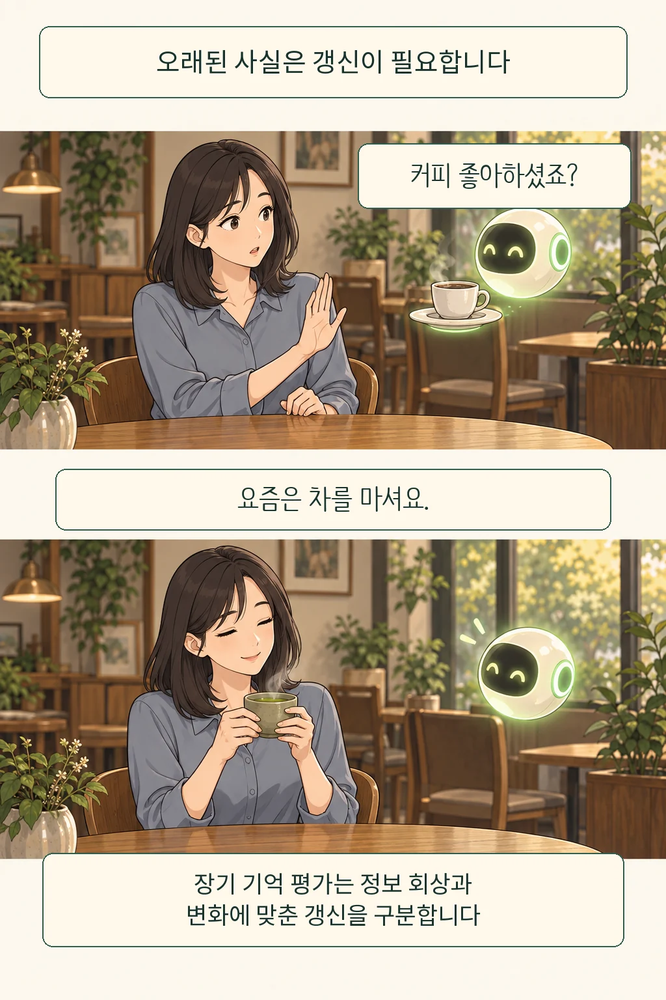
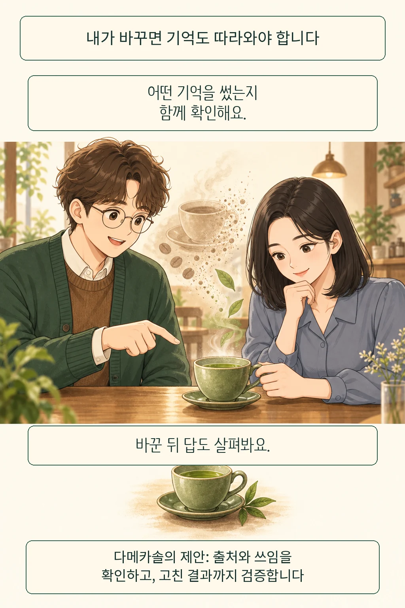

“요즘은 커피 대신 차를 마시는데, AI는 왜 계속 커피를 권할까?” 이런 일상적인 상상만으로도 장기 기억 기능의 빈틈이 선명하게 드러납니다. 예전에 남긴 기록이 사실이더라도 지금의 나와 어긋날 수 있기 때문인데요. **AI의 기억을 신뢰하려면 내가 바뀐 사실을 언제든 고칠 수 있고, 그 정보가 쓰일 자리도 직접 확인할 수 있어야 합니다.**

글·해설: 다메카솔

## 핵심 내용

- **기억 회상과 갱신의 분리**: 과거 대화를 많이 찾아내는 능력(회상)과 사용자의 상태 변화에 맞춰 지금 유효한 정보를 고르는 능력(갱신·시간 추론)은 별개의 과제입니다.
- **맥락에 맞는 적절성**: 사적인 대화에서 털어놓은 사실이라도 업무 문서 작성처럼 사용 목적과 맥락이 달라지면 그대로 가져다 쓰지 않도록 경계를 나눠야 합니다.
- **응답까지 이어지는 정정**: 저장된 기록 한 줄만 바꿀 것이 아니라, 정정한 내용이 다음 실제 응답과 검색 사본에까지 반영되는지 확인해야 합니다.

## 어제의 취향에 오늘의 날짜를 붙여 봅니다

지난달 즐기던 메뉴와 오늘 원하는 메뉴는 나란히 기록될 수 있습니다. 진짜 문제는 둘 중 어느 것을 지금의 답변에 적용하느냐인데요. 만약 시점 정보 없이 “커피를 좋아한다”는 요약만 남는다면, 나중에 취향이 달라졌다고 말해도 똑같은 무게의 문장 하나로 쌓일 뿐입니다. 사용자는 이미 기억을 고쳤다고 생각하는데 AI는 예전 취향을 다시 꺼내 오는 상황이 벌어지는 셈이죠.

실제로 LongMemEval 연구진은 장기 대화 기억을 평가하면서 단순 정보 회상 외에 사용자 상태 변화에 맞춘 기억 갱신, 시간 추론, 답할 근거가 부족할 때의 유보를 별도 범주로 구분했습니다([LongMemEval, §3](https://arxiv.org/html/2410.10813v2)). 기억을 많이 찾아내는 능력과 지금 시점에 맞는 정보를 골라내는 능력이 서로 다른 평가 대상임을 보여 주는 대목입니다(여기서 커피와 차는 평가 관점을 설명하기 위한 가상 사례이며, 특정 상용 서비스의 현재 기억 성능은 별도 검증이 필요합니다).

따라서 “내가 차를 마신다고 기억하니?”라고 묻는 **기록 확인**과 “오늘 무엇을 권하니?”라고 묻는 **적용 확인**을 나눠 살펴볼 필요가 있습니다. 아울러 내가 직접 밝힌 취향인지, 한 번 주문한 메뉴에서 AI가 추측해 적어 둔 취향인지에 따라 고쳐야 할 대상이 달라지므로 기억의 출처도 함께 따라가야 합니다. 앞서 [맞춤형 AI와 정체성 글](/posts/ai-personalization-authentic-self/)에서 다룬 취향의 되먹임 문제에, 이번에는 사용자가 직접 정정할 통로를 더하는 셈입니다.

## 그 이야기를 꺼내도 되는 자리는 따로 있습니다

그렇다면 가장 최신 정보만 반영하면 충분할까요? 친구에게 털어놓은 고민이 아무리 정확하게 기억되더라도, 업무 소개문을 작성할 때 갑자기 그 이야기가 등장하면 당황스러울 수밖에 없습니다. 내가 실제로 한 말이라는 사실과 이번 작업에서 그 정보를 써도 된다는 판단 사이에는 분명한 간격이 있기 때문입니다.

철학자 헬렌 니센바움은 2004년 논문에서 프라이버시를 ‘맥락적 온전성(Contextual Integrity)’, 즉 맥락에 맞는 정보의 적절성과 정보 흐름의 규범으로 설명했습니다([Privacy as Contextual Integrity, pp. 138–141](https://nissenbaum.tech.cornell.edu/papers/H.%20Nissenbaum,%20_Privacy%20as%20Contextual%20Integrity.pdf)). 어떤 정보를 나누는 것이 그 관계에 적절한지, 누구에게 어떤 방식으로 전달되는지를 함께 살펴야 하므로 단순히 과거에 한 번 공개했다는 사실만으로 모든 후속 이용을 정당화하기는 어렵다는 뜻입니다.

비록 니센바움의 원문이 오늘날 AI 기억 설정 메뉴를 직접 다룬 글은 아니지만, 이 렌즈를 AI 서비스에 가져오면 중요한 시사점을 얻을 수 있습니다. 사적인 대화와 업무 문서 작성이 같은 채팅창에서 이어지더라도 사용 목적은 전혀 다릅니다. 따라서 오래된 정보를 지우는 기능과, 특정 목적이나 맥락에서 그 정보를 쓰지 못하게 막는 기능은 각각 따로 설계하고 검토할 가치가 있습니다.

## 다메카솔의 해석: 정정은 다음 응답까지 이어져야 합니다

개인화 AI를 설계한다면 기억을 고치는 기능을 검색 기능만큼 중요한 기본기로 다뤄야 한다고 봅니다. 기억 항목마다 출처와 확인 시점, 적용할 목적을 남겨 두고, 사용자가 내용을 수정한 뒤에는 실제 생성되는 응답까지 바뀌는지 검사하는 방식입니다. 저장소의 텍스트 한 줄만 바뀌었다고 끝낼 일이 아닌 이유는, 예전 요약본이나 검색용 캐시 사본이 다음 답변에 그대로 흘러들어가면 사용자가 똑같은 정정을 반복해야 하기 때문입니다.

이는 백엔드 시스템에서 원본 데이터베이스를 고쳐도 캐시에 이전 값이 남아 오작동하는 문제와 꼭 닮았습니다. 친절한 수정 완료 메시지에 그치지 않고, 공개 자료에서 도출한 설계 원칙으로서 다음 두 경로를 함께 검증해 볼 것을 제안합니다.

- **갱신 반영 확인**: “커피 선호를 차로 정정했다”는 입력이 실제 “차를 권하는 새 응답”으로 이어지는지 확인합니다.
- **맥락 격리 확인**: 업무 목적에서 제외하도록 지정한 사적 정보가 문서 작성 응답에 다시 섞여 나오지 않는지 점검합니다.

물론 매번 모든 배경을 잊어버리면 처음부터 다시 설명해야 하는 수고가 돌아옵니다. 계속 유지하고 싶은 문체나 표현 방식과 그날만의 일시적인 사정은 다르게 다루되, 최신 설명이 모호할 때는 확인을 요청하고 사용 범위가 달라지면 다시 묻는 균형이 필요합니다.

만화 마지막 장면에서 독자는 마침내 따뜻한 차를 한 모금 마십니다. AI가 예전의 커피 취향을 정확히 외웠다는 칭찬보다, 새로운 설명을 듣고 실제로 찻잔을 건넸다는 변화가 훨씬 중요합니다. 나를 오래 안다는 말의 무게는 쌓아 둔 기억 항목의 개수가 아니라, 내가 달라졌을 때 함께 고쳐 나갈 수 있는 여지에서 드러납니다.

## 출처

- [Wu et al., LongMemEval: Benchmarking Chat Assistants on Long-Term Interactive Memory](https://arxiv.org/html/2410.10813v2)
- [Helen Nissenbaum, Privacy as Contextual Integrity (2004)](https://nissenbaum.tech.cornell.edu/papers/H.%20Nissenbaum,%20_Privacy%20as%20Contextual%20Integrity.pdf)

작성·출처 확인: 2026-09-12

이 글의 본문과 이미지는 생성형 AI로 제작했습니다. 기획과 편집 기준은 다메카솔이 정했습니다.
