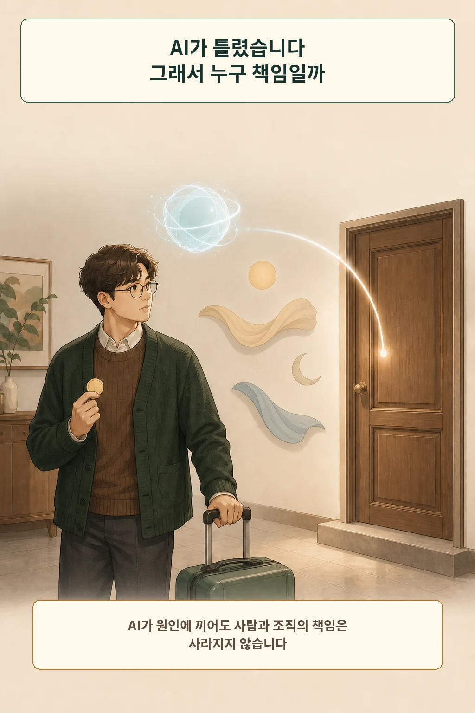
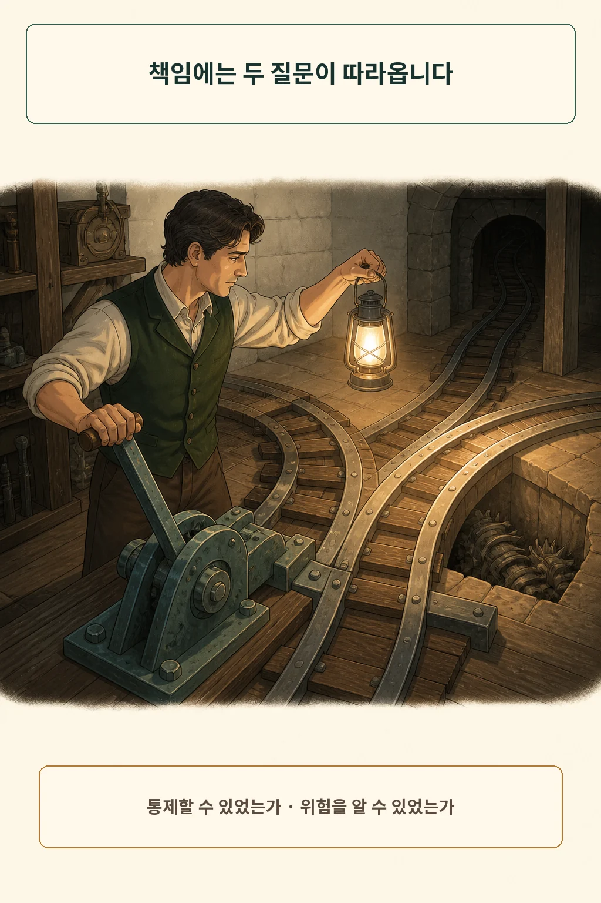
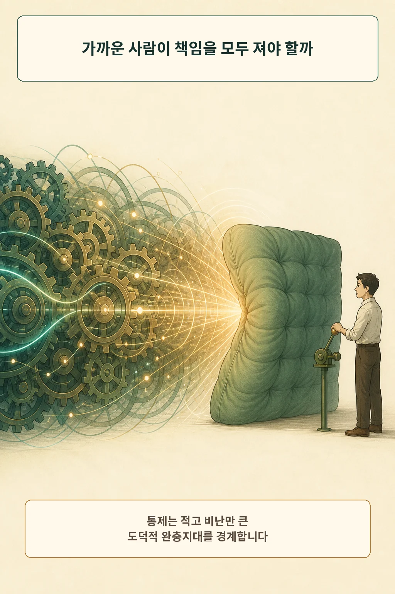
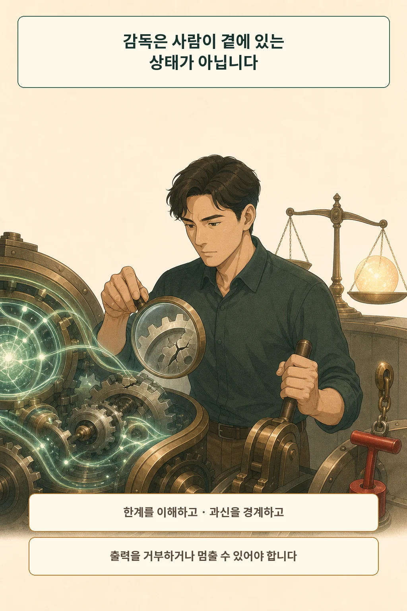
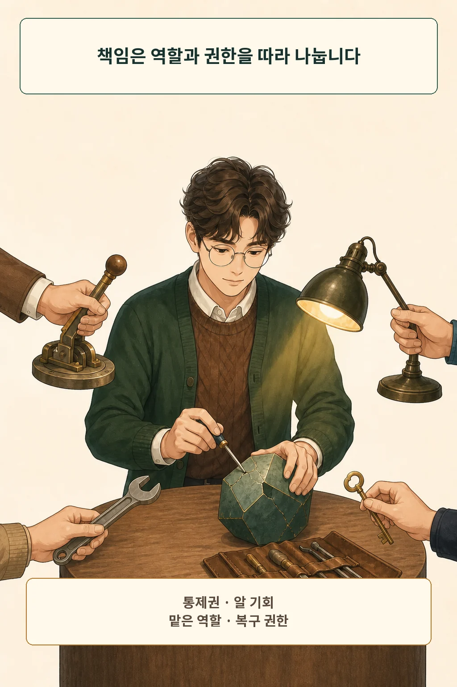

AI가 짜 준 여행 일정대로 움직였는데 예약 날짜가 틀렸다면, 결제를 누른 사람과 답을 만든 서비스, 검토 규칙을 정한 조직 중 누구의 책임일까요? **“AI가 그랬다”는 말은 원인을 가리킬 수는 있어도 책임 배분까지 끝내 주지는 못합니다. 책임은 통제권과 위험을 알 기회, 맡은 역할, 문제를 고칠 권한에 맞춰 나눠야 합니다.**

글·해설: 다메카솔

## AI가 원인이라고 책임이 사라질까

AI의 답을 실제 행동으로 옮긴 사람에게는 자기 판단 범위만큼의 책임이 남습니다. 되돌리기 어려운 결정을 근거 확인 없이 확정했다면 “도구가 추천했다”는 말만으로 설명을 마칠 수 없습니다. 동시에 서비스 제공자와 도입 조직도 책임을 피할 수 없는데, 어떤 한계를 미리 알렸는지, 충분한 검토 시간을 줬는지, 오류를 신고하고 고칠 길을 열어 두었는지 함께 따져야 하기 때문입니다.

그래서 책임은 원인의 개수보다 **누가 무엇을 할 수 있었는가**를 따라가야 합니다. AI는 결과에 기여한 기술적 원인일 수 있지만, 현재의 많은 AI 시스템을 칭찬이나 비난을 이해하고 응답하는 도덕적 행위자로 곧바로 확정하기는 어렵습니다. 이 글이 AI 뒤에 있는 사람과 조직의 책임 배분에 초점을 두는 이유입니다.

## 책임에는 통제와 인식이 필요합니다

책임을 묻는 첫 단계는 통제와 인식의 범위를 확인하는 일입니다. 스탠퍼드 철학 백과사전(Stanford Encyclopedia of Philosophy)은 도덕적 책임 논의에서 행위자가 적절한 통제나 자유를 가졌는지, 그리고 자신이 무엇을 하고 어떤 결과와 대안이 생길 수 있는지 알 수 있었는지(인식 조건)를 함께 살핀다고 정리합니다([The Epistemic Condition for Moral Responsibility](https://plato.stanford.edu/entries/moral-responsibility-epistemic/)).

이 철학적 렌즈가 책임을 자동으로 계산해 주는 공식은 아니며, 법적 책임 역시 관할과 계약, 과실 기준에 따라 달라집니다. 그래도 “중단하거나 바꿀 수 있었는가”와 “위험을 알 수 있었는가”를 분리해 물으면, 마지막으로 버튼을 누른 사람에게 모든 비난을 몰아주는 오류를 줄일 수 있습니다.

## 가장 가까운 사람은 완충재가 아닙니다

자동화된 시스템에서 사고가 나면 화면 앞에 앉아 있던 사람이 가장 먼저 눈에 띕니다. 연구자 Madeleine Clare Elish는 복잡한 자동화 사고 사례들을 분석하며, 실제 통제권이 제한된 현장 인간이 시스템 전체의 도덕적·법적 책임을 대신 흡수하는 현상을 **도덕적 완충지대(moral crumple zone)**라고 불렀습니다([Moral Crumple Zones](https://doi.org/10.17351/ests2019.260)).

물론 이 개념이 모든 운영자를 무조건 면책해 주지는 않습니다. 충분히 통제할 수 있었고 위험을 알면서도 무시했다면 현장 운영자의 책임이 커집니다. 반대로 설계자는 자동 결정을 기본값으로 만들고 조직은 속도 목표만 다그치면서 운영자에게 몇 초 안에 승인 버튼만 누르라고 요구했다면, “사람이 최종 검토했다”는 문구와 실제 통제권 사이에는 깊은 틈이 생깁니다.

## 좋은 인간 감독에는 권한과 정보가 필요합니다

자발적 위험관리 프레임워크인 미국 NIST AI RMF 1.0은 조직 전체의 AI 위험관리 역할과 연락선을 분명히 하고, 경영진이 개발·배포 위험에 관한 결정의 책임을 맡도록 제안합니다([NIST AI RMF 1.0](https://doi.org/10.6028/NIST.AI.100-1)). 또한 고위험 AI를 대상으로 한 유럽연합 AI 법(EU AI Act) 제14조는 인간 감독의 조건을 한층 구체화해, 감독자가 시스템의 역량과 한계를 이해하고 자동화 편향을 경계하며 출력을 해석해 필요할 때 무시·번복하거나 안전하게 중단할 수 있어야 한다고 규정합니다([EU AI Act, Article 14](https://eur-lex.europa.eu/eli/reg/2024/1689/oj)). 모든 일상 챗봇에 그대로 적용되는 법률 조항은 아니지만, 사람에게 감독 책임을 맡기려면 실질적인 권한과 정보도 함께 주어야 한다는 원칙은 분명하게 남습니다.

## 다메카솔의 판단: 네 요소로 책임을 나눕니다

저는 AI 관련 책임을 다음 네 가지 요소에 맞춰 나누어 봅니다.

1. **통제권**: 출력을 거부하고 수정하거나 시스템을 멈출 수 있었는가?
2. **알 기회**: 한계와 위험, 대안을 이해할 정보와 시간이 있었는가?
3. **맡은 역할**: 사용·승인·설계·배포 가운데 무엇을 책임지기로 했는가?
4. **복구 권한**: 문제가 생겼을 때 취소·정정·보상·재발 방지를 실행할 수 있는가?

일상 사용자는 돈, 건강, 직업처럼 되돌리기 어려운 결정을 AI의 답 하나로 확정하지 말고 근거를 확인해야 합니다. 팀은 승인자에게 멈출 시간과 거부권을 보장하고, 조직과 서비스 제공자는 시스템의 한계 안내·감사 기록·이의제기·복구 경로를 설계해야 합니다. 책임은 AI에게 떠넘길 짐도, 마지막 클릭을 한 사람에게 몰아줄 벌도 아닙니다. **결과를 바꿀 힘이 있던 곳에 설명과 복구의 의무도 함께 놓는 것**, 그것이 책임 배분의 기준입니다.

## 출처

- [Stanford Encyclopedia of Philosophy, The Epistemic Condition for Moral Responsibility](https://plato.stanford.edu/entries/moral-responsibility-epistemic/)
- [Madeleine Clare Elish, Moral Crumple Zones](https://doi.org/10.17351/ests2019.260)
- [NIST, Artificial Intelligence Risk Management Framework 1.0](https://doi.org/10.6028/NIST.AI.100-1)
- [European Union, Regulation (EU) 2024/1689, Article 14](https://eur-lex.europa.eu/eli/reg/2024/1689/oj)

이 글의 본문과 이미지는 생성형 AI로 제작했습니다. 기획과 편집 기준은 다메카솔이 정했습니다.

이미지는 텍스트 없는 원화에 결정적 레터링을 합성해 제작했습니다.
