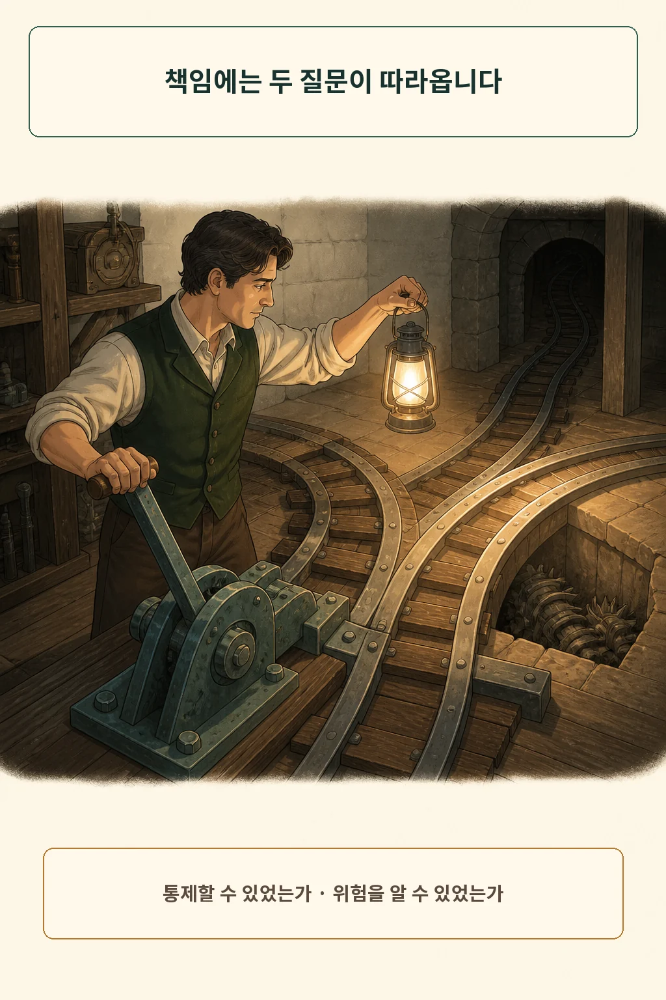
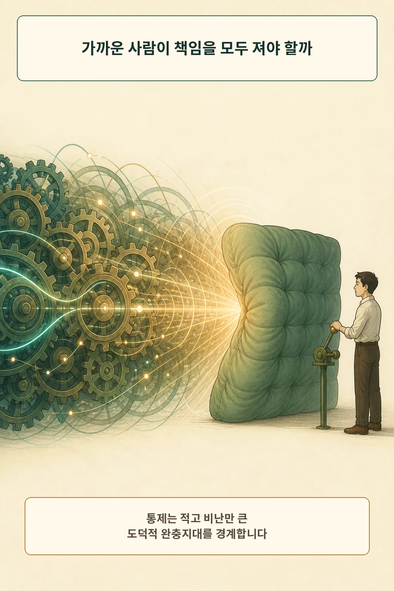
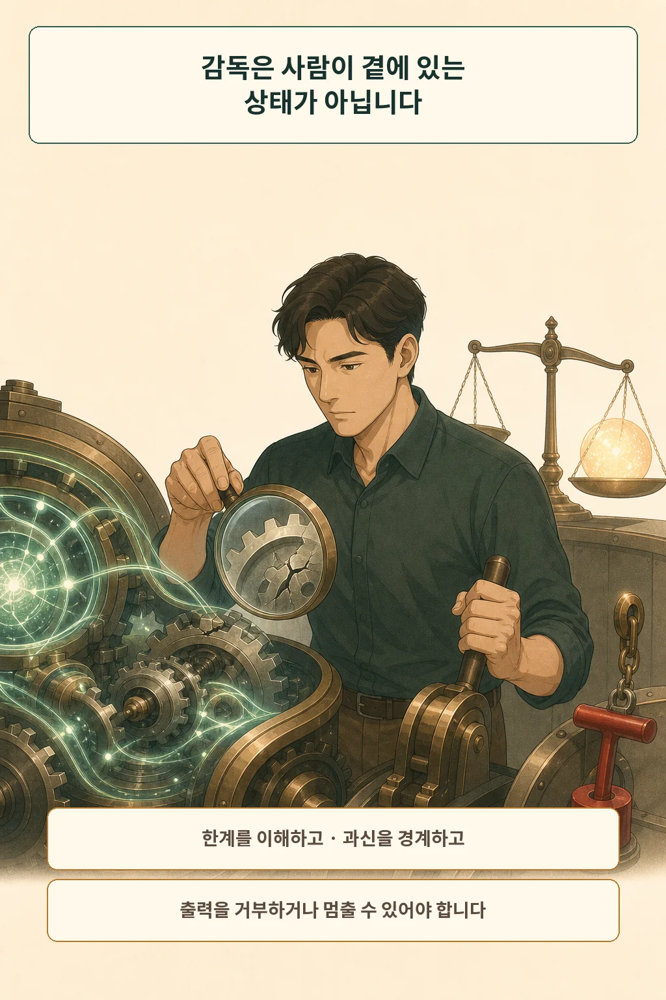
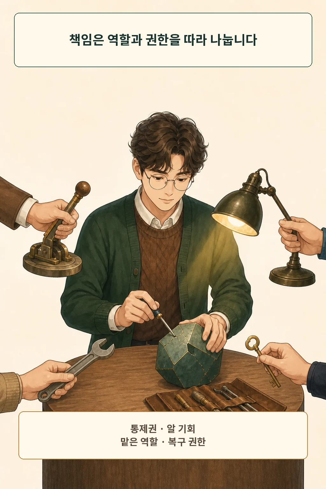

AI가 짜 준 여행 일정표만 믿고 숙소를 예약했는데 막상 도착해 보니 날짜가 어긋나 문이 닫혀 있다면, 결제를 누른 사람과 답을 만든 서비스, 운영 규칙을 정한 조직 중 누구의 책임일까요? 이럴 때 흔히 “AI가 그렇게 알려 줬다”는 말이 나오지만, 그 말은 사고의 원인만 가리킬 뿐 책임의 몫까지 대신 정리해 주지는 못하거든요. **결국 책임은 누가 결과를 통제하고 위험을 알 수 있었는지, 그리고 어떤 역할과 복구 권한을 맡았는지를 기준으로 나누어야 합니다.**

글·해설: 다메카솔

## 핵심 내용

- **원인 제공과 책임 면제는 다릅니다**: AI가 잘못된 결과에 기여했더라도 사용자·조직·제공자의 판단과 설계 책임은 각자의 범위만큼 남습니다.
- **통제 없는 사람에게 비난을 몰면 안 됩니다**: 철학의 통제·인식 조건과 ‘도덕적 완충지대’ 개념은, 멈출 권한이 부족한 현장 인간에게 책임이 쏠리는 위험을 경계하게 합니다.
- **실질적 감독과 네 가지 배분 기준**: 유효한 감독에는 한계 이해와 출력 거부·중단 권한이 필요하며, 책임도 통제권·알 기회·맡은 역할·복구 권한으로 나눕니다.

## AI가 원인이라고 책임이 사라질까

AI의 답변을 실제 행동으로 옮긴 사람에게는 스스로 판단하고 결정한 범위만큼의 책임이 남습니다. 예를 들어 AI가 추천한 동선만 보고 환불이 되지 않는 숙소나 항공권을 결제하면서 날짜와 영업시간 같은 기본 근거를 확인하지 않았다면, “도구가 골라 줬다”는 말만으로 설명을 끝내기 어렵죠. 동시에 서비스 제공자와 도입 조직의 몫도 함께 따져야 하는데요, 시스템의 한계를 미리 알렸는지와 검토할 시간·안내를 주었는지, 오류가 났을 때 신고하고 바로잡을 경로를 열어 두었는지에 따라 책임의 무게가 달라지기 때문입니다.

그래서 책임을 가릴 때는 원인이 몇 개인지 세기보다 **누가 무엇을 바꿀 수 있었는가**를 따라가는 편이 정확합니다. AI가 잘못된 결과에 기여한 기술적 원인일 수는 있어도, 현재의 AI 시스템을 칭찬이나 비난을 이해하고 스스로 도덕적 책임을 지는 행위자로 확정하기는 어렵습니다. 기술이 원인에 끼어들수록, 그 기술을 설계하고 배치하고 승인한 사람과 조직의 책임을 더 분명히 나누어야 하는 이유입니다.

## 책임에는 통제와 인식이 함께 따라옵니다

책임을 묻는 첫걸음은 두 가지 조건을 나란히 확인하는 일입니다. 스탠퍼드 철학 백과사전(Stanford Encyclopedia of Philosophy)에 정리된 도덕적 책임 논의에서는 행위자가 결과를 바꿀 적절한 통제나 자유를 가졌는지, 그리고 자신이 무엇을 하는지와 그 행동의 도덕적 의미, 가능한 결과와 대안을 알 수 있었는지(**인식 조건**)를 함께 살핍니다([The Epistemic Condition for Moral Responsibility](https://plato.stanford.edu/entries/moral-responsibility-epistemic/)). 다시 말해 지금 자신이 무엇을 하는지, 그 행동이 어떤 뜻과 결과를 낳는지, 다른 선택지는 무엇인지 파악할 수 있었는지가 핵심 질문이 됩니다.

물론 이 철학적 렌즈가 법원 판결처럼 책임을 자동 계산해 주는 공식은 아니며, 실제 법적 책임 역시 관할 법령과 계약, 과실 기준에 따라 달라집니다. 그래도 “중단하거나 바꿀 수 있었는가”와 “위험과 대안을 알 수 있었는가”를 따로 떼어 물어보는 습관은 실무에서도 큰 힘이 됩니다. 이 두 질문을 함께 던져야만, 복잡한 절차 끝에 마지막으로 버튼을 누른 사람에게 모든 비난을 몰아주는 오류를 줄일 수 있는 셈이죠.

## 가장 가까운 사람에게 책임이 쏠리는 완충지대

자동화된 시스템에서 사고가 나면 사람들은 화면 바로 앞에 앉아 있던 사람을 가장 먼저 떠올립니다. 연구자 Madeleine Clare Elish는 복잡한 자동화 사고 사례들을 분석하며, 실제 통제권이 제한된 현장 인간이 시스템 전체의 도덕적·법적 책임을 대신 흡수해 버리는 현상을 **도덕적 완충지대(moral crumple zone)**라고 불렀습니다([Moral Crumple Zones](https://doi.org/10.17351/ests2019.260)). 자동차 앞부분의 완충 구역이 충격을 대신 받아 구겨지듯, 기술 사슬의 허점이 드러날 때 가장 가까운 운영자가 비난의 충격을 고스란히 떠안는다는 뜻입니다.

가령 고객 환불이나 민원 심사를 돕는 시스템이 자동 추천안을 띄우고, 조직은 처리 속도 목표만 다그치며 담당자에게 짧은 시간 안에 승인 버튼만 누르도록 운영한다고 생각해 봅시다. 이런 구조에서는 “사람이 최종 검토했다”는 기록이 남아도 정작 현장 직원이 추천을 거슬러 멈추거나 원인을 따져 볼 여유가 빠듯해집니다. 물론 현장 운영자가 충분히 멈출 수 있었고 위험 신호도 알면서 무시했다면 본인 책임이 커집니다. 반대로 설계자가 자동 결정을 기본값으로 굳히고 조직이 거부할 시간조차 주지 않았다면, 책임의 화살은 승인자 개인을 넘어 시스템과 업무 절차를 설계한 쪽으로도 향해야 마땅합니다.

## 사람에게 감독을 맡기려면 권한과 정보가 필요합니다

최근의 위험관리 지침과 법령도 ‘이름뿐인 감독’과 ‘실질적인 감독’을 분명하게 가릅니다. 먼저 자발적 위험관리 프레임워크인 미국 [NIST AI RMF 1.0](https://doi.org/10.6028/NIST.AI.100-1)은 법적 책임 판정표가 아니라 조직 운영의 참고 틀로서, 조직 전체의 AI 위험관리 역할과 책임, 연락선을 명확히 하고 경영진이 개발·배포 위험에 관한 결정의 책임을 맡도록 제안합니다. 또한 고위험 AI를 대상으로 한 유럽연합 AI 법(EU AI Act) 제14조는 한층 구체적으로, 감독자가 시스템의 역량과 한계를 이해하고 AI 답을 과신하는 자동화 편향을 경계하며, 출력을 해석해 필요할 때 무시·번복하거나 안전하게 중단할 수 있어야 한다고 규정합니다([EU AI Act, Article 14](https://eur-lex.europa.eu/eli/reg/2024/1689/oj)).

물론 고위험 AI를 규율하는 이 법 조항이 모든 일상 챗봇이나 모든 나라의 분쟁에 그대로 적용되는 일반 법률 결론은 아닙니다. 그래도 두 자료가 공통으로 가리키는 원칙만큼은 일상의 팀과 서비스에도 그대로 유효합니다. 사람에게 감독 책임을 맡기려면 시스템의 한계를 살필 정보와, 잘못된 출력을 실제로 멈춰 세울 권한을 함께 보장해야 한다는 뜻이죠.

## 다메카솔의 판단, 네 가지 기준으로 책임 나누기

저는 AI가 얽힌 실수를 마주할 때 누구 탓인지부터 묻기보다, 다음 네 가지 기준으로 책임의 경계를 나누어야 한다고 생각합니다. 문제 뒤에 어떤 역할과 결정이 놓여 있었는지 표로 풀어 보면, 각자가 미리 챙길 의무도 훨씬 선명하게 보이거든요.

| 배분 기준 | 먼저 던질 질문 | 역할별 실천 조건 |
| --- | --- | --- |
| **통제권** | 출력을 거부·수정하거나 시스템을 멈출 수 있었는가? | 승인자에게 실질적 거부권과 안전 중단 수단을 보장한다 |
| **알 기회** | 시스템의 한계와 위험, 대안을 살필 정보와 시간이 있었는가? | 제공자는 한계를 안내하고 조직은 충분한 검토 시간과 교육을 제공한다 |
| **맡은 역할** | 사용·승인·설계·배포 중 무엇을 책임지기로 했는가? | 개인·승인자·경영진·제공자 사이의 역할과 연락선을 분명히 한다 |
| **복구 권한** | 문제가 생겼을 때 취소·정정·보상·재발 방지를 실행할 수 있는가? | 감사 기록과 이의제기·환불·정정 절차를 미리 설계한다 |

일상에서 AI를 쓰는 개인은 돈이나 건강, 직업처럼 되돌리기 어려운 결정만큼은 AI의 답 하나로 확정하지 말고 1차 근거를 확인해야 합니다. 팀에서는 승인 담당자에게 멈출 시간과 거부권을 실제로 보장하고, 도구가 틀렸을 때 곧바로 우회할 절차를 마련해 두어야 합니다. 서비스 제공자와 조직은 한계 안내·감사 기록·이의제기·복구 경로를 설계 단계부터 함께 갖추어야 하죠.

이처럼 AI 시대의 책임은 기계에 떠넘길 구멍도, 마지막 클릭을 한 사람에게 몰아줄 벌도 아닌 셈입니다. **결과를 바꿀 실질적 힘이 있던 곳에 설명과 복구의 의무도 함께 놓는 것**, 그것이 제가 제안하는 책임 배분의 기준입니다.

## 출처

- [Stanford Encyclopedia of Philosophy, The Epistemic Condition for Moral Responsibility](https://plato.stanford.edu/entries/moral-responsibility-epistemic/)
- [Madeleine Clare Elish, Moral Crumple Zones](https://doi.org/10.17351/ests2019.260)
- [NIST, Artificial Intelligence Risk Management Framework 1.0](https://doi.org/10.6028/NIST.AI.100-1)
- [European Union, Regulation (EU) 2024/1689, Article 14](https://eur-lex.europa.eu/eli/reg/2024/1689/oj)

이 글의 본문과 이미지는 생성형 AI로 제작했습니다. 기획과 편집 기준은 다메카솔이 정했습니다.

이미지는 텍스트 없는 원화에 결정적 레터링을 합성해 제작했으며, 본문은 공개된 철학 해설과 연구·제도 자료를 바탕으로 책임 배분 원칙을 정리한 글입니다.
