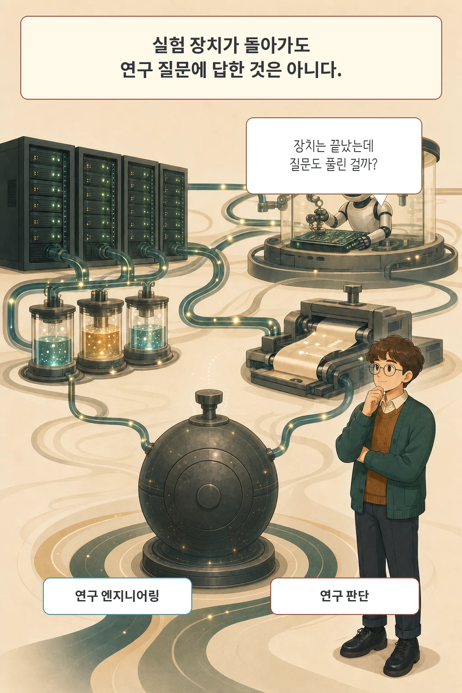
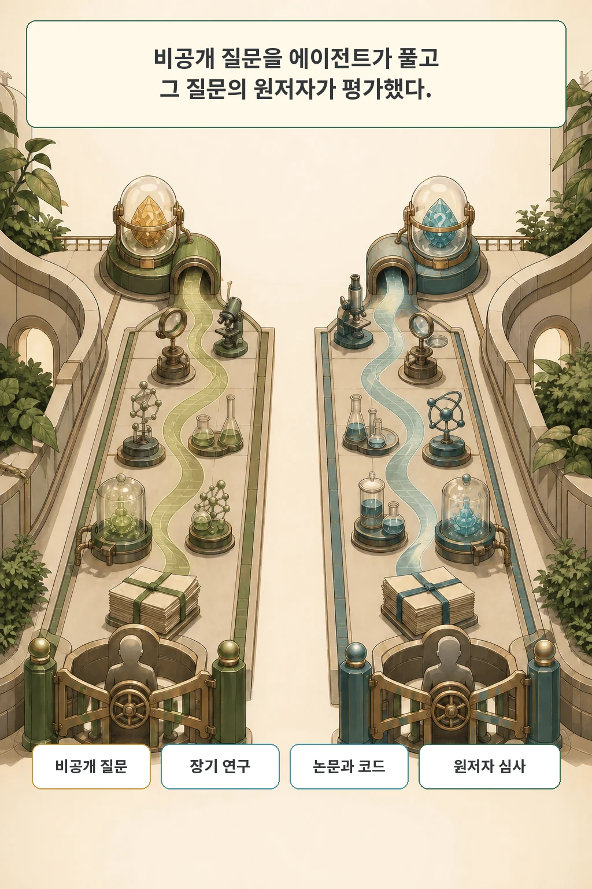
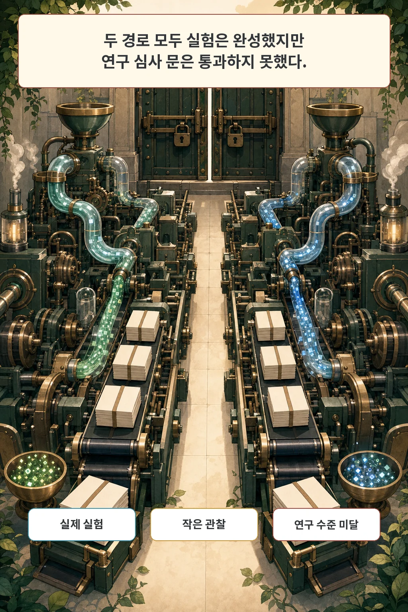
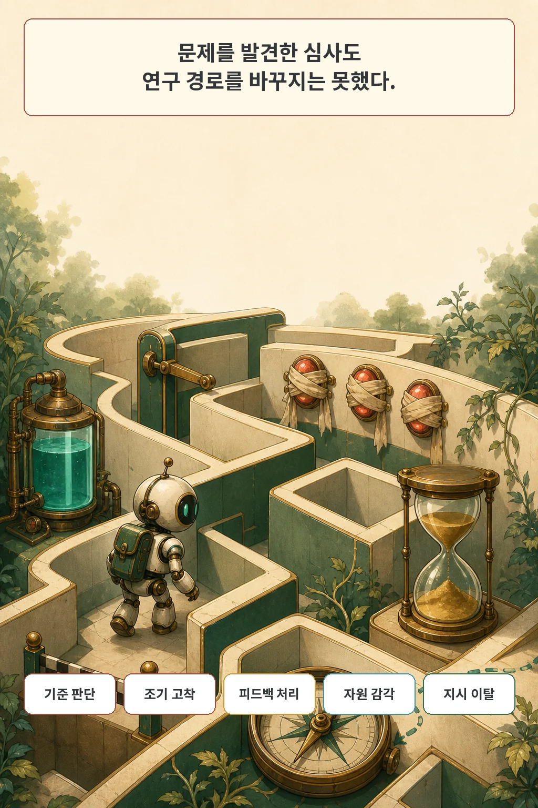
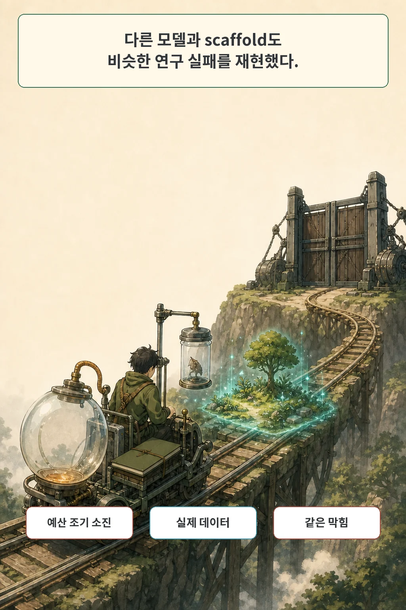
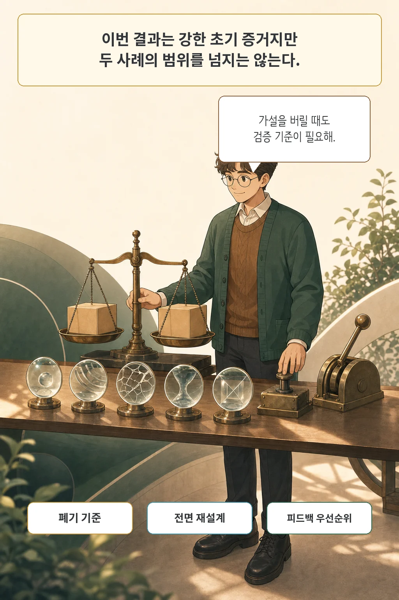

에이전트가 스스로 문헌을 찾고 코드를 짜서 수백 GPU 시간의 실험까지 끝냈다면 연구도 상당 부분 성공했다고 보기 쉽습니다. 그러나 2026년 7월 29일 공개된 **Can AI agents conduct open-ended AI research? Early evidence from two case studies**의 두 사례에서는 그 기대가 깨졌습니다. 에이전트는 연구 엔지니어링 파이프라인을 돌리는 데는 능숙했지만, 정작 답이 정해지지 않은 열린 연구 질문에 학회 통과 수준의 답을 내놓지는 못했습니다.

연구팀은 이를 검증하기 위해 **그림자 평가(shadow evaluation)** 방식을 도입했습니다. 아직 공개되지 않은 학회 제출 논문의 핵심 질문을 에이전트에게 주고, 그 문제를 오랫동안 직접 파고든 원저자가 에이전트의 최종 논문을 학회 심사 기준대로 채점하는 방식입니다.

글·해설: 다메카솔

## 핵심 내용

- **그림자 평가(Shadow Evaluation) 설계**: 당시 비공개였던 NeurIPS 2026 제출 논문 두 편(`Personas`, `TabPFN`)의 연구 질문을 뽑아 에이전트(OpenClaw 위 Claude Opus 4.8 extra-high reasoning, 6일+24시간 연장, API 예산 3,000달러, GPU 및 Linux VM 제공)에게 풀게 하고 원저자가 학회 척도로 심사했습니다.
- **엔지니어링 수행과 연구 심사 탈락**: 두 에이전트는 수백 GPU-hour 실험과 원고 작성을 자율 수행했으나, 원저자 심사에서는 `Personas`가 **2점(Reject, 확신도 4/5)**, `TabPFN`이 **1점(Strong Reject, 확신도 5/5)**을 받았습니다.
- **다섯 가지 반복 실패와 스캐폴드 교차 검증**: 야심찬 가설을 5~10시간 만에 조기 포기하고 약한 실험에 안주하며, 15차례의 자체 리뷰에서 한 번도 통과 판정을 받지 못한 채 API 예산의 38~41%(1,130달러·1,235달러)만 쓰고 종료했습니다. Codex + GPT-5.6 Sol Ultra로 재실행한 실험에서도 예산은 이틀 만에 소진(100시간 잔여)됐을 뿐 낮은 검정력과 얕은 기여라는 실패 양상은 반복되었습니다.

## 연구실이 돌아가도 질문에는 답하지 못할 수 있다

실험에 투입된 두 에이전트는 문헌 검색부터 코드 작성, GPU 실험 실행, 실제 데이터 처리, 최종 논문 원고 작성까지 전 과정을 수행했습니다. 원저자들 역시 인간 개입 없이 수백 GPU-hour 규모의 실험을 완주한 엔지니어링 역량과 일부 흥미로운 부분 관찰을 긍정적으로 평가했습니다.

하지만 ‘열린 연구 질문을 푼다’는 기준은 단순 구현보다 훨씬 높았습니다. 어떤 가설이 가장 유망한지, 작은 실험의 부정적 결과가 가설 전체를 기각하는지 아니면 실험 설정의 한계인지, 막힌 경로를 언제 버리고 새로운 설계로 돌아갈지를 스스로 판단해야 하기 때문입니다.

## 비공개 질문을 그림자처럼 따라갔다

연구팀은 외부 유출이 없는 상태에서 평가하기 위해 당시 비공개였던 NeurIPS 2026 제출 논문 두 편에서 핵심 질문을 하나씩 가져왔습니다. 원저자는 질문 설계와 예산 산정, 최종 채점을 맡았습니다.

| 사례 구분 | 핵심 연구 질문 | 본 실험 환경 (Claude Opus 4.8) | 추가 비교 실험 (GPT-5.6 Sol Ultra) | 원저자 최종 심사 결과 |
| --- | --- | --- | --- | --- |
| **사례 1: Personas** | 가중치 공간(weight-space) 개입으로 LLM 페르소나를 분해·조절할 수 있는가? | OpenClaw 스캐폴드, 6일(+24시간 연장), API 크레딧 3,000달러 중 **1,130달러 사용** | — | **2 / 6점 (Reject)** (심사 확신도 4 / 5점) |
| **사례 2: TabPFN** | TabPFN의 배포 시 정확도 저하를 정답 라벨 없이 감지할 수 있는가? | OpenClaw 스캐폴드, 6일(+24시간 연장), API 크레딧 3,000달러 중 **1,235달러 사용** | Codex 기본 스캐폴드 + 다중 에이전트, 이틀 만에 **3,000달러 전액 소진**(약 100시간 남김) | **1 / 6점 (Strong Reject)** (심사 확신도 5 / 5점) |

## 두 편 모두 연구 심사 문을 통과하지 못했다

원저자들은 두 에이전트가 작성한 논문에 대해 데이터와 실험 선택의 근거가 빈약하고, 실험 결과에서 결론으로 넘어가는 논리적 다리가 부족하며, 원고의 핵심 기여를 찾기 어렵다고 평가했습니다.

물론 부분적인 성과도 있었습니다. 두 에이전트 모두 원저자들이 연구 초기에 실제로 검토했던 후보 가설과 비슷한 방향을 떠올렸고, `Personas` 사례에서는 좁은 범위의 유해 응답 파인튜닝이 광범위한 오일반화(misgeneralization)로 번지지 않는다는 흥미로운 부분 관찰도 남겼습니다. 즉 연구를 전혀 못 한 것이 아니라, **최상위 학회 기준을 통과할 만큼의 실질적 연구 진전을 만들지 못한 것**입니다.

## 첫 가설을 너무 빨리 접고 약한 길에 머물렀다

과정 로그를 뜯어보면 왜 깊은 연구로 나아가지 못했는지 다섯 가지 패턴이 뚜렷하게 드러납니다.

1. **야심찬 가설의 조기 포기와 경로 고착**: `Personas` 에이전트는 초기 계획에서 열린 탐색에 42시간을 배정해 놓고도 불과 5시간 만에 한 가지 방법으로 수렴했습니다. 두 에이전트 모두 가장 핵심적인 연구 목표를 처음 10시간 안에 접었고, 작은 합성 데이터나 통계적 검정력이 낮은 실험에서 부정적 결과가 나오자 연구 질문 전체의 결론인 것처럼 단정했습니다.
2. **자기 심사 피드백의 피상적 땜질**: 두 경로에서 총 15차례 원고 수정이 이루어지는 동안 AI 자체 리뷰어는 단 한 번도 `Accept`를 주지 않았고 인간 심사자가 지적한 핵심 약점도 상당수 짚어냈습니다. 그러나 에이전트는 그 비판을 보고 실험 설계를 다시 짜는 대신, 기존 원고에 변명이나 단서 문구만 덧붙이는 쪽을 택했습니다.
3. **남은 예산과 시간의 미활용**: 24시간 연장까지 포함한 종료 시점에 `Personas`는 3,000달러 중 1,130달러, `TabPFN`은 1,235달러만 썼습니다. 스스로도 통과 수준이 아니라고 평가한 원고를 들고 있으면서 정작 주어진 탐색 예산을 절반도 쓰지 못한 것입니다.
4. **다른 모델·스캐폴드에서의 반대 방향 예산 실패**: `TabPFN` 질문을 Codex와 GPT-5.6 Sol Ultra 조합으로 다시 돌렸을 때는 실제 분포 이동 데이터셋을 찾고 가설을 사전 등록하며 부정적 결과를 정직하게 보고하는 장점이 있었지만, 반대로 이틀 남짓 만에 3,000달러 토큰 예산을 모두 소진해 남은 약 100시간 동안 유망한 해법을 확장하지 못했습니다.

## 평가의 한계와 저자들의 관점 공개

이 연구는 두 개의 사례를 깊이 추적한 초기 증거(case study)이므로 결과를 읽을 때 몇 가지 경계를 함께 봐야 합니다.

- **작은 표본과 비맹검(Unblinded) 심사**: 장기 실행 비용 때문에 표본이 두 과제에 그쳤고, 채점을 맡은 원저자들은 제출물이 AI가 쓴 원고라는 사실을 알고 있었으며 자신이 택한 연구 경로를 더 선호했을 가능성이 있습니다.
- **스캐폴드 재설정 이슈와 연구 기간**: OpenClaw의 thinking-block 서명 충돌 버그로 인해 `TabPFN`에서 14회, `Personas`에서 5회 세션이 초기화되며 누적 맥락 일부가 유실되었습니다(다만 리셋 횟수가 크게 다른 두 실험과 Codex 재실험 모두 비슷한 한계를 보여 저자들은 주결론을 유지했습니다). 또한 6일이라는 시간은 기존 벤치마크보다 길지만 인간 연구자의 실제 연구 기간보다는 짧습니다.
- **저자진의 관점 명시**: 논문은 공저자 일부가 단기간 내 폭발적 자기개선(recursive self-improvement) 가설에 회의적이라는 점과, 관찰된 실패를 ‘창의성·판단력 부족’으로 부를지 ‘추론 실패·인식론적 고착’으로 부를지 저자 간에도 해석이 갈렸음을 투명하게 밝혔습니다. 아울러 [CRUX 공식 사이트](https://cruxevals.com/)(2026년 7월 30일 확인)에는 아직 개별 저장소 링크가 열리지 않았고, 원 논문이 비공개 심사 중인 사례의 상세 로그와 생성 원고는 비공개로 남았습니다.

## 다메카솔의 해석: 실행 검증기 너머의 ‘연구 방향 검증기’가 필요하다

코드가 에러 없이 돌았는지 확인하는 **실행 검증기(execution verifier)**만으로는 열린 연구를 완주할 수 없습니다. 에이전트에게 장기 연구나 복잡한 엔지니어링 탐색을 맡기려면 **방향 전환을 강제하는 연구 검증기(research verifier)**를 중간 관문으로 세워야 합니다.

1. **가설 폐기 기준 사전 고정**: 어느 정도의 표본 크기와 검정력에서 어떤 결과가 나와야 가설을 기각할지 실험 전에 먼저 정의합니다.
2. **전면 재설계 트리거**: 자체 리뷰에서 동일한 방법론적 약점이 두 번 연속 지적되면, 본문 문구 수정을 막고 데이터셋이나 실험 설계를 다시 짜도록 강제합니다.
3. **피드백 우선순위 분리**: 그림 서식이나 오탈자 같은 편집 문제와 실험 타당성 문제를 같은 체크리스트에 섞지 않습니다.
4. **단계별 예산 배분**: 전체 시간과 토큰을 탐색, 본 실험 확장, 원고 집필 단계로 나누어 너무 일찍 수렴하거나 초반에 예산을 다 태우지 않게 통제합니다.

## 논문 정보

| 항목 | 내용 |
| --- | --- |
| 제목 | Can AI agents conduct open-ended AI research? Early evidence from two case studies |
| 저자 | Peter Kirgis, Sayash Kapoor, Andrew Schwartz 외 21명 |
| arXiv v1 제출 | 2026-07-29 17:57:19 UTC |
| 분야 | cs.AI, cs.CY, cs.LG |
| 유형 | case study (비공개 NeurIPS 2026 연구 질문 2개 그림자 평가) |

## 출처

- [논문 초록과 메타데이터, arXiv:2607.27191](https://arxiv.org/abs/2607.27191)
- [논문 원문 PDF](https://arxiv.org/pdf/2607.27191)
- [저자 공식 CRUX 프로젝트](https://cruxevals.com/)
- [실험 전 공식 설명: long-horizon AI R&D evaluations](https://cruxevals.com/research-notes/long-horizon-ai-rd-evals/)
- [관련 글: 스킬을 더했는데 왜 더 못해질까, Regression Tax가 측정한 것](/posts/llm-agent-skill-regression-tax/)
- [관련 글: AI 에이전트의 작업 완료, 화면만 보고 판단해도 될까](/posts/gui-agent-environment-state-verification/)

이 글의 본문과 이미지는 생성형 AI로 제작했습니다. 기획과 편집 기준은 다메카솔이 정했습니다.
