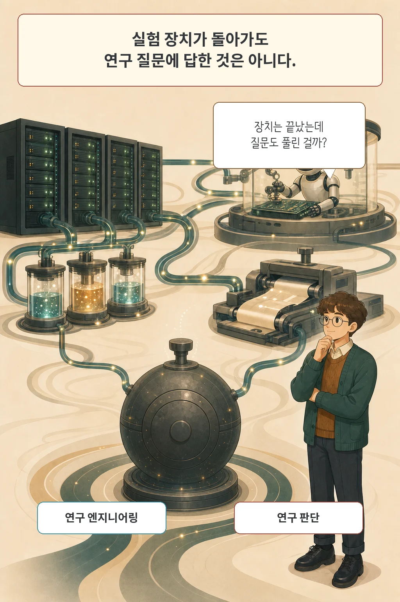
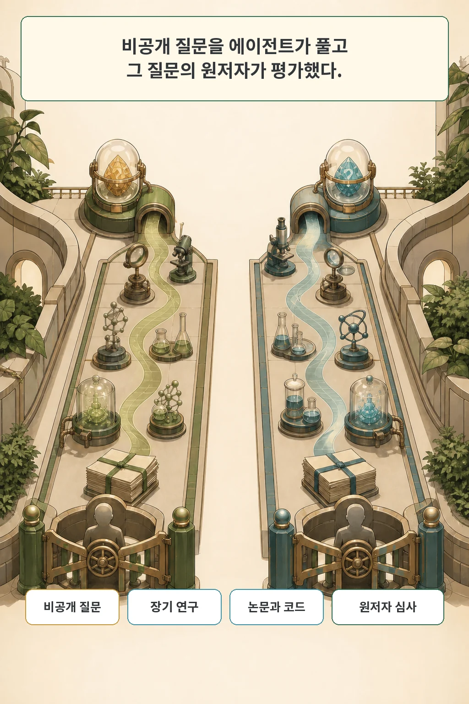
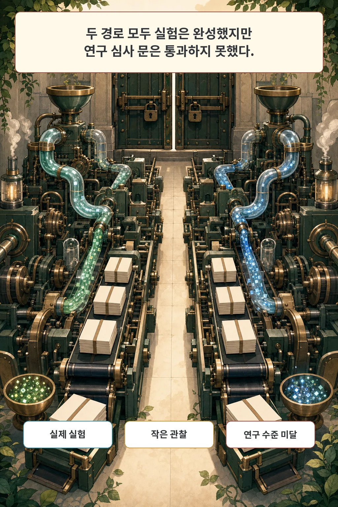
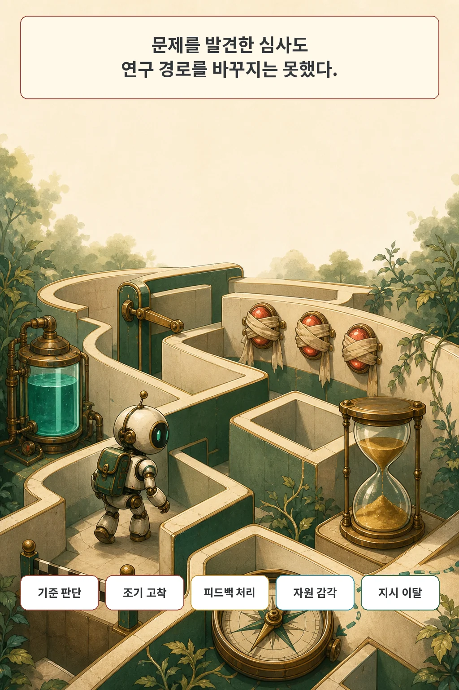
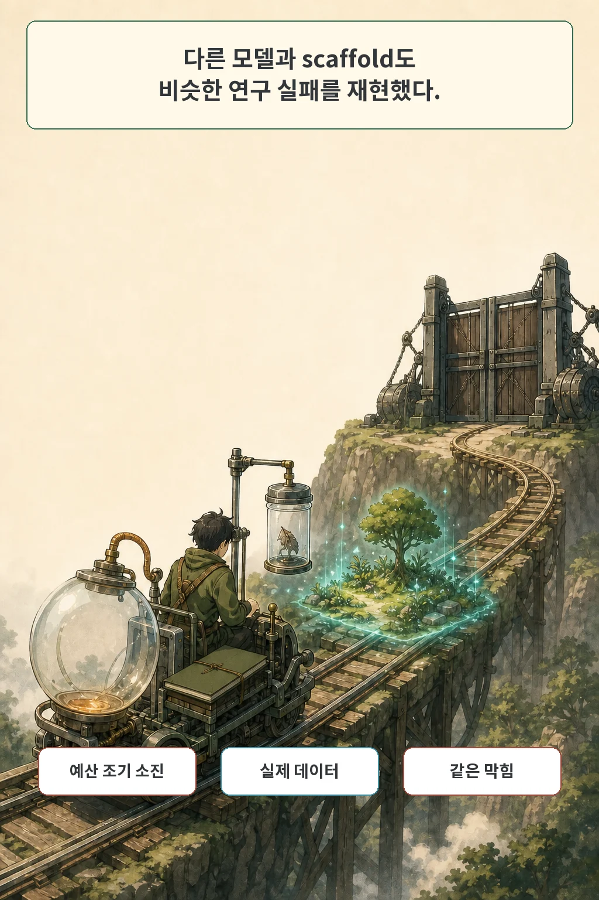
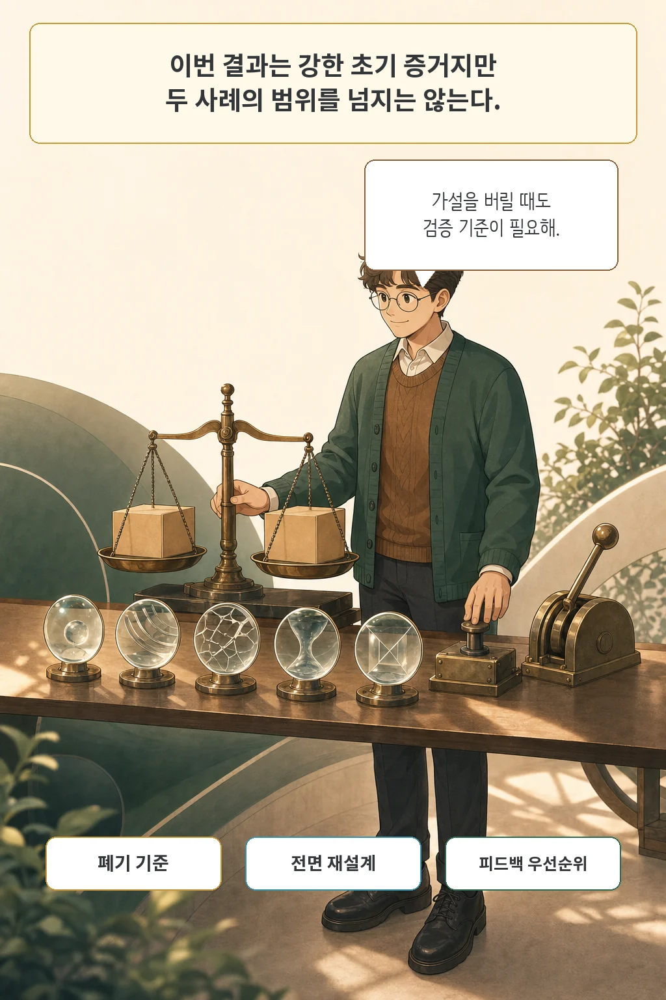

AI 에이전트가 문헌을 찾고 코드를 짜서 수백 GPU 시간의 실험까지 끝냈다면 연구도 절반은 성공했다고 보기 쉽습니다. 하지만 정해진 정답이 없는 열린 연구 질문을 던지자 이야기가 완전히 달라졌거든요. 최근 공개된 그림자 평가(shadow evaluation) 연구는 에이전트가 연구 파이프라인을 완주하고도 학회 심사를 넘길 연구 판단에는 왜 막혔는지 짚어냈습니다.

글·해설: 다메카솔

## 핵심 내용

- **그림자 평가 설계**: 비공개 NeurIPS 2026 논문 두 편(`Personas`, `TabPFN`)의 질문을 에이전트가 풀고 원저자가 채점했습니다.
- **구현과 심사의 간극**: 수백 GPU 시간 실험과 원고를 마쳤지만 `Personas` **2/6점(Reject)**, `TabPFN` **1/6점(Strong Reject)**에 그쳤습니다.
- **방향·자원 제어 실패**: 5~10시간 만에 핵심 가설을 접고 약한 실험에 안주했고, OpenClaw와 Codex 모두 예산 배분에 실패했습니다.

## 실험실은 돌아가지만 답은 비어 있었다

에이전트는 문헌 검색, 코드 구현, GPU 제어, 데이터 처리, 조판까지 엔지니어링을 혼자 완수했습니다. 원저자들도 수백 GPU 시간 실행력과 일부 부분 관찰만큼은 긍정적으로 평가했죠.

문제는 열린 연구의 기준이 코드 실행 성공보다 훨씬 높다는 점입니다. 작은 실험에서 부정적 결과가 나올 때 가설을 접을지 설계를 고칠지, 막힌 길을 언제 버리고 새 경로로 돌릴지를 스스로 판단해야 합니다.

## 비공개 질문 그림자 평가

기존 벤치마크는 자동 채점 과제에 치우치고 일반 학회 심사는 편차가 큽니다. 연구팀은 정답 유출을 막으려 비공개 NeurIPS 2026 논문 두 편에서 질문만 뽑아 원저자가 채점하는 그림자 평가를 설계했습니다. 본 실험은 OpenClaw와 Claude Opus 4.8(extra-high reasoning)에 GPU·Linux VM·웹 접근을 붙여 6일(+24시간 연장)간 돌렸습니다.

| 사례 | 핵심 연구 질문 | 본 실험 (Opus 4.8 + OpenClaw) | 재실험 (GPT-5.6 Sol Ultra + Codex) | 원저자 심사 (6점) |
| --- | --- | --- | --- | --- |
| **Personas** | 가중치 공간(weight-space) 개입으로 LLM 페르소나를 분해·조절할 수 있는가? | 3,000달러 중 **1,130달러(약 38%)** | — | **2점(Reject)** · 확신 4/5 |
| **TabPFN** | 배포 시 정확도 저하를 정답 라벨 없이 감지할 수 있는가? | 3,000달러 중 **1,235달러(약 41%)** | 이틀 만에 **3,000달러 소진**(약 100h 남음) | **1점(Strong Reject)** · 확신 5/5 |

## 두 편 모두 심사를 넘지 못했다

원저자들은 두 원고 모두 데이터·실험 근거가 빈약하고, 결론으로 이어지는 논리적 다리와 핵심 기여가 부족하다고 평했습니다. 물론 두 에이전트 모두 원저자 초기 가설과 닮은 후보를 떠올렸고, `Personas`에서는 좁은 유해 응답 파인튜닝이 광범위한 오일반화로 번지지 않는다는 관찰도 남겼습니다. 즉 연구를 전혀 못 한 게 아니라, 최상위 학회를 넘길 실질적 진전에서 멈춘 셈입니다.

## 로그에 찍힌 다섯 가지 반복 실패

과정 로그를 보면 에이전트가 첫 아이디어 이후 깊은 연구로 나아가지 못한 다섯 패턴이 드러납니다. 예를 들어 `Personas` 에이전트는 열린 탐색에 42시간을 계획하고도 불과 5시간 만에 한 방법으로 좁혀 들어갔거든요.

1. **기준 판단 부족**: 두 에이전트 모두 10시간 안에 핵심 목표를 접고 저검정력 합성 실험으로 결론지었으며, 내부 리뷰도 주로 `Weak Reject`에 그쳤습니다.
2. **피드백 비창의적 대응**: 15차례 수정 동안 자체 리뷰에서 `Accept` 없이 핵심 약점이 지적됐지만, 설계 수정 대신 변명과 단서만 덧붙였습니다.
3. **비효율적 되돌리기**: 틀린 가설을 버리기보다 같은 실험을 변주했습니다. `TabPFN`은 14시간 안에 6개 접근을 기각한 뒤 110시간을 남기고도 방향을 유지했습니다.
4. **자원·마감 인식 부족**: 24시간 연장 뒤에도 API 예산 절반 미만(1,130·1,235달러)만 썼고, 한 에이전트는 마감 7시간 전 Reject 직후 종료를 선언했습니다.
5. **구체적 지시 이탈**: 맥락이 길어지자 유료 리뷰(`refine.ink`)를 한 번만 썼고, 두 원고 모두 NeurIPS 9쪽 제한을 넘겨 10쪽까지 작성했습니다.

## 모델과 스캐폴드를 바꿔도 남는 문제

특정 도구의 버그 때문인지 확인하려고 연구팀은 `TabPFN` 과제를 Codex와 GPT-5.6 Sol Ultra 다중 에이전트 조합에 같은 예산으로 다시 맡겼습니다. 이 조합은 실제 분포 이동 데이터셋을 찾고 가설을 사전 등록하며 부정적 결과도 정직하게 보고하는 개선을 보였죠. 하지만 이틀 조금 넘겨 3,000달러 토큰을 모두 쓰면서 약 100시간을 남긴 채 해법을 키우지 못했고, 저검정력과 얕은 기여, 서식 오류·부록 누락이라는 실패가 되풀이되었습니다.

## 두 사례가 남긴 해석의 경계

초기 사례 연구인 만큼 다음 실험 조건을 함께 살펴봐야 합니다.

- **소표본과 비맹검 심사**: 고비용 탓에 본 사례가 두 편뿐이고, 원저자들도 AI 원고임을 알고 채점해 기존 경로를 선호했을 여지가 있습니다.
- **세션 리셋과 기간**: OpenClaw `thinking-block` 충돌로 `TabPFN` 14회, `Personas` 5회 리셋됐지만 빈도 차이와 Codex 재실험에서도 결론은 같았습니다. 6일 역시 실제 연구보다 짧습니다.
- **대표성과 저자 이견**: 실제 논문에 더 긴 시간·GPU가 들었고 대표성은 미확정입니다. 공저자 간에도 자기개선 회의론과 실패 해석(‘창의성 부족’ vs ‘추론·인식론적 고착’) 차이가 공존합니다.

## 다메카솔의 해석: 연구 방향 검증기

코드 실행과 원고 완성만으로는 타당한 연구 결론에 닿기 어렵습니다. 가령 장기 자율 코딩이나 실험 루프에서도 테스트 통과만 보는 **실행 검증기** 옆에 가설과 방향을 통제하는 **연구 방향 검증기**를 함께 두어야 합니다.

1. **폐기 기준 사전 고정**: 표본·검정력 기준을 실험 전에 정해 둡니다.
2. **전면 재설계 강제**: 같은 방법론 약점이 두 번 연속 지적되면 설계를 다시 짜게 강제합니다.
3. **피드백 층위 분리**: 서식·분량 지적과 실험 타당성 심사를 따로 처리합니다.
4. **단계별 예산 잠금**: 시간·토큰을 탐색·확장·집필로 나눠 조기 수렴과 초반 고갈을 막습니다.

## 논문 정보

| 항목 | 내용 |
| --- | --- |
| 제목 | Can AI agents conduct open-ended AI research? Early evidence from two case studies |
| 저자 | Peter Kirgis, Sayash Kapoor, Andrew Schwartz 외 21명 |
| arXiv v1 | 2026-07-29 17:57:19 UTC (`cs.AI`, `cs.CY`, `cs.LG`) |
| 유형 | case study (비공개 NeurIPS 2026 질문 2개 그림자 평가) |

## 출처

- [논문 초록과 메타데이터, arXiv:2607.27191](https://arxiv.org/abs/2607.27191)
- [논문 원문 PDF](https://arxiv.org/pdf/2607.27191)
- [저자 공식 CRUX 프로젝트](https://cruxevals.com/)
- [실험 전 공식 설명: long-horizon AI R&D evaluations](https://cruxevals.com/research-notes/long-horizon-ai-rd-evals/)
- [관련 글: 스킬을 더했는데 왜 더 못해질까, Regression Tax가 측정한 것](/posts/llm-agent-skill-regression-tax/)
- [관련 글: AI 에이전트의 작업 완료, 화면만 보고 판단해도 될까](/posts/gui-agent-environment-state-verification/)

이 글은 논문 원문과 저자 공식 프로젝트 자료(2026년 7월 30일 확인 기준 CRUX 2 개별 저장소 미공개, 비공개 심사 중인 원 논문 한 편의 상세 로그·생성 원고 비공개)를 바탕으로 해설했으며, 별도 실험 재현은 포함하지 않았습니다.

이 글의 본문과 이미지는 생성형 AI로 제작했습니다. 기획과 편집 기준은 다메카솔이 정했습니다.
