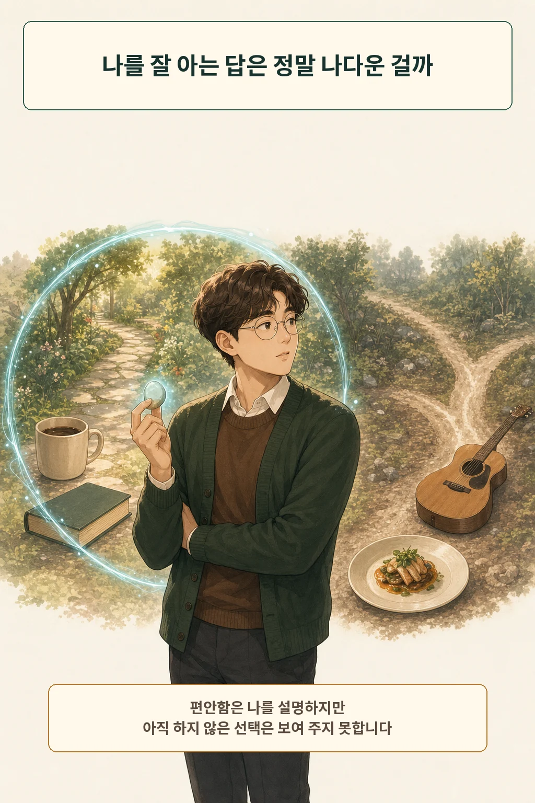
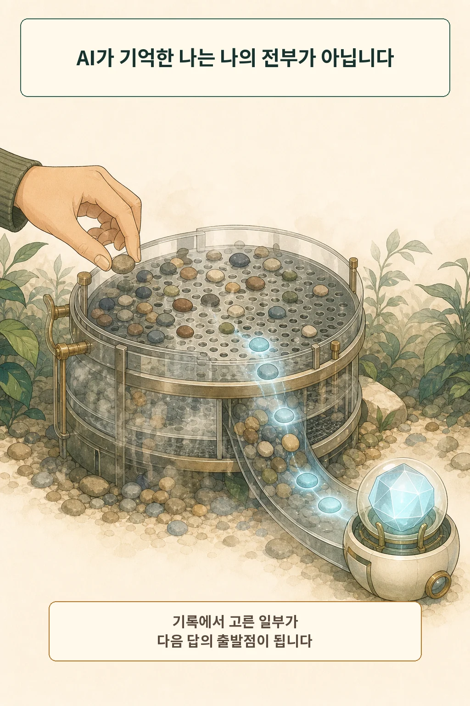
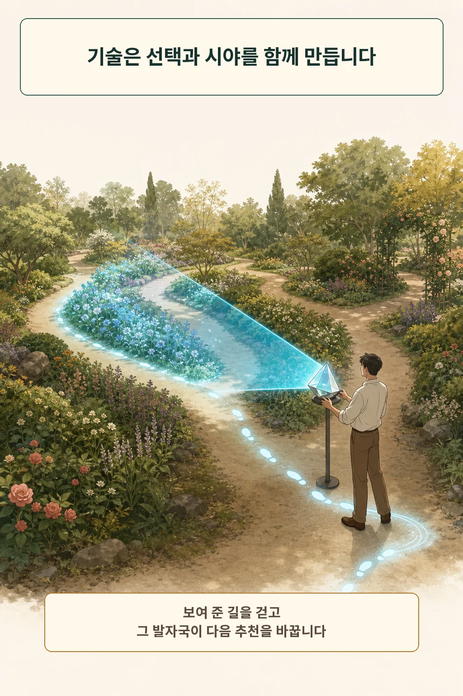
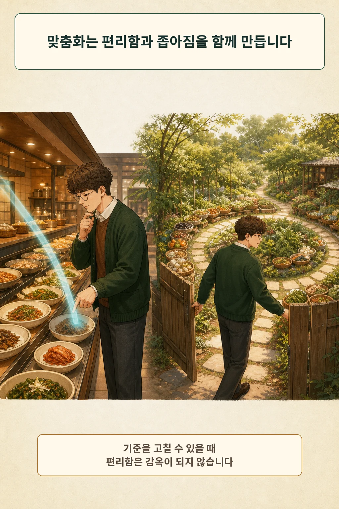
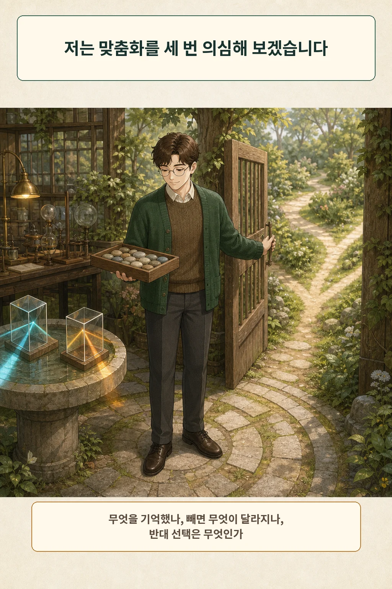

맞춤형 AI가 나를 더 나답게 만들어 주는지 묻는다면, 답은 “자동으로 그렇지는 않다”입니다. 과거 취향을 잘 맞히는 답변은 편리하지만, 그 답만 반복해서 고르는 동안 아직 시도해 보지 않은 선택지는 화면 밖으로 밀려나기 쉽습니다. **맞춤형 AI는 숨겨진 참자아를 비추는 거울이라기보다, 선택된 과거 기록과 현재의 반응이 서로를 강화하는 되먹임 고리(feedback loop)에 가깝습니다.**

글·해설: 다메카솔

## 핵심 내용

- **편리함과 선택된 기록의 차이**: AI 메모리 기능은 과거 대화·파일·연결 앱의 맥락을 불러와 반복 설명의 수고를 덜어 주지만, 시스템이 관련 있다고 추출한 일부 기록이 곧 나의 전체 정체성은 아닙니다.
- **자기 테크놀로지와 기술 매개**: 미셸 푸코의 ‘자기 테크놀로지’와 피터폴 버빅의 ‘기술 매개 이론’에 비추어 보면, 맞춤형 AI와의 대화는 고정된 자아를 확인하는 과정이 아니라 과거 기록이 추천을 좁히고 그 선택이 다시 다음 기록이 되는 상호 형성 과정입니다.
- **나다움을 지키는 3단계 습관**: 추천의 정확도보다 **내가 이 되먹임 고리를 직접 수정할 수 있는가**가 중요하며, 저장된 기억 점검하기, 메모리 끈 상태와 비교하기, 반대 관점(옆길) 요청하기로 고리를 열어 둘 수 있습니다.

## 익숙한 답은 현재의 나를 빠르게 불러옵니다

어제 고른 메뉴, 자주 읽는 글의 장르, 피하고 싶은 말투를 AI가 미리 기억해 두면 매번 배경을 다시 설명할 필요가 없습니다. OpenAI의 Memory FAQ(2026년 8월 6일 확인 기준) 역시 메모리를 활성화하면 채팅, 파일, 연결된 앱의 맥락을 활용해 경험을 개인화하며 사용자가 설정에서 이를 켜고 끌 수 있다고 안내합니다([OpenAI Memory FAQ](https://help.openai.com/en/articles/8590148-memory-faq)).

알레르기 정보나 접근성 요구처럼 매번 빠뜨리면 곤란한 조건에서 개인화는 분명한 가치를 발휘합니다. 하지만 “지금까지 자주 골랐다”는 사실과 “앞으로도 이것만이 나답다”는 판단은 같은 문장이 아닙니다.

## AI가 기억한 나는 선택된 기록입니다

같은 FAQ는 사용자가 메모리 요약본을 열람하고 수정할 수 있다고 설명하면서도, 화면에 표시되는 요약과 개인화 출처가 실제 응답을 만든 모든 요소를 전부 보여주지는 않을 수 있다고 덧붙입니다.

여기서 중요한 구분이 생깁니다. AI의 맞춤형 응답은 내 삶 전체에서 곧장 도출된 결론이 아니라, 시스템이 접근 가능한 기록 중에서 관련성이 높다고 추려 낸 일부 맥락에서 출발합니다. 미처 말하지 않은 욕구, 최근에 바뀐 생각, 기록 밖의 시도는 그 출발선에서 빠져 있을 수 있습니다.

## 푸코의 자기 테크놀로지와 버빅의 기술 매개

철학자 미셸 푸코는 1982년 강연에서 **자기 테크놀로지(Technologies of the Self)**를 사람이 혼자 또는 타인의 도움을 받아 자신의 생각, 행위, 존재 방식에 작업을 가해 스스로를 변화시키는 실천으로 설명했습니다. 그가 분석한 고대의 글쓰기와 자기 점검은 내면에 숨겨진 고정된 본질을 발굴하는 작업이 아니라, 무엇에 주의를 기울이고 어떤 기준으로 살아갈지 훈련하는 과정이었습니다([Michel Foucault, Technologies of the Self](https://foucault.info/documents/foucault.technologiesOfSelf.en/)).

여기에 기술철학자 피터폴 버빅의 **기술 매개(Technological Mediation)** 관점을 더하면 맞춤형 AI의 작동 방식이 더 또렷해집니다. 버빅은 기술을 가치중립적인 도구나 인간의 단순한 연장으로 보지 않고, 인간이 세계를 해석하고 행동하는 관계를 함께 빚어내는 매개로 봅니다([Peter-Paul Verbeek, Toward a Theory of Technological Mediation](https://ris.utwente.nl/ws/files/21754033/theory_of_mediation.pdf)).

| 관점 | 핵심 개념 | 맞춤형 AI 사용에 주는 시사점 |
| --- | --- | --- |
| **고정된 거울 관점** | 이미 완성된 ‘참자아’를 기술이 찾아내 비춰 줌 | 과거 취향 적중률만 높이면 나다움이 강화된다고 오해하기 쉬움 |
| **푸코 (자기 테크놀로지)** | 기록과 점검을 통해 주의의 방향과 삶의 기준을 훈련하는 실천 | AI와의 대화 역시 나를 단순 기록하는 데 그치지 않고 다음 질문과 판단 기준을 연습하는 과정이 됨 |
| **버빅 (기술 매개 이론)** | 기술이 선택지의 가시성을 바꾸고 인간이 이를 재해석해 실천에 통합함 | 과거 기록 → 맞춤형 답변 → 눈에 띄는 선택지 채택 → 새 기록 축적으로 이어지는 되먹임 고리를 사용자가 능동적으로 조율해야 함 |

## 다메카솔의 판단: 정확도보다 수정 가능성을 보겠습니다

결국 맞춤형 AI 시대에 던져야 할 질문은 “AI가 내 취향을 얼마나 잘 맞혔나”가 아니라 **“내가 이 되먹임 고리를 직접 수정할 수 있나”**입니다. 개인화가 나다움을 넓혀 주는 순간은 익숙한 답만 더 빨리 내놓을 때가 아니라, 저장된 기억과 기준을 내가 직접 고치고 예상 밖의 선택지를 만날 여지가 열려 있을 때입니다.

일상에서 이 고리를 열어 두는 데는 세 가지 습관이면 충분합니다.

1. **기억 보기**: AI가 나에 대해 어떤 전제와 요약 기억을 가지고 있는지 주기적으로 확인하고 철 지난 기록을 지웁니다.
2. **빼고 비교하기**: 메모리를 쓰지 않는 임시 대화에서 같은 질문을 던져 개인화 맥락이 가린 선택지가 무엇인지 비교합니다.
3. **옆길 넣기**: 평소 취향과 반대되는 선택지나 아직 시도해 보지 않은 관점을 명시적으로 요청합니다.

이 습관은 개인화의 편리함을 버리지 않으면서도 과거의 기록이 미래의 선택을 독점하지 못하게 막아 줍니다. AI에게 생각을 맡기는 경계가 궁금하다면 [AI에게 생각을 맡기면 나는 덜 생각하게 될까](/posts/ai-thinking-cognitive-offloading-philosophy/)를, AI와 관계를 맺는 조건은 [AI는 친구가 될 수 있을까](/posts/ai-companion-friendship-philosophy/)를 이어서 읽을 수 있습니다.

## 참고 자료

- [OpenAI, Memory FAQ](https://help.openai.com/en/articles/8590148-memory-faq)
- [Michel Foucault, Technologies of the Self](https://foucault.info/documents/foucault.technologiesOfSelf.en/)
- [Peter-Paul Verbeek, Toward a Theory of Technological Mediation](https://ris.utwente.nl/ws/files/21754033/theory_of_mediation.pdf)

이 글의 본문과 이미지는 생성형 AI로 제작했습니다. 기획과 편집 기준은 다메카솔이 정했습니다.

이미지는 텍스트 없는 원화에 결정적 레터링을 합성해 제작했습니다.
