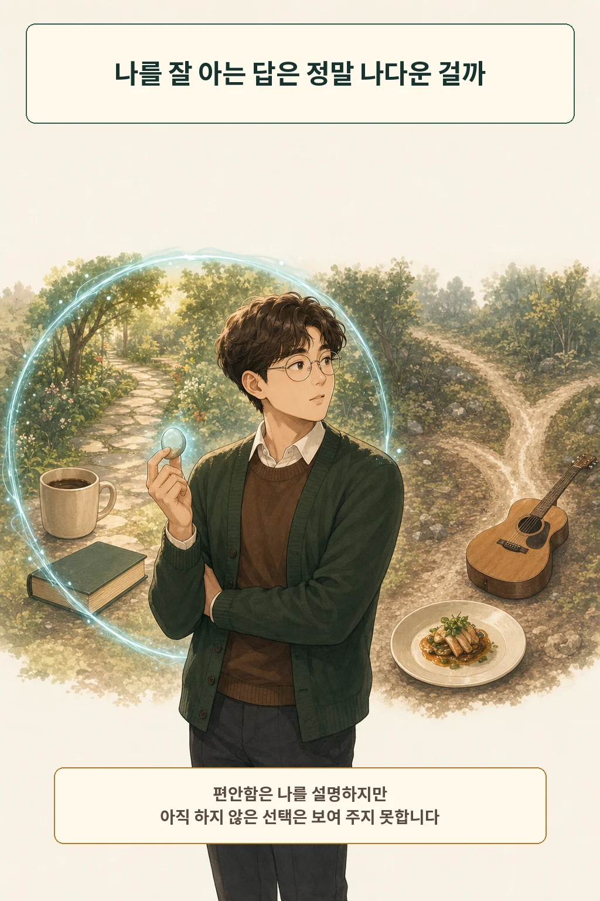
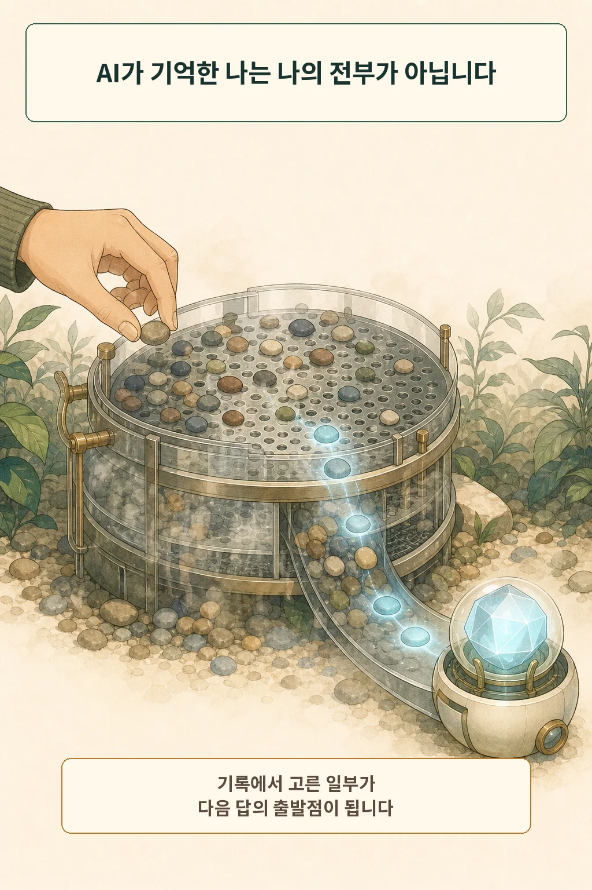
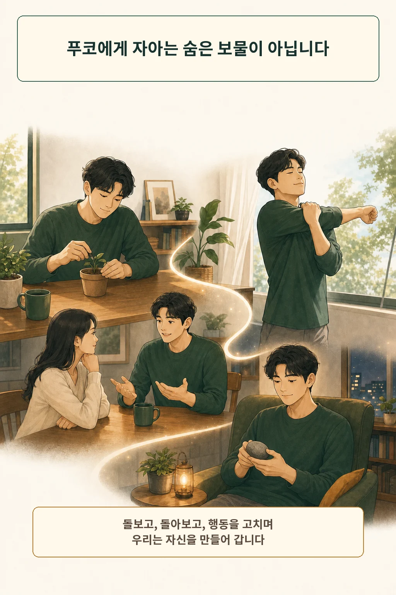
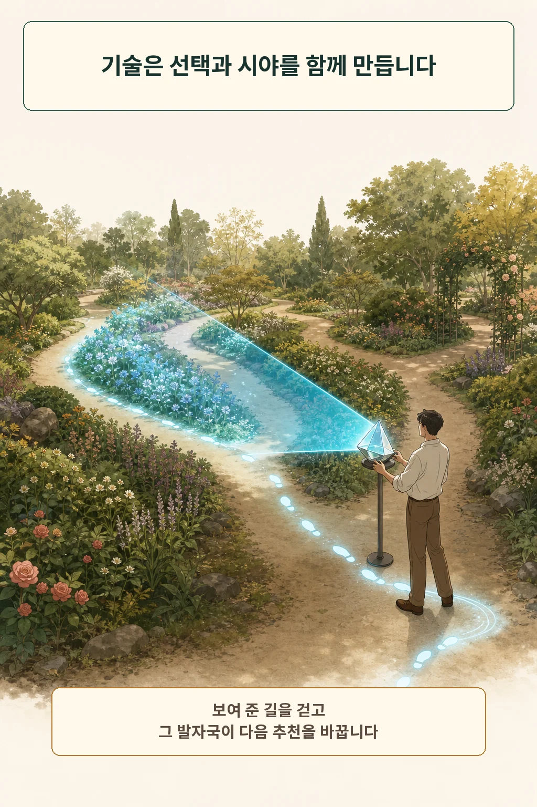
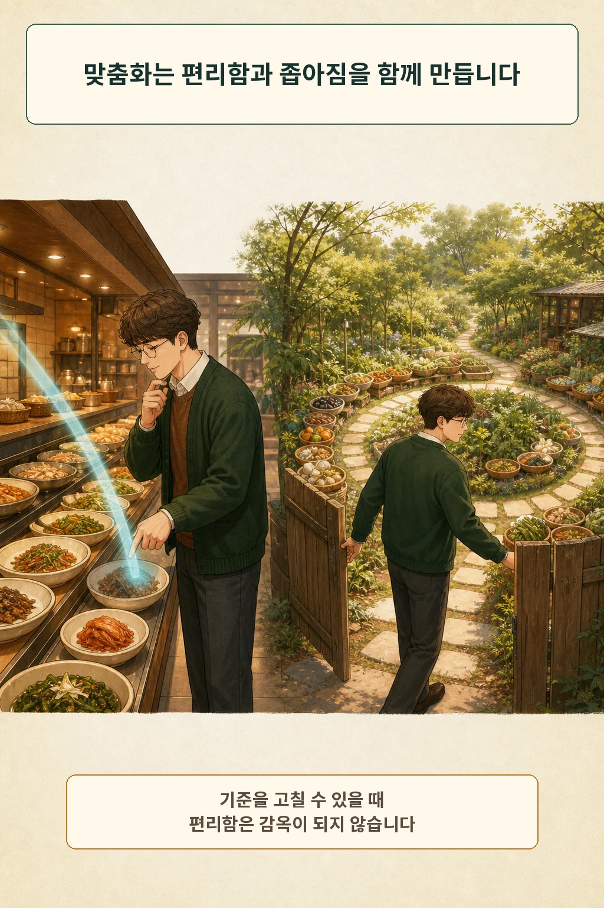
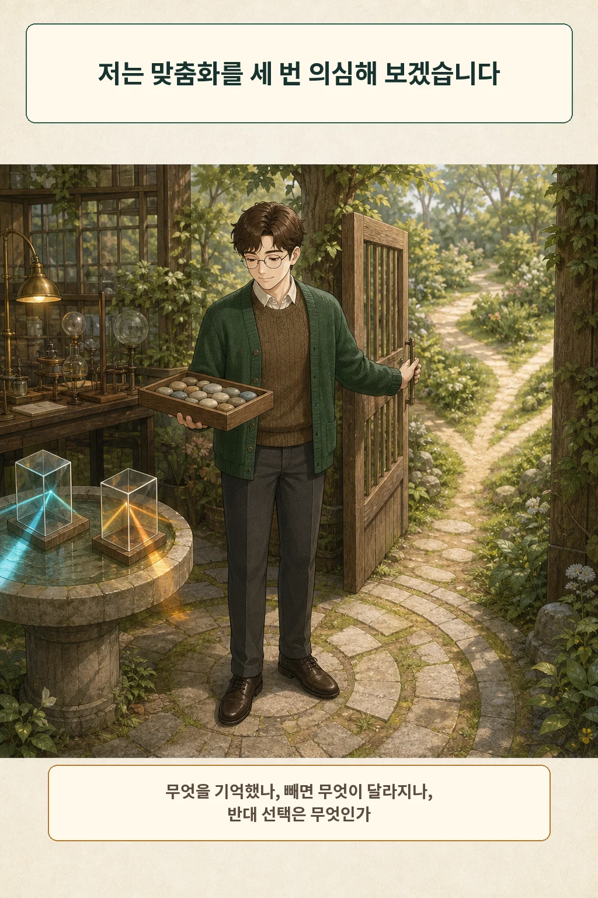

퇴근길에 오늘 저녁 메뉴나 주말에 볼 영화를 AI에게 물었는데, 예전에 내가 좋아했던 스타일을 콕 집어 추천해 주면 마치 마음 잘 통하는 단골집에 온 듯 반갑고 편해집니다. 하지만 그렇게 내 취향에 꼭 맞는 답만 골라 받다 보면, 문득 '이 추천이 나를 더 깊이 이해한 결과인지, 아니면 어제의 나만 계속 복제하는 건지' 의문이 들 때가 있죠. **맞춤형 AI는 숨겨진 참자아를 비추는 거울이라기보다, 선택된 과거 기록과 현재의 반응이 서로를 강화하는 되먹임 고리(feedback loop)에 가깝습니다.**

글·해설: 다메카솔

## 핵심 내용

- **편리함과 선택된 기록의 차이**: AI 메모리 기능은 과거 대화·파일·연결 앱의 맥락을 불러와 반복 설명의 수고를 덜어 주지만, 시스템이 관련 있다고 추출한 일부 기록만으로 나의 전체 정체성을 설명하기는 어렵습니다.
- **자기 테크놀로지와 기술 매개**: 미셸 푸코의 ‘자기 테크놀로지’와 피터폴 버빅의 ‘기술 매개 이론’으로 살펴보면, 맞춤형 AI와의 대화는 고정된 자아를 확인하는 거울보다 과거 기록과 현재 선택이 서로를 빚어내는 상호 형성 과정에 가깝습니다.
- **나다움을 지키는 세 가지 습관**: 추천의 정확도보다 **내가 이 되먹임 고리를 직접 고칠 수 있는가**가 중요하며, 저장된 기억 점검하기, 메모리 끈 대화와 비교하기, 반대 관점 요청하기로 선택의 여지를 열어 둘 수 있습니다.

## 익숙한 답은 현재의 나를 빠르게 불러옵니다

어제 고른 메뉴나 자주 읽는 책의 분위기, 피하고 싶은 말투를 AI가 미리 기억해 두면 매번 처음부터 설명해야 하는 번거로움이 크게 줄어듭니다. 2026년 8월 6일 확인한 [OpenAI Memory FAQ](https://help.openai.com/en/articles/8590148-memory-faq) 역시 메모리를 켜면 ChatGPT가 채팅과 파일, 연결된 앱에서 유용한 맥락을 기억해 사용 경험을 개인화하며 사용자가 설정에서 이를 언제든 켜고 끌 수 있다고 안내합니다.

예를 들어 알레르기 정보나 큰 글자 화면 같은 접근성 요구처럼 매번 빠뜨리면 곤란한 조건은 AI가 미리 챙겨 줄수록 일상이 한결 수월해집니다. 반면 주말 나들이 장소를 물을 때마다 예전에 몇 번 검색했던 조용한 북카페만 계속 추천한다면, 요즘 슬슬 관심이 생긴 전시회나 낯선 동네 산책길은 화면에 아예 올라오지 못할 수도 있습니다. "지금까지 자주 골랐다"는 과거의 기록이 "앞으로도 이것만이 나답다"는 기준으로 굳어지는 순간, 편리함이 오히려 내 취향의 울타리가 되는 셈이죠.

## AI가 기억한 나는 선택된 기록입니다

같은 FAQ는 사용자가 메모리 요약본을 열람하고 수정할 수 있다고 설명하면서도, 화면에 표시되는 요약과 개인화 출처가 실제 응답을 만든 모든 요소를 전부 보여주지는 않을 수 있다고 밝힙니다. 우리가 설정 창에서 확인하는 요약 목록만 보고는 답변 뒤에서 어떤 맥락이 작용했는지 남김없이 파악하기 어렵다는 뜻입니다.

결국 AI가 건네는 맞춤형 답변은 내 삶 전체를 속속들이 들여다본 결론이라기보다, 시스템이 접근 가능한 기록 가운데 지금 질문과 관련성이 높다고 추려 낸 일부 조각에서 출발합니다. 아직 말로 꺼내지 않은 바람이나 며칠 사이 바뀐 생각, 대화를 벗어난 현실의 시도는 그 계산 밖에서 빠져 있는 경우가 많거든요.

## 푸코의 자기 테크놀로지와 버빅의 기술 매개

이 지점에서 철학자 미셸 푸코가 1982년 강연에서 다룬 [**자기 테크놀로지(Technologies of the Self)**](https://foucault.info/documents/foucault.technologiesOfSelf.en/) 개념을 떠올려 보면 시야가 넓어집니다. 여기서 '테크놀로지'란 기계 장치만을 뜻하기보다 사람이 혼자 또는 타인의 도움을 받아 자신의 몸과 생각, 행위와 존재 방식에 공을 들이며 스스로를 변화시키는 삶의 실천을 가리킵니다. 푸코가 고대와 초기 기독교의 글쓰기·자기 점검 문화에서 읽어 낸 것도 내면에 숨어 있던 고정된 본질을 발굴하는 작업이 아니라, 무엇에 주의를 기울이고 어떤 기준으로 살아갈지 훈련하는 과정이었거든요.

고대의 자기 실천 시선 위에 현대 기술철학자 피터폴 버빅의 [**기술 매개(Technological Mediation)**](https://ris.utwente.nl/ws/files/21754033/theory_of_mediation.pdf) 이론을 포개 보면 AI 시대의 작동 방식이 한층 또렷해집니다. 버빅은 기술을 인간과 동떨어진 중립적 물건이나 단순한 손발의 연장으로 두지 않고, 인간이 세계를 경험하고 해석하며 행동하는 관계를 함께 빚어내는 매개로 봅니다. 동시에 기술이 일방적으로 사람을 찍어 누르기보다, 사람이 그 매개를 어떻게 받아들이고 의미를 부여해 기존의 일상 실천에 통합하는지도 함께 살펴야 한다고 강조합니다.

두 관점을 나란히 놓고 보면, 맞춤형 AI는 이미 완성된 참자아를 비추는 거울이나 사람을 일방적으로 빚는 조각가라기보다 **되먹임 고리**에 가깝습니다. 과거 기록에서 고른 일부 맥락으로 답을 건네고, 사용자가 그 답에 반응한 흔적이 다시 다음 추천의 재료로 쌓이는 순환 구조로 이해하는 편이 훨씬 정확합니다.

| 관점 | 핵심 개념 | 맞춤형 AI 사용에 주는 시사점 |
| --- | --- | --- |
| **고정된 거울 관점** | 이미 완성된 ‘참자아’를 기술이 찾아내 비춰 줌 | 과거 취향 적중률만 높이면 나다움이 강화된다고 오해하기 쉬움 |
| **푸코 (자기 테크놀로지)** | 기록과 점검을 통해 주의의 방향과 삶의 기준을 훈련하는 실천 | AI와의 대화 역시 나를 단순 기록하는 데 그치지 않고 다음 질문과 판단 기준을 연습하는 과정이 됨 |
| **버빅 (기술 매개 이론)** | 기술이 선택지의 가시성을 바꾸고 인간이 이를 재해석해 실천에 통합함 | 과거 기록 → 맞춤형 답변 → 눈에 띄는 선택지 채택 → 새 기록 축적으로 이어지는 되먹임 고리를 사용자가 능동적으로 조율해야 함 |

## 다메카솔의 판단: 정확도보다 수정 가능성을 보겠습니다

결국 맞춤형 AI 시대에 던져야 할 핵심 질문은 "AI가 내 취향을 얼마나 잘 맞혔나"보다 **"내가 이 되먹임 고리를 직접 수정할 수 있나"**여야 합니다. 저는 개인화가 나다움을 넓혀 주는 조건이 익숙한 답을 빠르게 내놓는 정확도가 아니라, 저장된 기억과 기준을 내가 직접 손보고 예상 밖의 선택지를 만날 여지가 남아 있는지에 달려 있다고 생각합니다.

가령 오랫동안 업무 효율화 팁과 실용서 요약만 즐겨 찾던 사람이 어느 날 문득 소설이나 예술 에세이를 읽어 보고 싶어진 상황을 떠올려 볼까요? AI가 예전 기록을 근거로 계속 실용서만 첫머리에 올려 둔다면, 정작 내 관심사는 달라졌는데도 화면은 여전히 과거의 나만 붙잡고 있게 됩니다. 이때 사용자가 직접 기억 목록에서 낡은 관심사를 덜어 내고 새로운 호기심을 끼워 넣을 수 있어야 비로소 도구가 내 변화의 속도를 따라잡을 수 있습니다.

일상에서 이 고리를 건강하게 열어 두는 데는 거창한 설정보다 세 가지 작은 습관이면 충분합니다.

1. **기억 보기**: 설정에서 AI가 나에 대해 어떤 전제와 요약 기억을 가지고 있는지 주기적으로 확인하고 철 지난 기록을 지웁니다.
2. **빼고 비교하기**: 메모리를 쓰지 않는 임시 대화에서 같은 질문을 던져 보며, 개인화 맥락이 앞세운 답 말고 다른 어떤 선택지가 더 있는지 나란히 비교해 봅니다.
3. **옆길 넣기**: 평소 취향과 반대되는 선택지나 아직 시도해 보지 않은 낯선 관점을 일부러 요청해 봅니다.

이 습관은 개인화가 주는 편리함을 버리지 않으면서도 어제의 기록이 내일의 선택을 독점하지 못하게 막아 줍니다. 나에게 꼭 맞는 답이 편안한 쉼표가 되는 날도 소중하지만, 가끔은 익숙한 추천 바깥으로 한 걸음 비켜서서 다음 질문을 직접 열어 보는 건 어떨까요? AI에게 생각을 맡기는 경계가 궁금하다면 [AI에게 생각을 맡기면 나는 덜 생각하게 될까](/posts/ai-thinking-cognitive-offloading-philosophy/)를, AI와 관계를 맺는 조건은 [AI는 친구가 될 수 있을까](/posts/ai-companion-friendship-philosophy/)를 이어서 읽을 수 있습니다.

## 출처

- [OpenAI, Memory FAQ](https://help.openai.com/en/articles/8590148-memory-faq)
- [Michel Foucault, Technologies of the Self](https://foucault.info/documents/foucault.technologiesOfSelf.en/)
- [Peter-Paul Verbeek, Toward a Theory of Technological Mediation](https://ris.utwente.nl/ws/files/21754033/theory_of_mediation.pdf)

이 글의 본문과 이미지는 생성형 AI로 제작했습니다. 기획과 편집 기준은 다메카솔이 정했습니다.

이미지는 텍스트 없는 원화에 결정적 레터링을 합성해 제작했으며, 본문은 공개된 공식 제품 문서와 철학 원전을 바탕으로 정리했습니다.
