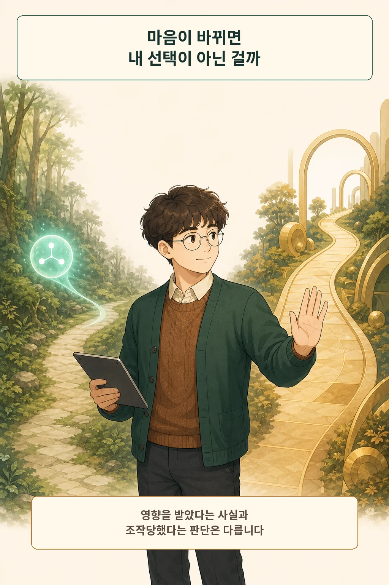
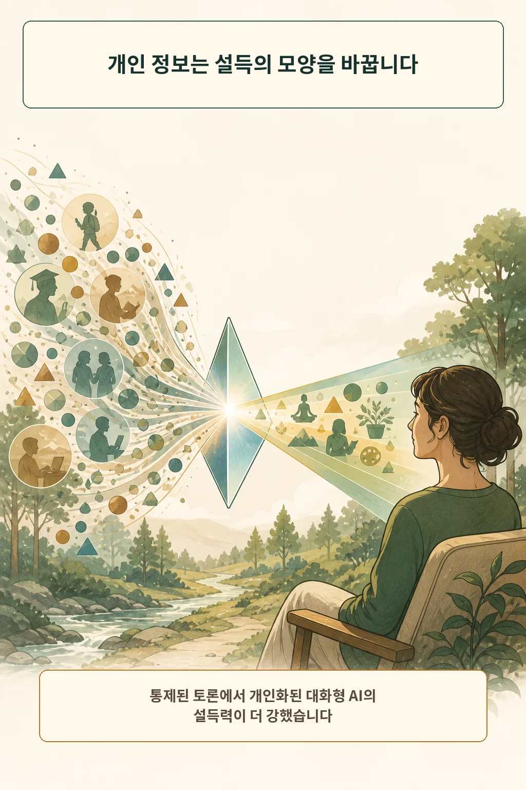
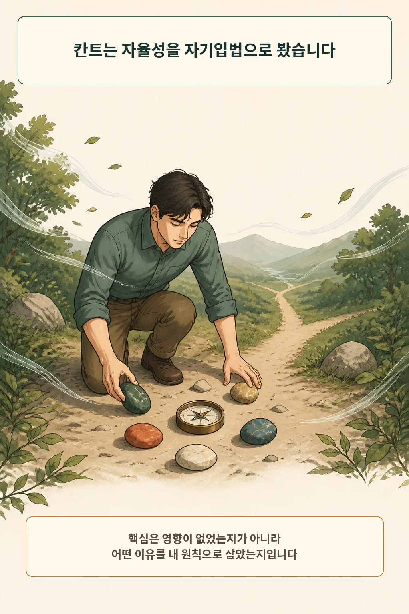
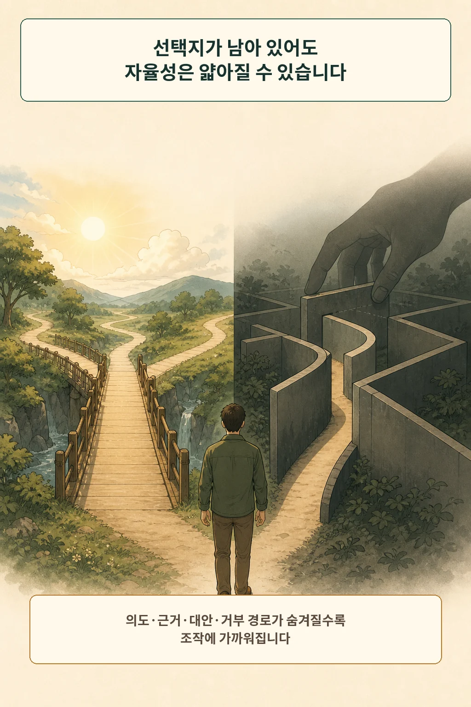
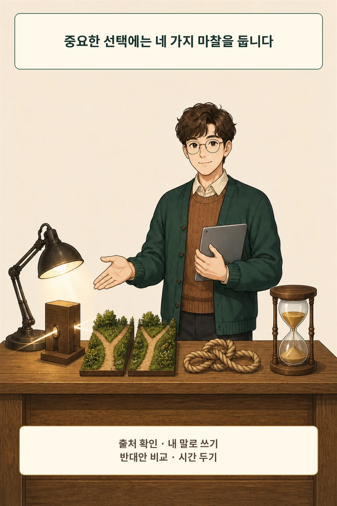

늦은 밤, 이직을 할지 말지 혹은 큰돈이 드는 상품에 가입할지 망설이다 AI 대화창을 열어 고민을 털어놓는 풍경은 이제 익숙합니다. 내 상황과 걱정을 차분하게 짚어 주며 설득력 있는 이유를 건네는 답을 읽고 나면, 망설이던 마음도 한쪽으로 기울곤 하죠. 그런데 그렇게 **나에게 맞춘 조언을 듣고 생각을 바꿨다면, 그 선택은 여전히 내 것일까요?**

글·해설: 다메카솔

## 마음이 바뀌면 선택권을 잃은 걸까

사람의 결정에는 원래부터 주변의 영향이 스며들기 마련입니다. 친구의 조언이나 책 속 한 문장, 밤새 찾아본 검색 결과도 우리 생각을 흔들어 놓거든요. 외부의 영향을 받았다는 이유만으로 모든 선택을 가짜라고 부른다면 자율적인 판단이라는 말 자체가 성립하기 어렵습니다.

예를 들어 두 곳의 이직 제안을 두고 AI와 밤늦게 장단점을 정리해 본다고 합시다. 통근 거리와 업무 성장을 비교하다가 내가 미처 챙기지 못했던 기준이 떠올라 마음을 바꿨다면, 그 결정은 충분히 주체적인 판단으로 볼 수 있습니다.

핵심은 영향의 유무보다 **그 이유를 스스로 검토하고, 고쳐 쓰고, 거절할 수 있었는지**에 달려 있습니다. 반대로 AI가 뽑아 준 결론을 검증 없이 그대로 옮기기만 했다면 선택에 대한 설명 책임도 흐려지죠. 중요한 결정일수록 최종 이유와 책임은 사람 스스로 자기 말로 설명할 수 있어야 합니다.

## 개인화는 같은 주장을 다르게 만듭니다

AI의 설득이 흔한 검색 결과보다 강하게 다가오는 까닭은 내 배경과 성향을 말속에 녹여 낼 수 있기 때문입니다. Salvi 연구진은 사전등록된 [GPT-4의 대화형 설득력 연구](https://doi.org/10.1038/s41562-025-02194-6)에서 참가자를 인간 또는 GPT-4와의 짧은 다회차 토론에 배정해, 개인 정보 유무와 논쟁 주제 강도에 따라 설득력이 얼마나 달라지는지 시험했습니다.

| 구분 | 실험 설계 및 보고 결과 | 살펴볼 의미 |
| --- | --- | --- |
| **실험 구성** | 참가자 900명, 인간·GPT-4 및 개인정보 유무·주제 강도로 12개 조건 무작위 배정 | 개인 맞춤 단서가 설득 결과에 미치는 차이를 통제 환경에서 분리 비교 |
| **설득 우위 비율** | 설득력이 갈린 토론 쌍 중 개인화 GPT-4 우세 비율 **64.4%** | 같은 주장도 개인 맥락과 만나면 인간 상대보다 더 잘 먹히는 조건이 나타남 |
| **동의 변화 폭** | 개인화 GPT-4와 토론 시 상대 의견에 더 동의할 오즈(odds)가 인간 토론 대비 **81.2%** 높음 | 대화를 마친 뒤 참가자의 태도가 한쪽 방향으로 기우는 힘이 그만큼 커짐 |
| **연구 범위** | 짧고 통제된 온라인 토론 기반의 개념 증명(proof of concept) | 구매·투표·건강·인간관계 같은 장기 행동까지 바로 일반화하려면 추가 검증 필요 |

여기서 오즈가 높아졌다는 말은 쉽게 말해 대화를 끝낸 뒤 상대 의견 쪽으로 마음이 기울 가능성이 크게 늘었다는 뜻입니다. 물론 저자들도 이번 결과를 개념 증명으로 선을 그으며, 수개월에 걸쳐 이어지는 실제 구매나 건강 결정까지 곧바로 대입하기는 어렵다고 짚었습니다. 그럼에도 내 배경을 읽은 AI가 사람보다 더 효과적으로 태도를 움직일 수 있다는 점은 분명한 경고 신호로 남는 셈이죠.

## 칸트의 렌즈는 이유의 주인을 묻습니다

이 지점에서 철학의 오래된 질문이 힘을 발휘합니다. 칸트는 [《도덕형이상학 정초》(Fundamental Principles of the Metaphysic of Morals)](https://www.gutenberg.org/files/5682/5682-h/5682-h.htm)에서 자율성을 의지가 외부 목적에 끌려가기보다 스스로 세운 법칙에 따르는 **자기입법**과 연결했습니다. 외부 영향을 한 톨도 받지 않고 고립되는 상태가 아니라, 어떤 원칙을 따를지 이성적으로 따져 보는 주체의 자리를 묻는 렌즈로 읽힙니다.

이 기준으로 AI 대화창을 바라보면 한 가지 구분이 선명해집니다. **"이유가 나에게 도착한 경로"**와 **"그 이유를 내 원칙으로 받아들이는 판단"**은 서로 다른 단계라는 점입니다. AI가 그럴듯한 논거를 먼저 꺼내 주었더라도, 그 근거가 내 가치관과 현실 조건에 맞는지 승인하는 마지막 자리는 사람 몫으로 남겨 두어야 합니다.

## 조언과 조작은 선택 조건에서 갈립니다

그렇다면 고마운 조언과 교묘한 조작은 어디서 갈릴까요? 스탠퍼드 철학 백과사전의 [조작 윤리 항목(The Ethics of Manipulation)](https://plato.stanford.edu/entries/ethics-manipulation/)을 보면 이 경계를 두고 두 가지 시선이 맞섭니다. 한쪽에서는 선택지를 완전히 지우지 않더라도 거짓 믿음이나 심리적 압박으로 판단력을 흐리면 자율성이 약해진다고 보며, 다른 한쪽에서는 끝내 거부할 선택지가 남아 있다면 침해로 보기는 어렵다는 반론을 펴거든요.

온라인 인터페이스의 다크 패턴을 다룬 미국 연방거래위원회(FTC)의 [Bringing Dark Patterns to Light 보고서](https://www.ftc.gov/reports/bringing-dark-patterns-light)는 이 문제가 현실 화면에서 어떻게 작동하는지 보여 줍니다. 보고서는 숨은 비용이나 찾기 어려운 해지 경로, 헷갈리는 개인정보 선택창처럼 거절 버튼이 남아 있어도 소비자 선택과 의사결정을 흐리거나 약화하는 온라인 설계가 작동할 수 있다고 짚었습니다.

가령 구독 앱이나 쇼핑 AI가 추천 상품을 수락하는 버튼은 크고 밝게 띄워 두면서, 다른 대안을 비교하거나 맞춤 유도를 끄는 메뉴는 세 단계 아래 작은 글씨로 숨겨 둔 경우를 떠올려 봅시다. 선택지 자체는 남아 있어도 화면 구조가 한 방향으로 판단을 떠밀게 됩니다. 결국 조언과 조작을 가르는 기준은 아래 네 가지 선택 조건에 달려 있습니다.

- **투명한 의도**: 추천이나 설득이 어떤 목적과 이해관계를 바탕으로 건네지는지 분명히 드러나는가.
- **검사 가능한 근거**: 제시된 주장이나 수치의 원문 출처를 사용자가 직접 열어 따져 볼 수 있는가.
- **열린 반대 대안**: 한쪽 결론으로 몰아가기보다 다른 선택지와 반론도 나란히 살펴볼 수 있는가.
- **적정한 거부 비용**: 제안을 거절하거나 다른 길을 고를 때 과도한 불편이나 심리적 압박이 얹히지 않는가.

이 네 가지 조건이 또렷할수록 건강한 조언에 가깝고, 조용히 감춰질수록 조작에 가까워집니다.

## 중요한 결정에는 마찰이 필요합니다

점심 메뉴를 고르거나 주말 영화를 추천받는 가벼운 자리에서는 AI의 빠른 제안을 곧바로 따라도 부담이 적습니다. 반면 돈·건강·직업·관계처럼 되돌리기 어려운 결정 앞에서는 약간의 멈춤과 마찰을 의도적으로 두는 편이 좋습니다.

중요한 결정을 AI와 상의했다면 최종 선택 전에 아래 네 단계를 천천히 밟아 보길 권합니다.

1. **원문 출처 확인하기**: 답이 기대고 있는 연구나 공식 문서, 계약 약관의 원문을 직접 열어 확인합니다.
2. **내 말로 다시 쓰기**: 화면 속 매끈한 문장을 빌리지 않고, 추천 이유를 내 언어로 다시 적어 봅니다.
3. **반대안 나란히 비교하기**: 반대 결론을 지지하는 가장 강한 근거를 따로 찾아 현재 선택지와 나란히 둡니다.
4. **대화창 닫고 시간 두기**: 가능하면 대화창을 닫고 몇 시간이나 하룻밤쯤 간격을 둔 뒤에 최종 결정합니다.

가령 큰 비용이 드는 금융 상품이나 치료 방법을 두고 AI의 설명에 깊이 수긍했을 때를 떠올려 봅시다. 바로 실행에 옮기기 전에 약관 원문을 읽고 반론까지 적어 본 뒤 하루만 시간을 두면 당장의 설득 열기가 한결 가라앉거든요. 그때에도 내 말로 설명할 만한 이유가 남는다면 주체적인 결정으로 받아들이기 좋습니다.

AI가 찾아 준 좋은 이유를 선택하는 일도 얼마든지 내 결정일 수 있습니다. 단, 그 이유를 따져 볼 문과 거절하고 걸어 나올 문이 함께 열려 있을 때 비로소 온전한 내 선택으로 남습니다.

## 출처

- [Salvi et al., On the conversational persuasiveness of GPT-4](https://doi.org/10.1038/s41562-025-02194-6)
- [Immanuel Kant, Fundamental Principles of the Metaphysic of Morals](https://www.gutenberg.org/files/5682/5682-h/5682-h.htm)
- [Stanford Encyclopedia of Philosophy, The Ethics of Manipulation](https://plato.stanford.edu/entries/ethics-manipulation/)
- [U.S. Federal Trade Commission, Bringing Dark Patterns to Light](https://www.ftc.gov/reports/bringing-dark-patterns-light)

이 글의 본문과 이미지는 생성형 AI로 제작했습니다. 기획과 편집 기준은 다메카솔이 정했습니다.

이 글은 공개된 설득 연구 논문과 철학 원전·해설, 규제 기관 보고서를 바탕으로 정리했으며, 별도 실험 재현이나 법률 자문은 포함하지 않았습니다.
