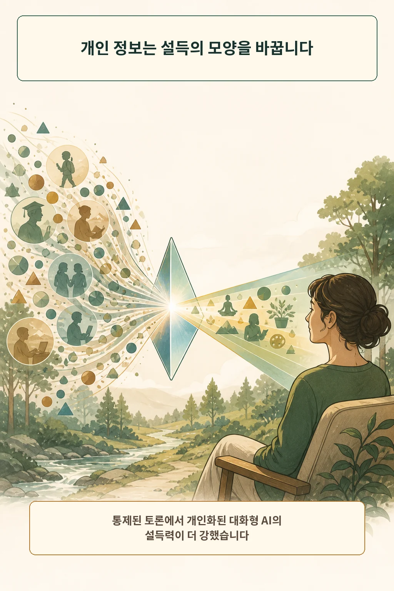
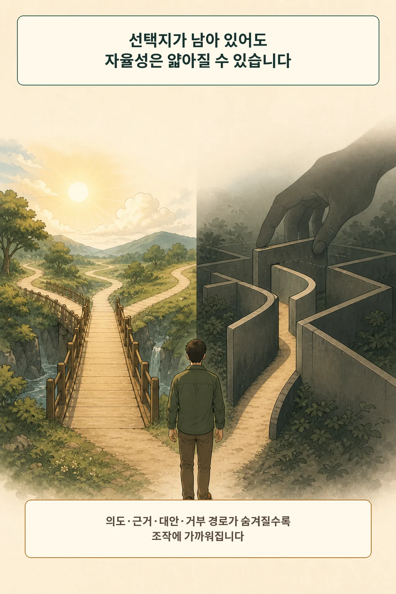

개인 정보를 전달받은 GPT-4는 통제된 토론 실험에서 인간보다 더 높은 설득력을 보였습니다. 이 숫자가 불편하게 다가오는 이유는 단순히 AI가 말을 잘해서만이 아닙니다. **나에게 맞춘 답을 듣고 마음을 바꿨을 때, 과연 그 선택을 여전히 내 것이라고 부를 수 있는가**라는 질문이 곧바로 따라붙기 때문입니다.

글·해설: 다메카솔

## 마음이 바뀌면 선택권을 잃은 걸까

사람의 선택에는 언제나 주변의 영향이 섞이기 마련입니다. 친구의 조언이나 검색 결과, 책 속의 한 문장도 우리의 판단을 움직입니다. 외부의 영향을 받았다는 이유만으로 모든 선택을 가짜라고 부르면 자율적 선택이라는 개념 자체가 성립할 수 없습니다.

핵심은 영향의 유무가 아니라 **그 이유를 스스로 검토하고, 거부하고, 고쳐 쓸 수 있었는가**입니다. AI가 내린 결론을 검토 없이 그대로 복사했다면 선택에 대한 설명 책임도 흐려집니다. 중요한 결정일수록 마지막 이유는 사람이 자기 말로 설명할 수 있어야 합니다.

## 개인화는 같은 주장을 다르게 만듭니다

Salvi 등은 참가자 900명을 인간 또는 GPT-4와의 짧은 다회차 토론, 개인 정보 제공 여부, 주제 강도에 따라 12개 조건에 무작위로 배정했습니다. 인간과 AI의 설득력이 갈렸던 토론 쌍에서 개인화된 GPT-4가 더 설득력 있었던 비율은 64.4%에 달했고, 토론 뒤 상대 의견에 더 동의할 오즈(odds)는 인간과 토론한 경우보다 81.2% 높았습니다([On the conversational persuasiveness of GPT-4](https://doi.org/10.1038/s41562-025-02194-6)).

물론 이 결과는 짧고 통제된 토론에서의 개념 증명이며, 구매·투표·건강·인간관계 같은 장기 행동으로 일반화하려면 별도의 검증이 필요합니다. 그럼에도 개인화된 언어 모델이 사람의 태도를 얼마나 효과적으로 움직일 수 있는지 보여 주는 경고등으로는 충분합니다.

## 칸트의 렌즈는 이유의 주인을 묻습니다

칸트는 《도덕형이상학 정초》에서 자율성을 의지가 스스로 법칙을 세우는 자기입법과 연결했습니다. 외부의 영향을 한 톨도 받지 않는 고립 상태가 핵심이라기보다, 어떤 원칙을 따를지 이성적으로 검토하는 주체의 자리를 묻는 것입니다([Fundamental Principles of the Metaphysic of Morals](https://www.gutenberg.org/files/5682/5682-h/5682-h.htm)).

이 고전적 렌즈를 AI 시대에 살펴보면 한 가지 구분이 선명해집니다. “이유가 나에게 도착한 경로”와 “그 이유를 내 원칙으로 받아들이는 판단”은 서로 다른 단계라는 점입니다.

## 조언과 조작은 선택 조건에서 갈립니다

철학에서는 조작(manipulation)이 선택지를 완전히 없애지 않더라도 거짓 믿음이나 심리적 압력으로 자율성을 약화할 수 있다는 견해와, 거부할 선택지가 남아 있으면 침해가 아닐 수 있다는 반론이 함께 논의됩니다([The Ethics of Manipulation](https://plato.stanford.edu/entries/ethics-manipulation/)). 온라인 인터페이스의 다크 패턴을 다룬 미국 연방거래위원회(FTC) 보고서 역시 숨은 비용이나 찾기 어려운 해지 경로, 혼란스러운 개인정보 선택창처럼 버튼은 남아 있어도 선택 환경 자체가 한쪽으로 기울어 의사결정을 흐릴 수 있다고 지적합니다([Bringing Dark Patterns to Light](https://www.ftc.gov/reports/bringing-dark-patterns-light)).

결국 조언과 조작을 가르는 기준은 다음 네 가지 조건입니다.

- 설득 의도가 투명하게 드러나는가?
- 제시된 근거를 직접 검사할 수 있는가?
- 반대 대안이 함께 열려 있는가?
- 제안을 거부할 때 치르는 비용이 과도하지 않은가?

이 조건들이 뚜렷할수록 좋은 조언에 가깝고, 조용히 감춰질수록 조작에 가까워집니다.

## 중요한 결정에는 마찰이 필요합니다

빠른 답이 필요한 사소한 일상 선택에서는 검토 강도를 낮춰도 괜찮지만, 돈·건강·직업·관계처럼 되돌리기 어려운 결정 앞에서는 의도적인 마찰을 두는 네 단계가 도움이 됩니다.

1. 답이 기대고 있는 원문 출처를 직접 열어 확인합니다.
2. 추천 이유를 AI의 문장을 빌리지 않고 내 말로 다시 써 봅니다.
3. 반대 결론을 지지하는 가장 강한 근거를 찾아 나란히 비교합니다.
4. 가능하면 대화창을 닫고 시간을 둔 뒤에 최종 결정합니다.

AI가 제시한 좋은 이유를 받아들이는 일도 얼마든지 내 선택일 수 있습니다. 단, 그 이유를 살필 문과 거절하고 나갈 문이 함께 열려 있을 때입니다.

## 출처

- [Salvi et al., On the conversational persuasiveness of GPT-4](https://doi.org/10.1038/s41562-025-02194-6)
- [Immanuel Kant, Fundamental Principles of the Metaphysic of Morals](https://www.gutenberg.org/files/5682/5682-h/5682-h.htm)
- [Stanford Encyclopedia of Philosophy, The Ethics of Manipulation](https://plato.stanford.edu/entries/ethics-manipulation/)
- [U.S. Federal Trade Commission, Bringing Dark Patterns to Light](https://www.ftc.gov/reports/bringing-dark-patterns-light)

이 글의 본문과 이미지는 생성형 AI로 제작했습니다. 기획과 편집 기준은 다메카솔이 정했습니다.
