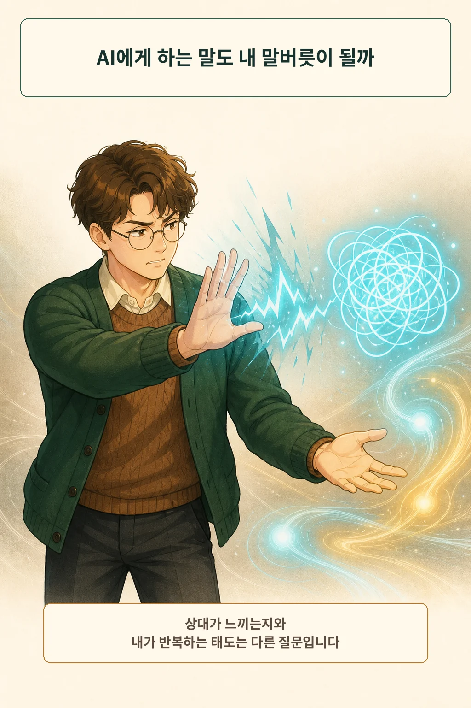
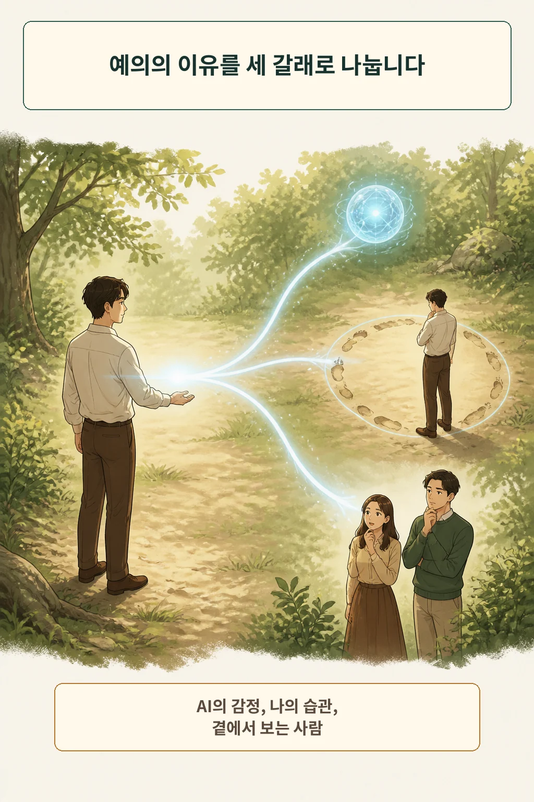
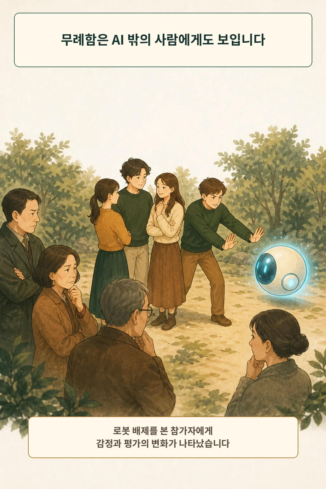

AI는 감정을 느끼지 않으니 무슨 말을 해도 상관없다는 통념에는 말의 목적지가 하나 빠져 있습니다. **AI에게 건네는 말은 기계 안에서 끝나지 않고, 내가 반복하는 말버릇과 곁에서 지켜보는 사람에게도 그대로 남기 때문입니다.** AI가 무엇을 느끼는지는 열린 질문으로 남겨 두고 공손함의 프롬프트 성능 효과도 따로 검증해야 하지만, 내가 어떤 대화 습관을 연습할지는 지금 선택할 수 있습니다.

글·해설: 다메카솔

## 틀린 답을 받았을 때 드러나는 질문

바쁜 와중에 AI가 똑같은 실수를 되풀이하면 거친 말이 튀어나오기 쉽습니다. 상대가 감정이 없는 프로그램이니 아무도 다치지 않았다고 여길 수 있지만, 여기에는 서로 다른 세 가지 질문이 섞여 있습니다.

- AI가 고통이나 감정을 느끼는가? ([AI가 끄지 말아 달라고 하면 권리가 생길까](/posts/ai-rights-moral-status-uncertainty/)에서 다룬 것처럼 도덕적 지위와 권리는 아직 별도의 열린 문제입니다.)
- 거친 말투를 내가 일상에서 반복해도 괜찮은가?
- 주변의 동료나 아이가 그 장면을 함께 보고 있는가?

예의를 오직 상대방의 고통을 막기 위한 반응으로만 보면 AI의 의식 여부가 판정될 때까지 답을 미뤄야 합니다. 하지만 시선을 말하는 사람에게 돌리면, 내가 어떤 표현을 습관으로 굳히고 싶은지, 분노를 풀기 위해 모욕적인 언어가 꼭 필요한지, 같은 공간의 관찰자에게 어떤 태도를 보여 주고 있는지라는 현실적인 기준이 남습니다.

## 반복되는 말버릇과 주변 사람의 시선

아리스토텔레스는 《니코마코스 윤리학》 제2권에서 도덕적 성품이 비슷한 행위를 반복하는 습관을 통해 형성된다고 보았습니다. 친절한 행동을 되풀이하며 친절한 사람이 되고, 거친 행동을 반복하면 거친 태도가 몸에 밴다는 관점입니다([Nicomachean Ethics, Book II](https://www.perseus.tufts.edu/hopper/text?doc=Perseus%3Atext%3A1999.01.0054%3Abook%3D2)). 이는 현대 실험 결과와 성격이 다른 고전 철학이지만, **내가 지금 어떤 말버릇을 연습하고 있는가**를 돌아보게 하는 좋은 렌즈입니다.

주변 사람에게 미치는 영향은 실제 심리학 실험에서도 관찰됐습니다. Marinucci 등은 세 건의 사전등록 실험에서 로봇이 집단에서 배제되는 장면을 참가자들에게 보여 주었는데, 이를 지켜본 사람들은 더 부정적인 감정을 느꼈고 로봇을 배제한 당사자들에 대해서도 더 부정적으로 평가했습니다([How low can you still go?](https://doi.org/10.1177/13684302241309578)). 물론 로봇 배제를 목격한 직후의 단기 반응이므로 일상적인 LLM 채팅이나 장기적 성격 변화로 곧장 일반화할 수는 없지만, 기계를 대하는 태도가 주변 사람의 감정과 평가에 영향을 준다는 점은 분명히 보여 줍니다.

## 예의는 만능 프롬프트 기술이 아닙니다

반대로 “AI에게 공손하게 물으면 항상 더 정확한 답을 준다”는 속설도 경계해야 합니다. Mehta 등이 세 언어와 다섯 모델에서 여러 공손성 수준을 비교한 결과, 성능 변화는 언어와 모델, 앞선 대화 맥락에 따라 제각각이었습니다([No Universal Courtesy](https://arxiv.org/abs/2604.16275)). 따라서 답변의 정확성은 출처와 조건으로 냉정하게 검증하고, 말투는 내가 유지할 대화 규범으로 분리해 다루는 편이 맞습니다.

## 다메카솔의 판단: 모욕 없는 직접성

저는 AI와 대화할 때 **모욕 없는 차분한 직접성**을 기준으로 삼습니다. 매번 긴 감사 인사를 덧붙일 필요 없이 오류를 정확히 짚고 원하는 조건을 분명하게 말하되, 긴급하거나 안전이 걸린 순간에는 “멈춰”처럼 짧고 즉각적인 지시를 우선하는 방식입니다.

1. **습관**: 사람에게도 그대로 쓰고 싶은 말투인가?
2. **관찰자**: 아이나 동료가 옆에서 보고 들어도 괜찮은가?
3. **상황**: 지금은 완곡한 표현보다 속도와 명확성이 먼저인가?

AI의 마음은 아직 열린 질문이지만, 내가 어떤 대화 방식을 반복할지는 오늘 정할 수 있습니다.

## 참고 자료

- [Aristotle, Nicomachean Ethics, Book II](https://www.perseus.tufts.edu/hopper/text?doc=Perseus%3Atext%3A1999.01.0054%3Abook%3D2)
- [Marinucci et al., How low can you still go?](https://doi.org/10.1177/13684302241309578)
- [Mehta et al., No Universal Courtesy](https://arxiv.org/abs/2604.16275)

이 글의 본문과 이미지는 생성형 AI로 제작했습니다. 기획과 편집 기준은 다메카솔이 정했습니다.

이미지는 텍스트 없는 원화에 결정적 레터링을 합성해 제작했습니다.
