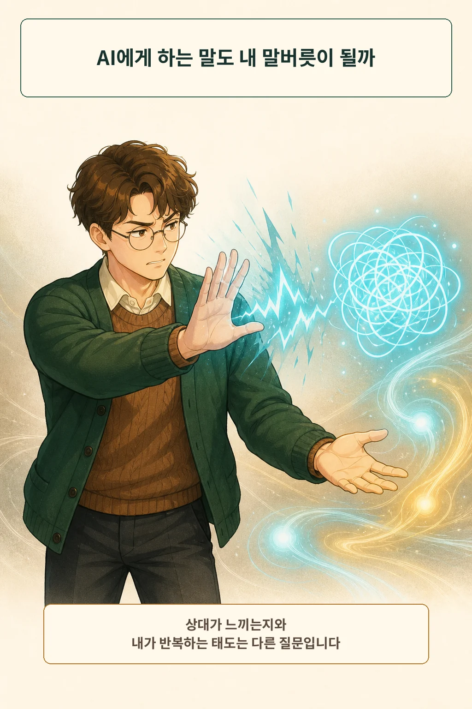
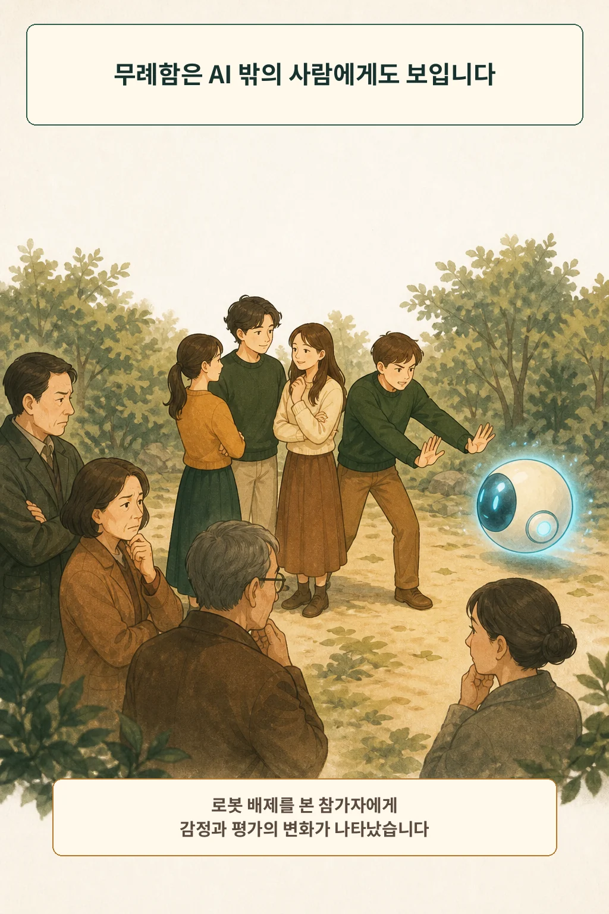

바쁜 저녁, 급하게 마쳐야 할 문서 작업 중에 AI가 자꾸 핵심 조건을 빠뜨리고 엉뚱한 답만 내놓는다면 답답함이 먼저 올라옵니다. 어차피 감정이 없는 프로그램이니 거친 말을 쏟아내도 아무도 다치지 않는다고 넘기기 쉽지만, 여기에는 말의 도착지가 하나 빠져 있거든요. **AI에게 건네는 말은 화면 안에서 사라지지 않고, 내가 반복해 익히는 말버릇과 곁에서 지켜보는 사람에게도 그대로 남습니다.**

글·해설: 다메카솔

## 엉킨 대답 앞에서 마주하는 세 가지 질문

예를 들어 주말 여행 일정을 짜거나 중요한 안내 메일을 다듬다가 AI가 세 번째 똑같은 실수를 되풀이하는 상황을 떠올려 보겠습니다. 시간이 촉박할수록 "왜 이것도 못 알아듣느냐"며 날 선 표현을 치고 싶은 충동이 들기 마련이죠. 하지만 화면 앞에서 멈칫하게 되는 이유는 서로 다른 세 가지 질문이 한꺼번에 얽혀 있기 때문입니다.

- **AI의 감정과 지위**: AI가 실제로 고통이나 서운함을 느끼는가? ([AI가 끄지 말아 달라고 하면 권리가 생길까](/posts/ai-rights-moral-status-uncertainty/)에서 살폈듯 도덕적 지위와 권리는 아직 별도의 열린 문제입니다.)
- **나의 말버릇**: 상대를 낮추는 거친 말투를 내 일상에서 반복해도 괜찮은가?
- **주변의 시선**: 같은 공간의 가족이나 아이, 나란히 화면을 보는 동료가 이 대화를 함께 보고 듣는가?

만약 예의를 오직 '상대방의 고통을 막기 위한 규칙'으로만 좁혀 보면, AI의 의식 여부가 판정될 때까지 답을 미뤄야 합니다. 반대로 시선을 말을 건네는 사람과 그 공간으로 돌리면 기준이 또렷해집니다. 내가 어떤 말투를 몸에 익히고 싶은지, 답답함을 풀기 위해 모욕적인 표현까지 써야 하는지, 곁의 관찰자에게 어떤 태도를 보여 주고 있는지를 오늘 바로 따져 볼 수 있습니다.

## 반복하는 말투가 나의 길이 됩니다

고대 그리스 철학자 아리스토텔레스는 [《니코마코스 윤리학》 제2권](https://www.perseus.tufts.edu/hopper/text?doc=Perseus%3Atext%3A1999.01.0054%3Abook%3D2)에서 도덕적 성품이 타고난 기질만으로 완성되기보다 비슷한 행위를 반복하는 습관에서 빚어진다고 보았습니다. 친절한 행동을 거듭하면 친절함이 몸에 배고, 거칠고 조급한 반응을 반복하면 어느새 그 태도가 자연스러운 기본값으로 굳어진다는 관점입니다. 같은 정원 풀밭을 매일 걷다 보면 희미하던 발자국이 뚜렷한 길로 남는 모습과 닮아 있죠.

물론 기원전의 고전 철학을 현대 심리학의 인과 데이터와 나란히 둘 수는 없고, 이번 글의 출처들만으로는 무례한 말투가 장기적으로 인간의 성격을 바꾼다고 확정하기도 이릅니다. 그럼에도 이 렌즈는 화면 앞 우리에게 **"지금 내가 어떤 말버릇을 연습하고 있는가"**를 돌아보게 해 줍니다.

가령 늦은 밤, 문서 요약이 마음에 들지 않아 짜증이 치밀 때를 생각해 봅시다. 화풀이로 타박하는 대신 "방금 요약에서 핵심 날짜가 빠졌으니 다시 맞춰 줘"라고 말문을 고쳐 잡으면 어떨까요? AI는 두 말투의 차이를 서운해하지 않겠지만, 말하는 나 자신은 감정이 상한 순간에도 요점만 차분히 짚는 태도를 연습하게 됩니다.

## 화면 밖 사람에게까지 번지는 태도

AI와 나누는 대화가 나 혼자만의 사적인 행동으로만 남기 어렵다는 점은 심리학 실험에서도 드러납니다. 마리누치(Marinucci) 등의 연구진은 미리 절차를 등록해 둔 세 건의 [로봇 배제 관찰 실험](https://doi.org/10.1177/13684302241309578)에서, 로봇이 집단에서 밀려나는 장면을 참가자들에게 보여 주었거든요. 그 결과 장면을 지켜본 사람들은 기분이 한층 가라앉았을 뿐 아니라, 로봇을 배제한 당사자들까지 부정적으로 평가하는 경향을 보였습니다.

예를 들어 거실에서 가족이 함께 있는 시간이나 사무실에서 동료와 모니터를 같이 보며 AI 음성 비서에게 지시하는 상황을 떠올려 볼 수 있습니다. 기기 자체야 감정이 없겠지만, 곁에서 듣는 아이나 동료는 상대를 몰아세우는 말투를 고스란히 사회적 태도로 받아들입니다. 다만 이 연구는 로봇 배제를 목격한 직후의 단기 반응을 살핀 결과이므로, 혼자 조용히 나누는 일상 채팅이나 장기 성격 변화로 곧장 일반화하기는 어렵습니다. 그럼에도 기계를 대하는 태도가 주변 사람의 정서와 평가에 닿아 있다는 점만큼은 분명히 보여 줍니다.

## "공손하면 답이 더 정확해진다"는 속설, 사실일까요?

한편 "AI에게 공손하게 물어야 항상 더 정확한 답을 준다"는 속설도 흔히 들립니다. 실제로 메타(Mehta) 등의 연구진이 2026년 공개한 [프리프린트 논문](https://arxiv.org/abs/2604.16275)에서 세 언어와 다섯 개 모델을 대상으로 여러 공손성 수준을 비교해 보았는데요. 결과는 사용한 언어와 모델, 앞선 대화 맥락에 따라 제각각으로 엇갈렸습니다. 결국 예의를 답변 품질을 끌어올리는 보편적 프롬프트 요령으로 내세우면 연구가 뒷받침하는 범위를 넘어서게 됩니다.

세 가지 갈래를 한자리에 정리하면 우리가 챙길 대화 규범과 따로 검증할 영역이 한눈에 구분됩니다.

| 살펴보는 기준 | 근거와 범위 | 일상 대화에서의 적용 |
| --- | --- | --- |
| **나의 말버릇** | 아리스토텔레스 《니코마코스 윤리학》 제2권 (성품과 습관의 철학 렌즈) | AI의 의식 여부와 별개로 내가 익히고 싶은 태도를 고름 |
| **주변의 관찰자** | Marinucci 등 3건의 사전등록 실험 (로봇 배제 직후의 단기 반응) | 가족·동료가 지켜보는 자리일수록 말투가 인상에 영향을 줌 |
| **답변 정확성** | Mehta 등 2026년 프리프린트 (3개 언어·5개 모델 공손성 비교) | 예의를 만능 요령으로 쓰지 않고 조건과 출처로 답을 검증함 |

만약 답이 잘 나온다는 이유만으로 공손함을 택한다면, 새 모델이 거친 말투에도 똑같이 답하는 순간 예의를 지킬 근거도 함께 흔들립니다. 답변의 정확성은 요구 조건과 출처로 냉정하게 따지고, 말투는 내가 일관되게 유지할 대화 규범으로 분리해 두는 편이 훨씬 단단하죠.

## 다메카솔의 판단: 모욕 없는 차분한 직접성

저는 AI와 대화할 때 **모욕 없는 차분한 직접성**을 기본 기준으로 삼습니다. 여기서 말하는 예의란 매번 긴 인사말이나 감사를 덧붙이는 장황한 수사와 거리가 멉니다. 평상시에는 불필요한 감정 없이 오류와 원하는 조건을 또렷하게 짚고, 안전이나 시간이 다급한 순간에는 "멈춰"처럼 짧고 즉각적인 지시를 우선하는 방식이라고 봅니다.

가령 보고서 초안을 다듬는 평일 오후에는 "두 번째 문단이 주제를 벗어났으니 앞선 근거와 연결해 세 줄로 줄여 줘"처럼 차분하고 명확하게 요청합니다. 반면 자동화 도구가 엉뚱한 파일을 건드리려는 긴급한 순간에는 완곡한 인사말보다 짧고 선명한 중단 명령이 먼저 나와야 하죠. 공손함과 직접성은 서로 충돌하기보다 상황에 따라 강약만 달라질 뿐입니다.

AI에게 말을 걸기 전에 아래 세 가지를 가볍게 확인해 보면 알맞은 어조를 고르기 한결 수월해집니다.

1. **습관**: 사람에게도 내 언어 습관으로 그대로 쓰고 싶은 말투인가?
2. **관찰자**: 아이나 가족, 동료가 곁에서 듣고 보아도 불편함 없이 넘길 수 있는가?
3. **상황**: 지금은 여유 있게 존중을 담을 때인가, 속도와 명확성을 최우선으로 둘 순간인가?

AI의 내면에 감정이 싹트는지 여부는 앞으로도 열린 질문으로 남을 가능성이 큽니다. 하지만 오늘 내 손끝에서 어떤 말투를 반복할지는 지금 스스로 정할 수 있습니다. 다음 대화창을 열기 전에, 기계 너머에 돌아올 내 말버릇과 곁의 시선을 한 번쯤 떠올려 보시면 어떨까요?

## 출처

- [Aristotle, Nicomachean Ethics, Book II](https://www.perseus.tufts.edu/hopper/text?doc=Perseus%3Atext%3A1999.01.0054%3Abook%3D2)
- [Marinucci et al., How low can you still go?](https://doi.org/10.1177/13684302241309578)
- [Mehta et al., No Universal Courtesy](https://arxiv.org/abs/2604.16275)

이 글의 본문과 이미지는 생성형 AI로 제작했습니다. 기획과 편집 기준은 다메카솔이 정했습니다.

이 글은 고전 철학 원전과 공개된 학술 연구를 바탕으로 정리한 해설이며, 별도 실험은 진행하지 않았고 이미지는 텍스트 없는 원화에 결정적 레터링을 합성해 새로 구성했습니다.
