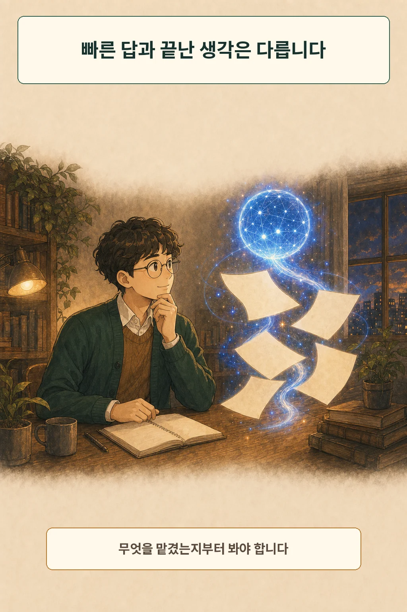
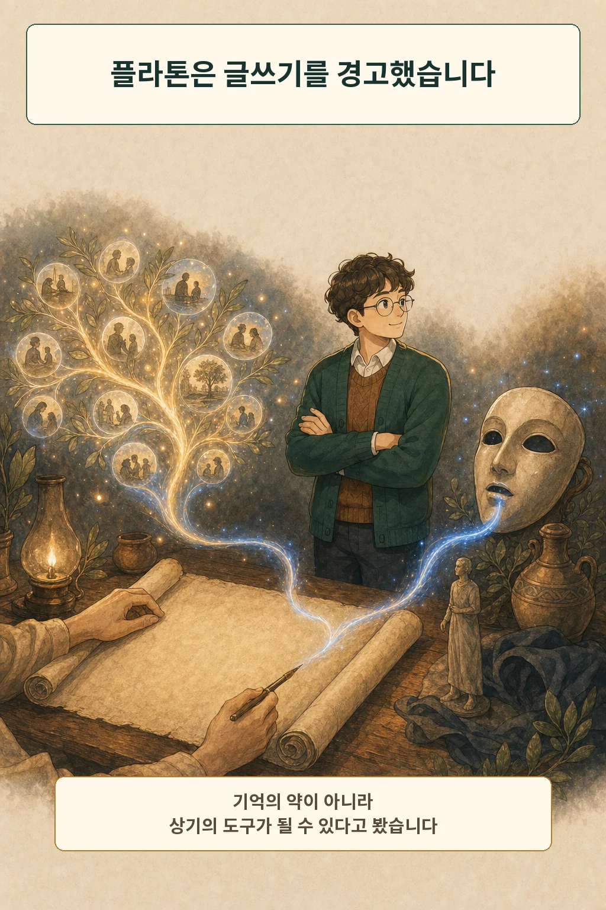
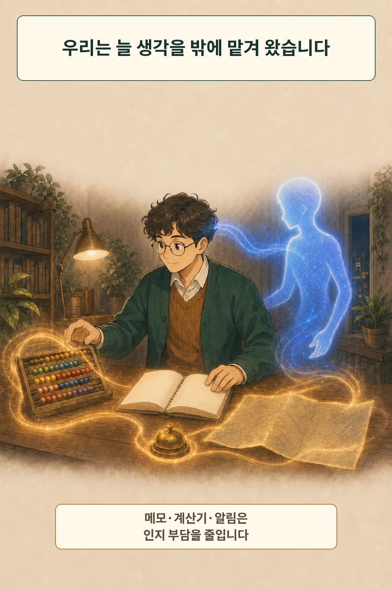
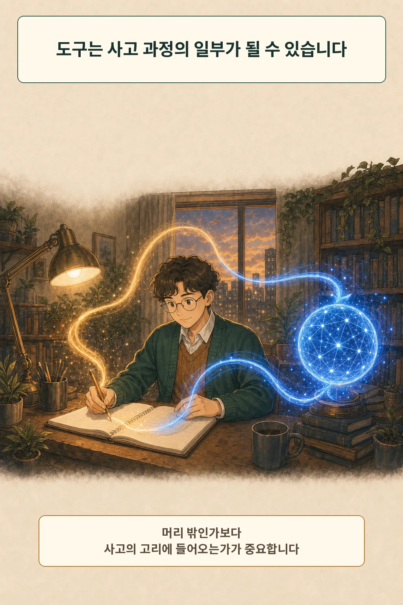
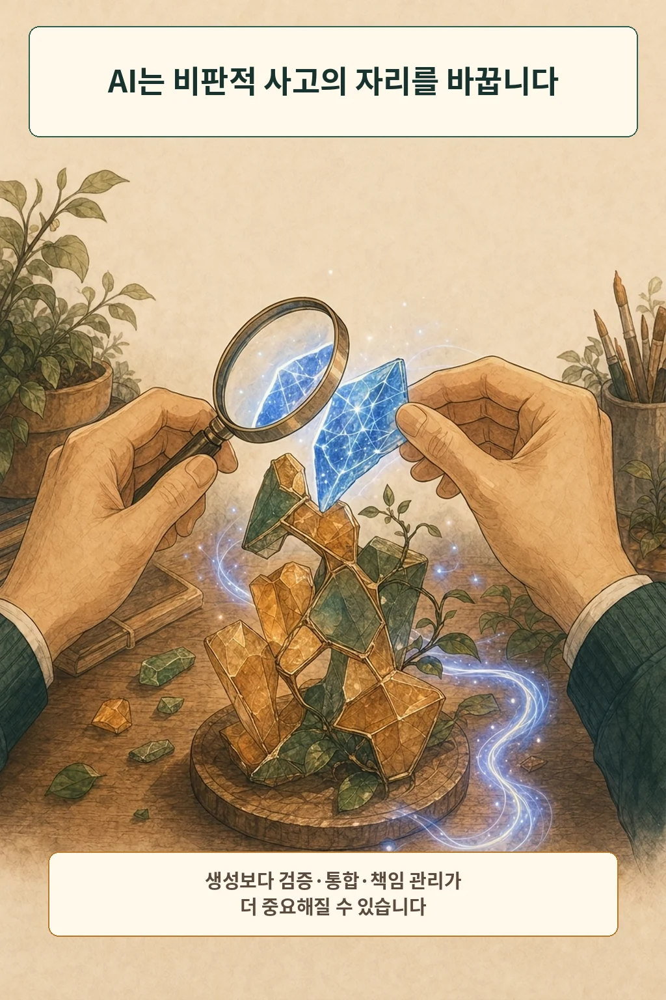
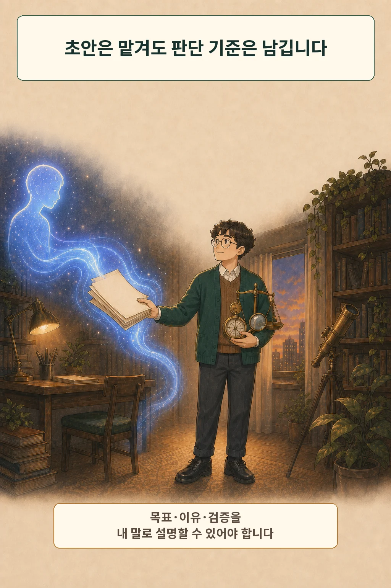

프롬프트 몇 줄을 입력했더니 AI가 몇 분 만에 그럴듯한 초안을 내놓습니다. 전에는 한 시간 걸렸을 일을 순식간에 끝냈다면, 편해진 만큼 우리의 사고력은 줄어든 것일까요? **빠르게 답을 얻은 일과 생각을 끝낸 일은 같지 않습니다.** 기억, 초안 작성, 대안 비교, 최종 판단 가운데 무엇을 밖에 맡겼는지부터 나누어 봐야 합니다.

글·해설: 다메카솔

## 핵심 내용

- **플라톤의 경고와 인지적 오프로딩**: 플라톤은 『파이드로스』에서 외부 기록이 기억 연습을 줄이고 ‘지혜의 외양’만 남길 수 있다고 경고한 반면, 현대 인지과학은 기억·계산 부담을 외부 도구로 덜어 상위 사고에 자원을 쓰는 행위를 ‘인지적 오프로딩(cognitive offloading)’으로 설명합니다.
- **확장된 마음과 비판적 사고의 이동**: 클라크와 차머스의 ‘확장된 마음’ 이론처럼 외부 도구가 질문·검토·수정의 되먹임 고리에 통합되면 인지의 일부로 작동할 수 있습니다. Microsoft Research·CMU의 지식 노동자 319명(936개 사례) 조사에서도 AI 신뢰가 높을수록 인지 노력이 줄고 자기 효능감이 높을수록 비판적 사고가 늘었으며, 사고의 초점이 ‘초안 생성’에서 ‘검증·통합·책임’으로 이동하는 양상이 나타났습니다.
- **주도권을 지키는 3가지 기준**: 초안과 요약은 AI에게 맡기더라도 **무엇을 결정할지 정하는 목표, 반대 근거를 대조하는 이유 탐색, 원출처 검증과 최종 설명 책임**은 사람 손에 남겨야 합니다.

## 매끈한 답에서 무엇이 사라졌을까

AI로 초안을 만들면 빈 화면에서 첫 문장을 떠올리고 문단 순서를 잡는 부담이 크게 줄어듭니다. 계산기를 썼다고 수학적 사고 전체가 사라지지 않듯, 초안 작성의 수고가 줄었다는 사실만으로 사고력의 손실 여부를 단정할 수는 없습니다.

차이는 사용자가 여전히 **문제를 직접 정의하고 있는가**에서 갈립니다. 내가 무엇을 원하는지도 모른 채 AI의 첫 답안을 그대로 복사해 넣었다면 초안뿐 아니라 판단의 출발점까지 넘긴 셈입니다. 반대로 목표와 기준을 먼저 세우고 여러 답안을 비교·수정했다면 AI는 생각을 없애는 대신 탐색 범위를 넓히는 도구가 됩니다.

## 플라톤의 경고에서 확장된 마음까지

생각의 일부를 바깥 도구에 맡기는 행위는 문자 발명 이래 오랜 철학적·과학적 논쟁거리였습니다.

- **플라톤의 『파이드로스』(지혜와 지혜의 외양)**: 글자를 발명한 테우트에게 이집트 왕 타무스는 사람들이 외부 기록에 의존하면 스스로 기억을 연습하지 않게 되고, 실제 지혜가 아니라 ‘지혜로워 보이는 외양’만 얻게 될 것이라고 경고합니다([『파이드로스』 275a~275e](https://www.perseus.tufts.edu/hopper/text?doc=Perseus%3Atext%3A1999.01.0174%3Atext%3DPhaedrus%3Apage%3D275)). 다만 같은 대화편에서 문자는 이미 아는 사람에게 기억을 일깨우는(상기) 구실을 할 수 있다고도 덧붙입니다. 문제는 기록 자체가 아니라 **외부 기록을 내 이해와 지혜 그 자체로 착각하는 일**입니다.
- **인지적 오프로딩(Cognitive Offloading)**: 현대 인지과학은 머릿속 작업 기억의 부담을 메모, 일정 알림, 종이 계산 같은 외부 행동과 도구로 덜어내는 전략을 인지적 오프로딩이라고 부릅니다([Risko & Gilbert 리뷰](https://discovery.ucl.ac.uk/id/eprint/1508770/)). 낮은 수준의 암기·계산 부담을 덜어 그 자원을 상위 판단에 쓰느냐, 아니면 오류를 알아차릴 감각까지 함께 잃느냐가 핵심입니다.
- **확장된 마음(The Extended Mind)**: 앤디 클라크와 데이비드 차머스는 마음의 경계를 피부와 두개골 안에만 가두지 말자고 제안했습니다. 종이 위에서 수식을 풀거나 노트를 기억처럼 상시 조회하고 수정하는 과정이 행동을 실시간으로 이끈다면 외부 도구도 인지 시스템의 일부로 볼 수 있다는 주장입니다([Clark & Chalmers 원문](https://www.consc.net/papers/extended.html)). 물론 단순한 도구 참조와 실제 인지 구성을 구분해야 한다는 반론([체화된 인지 논쟁](https://plato.stanford.edu/entries/embodied-cognition/))도 뚜렷하므로, AI가 내 사고의 일부가 되려면 **목표 부여 → 결과 검토 → 수정 재질문**의 능동적 되먹임 고리가 살아 있어야 합니다.

| 관점 및 연구 | 핵심 통찰 | AI 사용 시 경계해야 할 지점 |
| --- | --- | --- |
| **플라톤 (『파이드로스』)** | 외부 표식은 상기(기억 보조)를 돕지만 ‘지혜의 외양’을 만들 수 있음 | AI가 출력한 매끈한 문장을 읽은 것을 내가 그 이치를 이해한 것으로 착각하는 현상 |
| **인지적 오프로딩 (Risko & Gilbert)** | 외부 도구로 작업 기억 부담을 줄여 여유 인지 자원을 확보함 | 도구가 틀렸을 때 이를 알아차릴 최소한의 배경지식과 검증 감각까지 외주화하는 현상 |
| **확장된 마음 (Clark & Chalmers)** | 상호작용 고리에 깊이 결합된 외부 도구는 인지 과정의 일부로 작동함 | 질문·검토·수정 없이 일방적으로 답만 받아 적는 수동적 소비 |
| **지식 노동자 조사 (MS Research·CMU, CHI 2025)** | 비판적 사고가 ‘초안 생성’에서 ‘검증·통합·책임’으로 자리를 옮김 | AI에 대한 맹목적 신뢰가 높고 자기 과제 자신감이 낮을수록 검증 노력을 생략하는 경향 |

## AI는 비판적 사고를 없애기보다 자리를 옮깁니다

실제 업무 현장에서는 어떤 일이 일어나고 있을까요? Microsoft Research와 카네기멜런대(CMU) 연구진이 생성형 AI를 주 1회 이상 업무에 사용하는 지식 노동자 319명으로부터 936개의 사용 사례를 수집해 분석한 결과(자기보고 설문 기반 상관관계), **AI에 대한 신뢰가 높을수록 비판적 사고 노력을 덜 기울였다고 답한 반면, 자신의 과제 수행 능력에 자신감이 높을수록 비판적 사고를 더 많이 수행했다고 보고했습니다**([CHI 2025 연구](https://www.microsoft.com/en-us/research/publication/the-impact-of-generative-ai-on-critical-thinking-self-reported-reductions-in-cognitive-effort-and-confidence-effects-from-a-survey-of-knowledge-workers/)).

특히 주목할 대목은 비판적 사고가 작동하는 위치의 이동입니다. 참여자들은 정보를 백지에서 처음 만들어내는 데 쓰던 에너지를 **AI 결과를 검증(verification)하고, 자신의 맥락에 맞게 통합(integration)하며, 최종 결과를 책임(stewardship)지는 단계**로 옮겼습니다.

## 다메카솔의 판단: 초안보다 판단 기준을 지키는 쪽을 택합니다

AI가 우리의 사고력을 빼앗는다기보다 **생각의 빈틈을 너무 매끈한 문장으로 가려 버리는 위험**이 더 큽니다. 완성된 문장만 읽다 보면 그 안에 어떤 무리한 가정이 숨어 있는지 눈치채기 어렵고, 왜 그 결론을 골랐는지 내 입으로 다시 설명하지 못한다면 편의와 함께 판단의 주도권도 넘긴 상태가 됩니다.

그래서 초안 작성이나 요약은 AI에게 맡기더라도 다음 세 가지는 반드시 내 손에 남겨 둡니다.

1. **목표 정의**: 프롬프트를 입력하기 전에 내가 무엇을 결정하려는지와 좋은 답의 기준을 먼저 한 문장으로 적습니다.
2. **반대 이유 탐색**: 첫 답을 받으면 곧바로 채택하지 않고 반대 근거, 대안 선택지, 숨은 전제를 함께 물어 비교합니다.
3. **원출처 검증과 설명 책임**: 핵심 사실은 원본 출처에서 직접 대조하고, 최종 선택의 이유를 내 말로 다시 설명할 수 있는지 확인합니다.

다음에 AI가 멋진 초안을 내놓았을 때 “내가 덜 생각했나?”라고 자책할 필요는 없습니다. 대신 **“나는 무엇을 맡겼고, 무엇을 검증했으며, 최종 판단의 이유를 내 말로 설명할 수 있는가?”**를 물을 수 있다면, AI는 사고의 종착점이 아니라 생각이 오가는 든든한 작업대가 됩니다(AI와 인간의 관계 자체에 대한 논의는 [AI는 친구가 될 수 있을까](/posts/ai-companion-friendship-philosophy/)에서 이어집니다).

## 참고 자료

- [Plato, Phaedrus, page 275](https://www.perseus.tufts.edu/hopper/text?doc=Perseus%3Atext%3A1999.01.0174%3Atext%3DPhaedrus%3Apage%3D275)
- [Andy Clark & David J. Chalmers, The Extended Mind](https://www.consc.net/papers/extended.html)
- [Stanford Encyclopedia of Philosophy, Embodied Cognition](https://plato.stanford.edu/entries/embodied-cognition/)
- [Risko & Gilbert, Cognitive Offloading](https://discovery.ucl.ac.uk/id/eprint/1508770/)
- [Microsoft Research, The Impact of Generative AI on Critical Thinking](https://www.microsoft.com/en-us/research/publication/the-impact-of-generative-ai-on-critical-thinking-self-reported-reductions-in-cognitive-effort-and-confidence-effects-from-a-survey-of-knowledge-workers/)

이 글의 본문과 이미지는 생성형 AI로 제작했습니다. 기획과 편집 기준은 다메카솔이 정했습니다.

이미지는 텍스트 없는 원화에 결정적 레터링을 합성해 제작했습니다.
