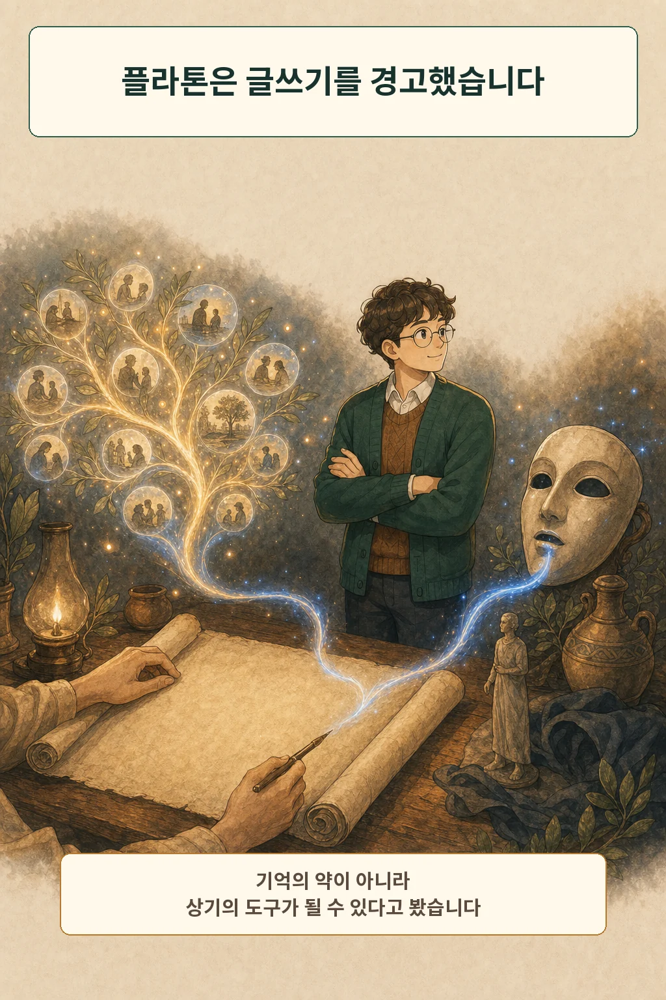
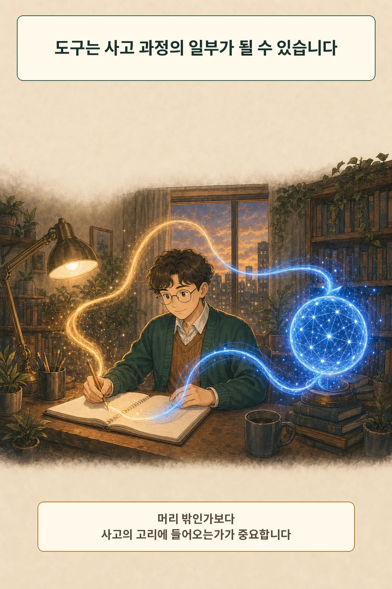

출근길이나 마감을 앞둔 오후, 막막한 보고서나 공지 글의 첫 문장을 AI에게 부탁했더니 단 몇 분 만에 매끈한 초안이 화면에 떠오릅니다. 예전에는 한 시간 넘게 뼈대를 잡느라 끙끙대던 일을 순식간에 끝내고 나면, 편해진 만큼 내 사고력도 무뎌지는 건 아닌지 문득 불안해지곤 하죠. 하지만 답을 빠르게 얻은 일과 스스로 생각을 끝낸 일은 엄연히 달라, 기억·초안·비교·판단 가운데 무엇을 밖에 맡겼는지부터 나누어 보아야 합니다.

글·해설: 다메카솔

## 핵심 내용

- **플라톤의 경고와 인지적 오프로딩**: 플라톤은 외부 기록이 기억 연습을 줄여 ‘지혜의 외양’만 남길 수 있다고 경고했고, 현대 인지과학은 외부 도구로 기억 부담을 덜어 상위 사고에 자원을 쓰는 전략을 인지적 오프로딩으로 봅니다.
- **확장된 마음과 사고의 이동**: 도구가 검토·수정 고리에 결합되면 인지 과정의 일부로 작동할 수 있으며, CHI 2025 설문에서도 비판적 사고가 ‘초안 생성’에서 ‘검증·통합·책임’으로 옮겨 가는 경향이 나타났습니다.
- **주도권을 지키는 기준**: 초안과 요약은 AI에게 맡기더라도 목표 정의, 반대 근거 탐색, 원출처 검증과 최종 설명 책임은 사람 손에 남겨야 합니다.

## 매끈한 답에서 무엇이 사라졌을까

AI로 초안을 만들면 백지에서 첫 문장을 떠올리고 문단 순서를 짜는 수고가 크게 줄어듭니다. 계산기를 쓴다고 수학적 사고 전체가 사라지지 않듯, 글쓰기 초반의 뼈대 잡기를 도구에 맡겼다는 사실만으로 사고력이 줄었다고 성급히 결론 내리기는 어렵죠.

가령 팀 회의에 올릴 제안서를 AI에게 부탁하는 두 상황을 떠올려 봅시다. 한쪽은 주제 단어 몇 개만 던져 나온 문장을 그대로 복사해 붙였고, 다른 쪽은 꼭 들어갈 결정 사항과 예상 반론을 먼저 적은 뒤 초안을 고쳐 나갔습니다. 결과물은 비슷하게 매끈해 보여도, 전자는 판단의 출발점까지 넘긴 반면 후자는 AI를 탐색의 폭을 넓히는 보조 도구로 쓴 셈입니다.

## 플라톤의 경고에서 확장된 마음까지

### 플라톤의 『파이드로스』가 짚은 지혜와 외양

생각의 일부를 바깥 도구에 맡기는 일은 문자 발명 이래 오랜 논쟁거리였습니다. 플라톤의 대화편 [『파이드로스』(275a~275e)](https://www.perseus.tufts.edu/hopper/text?doc=Perseus%3Atext%3A1999.01.0174%3Atext%3DPhaedrus%3Apage%3D275)에는 글자를 발명한 테우트에게 이집트 왕 타무스가 건네는 경고가 등장하는데요. 사람들이 외부 표식에 의존하면 기억 연습을 게을리해 실제 지혜 대신 ‘지혜로워 보이는 외양’만 얻게 되리라는 우려입니다.

흥미롭게도 같은 대목은 이미 아는 사람에게 글이 기억을 다시 일깨우는(상기) 구실도 한다고 짚습니다. 플라톤의 논지를 모든 기록 도구의 금지로 읽기보다, 화면에 뜬 그럴듯한 문장을 곧장 내 이해와 지혜로 착각하는 태도를 경계한 말씀으로 새겨야 하는 까닭입니다.

### 일상 속 인지적 오프로딩의 양면

[Risko & Gilbert의 인지과학 리뷰](https://discovery.ucl.ac.uk/id/eprint/1508770/)가 정리하듯, 물리적 행동이나 외부 도구로 작업 기억의 부담을 덜어내는 전략을 ‘인지적 오프로딩(cognitive offloading)’이라고 부릅니다. 스마트폰 알림에 일정을 맡기고, 종이에 계산을 적거나 지도 앱을 켜고 낯선 길을 찾는 모습 모두 익숙한 사례죠.

단순한 암기와 계산 수고를 바깥으로 넘기면 남은 집중력을 더 깊은 판단에 쓸 여유가 생깁니다. 반대로 도구가 틀렸을 때 이상함을 알아차릴 최소한의 배경지식과 확인 감각까지 내려놓는다면, 작은 오류 앞에서도 쉽게 흔들릴 수 있습니다.

### 확장된 마음과 능동적인 되먹임 고리

철학자 앤디 클라크와 데이비드 차머스는 [「확장된 마음」 논문](https://www.consc.net/papers/extended.html)에서 마음의 경계를 두개골 안에만 가두지 말자고 제안했습니다. 종이 위에서 도형을 돌리거나 수식을 풀고, 수첩 메모를 기억처럼 상시 조회하고 고쳐 쓰며 행동한다면 그 외부 과정도 인지 시스템의 일부로 볼 수 있다는 주장입니다.

물론 스탠퍼드 철학 백과사전의 [체화된 인지 논의](https://plato.stanford.edu/entries/embodied-cognition/)에서 짚듯, 단순 도구 참조와 실제 인지 구성 사이에는 뚜렷한 구분이 따른다는 반론도 제기됩니다. 결국 AI가 단발성 대필 기계를 넘어 내 사고의 연장선이 되려면 **목표 부여, 결과 검토, 수정 재질문**으로 이어지는 능동적인 되먹임 고리가 살아 있어야 합니다.

## AI는 비판적 사고를 없애기보다 자리를 옮깁니다

실제 업무 현장에서는 AI가 사고력을 어떻게 바꾸고 있을까요? Microsoft Research와 카네기멜런대(CMU) 연구진은 생성형 AI를 주 1회 이상 업무에 쓰는 지식 노동자 319명에게 936개의 사용 사례를 받아 [자기보고 설문 연구(CHI 2025)](https://www.microsoft.com/en-us/research/publication/the-impact-of-generative-ai-on-critical-thinking-self-reported-reductions-in-cognitive-effort-and-confidence-effects-from-a-survey-of-knowledge-workers/)를 진행했습니다.

분석 결과 AI 신뢰가 높을수록 비판적 사고 노력을 덜 기울였다고 답한 반면, 자기 과제 수행 능력에 대한 자신감이 높을수록 비판적 사고를 더 많이 수행했다고 보고했습니다. 설문에서 관찰된 연관성이라 곧바로 인과관계까지 단정하기는 어렵지만, 도구를 맹신할수록 스스로 따져 보는 수고가 줄어드는 경향만큼은 또렷하게 엿보이죠.

특히 주목할 대목은 비판적 사고가 작동하는 위치의 이동인데요. 참여자들은 백지에서 자료를 처음 만들어 내는 데 쓰던 에너지를 줄이는 대신, AI 결과를 검증(verification)하고 자기 맥락에 맞게 통합(integration)하며 최종 결과에 책임(stewardship)을 지는 단계로 사고의 초점을 옮겼습니다.

고대 철학부터 최신 직장인 설문까지 나란히 비교해 보면 공통으로 가리키는 방향이 선명해집니다.

| 관점 및 연구 | 핵심 통찰 | AI 사용 시 경계할 지점 |
| --- | --- | --- |
| **플라톤 (『파이드로스』)** | 외부 표식은 상기(기억 보조)를 돕지만 ‘지혜의 외양’을 만들 수 있음 | 매끈한 출력 문장을 읽은 뒤 그 이치를 이해했다고 착각하는 현상 |
| **인지적 오프로딩 (Risko & Gilbert)** | 외부 도구로 작업 기억 부담을 덜어 상위 판단 자원을 확보함 | 오류가 났을 때 알아차릴 배경지식과 검증 감각까지 외주화하는 현상 |
| **확장된 마음 (Clark & Chalmers)** | 상호작용 고리에 결합된 외부 도구는 인지 과정의 일부로 작동함 | 질문·검토·수정 없이 일방적으로 답만 받아 적는 수동적 소비 |
| **지식 노동자 조사 (MS Research·CMU, CHI 2025)** | 비판적 사고가 ‘초안 생성’에서 ‘검증·통합·책임’으로 이동함 | AI 신뢰가 높거나 자기 과제 자신감이 낮을수록 비판적 사고 노력을 덜 기울이는 경향 |

## 다메카솔의 판단: 초안보다 판단 기준을 지키는 쪽을 택합니다

AI 시대에 진짜 경계할 지점은 생각이 멈추는 상황보다, **생각의 빈틈을 너무 매끈한 문장이 가려 버리는 현상**에 가깝습니다. 문장이 유려할수록 숨은 가정이나 빠진 전제를 눈치채기 어려워지고, 왜 그 결론을 골랐는지 내 입으로 설명하기 힘든 채 주도권까지 넘기게 되거든요.

저는 초안이나 요약처럼 손이 많이 가는 일은 AI에게 맡기더라도, 다음 세 가지 기준만큼은 반드시 내 손에 남겨 두어야 한다고 봅니다.

1. **목표 정의**: 프롬프트를 입력하기 전에 내가 무엇을 결정하려는지와 좋은 답의 기준을 먼저 한 문장으로 적습니다.
2. **반대 이유 탐색**: 첫 답을 곧바로 채택하기보다 반대 근거, 대안 선택지, 숨은 전제를 함께 물어 비교합니다.
3. **원출처 검증과 설명 책임**: 핵심 사실은 원본 출처에서 직접 대조하고, 최종 선택 이유를 내 말로 다시 설명할 수 있는지 확인합니다.

예를 들어 동네 모임 안내문이나 업무 공지를 쓸 때도, 초안의 날짜·장소·예외 조건을 원본 메모와 대조하고 빠진 조건이나 오해할 표현이 없는지 한 번 더 살펴보면 주도권이 금세 내 쪽으로 돌아옵니다.

다음에 AI가 순식간에 그럴듯한 초안을 내놓았을 때 "내가 덜 생각했나" 하며 위축되기보다, **내가 무엇을 맡겼고 무엇을 검증했으며 최종 선택 이유를 내 말로 설명할 수 있는지** 점검해 보세요. 그 질문이 살아 있는 한 AI는 생각을 끝내 버리는 자판기가 아니라, 더 깊은 판단을 함께 다듬는 작업대가 됩니다(AI와 인간의 관계 경계에 대해서는 [AI는 친구가 될 수 있을까](/posts/ai-companion-friendship-philosophy/)에서도 이어집니다).

## 출처

- [Plato, Phaedrus, page 275](https://www.perseus.tufts.edu/hopper/text?doc=Perseus%3Atext%3A1999.01.0174%3Atext%3DPhaedrus%3Apage%3D275)
- [Andy Clark & David J. Chalmers, The Extended Mind](https://www.consc.net/papers/extended.html)
- [Stanford Encyclopedia of Philosophy, Embodied Cognition](https://plato.stanford.edu/entries/embodied-cognition/)
- [Risko & Gilbert, Cognitive Offloading](https://discovery.ucl.ac.uk/id/eprint/1508770/)
- [Microsoft Research, The Impact of Generative AI on Critical Thinking](https://www.microsoft.com/en-us/research/publication/the-impact-of-generative-ai-on-critical-thinking-self-reported-reductions-in-cognitive-effort-and-confidence-effects-from-a-survey-of-knowledge-workers/)

공개된 철학 원전과 인지과학 리뷰, 지식 노동자 설문 연구를 바탕으로 정리한 해설이며, 별도의 실험이나 장기 인지 변화 측정은 포함하지 않았습니다.

이 글의 본문과 이미지는 생성형 AI로 제작했습니다. 기획과 편집 기준은 다메카솔이 정했습니다.

이미지는 텍스트 없는 원화에 결정적 레터링을 합성해 제작했습니다.
