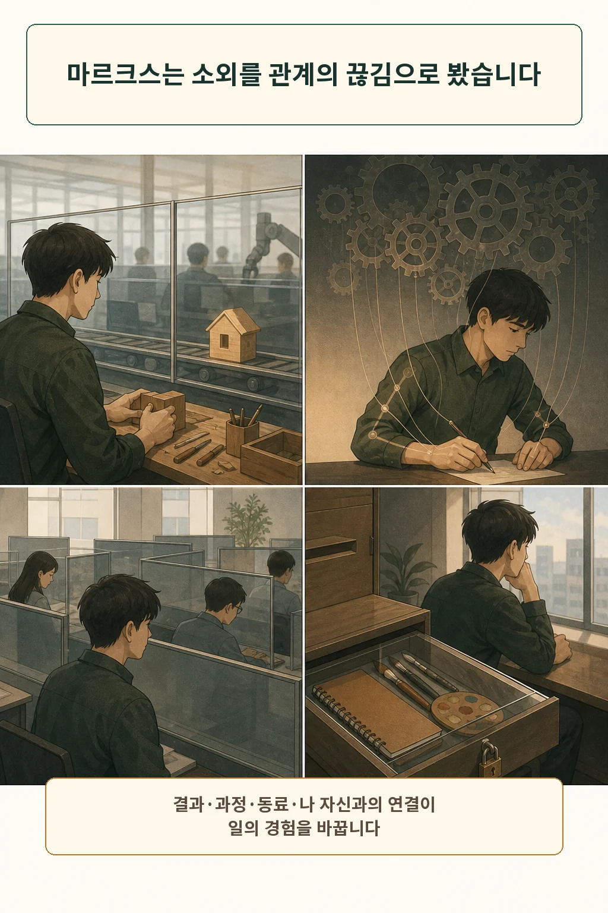
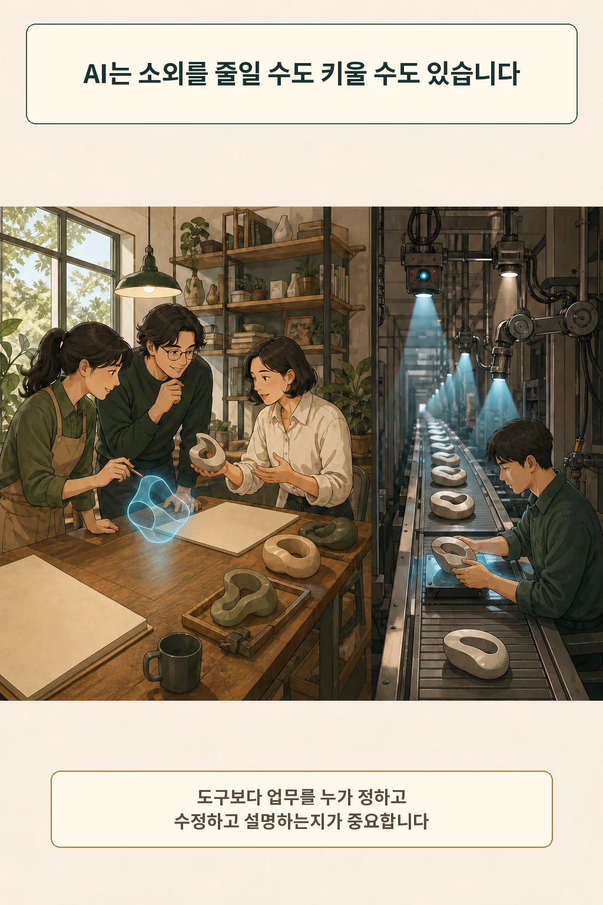
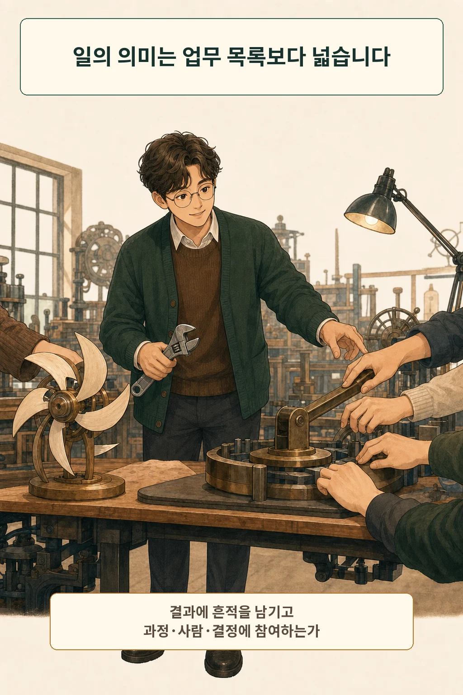
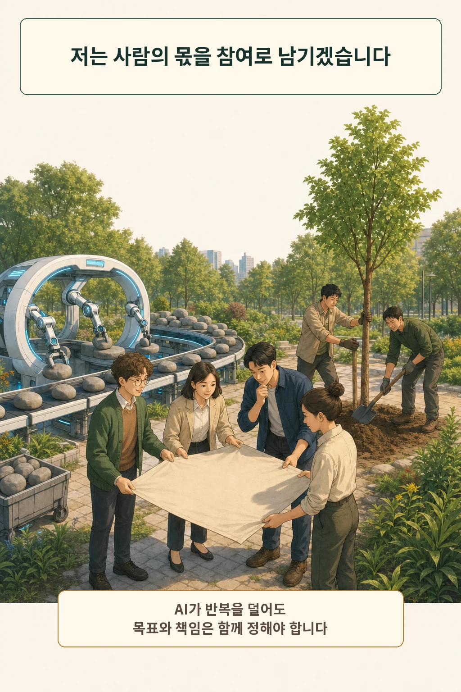

AI가 더 많은 업무를 대신하면 사람이 덜 일하고 더 자유로워질 것이라는 기대가 흔하지만, 현장의 변화는 한 방향으로만 흐르지 않습니다. 반복 과업이 줄어든 자리에 처리 속도 압박과 알고리즘 감시가 들어설 수도 있고, 반대로 비워진 시간이 더 깊은 판단과 동료 간 협력에 쓰일 수도 있습니다. **결국 일의 의미는 자동화로 사라진 업무의 개수보다 결과·과정·동료·결정과 맺는 관계에서 드러납니다.**

글·해설: 다메카솔

## 핵심 내용

- **노출 지수와 실제 해고의 구분**: 국제노동기구(ILO)와 NASK의 2025년 지수는 전 세계 노동자 4명 중 1명이 생성형 AI에 노출된 직업에 속한다(최고 노출 구간은 전체 고용의 3.3%)고 추정했지만, 이는 과업 변형 가능성을 뜻할 뿐 곧바로 일자리 소멸이나 해고를 뜻하지 않습니다.
- **마르크스의 ‘소외’와 아렌트의 ‘노동·작업·행위’**: 마르크스의 소외론은 기계 자체가 아니라 생산물·과정·동료·자율적 창조성에서 분리되는 관계를 문제 삼으며, 한나 아렌트의 활동 구분(생명을 유지하는 노동, 세계를 짓는 작업, 타인과 새 시작을 여는 행위)은 한 직업 안에서 AI가 무엇을 덜어내고 무엇을 남겨야 하는지 보여줍니다.
- **일의 의미를 지키는 4대 관계 기준**: 자동화 비율보다 **결과에 내 판단이 남는가, 과정을 수정할 수 있는가, 동료와의 협력이 깊어지는가, 평가·배분 결정에 참여할 수 있는가**를 먼저 점검해야 합니다.

## 노출된 직업 수는 해고 예측이 아닙니다

ILO와 NASK는 2025년 발표한 글로벌 노출 지수에서 전 세계 노동자 네 명 중 한 명이 생성형 AI에 어느 정도 노출된 직업에 종사하고 있으며, 가장 노출도가 높은 구간은 전 세계 고용의 3.3%라고 추정했습니다. 다만 대부분의 직업 안에는 여전히 사람의 개입이 필요한 과업이 섞여 있어, 보고서는 일자리 전체의 대체보다 **직무 내용의 변형(transformation)**을 더 가능성 높은 경로로 꼽았습니다([ILO 2025 보고서](https://www.ilo.org/publications/generative-ai-and-jobs-refined-global-index-occupational-exposure)).

이어 2026년 ILO는 이 지표가 과업 수준의 기술적 가능성을 가늠하는 조기 경보일 뿐, 실제 해고 규모나 임금 변화, 전직률을 단독으로 예측하지 못한다고 선을 그었습니다([ILO의 노출 지표 해설](https://www.ilo.org/resource/news/new-ilo-brief-explains-what-ai-exposure-indicators-reveal-about-jobs)).

## 마르크스가 묻는 것은 기계보다 관계입니다

일자리가 유지된 채 직무가 변형된다면, 그 변화가 좋은지 나쁜지는 무엇으로 판단할 수 있을까요? 카를 마르크스는 『1844년 경제학·철학 수고』에서 **소외된 노동**을 네 가지 단절로 설명했습니다. 노동자가 자신이 만든 **생산물**을 통제하지 못하고, 일하는 **과정**에서 재량을 잃으며, **동료**와 협력자 대신 경쟁자로 맞서고, 자유롭고 의식적으로 무언가를 빚어내는 **유적 존재로서의 능력**에서 멀어지는 상태입니다([Stanford Encyclopedia of Philosophy — Karl Marx](https://plato.stanford.edu/entries/marx/)).

여기서 핵심은 기계 자체가 자동으로 악역이 되지 않는다는 점입니다. AI가 번거로운 반복 작업을 덜어 주더라도 사람이 최종 결과물을 통제하지 못하고 과정의 재량까지 잃는다면 소외는 오히려 깊어집니다.

실제로 OECD가 제조·금융 분야의 AI 도입 사업장 노동자들을 조사한 보고서에서도 양면성이 나란히 나타났습니다. AI가 반복 과업을 덜고 의사결정을 돕는다는 긍정적 응답이 나온 한편, 알고리즘 관리(algorithmic management) 아래에서는 오히려 직무 자율성이 줄고 업무 강도와 사생활 감시 위험이 커졌다는 보고도 함께 나왔습니다([OECD Employment Outlook 2023](https://www.oecd.org/en/publications/oecd-employment-outlook-2023_08785bba-en/full-report/artificial-intelligence-job-quality-and-inclusiveness_a713d0ad.html)).

## 아렌트는 한 직업 안의 세 활동을 나눕니다

한나 아렌트가 『인간의 조건』에서 제시한 세 가지 활동 구분은 AI가 우리 일의 어느 층위를 바꾸고 있는지 더 세밀하게 보여줍니다([Stanford Encyclopedia of Philosophy — Hannah Arendt](https://plato.stanford.edu/entries/arendt/)).

| 철학적 렌즈 | 핵심 개념 | AI 도입 현장에서 던져야 할 질문 |
| --- | --- | --- |
| **마르크스: 소외의 4가지 단절** | 생산물·생산 과정·동료·자율적 창조성으로부터의 분리 | AI 도입 후 결과물과 과정에 대한 수정 권한이 넓어졌는가, 아니면 알고리즘 지시에 맞춘 속도 경쟁만 남았는가? |
| **아렌트: 노동 (Labor)** | 생명과 일상을 유지하기 위해 반복되는 필수 활동 | 반복 처리 부담이 줄어든 시간이 단순 처리량(할당량) 상향으로 다시 채워지지 않았는가? |
| **아렌트: 작업 (Work)** | 도구·제도·산출물처럼 시간 속에 남아 공동의 세계를 이루는 제작 활동 | AI 초안을 넘어 사람의 안목과 책임이 담긴 지속 가능한 결과물을 만들고 있는가? |
| **아렌트: 행위 (Action)** | 여러 사람이 말과 행동으로 의견을 나누고 함께 새로운 시작을 여는 활동 | 절약된 시간이 동료들과 방향을 토론하고 새로운 시도를 함께 결정하는 데 쓰이고 있는가? |

이 세 구분을 직업 간의 귀천 서열로 오해해서는 안 됩니다. 현실의 돌봄과 생계 노동에도 깊은 관계와 판단이 들어 있기 때문입니다. 오히려 한 직업 안에서 **반복 처리(노동)를 줄인 자리에 지속 가능한 제작(작업)과 동료와의 숙의(행위)가 늘어나는지** 살피는 렌즈로 쓸 때 가장 유용합니다.

## 다메카솔의 판단: 사람의 몫은 참여입니다

팀이나 조직에 AI 자동화를 도입할 때, 단순 자동화 비율이나 시간 단축 수치보다 다음 네 가지 관계를 먼저 확인해야 합니다.

1. **결과**: 최종 산출물에 내 판단과 책임의 흔적이 남는가?
2. **과정**: AI의 제안을 거부하거나 목표와 방법을 직접 수정할 재량이 있는가?
3. **동료**: 도구가 동료 간의 대화를 끊어 놓는가, 아니면 더 깊은 협력을 위한 여백을 만드는가?
4. **결정**: 나에게 영향을 주는 성과 평가와 업무 배분 규칙에 설명을 요구하고 참여할 수 있는가?

AI가 반복 업무를 덜어 낸 자리에 더 빡빡한 처리량 목표와 감시만 채워 넣으면 일의 의미는 얇아집니다. 자동화가 만들어 준 시간은 그 자체로 자유가 아니며, 그 시간을 무엇에 쓸지 일하는 사람들이 함께 결정할 때 비로소 자유의 재료가 됩니다.

AI에게 사고를 맡기는 인지적 경계는 [AI에게 생각을 맡기면 나는 덜 생각하게 될까](/posts/ai-thinking-cognitive-offloading-philosophy/)에서, 기업의 인력 재편 전망 분석은 [AI는 인력 전략을 어떻게 바꾸고 있나](/posts/thomson-reuters-ai-workforce-shift/)에서 이어서 읽을 수 있습니다.

## 참고 자료

- [ILO, Generative AI and Jobs: A Refined Global Index of Occupational Exposure](https://www.ilo.org/publications/generative-ai-and-jobs-refined-global-index-occupational-exposure)
- [ILO, What AI exposure indicators tell us — and what they do not](https://www.ilo.org/resource/news/new-ilo-brief-explains-what-ai-exposure-indicators-reveal-about-jobs)
- [Stanford Encyclopedia of Philosophy, Karl Marx](https://plato.stanford.edu/entries/marx/)
- [Stanford Encyclopedia of Philosophy, Hannah Arendt](https://plato.stanford.edu/entries/arendt/)
- [OECD Employment Outlook 2023, Artificial intelligence, job quality and inclusiveness](https://www.oecd.org/en/publications/oecd-employment-outlook-2023_08785bba-en/full-report/artificial-intelligence-job-quality-and-inclusiveness_a713d0ad.html)

이 글의 본문과 이미지는 생성형 AI로 제작했습니다. 기획과 편집 기준은 다메카솔이 정했습니다.

이미지는 텍스트 없는 원화에 결정적 레터링을 합성해 제작했습니다.
