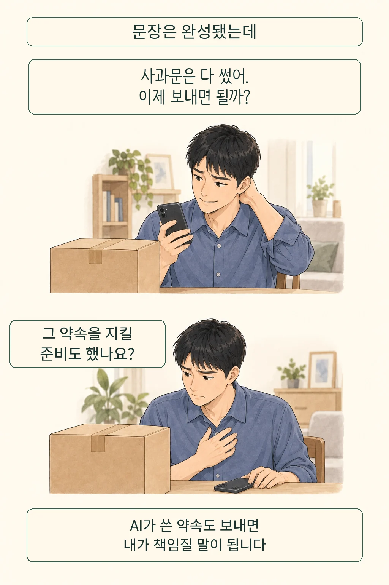
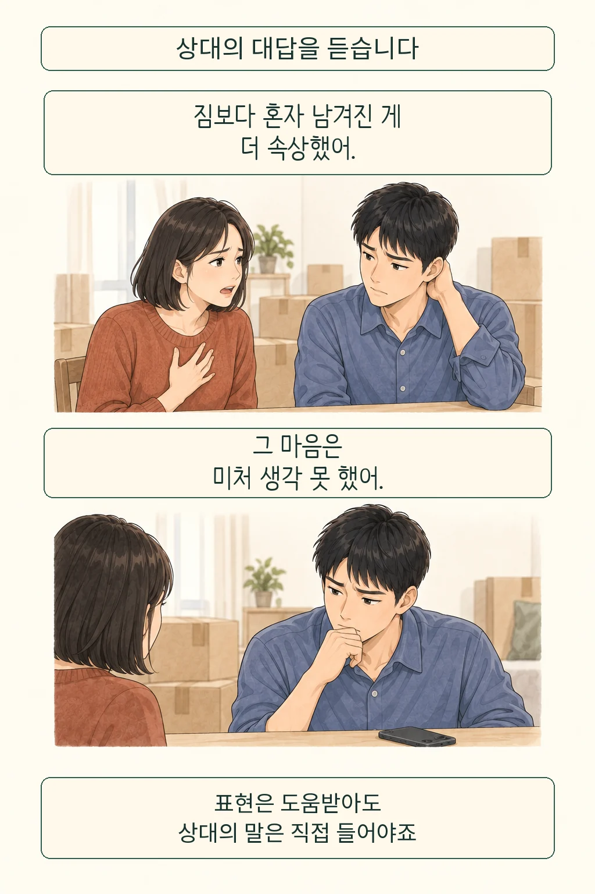
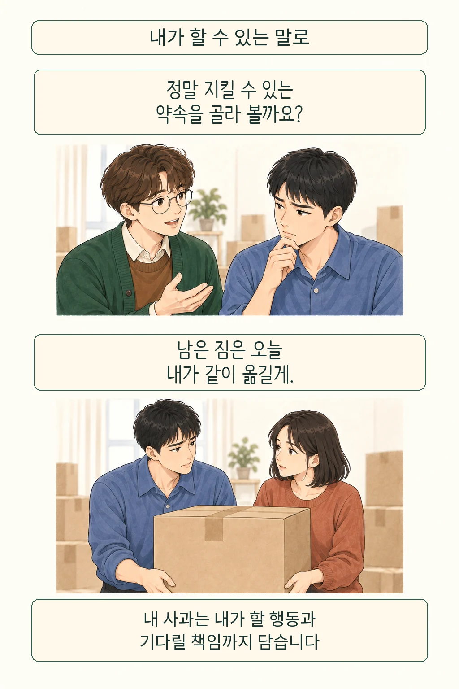

약속 시간을 훌쩍 넘긴 아침, 미안함과 민망함에 손가락이 굳어 버린 채 AI 대화창에 대신 사과문을 써 달라고 부탁해 본 적 있으신가요? 화면에 뜬 문장은 놀랄 만큼 정중하고 논리적이라 당장 복사해 보내고 싶어지곤 합니다. **하지만 저는 잘못을 직접 인정하고 실행할 약속을 스스로 정하며 상대의 반응까지 마주할 준비가 되어 있다면, AI에게 표현 도움을 받더라도 내 사과로 설 수 있다고 봅니다.**

글·해설: 다메카솔

## 문장을 고르는 사람과 약속을 지키는 사람

가령 주말에 친구의 이사를 돕기로 약속해 놓고 늦잠을 자 버린 상황을 떠올려 봅시다. 뒤늦게 휴대폰을 확인하고 미안하면서도 당황스러운 마음에 AI에게 정중한 사과문을 부탁하면, 재발 방지와 확실한 보상을 약속하는 매끄러운 초안이 금세 완성됩니다. 그런데 그 약속을 언제 어떤 방식으로 지킬지 스스로 정하지도 않은 채 전송 버튼부터 누른다면, 초안 속 문장은 곧바로 친구가 나에게 이행을 따져 물을 수 있는 빈 약속이 되고 말죠.

결국 사과의 무게를 가르는 기준은 글솜씨가 아니라 **약속의 주인**입니다. 무엇을 잘못했는지 내 입으로 분명히 설명할 수 있고 내가 감당할 행동을 직접 골랐다면 표현을 다듬는 도구의 도움을 받을 여지가 열립니다. 반대로 종이 위에 한 글자씩 손수 적은 편지라도 지킬 뜻 없는 화려한 다짐만 늘어놓았다면 속이 빈 말에 지나지 않거든요. 앞서 [AI와 저자성에 관한 글](/posts/ai-assisted-authorship-ownership/)에서 결과물에 남긴 의도와 수정·책임의 흔적을 짚었다면, 사과문에서는 한 걸음 더 나아가 그 말을 건네받은 상대에게 내가 무엇을 책임질지 묻게 됩니다.

실제 학술 연구에서도 AI의 도움을 밝힌 메시지가 사람들에게 어떻게 읽히는지 단서가 확인됐습니다. Khadpe 연구진은 2025년 논문에서 가상의 사과나 감사 메시지에 AI 도움을 받았다는 표시를 붙였을 때, 제3자가 그 문장을 보낸 사람의 따뜻한 성품을 드러내는 신호로 받아들이는 정도가 약해졌다고 보고했습니다([연구 원문](https://arxiv.org/html/2509.09645v1)). 사과처럼 다정함과 진심이 중요한 말에 AI의 손길이 드러나면, 읽는 사람은 이 배려가 보낸 이의 마음에서 나왔는지 도구의 매끄러운 문장에서 나왔는지 선명하게 가늠하기 어려워지기 때문입니다. 물론 이 연구는 가상의 시나리오에서 메시지 표시와 제3자의 인상 평가를 비교한 실험이므로, 당사자가 실제로 느낀 후회의 깊이나 오랜 관계가 회복되는 과정까지 측정한 결과와는 구별해 읽어야 합니다.

## 불편한 대답을 듣는 자리까지 남겨 둡니다

사과문을 건넨 뒤 친구가 “짐보다 혼자 남겨진 게 더 속상했어”라고 답한다면 이야기는 전혀 다른 국면으로 넘어갑니다. 내가 미안해하던 지점은 늦잠으로 일손을 덜어 주지 못한 실수였지만, 정작 친구가 다친 곳은 약속 자리에 혼자 남겨졌다는 서운함이었던 셈이죠. 이때 필요한 일은 다시 AI를 켜서 유려한 해명 문장을 생성하기보다, 내 첫 이해가 부족했음을 받아들이고 친구가 꺼낸 마음을 차분히 듣는 일입니다.

철학자 데지레 림(Désirée Lim)의 2026년 논문 역시 바로 이 관계의 결을 짚어 냅니다([Lim, §§3–4](https://onlinelibrary.wiley.com/doi/full/10.1111/phpe.70013)). 림은 AI가 쓴 사과를 언제나 무효라거나 비도덕적이라고 단정하기는 어렵다고 보면서도, 가까운 사이에서 상대의 감정을 헤아리고 내 언어로 조율하는 연습이 약해질 위험을 별도로 논증합니다. 감정이 격해져 말이 꼬이기 쉽거나 익숙하지 않은 외국어로 사과해야 하는 사람에게는 AI 초안이 막막한 대화를 여는 입구가 될 수 있지만, 상대를 이해하려 애쓰는 수고까지 매끄러운 대필에 넘겨 버릴 우려도 함께 따른다는 철학적 통찰입니다. 물론 이는 관계의 조건을 살핀 철학적 논증이므로, AI가 모든 관계를 반드시 해친다는 실험 결과와는 성격을 나누어 볼 필요가 있습니다.

그래서 저는 AI에게 표현 도움을 받더라도 문장 정리와 관계의 책임을 분명하게 나누어 보는 편입니다. 아래 표처럼 각 단계를 구분해 두면 어디까지 도구의 힘을 빌리고 어디부터 내가 직접 나서야 하는지 훨씬 또렷하게 보입니다.

| 사과의 단계 | AI가 도울 수 있는 영역 | 내가 직접 맡아야 할 책임 |
| --- | --- | --- |
| **잘못 설명** | 감정적으로 얽힌 문장을 차분하고 정중하게 다듬기 | 무엇을 왜 잘못했는지 내 입으로 분명히 인정하기 |
| **약속 제시** | 상황에 어울리는 공손한 제안 문구 고르기 | 실제로 지킬 수 있는 시간과 행동을 스스로 정하기 |
| **상대 반응** | 첫 문장을 꺼내기 막막할 때 대화의 문턱 낮추기 | 서운한 대답을 직접 듣고 오해를 풀며 기다리기 |
| **작성 공개** | 표현을 다듬는 데 도움을 받았다고 솔직히 밝히기 | 공개를 이유로 용서나 수용을 요구하지 않기 |

## 작성 과정을 밝히는 일과 용서를 구하는 일은 다릅니다

여기서 한 가지 더 짚고 싶은 대목이 바로 **AI 사용 공개**의 자리입니다. 혹시 친구가 “이 문장 네가 직접 쓴 게 맞느냐”고 묻거나 평소와 다른 말투를 낯설어한다면, 어디까지 표현 도움을 받았는지 솔직하게 알리는 태도가 정직한 소통에 도움이 됩니다.

그렇다고 AI의 도움을 받았다고 밝히는 일만으로 사과하는 사람의 책임이 온전히 다해지기는 어렵습니다. 예컨대 작성 과정을 투명하게 털어놓은 뒤 “솔직하게 말했으니 이제 사과를 받아 달라”며 상대의 마음을 재촉한다면, 공개가 진심을 나누는 과정 대신 면죄부처럼 쓰이고 말거든요. 작성 경위를 알리는 일은 어디까지나 초안이 만들어진 배경을 전하는 정보에 머물러야 하며, 사과를 받아들일지 생각할 시간을 더 가질지는 상처 입은 상대가 정할 몫입니다.

## 다메카솔의 제안: 보내기 전에 내 몫부터 고릅니다

결국 좋은 사과는 AI를 아예 멀리하겠다고 다짐하는 데서 나오기보다, 전송 버튼을 누르기 전에 내 몫을 먼저 챙기는 습관에서 시작됩니다. 제가 실제로 사과문을 다듬어야 할 상황이 온다면 다음 네 가지 순서부터 챙겨 보겠습니다.

1. **인정할 사실 먼저 적기**: AI 창을 열기 전에 “늦잠을 자서 약속을 어겼고, 네가 혼자 무거운 짐을 옮기게 했다”처럼 내가 책임질 사실을 먼저 두 줄로 적어 둡니다.
2. **과장된 변명과 다짐 덜어 내기**: 생성된 초안에 내가 입력하지 않은 핑계나 “앞으로 평생 실망시키지 않겠다” 같은 거창한 약속이 붙어 있다면 보내기 전에 지웁니다.
3. **실행할 행동 구체화하기**: 추상적인 보상 대신 “남은 짐은 오늘 내가 같이 옮길게”처럼 지금 당장 감당할 수 있는 행동 하나를 남깁니다.
4. **기다릴 여지 열어 두기**: 메시지를 보낸 뒤에도 상대가 서운함을 더 이야기하거나 생각할 시간을 청할 수 있도록 대화를 서둘러 닫지 않습니다.

메시지 작성 도우미 기능을 만드는 서비스 설계에서도 같은 원리를 적용해 볼 만합니다. 초안 생성과 실제 전송 사이에 한 번의 확인 단계를 두어, 사용자가 직접 적지 않았는데 AI가 임의로 덧붙인 변명 사유나 약속 문구를 따로 표시해 주는 방식입니다. 사용자가 그 문장을 스스로 검토하고 승인한 뒤에야 전송되도록 설계하면, 매끄러운 자동 완성이 의도치 않은 대외 약속으로 이어지는 사고를 한결 줄일 수 있습니다.

“앞으로 평생 잘할게”라는 그럴듯한 문장을 지우고 오늘 들 수 있는 상자 하나를 함께 드는 것처럼, 제가 신뢰하고 싶은 사과는 매끈한 마침표가 아니라 **그다음 행동과 대화로 이어지는 말**입니다. 다음에 누군가에게 미안한 마음을 전할 일이 생긴다면, AI에게 건네받은 문장을 보내기 전에 내가 지킬 약속부터 먼저 골라 보는 건 어떨까요?

## 출처

- [Désirée Lim, The Relational Risks of Generative Artificial Intelligence (2026)](https://onlinelibrary.wiley.com/doi/full/10.1111/phpe.70013)
- [Khadpe et al., AI-assisted messages and moral character (2025)](https://arxiv.org/html/2509.09645v1) · [AIES 정식 출판 정보](https://ojs.aaai.org/index.php/AIES/article/view/36641)

작성·출처 확인: 2026-09-21

이 글은 공개된 철학 논문과 선행 연구를 바탕으로 일상 장면을 가정해 해설한 칼럼이며, 별도 실험 재현이나 개별 관계 평가 결과를 포함하지 않습니다.

이 글의 본문과 이미지는 생성형 AI로 제작했습니다. 기획과 편집 기준은 다메카솔이 정했습니다.
