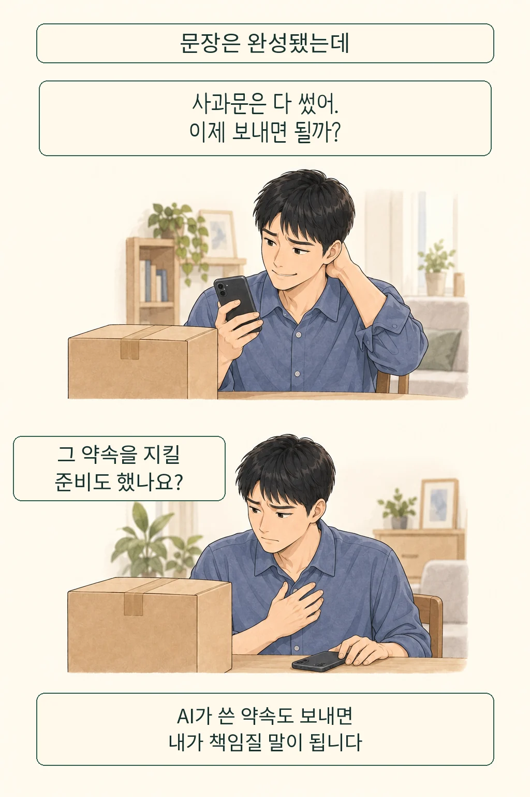
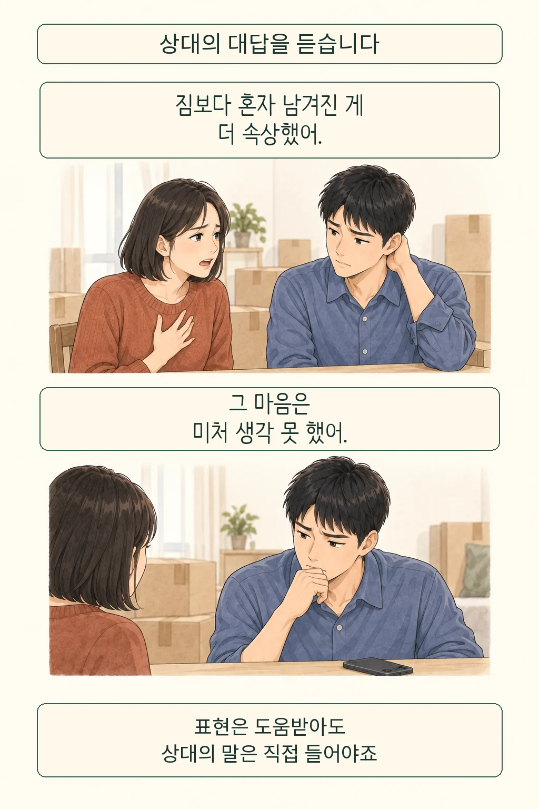

친구에게 보낼 사과문을 AI에게 부탁해도 괜찮을까요? AI로 문장을 매끄럽게 다듬더라도 사과의 책임은 결국 전송 버튼을 누른 사람에게 남습니다. **저는 잘못한 사실을 직접 인정하고 실제로 지킬 약속을 스스로 정하며, 상대방의 서운한 반응까지 마주할 준비가 되어 있다면 AI의 표현 도움을 받더라도 내 사과로 설 수 있다고 봅니다.** 반대로 그럴듯한 문장만 골라 보낸 뒤 대화를 빨리 끝내려 할 때가 진짜 문제입니다.

글·해설: 다메카솔

## 문장을 고르는 사람과 약속을 지키는 사람

이 차이를 생각하기 위해 친구의 이사를 돕기로 해 놓고 늦잠을 잔 상황을 떠올려 봅니다. 미안한 마음에 AI에게 정중한 사과문을 부탁했더니, 재발 방지와 확실한 보상을 약속하는 매끄러운 초안이 나왔습니다. 하지만 그 약속을 언제 어떻게 지킬지 스스로 정하지 않은 채 전송 버튼을 누른다면, 초안 속 문장은 곧바로 친구가 나에게 이행을 물을 수 있는 빈 약속이 됩니다.

여기서 중요한 것은 문장력이 아니라 **약속의 주인**입니다. 무엇을 잘못했는지 내 입으로 설명할 수 있고 감당할 행동을 직접 골랐다면 문장을 다듬는 도움을 받을 수 있지만, 손수 쓴 글이라도 지킬 뜻 없는 말만 늘어놓았다면 빈껍데기에 불과합니다. [AI와 저자성에 관한 글](/posts/ai-assisted-authorship-ownership/)이 창작물에 대한 관여를 물었다면, 사과문에서는 그 말을 읽은 상대방에게 무엇을 책임질지를 묻게 됩니다.

실제 연구에서도 AI 도움 여부와 인물에 대한 평가는 미묘하게 갈렸습니다. Khadpe 연구진은 가상 상황의 사과 메시지에 AI 도움을 받았다는 표시를 붙였을 때, 그 메시지가 보낸 사람의 따뜻한 성품을 보여 준다는 제3자의 평가가 약해졌다고 보고했습니다(메시지 표시와 인상 평가를 비교한 실험이며, 당사자의 실제 후회 정도나 장기적인 관계 회복까지 측정한 결과는 아닙니다). ([연구 원문](https://arxiv.org/html/2509.09645v1))

## 불편한 대답을 듣는 자리까지 남겨 둡니다

사과문을 읽은 친구가 “짐 옮기는 것보다 혼자 남겨진 기분이 더 속상했어”라고 답한다면 상황은 새로운 국면으로 넘어갑니다. 내가 생각한 잘못과 상대가 실제로 상처받은 지점이 달랐던 것입니다. 이때 필요한 일은 AI에게 다시 더 유려한 답장을 생성하게 하는 것이 아니라, 내 첫 이해가 부족했음을 인정하고 친구의 말을 귀담아듣는 일입니다.

철학자 데지레 림(Désirée Lim)은 2026년 논문에서 AI가 작성한 사과를 언제나 무효이거나 비도덕적이라고 단정하기는 어렵다고 보면서도, 가까운 관계에서 상대의 감정을 헤아리고 내 언어로 조율하는 연습이 약해질 위험을 짚었습니다. 상대를 이해하려 애쓰는 수고까지 매끄러운 대필에 넘겨 버릴 수 있다는 철학적 논증입니다. ([Lim, §§3–4](https://onlinelibrary.wiley.com/doi/full/10.1111/phpe.70013))

이 관점으로 보면 서툰 표현을 무조건 고집할 이유도, 반대로 AI 초안에 모든 것을 맡길 이유도 없습니다. 외국어로 사과해야 하거나 감정을 차분한 글로 옮기기 어려워 막막한 사람에게 AI의 초안은 대화를 여는 입구가 될 수 있으되, 그 문을 연 뒤 돌아오는 상대의 반응에는 내가 직접 마주 앉아 답해야 합니다.

## 다메카솔의 해석: 보내기 전에 내 몫을 정합니다

사과문을 다듬기 위해 AI를 켠다면, 프롬프트를 입력하기 전에 **내가 인정할 사실과 내가 감당할 약속** 두 줄부터 먼저 적어 두겠습니다. “늦잠을 자서 약속을 어겼고, 네가 혼자 무거운 짐을 옮기게 했다”처럼 사실을 구체화한 뒤 내가 실제로 실천할 수 있는 행동만 넣어 문장을 다듬고, AI가 임의로 덧붙인 거창한 변명이나 과장된 보상 약속은 보내기 전에 덜어 내는 방식입니다.

메시지 작성 도우미 서비스를 설계할 때도 마찬가지입니다. 초안 생성과 실제 전송 사이에 확인 단계를 두어, 사용자가 직접 입력하지 않은 변명 사유나 약속 문구를 별도로 표시해 주고 본인이 확인한 내용만 보내도록 설계하면 자동 생성이 곧바로 의도치 않은 대외 약속으로 이어지는 사고를 줄일 수 있습니다.

“앞으로 평생 잘할게”라는 AI의 거창한 문장을 지우고 “오늘 남은 상자 정리를 같이 도울 수 있을까?”라고 묻는 것처럼, 제가 신뢰하고 싶은 사과는 매끈한 마침표가 아니라 **그다음 행동과 대화로 이어지는 말**입니다.

## 출처

- [Désirée Lim, The Relational Risks of Generative Artificial Intelligence (2026)](https://onlinelibrary.wiley.com/doi/full/10.1111/phpe.70013)
- [Khadpe et al., AI-assisted messages and moral character (2025)](https://arxiv.org/html/2509.09645v1) · [AIES 정식 출판 정보](https://ojs.aaai.org/index.php/AIES/article/view/36641)

작성·출처 확인: 2026-09-21

이 글의 본문과 이미지는 생성형 AI로 제작했습니다. 기획과 편집 기준은 다메카솔이 정했습니다.
