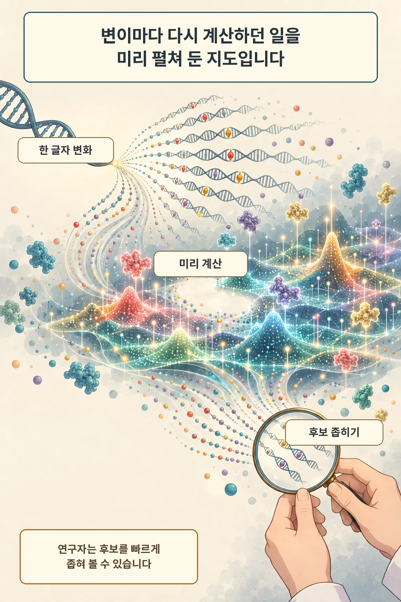

인간 유전체에서 가능한 단일염기 변이를 하나씩 따져 보면 약 **90억 개**의 경우가 생깁니다. Google DeepMind는 2026년 9월 8일 이 방대한 변이들의 분자적 영향 예측을 미리 계산해 둔 `AlphaGenome Atlas`를 공개했는데요. 핵심은 정답을 자동으로 확정하는 데 있는 것이 아니라, 연구자가 먼저 살펴볼 후보를 빠르게 좁히는 데 있습니다. [C001][C002][C009]

글·해설: 다메카솔

## 핵심 내용

- **전 유전체 사전 계산**: 인간 유전체의 가능한 단일염기 변이 약 90억 개에 대한 분자 효과 예측을 1페타바이트 규모(AlphaFold Database의 30배 초과)로 미리 계산해 공개했습니다. [C001][C002][C003]
- **점수와 생물학적 근거 연결**: `AlphaGenome Variant Impact(AVI)` 점수와 함께 스플라이싱·유전자 발현·보존성 등 점수에 기여한 생물학적 특성을 연결해 보여 줍니다. [C004]
- **접근 범위와 임상 경계**: 2026년 9월 8일 기준 비상업 연구자는 웹 포털과 공식 API로 이용할 수 있고 상업용 접근은 Google Cloud에서 추후 제공될 예정이며, 임상 진단·치료 목적의 도구는 아닙니다. [C005][C008][C010]

## 90억 변이를 실험으로 모두 확인할 수는 없습니다

한 위치의 DNA 글자가 바뀌면 유전자 발현, RNA 스플라이싱, 염색질 접근성처럼 여러 분자 과정에 연쇄적인 영향을 줄 수 있습니다. 하지만 가능한 변이를 실험실에서 하나씩 모두 검사하는 방식은 현실적인 시간과 비용 안에 들어오지 않는데요. Google DeepMind는 이 탐색 부담을 줄이기 위해 AlphaGenome의 예측값을 전 유전체 규모로 미리 계산해 두었습니다. [C002][C004]

회사 설명에 따르면 Atlas는 **1페타바이트** 규모로, 기존 AlphaFold Database보다 30배 넘게 큽니다. 다만 데이터 규모 자체가 예측 성능이나 임상적 가치를 곧바로 보증하지는 않으며, 실제 쓸모는 연구 질문에 맞는 변이를 찾고 왜 그 후보가 눈에 띄는지 근거를 추적할 수 있느냐에 달려 있습니다. [C003][C009]

## 사전 계산은 탐색 순서를 바꿉니다

Atlas는 변이별 분자 효과 예측값을 저장하면서 `AlphaGenome Variant Impact(AVI)` 점수와 그 점수에 기여한 생물학적 특성을 함께 연결합니다. 덕분에 연구자는 단일 점수만 보고 끝내지 않고 스플라이싱, 유전자 발현, 보존성 가운데 어떤 신호가 후보를 밀어 올렸는지 함께 살필 수 있습니다. 변이마다 모델을 반복 계산하는 시간 대신 탐색과 비교에 더 많은 시간을 쓰게 만드는 구조입니다. [C004]

이용 경로는 목적에 따라 나뉩니다. **2026년 9월 8일 기준** 비상업 연구자는 웹 포털과 공식 API를 통해 Atlas를 바로 이용할 수 있는 반면, 상업용 Atlas 접근은 향후 Google Cloud를 통해 제공할 계획이어서 현재 이용 가능 범위와 미래 출시 계획을 구분해 볼 필요가 있습니다. [C005]

## 협업 사례도 예측과 검증을 따로 봐야 합니다

Google DeepMind가 함께 소개한 두 가지 연구 협업 사례는 사전 계산 지도가 실제 탐색에서 어떻게 쓰이는지 보여 줍니다.

- **희귀질환 후보 변이 탐색**: Atlas가 `DNM1` 관련 후보 변이와 잘못된 RNA 스플라이싱 경로를 가리켰고, 연구진이 후속 실험을 통해 그 예측과 인접 변이의 유사 효과를 확인했습니다. Atlas가 실험을 대체했다기보다 실험할 우선순위를 고르는 데 도움을 준 사례입니다. [C006]
- **영국 바이오뱅크 비암호화 변이 분석**: 참가자 5만 4천 명 이상의 전장유전체 자료에 예측 점수를 적용해, 기존 통계 잡음에 가려 보이지 않던 비암호화 변이 연관성을 **22%** 더 찾아냈다고 회사가 보고했습니다(이는 Google DeepMind가 소개한 특정 협업 성과이며, 모든 질환이나 데이터셋에서 동일한 증가율이 재현된다는 뜻은 아닙니다). [C007]

## 지도는 실험과 임상 판단을 대신하지 않습니다

예측 점수는 후보의 우선순위를 정해 주고 특성 기여도는 가능한 작동 경로를 보여 주지만, 실제 질병 원인과 치료 결정을 확정하려면 독립 데이터와 실험 재현, 임상 근거가 반드시 뒤따라야 합니다. [C008][C010]

Google DeepMind와 공식 API 문서 역시 AlphaGenome Atlas가 임상용으로 검증되거나 승인되지 않았으며 의료 조언·진단·치료를 대신하지 않는다고 명시하고 있습니다. 이 경계는 단순한 부가 주의문을 넘어 제품의 현재 상태를 정의하는 기준입니다. 연구용 예측 점수를 곧바로 환자 판단으로 건너뛰면 Atlas가 줄여 준 탐색 비용보다 훨씬 큰 오류 비용을 치를 수 있습니다. [C008][C010]

## 다메카솔의 해석

Atlas의 가장 큰 가치는 거대한 계산 결과 자체보다 **연구 병목의 이동**에 있습니다. 변이마다 모델을 다시 돌리는 단계가 줄어들면, 다음 병목은 좋은 연구 질문을 고르고 후보 순위의 근거를 읽으며 실패한 실험까지 체계적으로 기록하는 일로 옮겨 갑니다. 소프트웨어 팀이 테스트 자동화를 넓힌 뒤 실패 분류와 회귀 기준 설계가 더 중요해지는 흐름과 닮았습니다. [C009]

실제 연구 파이프라인에 도입한다면 예측 점수 하나를 곧바로 승인 신호로 쓰지는 않을 것입니다. 후보를 만든 모델 버전, 데이터 범위, 점수 근거, 후속 실험 결과를 하나의 계보로 묶어 기록하고, 실험에서 재현되지 않은 후보까지 함께 남겨 다음 판단의 편향을 줄이는 편이 좋습니다. AlphaGenome Atlas는 연구 질문을 빠르게 좁혀 주는 지도일 뿐, 마지막 결론은 여전히 검증 과정에서 만들어집니다. [C010]

## 출처

- [Google DeepMind, AlphaGenome Atlas: A predictive map of every possible DNA letter change in the human genome (2026-09-08)](https://deepmind.google/blog/alphagenome-atlas-a-predictive-map-of-every-possible-dna-letter-change-in-the-human-genome/)
- [Google DeepMind, AlphaGenome API 공식 저장소](https://github.com/google-deepmind/alphagenome)

이 글의 본문과 이미지는 생성형 AI로 제작했습니다. 기획과 편집 기준은 다메카솔이 정했습니다.
