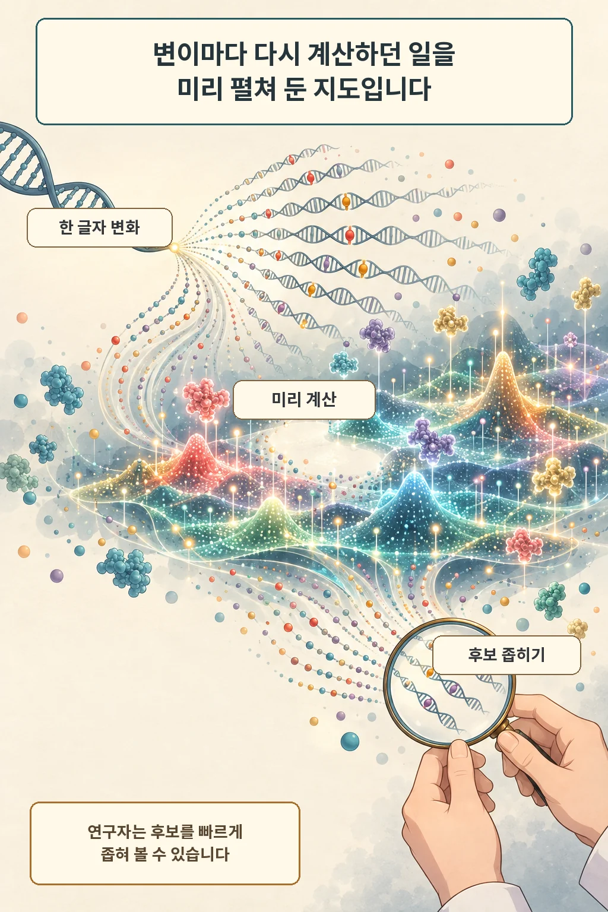
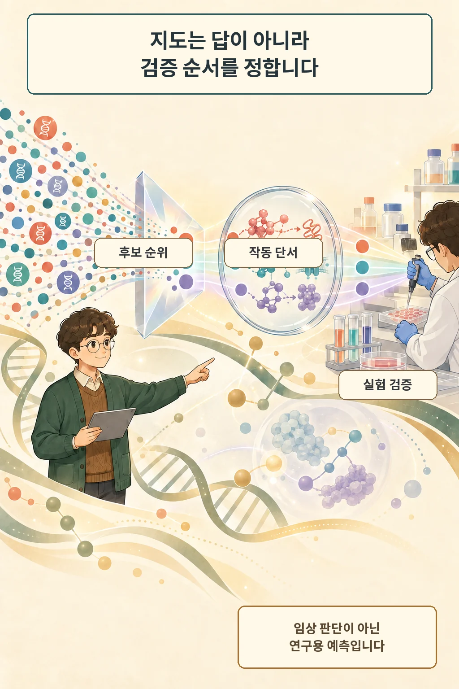

유전체 데이터에서 원인 변이를 추릴 때는 수억~수십억 개 후보마다 모델을 돌려 점수를 내는 단계부터 시간이 많이 듭니다. Google DeepMind가 **2026년 9월 8일** 공개한 `AlphaGenome Atlas`는 인간 유전체에서 가능한 단일염기 변이 약 **90억 개**의 분자적 영향 예측을 미리 계산해 묶은 지도인 셈이죠. 핵심은 AI가 정답을 확정하는 것이 아니라, 연구자가 먼저 실험해 볼 후보 순서를 빠르게 좁히는 데 있습니다.

글·해설: 다메카솔

## 핵심 내용

- **전 유전체 사전 계산**: 단일염기 변이 약 90억 개의 분자 효과 예측을 1페타바이트(AlphaFold Database의 30배 초과) 규모로 공개했습니다.
- **점수와 기전 근거 연결**: `AlphaGenome Variant Impact(AVI)` 점수와 스플라이싱·유전자 발현·보존성 기여도, DNA 서열 모티프를 함께 제공합니다.
- **비상업 우선 공개**: 2026년 9월 8일 기준 비상업 연구자는 웹 포털·공식 API로 쓸 수 있고 상업용은 Google Cloud에서 추후 제공되며, 임상 진단·치료 용도는 제외됩니다.

## 매번 계산하던 변이 예측을 지도로 펼친 이유

DNA 서열의 한 글자가 바뀌면 유전자 발현, RNA 스플라이싱, 염색질 접근성 등 여러 분자 과정이 함께 흔들릴 수 있습니다. 하지만 가능한 변이를 실험실에서 하나씩 모두 확인하기란 시간과 비용 면에서 현실적으로 어렵죠. Google DeepMind는 이 탐색 병목을 줄이기 위해 AlphaGenome 예측값을 전 유전체 단위로 미리 계산해 두었습니다.

예를 들어 희귀질환 환자군에서 후보 유전자 주변의 비암호화 변이 수천 건을 걸러내는 파이프라인을 떠올려 볼까요? 기존에는 대상 구간이 바뀔 때마다 서열 모델을 반복 호출하고 점수의 근거를 따로 해석해야 했습니다. Atlas 환경에서는 사전 계산된 `AVI` 점수를 조회하고, 어떤 생물학적 특성과 DNA 서열 모티프가 점수를 높였는지 곧바로 이어서 살필 수 있습니다.

## 제공 범위와 접근 경로 한눈에 보기

도입을 검토할 때는 공개 규모와 현재 열린 접근 경로를 구분해 보는 편이 좋습니다.

| 항목 | 공개 범위 (2026-09-08 기준) | 실무 확인 포인트 |
| --- | --- | --- |
| **사전 계산 규모** | 단일염기 변이 약 90억 개, 1PB (AlphaFold Database 30배 초과) | 공급사 발표 수치로, 데이터 크기가 예측 성능을 자동 보증하진 않음 |
| **제공 출력 정보** | 분자 효과 예측, `AVI` 점수, 특성 기여도, DNA 서열 모티프 | 단일 점수 외에 스플라이싱·발현·보존성 근거를 함께 검토 |
| **비상업 연구 접근** | 웹 포털·공식 API (`google-deepmind/alphagenome`) 즉시 이용 | 비상업·연구 조건 무료 제공, 대규모 쿼리에는 이용 한계 존재 |
| **상업용·임상 경계** | 상업용은 Google Cloud 추후 제공 예정, 임상 승인 미완료 | 상용 일정과 분리 계획 필요, 의료 조언·진단·치료 활용 불가 |

즉시 테스트할 수 있는 비상업 연구 경로와 Google Cloud 출시를 기다려야 하는 상용 일정은 분리해 계획해야 합니다.

## 협업 사례가 보여 주는 예측과 검증의 경계

Google DeepMind가 소개한 두 협업 사례는 사전 계산 지도가 실제 연구에서 맡는 역할을 보여 줍니다.

- **희귀질환 후보 변이 탐색**: Atlas 예측이 `DNM1` 관련 후보 변이와 잘못된 RNA 스플라이싱 경로를 가리켰고, 후속 실험 스크리닝에서 해당 예측과 인접 변이의 유사 효과를 확인했습니다. 예측이 실험을 대신하기보다 실험 우선순위를 좁혀 준 셈이죠.
- **영국 바이오뱅크 비암호화 변이 분석**: 참가자 5만 4천 명 이상의 전장유전체 자료에 점수를 적용해, 기존 통계 잡음에 가려 있던 비암호화 변이 연관성을 **22%** 더 찾아냈다고 Google DeepMind가 보고했습니다. 특정 코호트 협업 성과이므로 다른 질환이나 데이터셋에 적용할 때는 별도 재현 확인이 필요합니다.

이처럼 점수와 특성 기여도가 유력한 단서를 주더라도 질병의 원인성과 치료 결정을 확정하는 일은 별개의 단계입니다. Google DeepMind와 공식 API 문서 역시 AlphaGenome Atlas가 임상용으로 검증·승인되지 않았으며 의료 조언·진단·치료를 대신하지 않는다고 명시하고 있습니다. 연구용 예측 지표를 곧바로 환자 판단으로 넘기면 탐색에서 줄인 시간보다 큰 오류 비용을 치르게 됩니다.

## 다메카솔의 해석

Atlas의 진짜 가치는 거대한 데이터 크기보다 **연구 병목의 이동**에 있습니다. 변이마다 모델을 재계산하는 단계가 사라지면, 다음 병목은 좋은 질문을 던지고 후보 순위의 근거를 검토하며 실패한 실험까지 체계적으로 남기는 일로 옮겨 가거든요. 소프트웨어 팀이 테스트 자동화를 넓힌 뒤 실패 분류와 회귀 기준을 다듬는 흐름과 비슷합니다.

실제 연구 파이프라인에 Atlas를 연동할 때는 점수 하나를 통과 신호로 삼기보다 후보 선정의 계보를 함께 기록하는 편이 좋습니다. 어떤 모델 버전과 데이터 범위에서 나온 점수인지, 어떤 모티프와 특성이 기여했는지, 재현되지 않은 실험 결과는 무엇인지를 묶어 두어야 다음 가설의 편향을 줄일 수 있습니다. AlphaGenome Atlas는 후보를 빠르게 추려 주는 지도이고, 최종 결론은 검증 실험에서 내려집니다.

## 출처

- [Google DeepMind, AlphaGenome Atlas: A predictive map of every possible DNA letter change in the human genome (2026-09-08)](https://deepmind.google/blog/alphagenome-atlas-a-predictive-map-of-every-possible-dna-letter-change-in-the-human-genome/)
- [Google DeepMind, AlphaGenome API 공식 저장소](https://github.com/google-deepmind/alphagenome)

이 글은 2026년 9월 8일 공개된 Google DeepMind 공식 발표와 API 저장소를 바탕으로 정리했으며, 별도 실험 재현이나 독립 임상 검증은 포함하지 않았습니다.
이 글의 본문과 이미지는 생성형 AI로 제작했습니다. 기획과 편집 기준은 다메카솔이 정했습니다.
