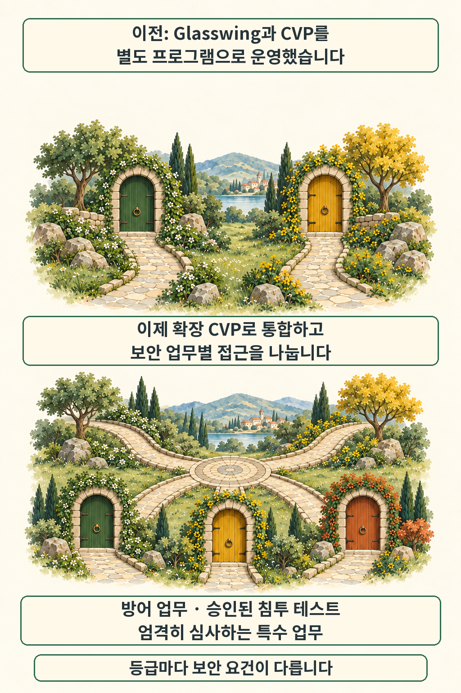

글·해설: 다메카솔

발행·확인: 2026-10-07

**보안팀이 Claude 사용 승인을 받았더라도, 어떤 업무를 어느 작업공간(Workspace)에서 실행할지는 따로 살펴야 합니다.** Anthropic은 2026년 10월 6일 사이버 검증 프로그램(CVP)을 확대 개편하면서 방어·레드팀·특수 접근의 세 등급으로 이용 조건을 나누었습니다. ([공식 발표](https://www.anthropic.com/news/cyber-verification-program))

## 별도 프로그램에서 업무별 접근 등급으로

이번 개편으로 기존 Project Glasswing과 종전 CVP가 하나의 프로그램으로 통합됐으며, 기존 Glasswing 참여 조직은 현재 모델에 대한 별도 재승인 없이 확장 CVP의 Specialized Access 등급으로 전환됩니다. ([Glasswing의 10월 6일 안내](https://www.anthropic.com/glasswing))

세 등급은 모델 이름보다 **팀이 수행하려는 보안 업무의 성격**을 기준으로 나뉩니다. ([등급별 범위](https://www.anthropic.com/news/cyber-verification-program))

| 접근 등급 | 발표에서 설명한 업무 범위 | 신청 대상 |
| --- | --- | --- |
| Defense Access | 보안 관제, 사고 대응, 취약점 분석 등 방어 업무 | 유료 요금제 개인 연구자 및 조직 |
| Red Team Access | 방어 업무에 더해 사전 승인을 받은 시스템의 침투 테스트·레드팀 활동 | 검증된 조직 |
| Specialized Access | 엄격한 심사를 거친 제한된 조직의 고위험 안전 시스템 테스트 | 제한된 심사 통과 조직 |

등급마다 신청자 검증과 보안 요건이 다르며, Red Team Access를 받더라도 물리적 피해나 대규모 서비스 장애를 유발할 수 있는 작업에는 안전 차단이 그대로 유지됩니다. 또한 일반 공개 모델에서도 안전한 코드 리뷰, 알려진 취약점 패치, 본인이 소유한 소스 코드의 취약점 탐색 같은 일상적인 방어 작업은 별도 CVP 신청 없이 계속 수행할 수 있습니다. ([신청 대상과 일반 이용 범위](https://support.claude.com/en/articles/14604842-cyber-verification-program))

## 승인 다음에는 실제 작업공간과 데이터 보관 조건을 봅니다

조직이 프로그램 승인을 받았더라도 모든 API 키에 권한이 자동으로 켜지는 것은 아닙니다. 확인해야 할 운영 조건은 두 가지입니다.

- **작업공간(Workspace)별 권한 연결**: Claude Console 안내에 따르면 조직에 부여된 프로그램 권한은 요건을 충족하고 프로그램이 할당된 작업공간의 API 요청에만 적용됩니다. 자동 적용되는 프로그램과 관리자가 직접 작업공간을 지정해야 하는 경우가 나뉘므로, 조직 관리자는 콘솔에서 작업공간별 연결 상태와 미충족 요건을 먼저 확인해야 합니다. ([작업공간 적용 안내](https://support.claude.com/en/articles/16764810-assign-a-program-to-workspaces-in-claude-console))
- **데이터 보관 요건과 ZDR 예외**: CVP는 원칙적으로 데이터 보존을 요구하지만, Fable 또는 Mythos의 무보존(ZDR) 이용 자격을 갖춘 조직에는 고객 관리 클라우드에 데이터를 보관하는 Enterprise Frontier Safeguards(EFS, 향후 제공 예정)가 도입되기 전까지 예외가 안내돼 있습니다. ([보존 조건과 예외](https://support.claude.com/en/articles/14604842-cyber-verification-program))

## 다메카솔의 해석: 권한의 적용 지점을 좁혀 봅니다

보안 자동화 도구나 내부 에이전트에 Claude API를 연결할 때는 **승인받은 업무 범위, API 요청이 나가는 작업공간, 로그와 데이터가 남는 위치**를 한 묶음으로 맞춰 두는 편이 안전합니다. 일반 방어 분석용 호출과 사전 승인된 침투 테스트용 호출을 같은 작업공간에 섞어 두면, 요청이 차단됐을 때 작업공간 설정 누락인지 허용 범위를 벗어난 프롬프트인지 원인을 좁히기 어렵기 때문입니다.

운영체제 수준에서 에이전트의 로컬 파일 접근 범위를 통제하는 문제를 [Apple의 Full Disk Access 안내](/posts/apple-full-disk-access-ai-agent-controls/)에서 다뤘다면, 이번 CVP 개편은 클라우드 모델 API의 권한을 업무와 작업공간 단위로 분리하는 사례입니다. 도입을 검토하는 팀이라면 가장 자주 수행하는 보안 작업 하나를 골라 어느 등급에 해당하는지, 그리고 그 요청이 어느 작업공간 키를 통해 나가는지부터 점검해 보기를 권합니다.

## 출처

- [Anthropic, Expanding the Cyber Verification Program — 2026-10-06](https://www.anthropic.com/news/cyber-verification-program)
- [Anthropic, Project Glasswing — 2026-10-06 업데이트](https://www.anthropic.com/glasswing)
- [Claude Help Center, Cyber Verification Program](https://support.claude.com/en/articles/14604842-cyber-verification-program)
- [Claude Help Center, Assign a program to workspaces in Claude Console](https://support.claude.com/en/articles/16764810-assign-a-program-to-workspaces-in-claude-console)

공식 발표와 고객지원 문서를 바탕으로 정리했으며, 실제 CVP 신청이나 승인 후 API 동작은 직접 시험하지 않았습니다. 이 글의 본문과 이미지는 생성형 AI로 제작했습니다. 기획과 편집 기준은 다메카솔이 정했습니다.
