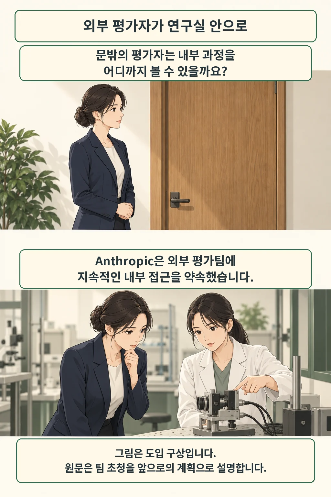
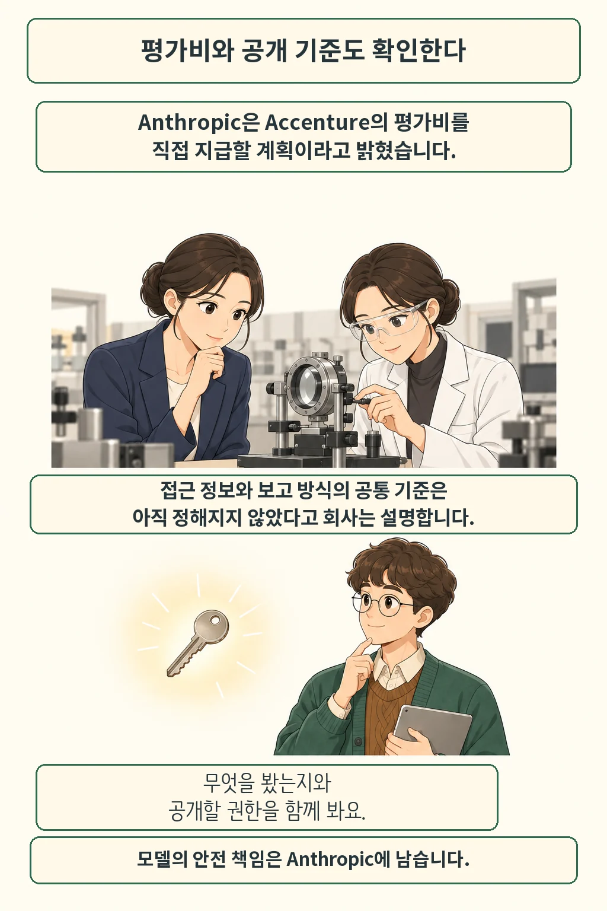

AI 개발사가 외부 평가팀에 내부 연구 과정을 열어 주겠다고 발표하면, 실무에서는 먼저 "실제로 어떤 기록까지 보고 불편한 결과도 그대로 공개할 수 있는가"를 따져 보게 됩니다. Anthropic과 Accenture가 2026년 9월 18일 발표한 [상주 외부 평가팀(Embedded Evaluators) 협력](https://www.anthropic.com/news/accenture-embedded-evaluation) 역시 취지는 분명하지만, 발표문을 뜯어보면 정해진 계획과 비어 있는 운영 기준이 뚜렷하게 갈리거든요. 양사의 공식 발표문과 앞선 구상 에세이를 나란히 놓고 무엇이 확정됐고 무엇이 과제로 남았는지 정리합니다.

글·해설: 다메카솔

## 초청 약속에서 첫 협력사 발표로

이번 협력은 다리오 아모데이(Dario Amodei)가 [9월 에세이](https://darioamodei.com/post/we-must-pace-the-frontier)에서 내놓은 구상의 후속 조치입니다. 아모데이는 안전 검증 시간을 확보할 수 있도록 프런티어 AI 모델의 능력 향상 속도를 조율하자며, 상주 외부 평가팀에 내부 직원과 비슷한 수준의 지속적인 접근권을 주겠다고 독자적으로 약속한 바 있습니다. 이번 파트너십을 계기로 Accenture의 AI 사업부인 **Faculty**가 주도하는 평가팀이 모델 역량 평가, 공격적 시험으로 취약점을 찾는 레드팀 활동, 정렬(alignment) 평가, 안전장치 시험을 함께 추진할 계획입니다.

Anthropic은 외부 평가자가 모델 학습 과정과 개발·배포 결정을 가까이서 관찰하고 내부 직원과 대화하는 구상을 설명했습니다. 다만 현재 공개된 문서는 파트너십 체결을 알린 초기 발표 단계에 해당하는데요. 세부 운영 방식은 계속 논의 중이며, 실제 팀 배치 완료나 첫 평가 보고서 발간은 앞으로 확인해야 할 영역으로 남아 있습니다.

## 평가 비용과 공개 기준은 어디까지 정해졌을까

외부 감시·평가 제도의 실효성은 결국 **누가 비용을 대고 어디까지 독자적으로 결과를 공개할 수 있는가**에서 갈립니다. 양사 발표문과 아모데이의 9월 에세이를 대조해 보면, 이미 윤곽이 잡힌 항목과 아직 미정인 기준이 아래 표처럼 나뉩니다.

| 확인 항목 | 발표문·에세이에서 확인되는 내용 | 남은 기준과 해석 경계 |
| --- | --- | --- |
| **평가 비용 지급** | Accenture 평가팀의 업무 비용은 Anthropic이 직접 지급할 계획 | 비영리 기관 **METR** 등과 자체 재원 시범 운영도 논의 중 |
| **협력 형태** | 비독점 파트너십으로 추진하며 추가 평가자는 추후 발표 예정 | 업계 공통의 접근·보고 기준과 독립 재원 체계는 아직 미정 |
| **5년간 투자 전망** | [Accenture 발표문](https://newsroom.accenture.com/news/2026/accenture-and-anthropic-partner-to-build-team-of-embedded-evaluators-at-anthropic)에 양사 각각 최소 10억 달러 투자 예상 명시 | 집행 완료 기금이나 확정 용역 대금이 아니라 실현이 보장되지 않은 장기 전망치 |
| **접근권과 발표권** | 9월 에세이에서 개인정보·계약·법적 예외를 뺀 내부 접근과 독자적 핵심 결과 발표권, 제한적 민감정보 삭제권 구상 | 9월 18일 발표문 기준 구체적 운영 방식은 계속 논의 중 |
| **안전 최종 책임** | 외부 평가팀이 관찰·시험에 참여하더라도 모델 안전 책임은 Anthropic에 남음 | 외부 평가 도입 후에도 최종 책임 주체는 개발사로 유지 |

표에서 가장 눈에 띄는 대목은 공통 기준의 공백입니다. Anthropic 스스로도 평가자의 정보 접근과 보고 방식에 관한 업계 공통 기준이나 안정적인 독립 재원 체계가 아직 자리 잡지 않았다고 설명했거든요. 따라서 보도자료의 5년간 투자 전망치를 곧바로 확정 감사 예산으로 읽기보다, 평가 비용의 지급 주체와 비독점 시범 운영 범위를 함께 짚어 보는 편이 정확합니다.

## 다메카솔의 해석: 원시 기록 접근과 이견 공개 절차가 관건

실무 관점에서 '상주 평가팀'이라는 명칭보다 중요한 기준은 **실제로 어떤 원시 기록까지 열어 볼 수 있는가**입니다. 예를 들어 백엔드 시스템을 감사할 때도 요약된 보고서만 건네받는 것과 실패한 실행 로그·학습 체크포인트를 직접 대조하는 것은 검증의 깊이가 완전히 다르죠.

평가 대상 기업이 평가 비용을 직접 지급하는 구조에서는 양측 판단이 엇갈렸을 때 불리한 발견이나 이견을 외부에 공개할 수 있는 절차가 신뢰도를 좌우합니다([최근 정렬 사건에 대한 회사 자체 평가](/posts/claude-cyber-incidents-alignment-assessment/)를 읽을 때도 같은 기준이 적용됩니다). 한편 데미스 하사비스(Demis Hassabis)가 2026년 7월 14일 제안한 [공동 평가기구 구상](https://demishassabis.substack.com/p/a-framework-for-frontier-ai-and-the-dawning-of-a-new-age)이나 아모데이 에세이의 민주국가 내 기업·국제 협력 제안은 더 넓은 조정이 필요한 별도 구상입니다. 이번 발표는 업계 전체의 합의나 훈련 중단을 선언한 사례가 아니라 개별 기업 간 파트너십에 해당하며, Anthropic 역시 모델 학습과 출시를 계속 진행한다고 밝혔습니다.

앞으로 첫 평가 보고서가 공개될 때는 아래 세 가지부터 확인해 보기를 권합니다.

- **원시 자료 접근 범위**: 평가팀이 직접 확인한 자료 범위와 개인정보·계약·법적 예외 등으로 접근하지 못한 범위가 함께 적혀 있는가
- **이견·불리한 결과 공개 절차**: 개발사와 평가팀의 해석이 엇갈릴 때 핵심 결과를 독자적으로 알릴 수 있는 구조가 마련됐는가
- **추가 외부 기관 참여 성과**: 비독점 협력 방침에 따라 METR 등 자체 재원을 갖춘 외부 평가자의 시범 운영이 실제 평가와 보고서 공개로 이어졌는가

## 출처

- [Anthropic — Partnering with Accenture on embedded evaluation](https://www.anthropic.com/news/accenture-embedded-evaluation): 2026년 9월 18일 발표.
- [Accenture — Accenture and Anthropic Partner to Build Team of Embedded Evaluators at Anthropic](https://newsroom.accenture.com/news/2026/accenture-and-anthropic-partner-to-build-team-of-embedded-evaluators-at-anthropic): 2026년 9월 18일 발표.
- [Dario Amodei — We Must Pace the Frontier](https://darioamodei.com/post/we-must-pace-the-frontier): 2026년 9월 에세이.
- [Demis Hassabis — A Framework for Frontier AI and the Dawning of a New Age](https://demishassabis.substack.com/p/a-framework-for-frontier-ai-and-the-dawning-of-a-new-age): 2026년 7월 14일 (모든 원문 2026년 9월 21일 재확인).

이 글은 2026년 9월 14일 초청 구상을 다룬 뒤 9월 18일 양사 공식 발표를 반영해 9월 21일 보완한 자료를 바탕으로 정리했으며, 별도의 독립 감사나 실행 검증은 포함하지 않았습니다.
이 글의 본문과 이미지는 생성형 AI로 제작했습니다. 기획과 편집 기준은 다메카솔이 정했습니다.
