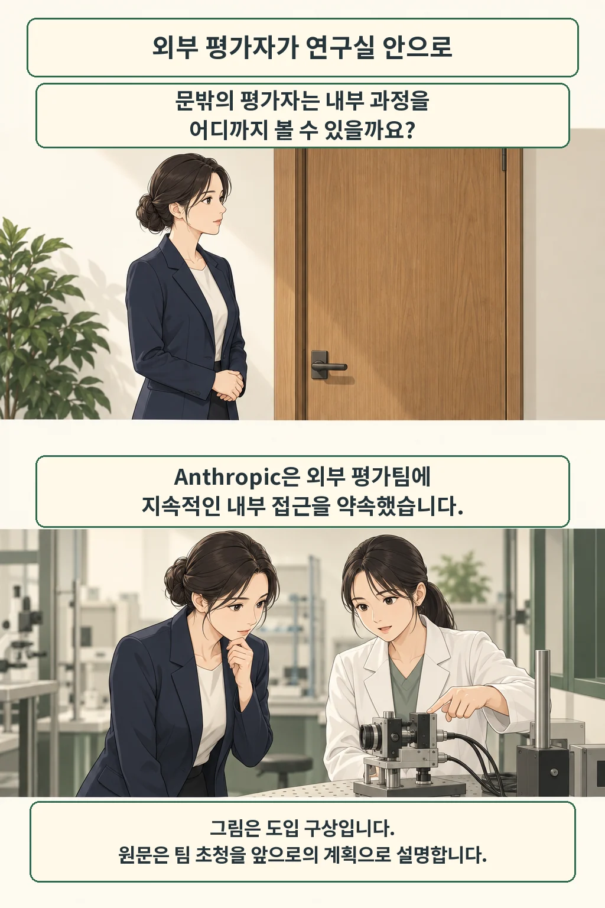
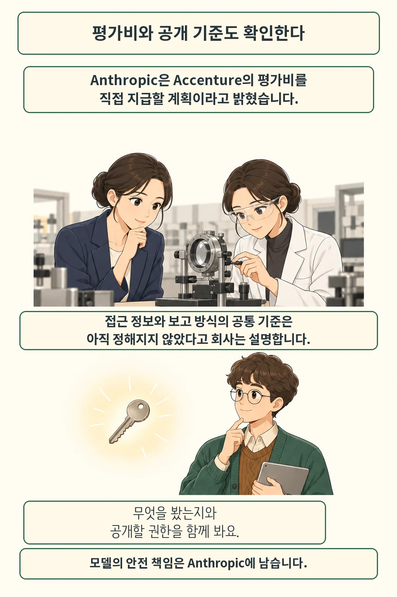

Anthropic과 Accenture가 2026년 9월 18일 [상주 외부 평가팀(Embedded Evaluators) 협력](https://www.anthropic.com/news/accenture-embedded-evaluation)을 발표했습니다. 앞서 외부 평가자를 연구 과정에 초청하겠다고 밝혔던 구상에 첫 협력사가 정해진 것인데요. Accenture의 AI 사업부인 Faculty가 주도할 예정이며 구체적인 운영 세부사항은 계속 논의 중입니다. 9월 21일 확인한 양사 발표를 바탕으로 무엇이 정해졌고 무엇이 과제로 남았는지 정리합니다.

글·해설: 다메카솔

Updated: 2026-09-21

## 초청 약속에서 첫 협력사 발표로

앞서 다리오 아모데이(Dario Amodei)는 [9월 에세이](https://darioamodei.com/post/we-must-pace-the-frontier)에서 안전 검증 시간을 확보할 수 있도록 프런티어 AI의 능력 향상 속도를 조율하자며 상주 외부 평가팀 초청 계획을 제안한 바 있습니다. 이번 발표는 그 후속 조치로, 양사는 모델 역량 평가, 공격적 시험으로 취약점을 찾는 레드팀 활동, 정렬(alignment) 평가 및 안전장치 시험을 함께 추진한다고 밝혔습니다.

Anthropic은 외부 평가자가 내부 직원과 유사한 수준의 접근권으로 모델 학습 과정과 개발·배포 결정을 가까이서 관찰하는 구상을 설명했습니다. 다만 현재 공개된 내용은 **파트너십 체결 발표** 단계이며, 이미 상주 팀 배치가 완료됐거나 첫 평가 보고서가 나왔다는 뜻은 아닙니다.

## 평가 비용 지급 구조와 공개 기준의 현재 상태

외부 감시·평가 제도를 볼 때는 누가 비용을 대고 어디까지 독자적으로 결과를 공개할 수 있는지가 핵심입니다. 양사 발표문에서 확인되는 조건은 다음 세 가지입니다.

- **평가 비용 지급과 비독점 시범 운영**: 이번 협력에서 Accenture 평가팀의 업무 비용은 Anthropic이 직접 지급할 계획입니다. Anthropic은 아직 업계 공통의 정보 접근·보고 기준이나 독립된 재원 체계가 자리 잡지 않았다고 설명하며, 비영리 평가 기관인 METR 등과도 자체 재원을 활용한 시범 운영을 논의 중이라고 밝혔습니다(이번 협력은 비독점이며 추가 평가자는 추후 발표 예정).
- **투자 전망과 확정 금액의 구분**: [Accenture 발표문](https://newsroom.accenture.com/news/2026/accenture-and-anthropic-partner-to-build-team-of-embedded-evaluators-at-anthropic)에는 양사가 향후 5년간 AI 안전 역량에 각각 최소 10억 달러씩 투자할 것으로 예상한다는 문구가 실려 있으나, 이는 이미 집행된 기금이나 확정된 평가 용역 대금이 아니라 실현 보장이 없는 장기 전망치로 명시돼 있습니다.
- **결과 발표권과 최종 책임**: 아모데이의 9월 에세이는 개인정보·계약·법적 예외를 제외한 내부 접근권과 외부 평가자의 독자적 핵심 결과 발표권을 구상했으나, 9월 18일 발표문에서는 세부 운영 방식이 아직 논의 중이라고 적고 있습니다. 또한 외부 평가팀이 참여하더라도 모델 안전에 대한 최종 책임은 Anthropic에 남습니다.

## 다메카솔의 해석: 기록 접근 범위와 이견 공개 절차가 관건

상주 평가팀이라는 이름보다 실무적으로 더 중요한 것은 **실제로 어떤 원시 기록까지 열어 볼 수 있는가**입니다. 백엔드 시스템을 감사할 때도 요약된 보고서만 건네받는 것과 실패한 실행 로그·학습 체크포인트를 직접 대조하는 것은 검증의 깊이가 완전히 다르기 때문입니다.

또한 평가 대상 기업이 평가 비용을 직접 지급하는 구조에서는, 양측의 판단이 엇갈렸을 때 외부 평가팀이 불리한 발견이나 이견을 어떻게 외부에 공개할 수 있는지가 신뢰도를 좌우합니다([최근 정렬 사건에 대한 회사 자체 평가](/posts/claude-cyber-incidents-alignment-assessment/)를 읽을 때도 같은 기준이 적용됩니다). 한편 데미스 하사비스(Demis Hassabis)의 [7월 공동 평가기구 구상](https://demishassabis.substack.com/p/a-framework-for-frontier-ai-and-the-dawning-of-a-new-age)이나 아모데이의 업계·국제 조정 제안과 달리 이번 발표는 개별 기업 간 파트너십이며, Anthropic은 모델 학습과 출시를 계속 진행한다고 밝혔습니다. 앞으로 첫 평가 보고서가 나올 때는 **평가팀이 직접 확인한 자료 범위와 접근하지 못한 범위가 투명하게 함께 적혀 있는지**부터 살펴보겠습니다.

> **업데이트 (2026-09-21)**: 9월 14일 최초 발행 당시 ‘외부 평가팀 초청 계획’으로 다뤘던 내용에 9월 18일 Anthropic·Accenture 협력 발표를 반영해 본문과 만화 문구를 갱신했습니다(최초 발행일과 URL은 유지).

## 출처

- [Anthropic — Partnering with Accenture on embedded evaluation](https://www.anthropic.com/news/accenture-embedded-evaluation): 2026년 9월 18일 발표.
- [Accenture — Accenture and Anthropic Partner to Build Team of Embedded Evaluators at Anthropic](https://newsroom.accenture.com/news/2026/accenture-and-anthropic-partner-to-build-team-of-embedded-evaluators-at-anthropic): 2026년 9월 18일 발표.
- [Dario Amodei — We Must Pace the Frontier](https://darioamodei.com/post/we-must-pace-the-frontier): 2026년 9월 에세이.
- [Demis Hassabis — A Framework for Frontier AI and the Dawning of a New Age](https://demishassabis.substack.com/p/a-framework-for-frontier-ai-and-the-dawning-of-a-new-age): 2026년 7월 14일 (모든 원문 2026년 9월 21일 재확인).

이 글의 본문과 이미지는 생성형 AI로 제작했습니다. 기획과 편집 기준은 다메카솔이 정했습니다.
