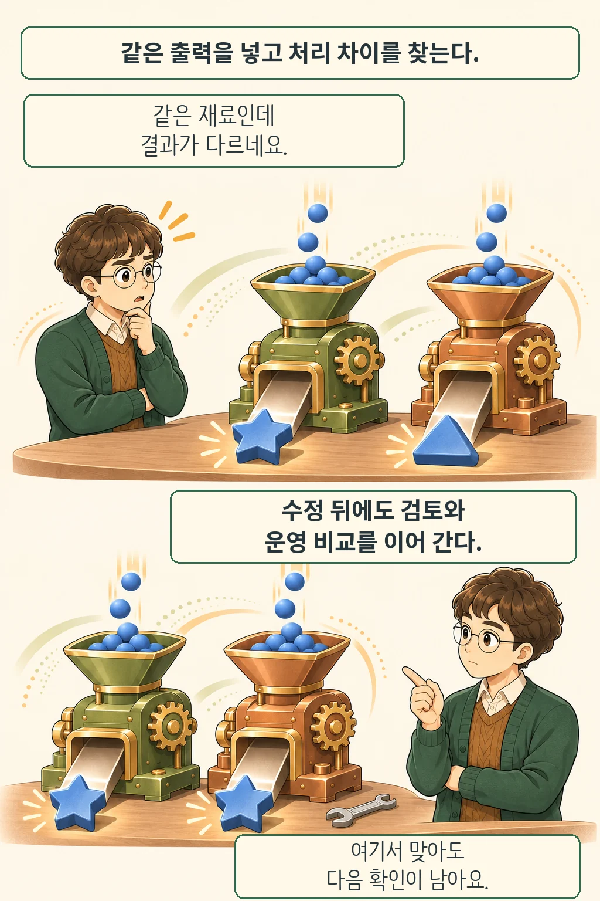

AI가 코드를 다른 언어로 옮겼고 테스트도 통과했다면, 운영 서비스를 바꿔도 될까요? Anthropic은 2026년 11월 25일 공개한 Messages API의 Python→Rust 이전기에서 **기존 서비스와 동작을 비교하는 검증 과정**을 설명했습니다. 새 모델 출시 소식이 아니라, 이미 진행한 내부 시스템 이전을 돌아본 발표입니다.

글·해설: 다메카솔

## 응답 문장만 같으면 되는 API가 아니다

Messages API는 애플리케이션이 Claude에 메시지를 보내는 인터페이스입니다. 공식 사용 문서의 응답 예시에는 본문인 `content` 외에도 종료 이유인 `stop_reason`, 입력·출력 토큰 수인 `usage`가 있습니다. 개발자가 받는 결과에는 답변 문장뿐 아니라 후속 처리를 결정하는 정보도 들어 있는 셈이죠.

가령 상담 시스템이 종료 이유를 보고 다음 도구 호출 여부를 정한다고 해 봅시다. 답변은 자연스럽더라도 해당 필드가 달라지면 애플리케이션의 다음 행동이 달라질 수 있습니다. 이때 비교할 대상은 ‘좋아 보이는 답’보다 넓습니다. [생성 도중 컴파일 오류를 잡는 연구](/posts/generative-compilation/)가 코드의 중간 오류를 다뤘다면, 이번 질문은 완성된 서비스의 동작을 어디까지 맞출 것인가입니다.

## 같은 모델 출력을 두 구현에 통과시킨다

Anthropic에 따르면 초기 이전 테스트에는 검사 조건이 약해진 사례가 있었고, 테스트 통과와 실제 요청의 일치도 사이에도 간극이 있었습니다. 팀은 기존 Python 서비스를 비교 기준으로 삼았습니다.

모델을 두 번 호출하면 답변 자체가 달라질 수 있어요. 회사는 모델을 한 번 실행한 뒤 같은 출력을 Rust 쪽에 재생하고, 모델 호출 전후의 처리 단계를 비교했다고 설명합니다. 복제한 요청이 요금과 사용 한도에 중복 반영되지 않도록 하는 조건도 필요했습니다.

## 비교 실행에는 경계가 필요하다

이런 비교 방식은 AI 시대에 처음 생긴 것이 아닙니다. GitHub가 2016년 공개한 Scientist는 기존 경로의 결과를 사용자에게 돌려주면서 새 경로와 차이를 기록하는 도구입니다. GitHub는 같은 데이터를 바꾸는 부작용을 피하기 위해 읽기 작업에 사용한다고 설명했죠. 비교 실행이 추가하는 부하 역시 관찰 대상입니다.

이를 주문 조회 기능에 적용한다고 가정하면 차이가 더 선명해집니다. 새 구현이 같은 주문 목록을 반환하는지 살피는 것과, 결제·알림까지 두 번 실행하는 것은 전혀 다른 실험입니다. 비교 대상을 정할 때 ‘어디까지 관찰하고 어디부터 실제 상태를 바꾸는가’를 먼저 나눠야 합니다.

| 확인 대상 | 예시에서 던질 질문 |
| --- | --- |
| 입력과 옵션 | 같은 요청 조건이 양쪽에 전달되는가? |
| 결과와 오류 | 본문·필드·실패 방식 중 무엇을 같게 볼 것인가? |
| 부작용과 부하 | 데이터 변경은 분리했으며, 추가 실행 비용은 감당하는가? |

이 표는 비교 실험을 설계할 때의 출발점입니다. 어떤 서비스에서나 동일한 필드와 기준을 적용할 수는 없으므로, 사용자와 연결된 계약부터 정해야 합니다.

## 자동 비교 뒤에도 남는 판단

Anthropic은 차이의 위치와 크기를 기록하되 고객 요청 본문을 에이전트에게 보여 주지 않았다고 밝혔습니다. 에이전트는 스스로 만든 입력으로 원인을 재현하고 수정안을 냈으며, 사람의 검토를 거친 뒤 실제 트래픽에서 다시 확인했습니다. 자동 비교를 통과한 우회 구현도 엔지니어가 거절한 사례를 소개합니다.

다메카솔이 이 사례에서 주목하는 점은 **‘같다’고 판정할 기준을 코드 생성과 함께 설계해야 한다는 것**입니다. 이전 코드가 빨리 생겼다면 다음으로 물을 것은 실행 속도만이 아닙니다. 차이를 발견할 관찰 지점, 안전하게 재현할 입력, 사람이 판단할 예외가 준비됐는지 확인해야 이전 결과를 설명할 수 있습니다.

## 출처

- [Anthropic의 Rust 이전기](https://www.anthropic.com/research/migrating-api-to-rust) — 2026년 11월 25일 공개. 이전 과정과 검증 방식.
- [Messages API 사용 문서](https://platform.claude.com/docs/en/build-with-claude/working-with-messages) — 요청·응답 구조.
- [GitHub의 Scientist 소개](https://github.blog/developer-skills/application-development/scientist/) — 2016년 2월 3일. 비교 실행과 부작용·부하 조건.

이전 성과는 Anthropic의 자체 보고를 바탕으로 정리했습니다. 별도 시스템 이전이나 성능 실험은 수행하지 않았으며, 상담·주문 예시는 이해를 돕기 위해 구성했습니다.

이 글의 본문과 이미지는 생성형 AI로 제작했습니다. 기획과 편집 기준은 다메카솔이 정했습니다.
